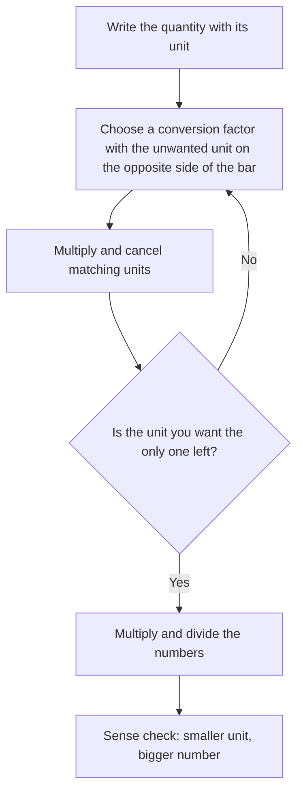

## Numbers with units

A measurement is a number *and* a unit: 6 feet, 2.5 liters, 45 minutes. The number alone means nothing; "6" could be 6 inches or 6 miles. This lesson covers the two measuring systems used in the United States (the US customary system and the metric system), how to convert within and between them, and a single method, dimensional analysis, that handles every conversion, including rates like miles per hour. The geometry lessons that follow depend on getting units right.

## US customary units

| Length | Weight | Capacity (volume) | Time |
|---|---|---|---|
| 12 inches (in) = 1 foot (ft) | 16 ounces (oz) = 1 pound (lb) | 8 fluid ounces (fl oz) = 1 cup (c) | 60 seconds = 1 minute |
| 3 feet = 1 yard (yd) | 2,000 pounds = 1 ton | 2 cups = 1 pint (pt) | 60 minutes = 1 hour |
| 5,280 feet = 1 mile (mi) | | 2 pints = 1 quart (qt) | 24 hours = 1 day |
| | | 4 quarts = 1 gallon (gal) | 7 days = 1 week |

These have to be memorized; there's no pattern.

## The metric system

The **metric system** uses one base unit for each kind of quantity, and prefixes that are powers of 10:

| Prefix | kilo- (k) | hecto- (h) | deka- (da) | base unit | deci- (d) | centi- (c) | milli- (m) |
|---|---|---|---|---|---|---|---|
| Times the base | 1,000 | 100 | 10 | 1 | 0.1 | 0.01 | 0.001 |

The base units are the **meter** (m) for length, the **gram** (g) for mass, and the **liter** (L) for capacity. So a kilometer is 1,000 meters, a centimeter is $\tfrac{1}{100}$ meter, and a milligram is $\tfrac{1}{1000}$ gram. The ones you'll use most are km, m, cm, mm; kg, g, mg; L and mL. (One technical note: the prefixes attach to the gram, but in the SI system scientists use, the official base unit of mass is the kilogram.)

Because every step is a factor of 10, converting within the metric system just moves the decimal point, exactly as in Lesson 14. Moving one column to the right in the table (toward smaller units) multiplies by 10; moving left divides by 10.

Picture the prefixes as a staircase: walking down to a smaller unit, each step multiplies the number by 10; walking up to a larger unit, each step divides by 10.

### Example 1

Convert 3.75 km to meters, and 480 mL to liters.

- km to m: 3 columns right, multiply by 1,000: 3.75 km = 3,750 m.
- mL to L: 3 columns left, divide by 1,000: 480 mL = 0.48 L.

A quick sense check: smaller units mean a bigger number (3,750 m vs 3.75 km), and bigger units mean a smaller number.

## Dimensional analysis

For any conversion, there's one method that always works. A **conversion factor** is a fraction equal to 1 whose top and bottom are the same amount in different units, such as

$$\frac{12 \text{ in}}{1 \text{ ft}} \quad\text{or}\quad \frac{1 \text{ ft}}{12 \text{ in}}.$$

Multiplying by 1 doesn't change a quantity, so you can multiply by conversion factors freely. The trick is to choose the version that makes the unwanted unit cancel: units cancel like factors in a fraction. This method is called **dimensional analysis** (or unit analysis).

The whole method fits in one loop:

### Example 2

Convert 90 inches to feet.

$$90 \text{ in} \times \frac{1 \text{ ft}}{12 \text{ in}} = \frac{90}{12} \text{ ft} = 7.5 \text{ ft}$$

Inches are on top in 90 in, so the factor puts inches on the bottom to cancel them.

### Example 3

How many seconds are in a day?

Chain factors, each canceling the previous unit:

$$1 \text{ day} \times \frac{24 \text{ h}}{1 \text{ day}} \times \frac{60 \text{ min}}{1 \text{ h}} \times \frac{60 \text{ s}}{1 \text{ min}} = 86{,}400 \text{ s}$$

## Converting between systems

Some useful approximate equivalents:

| Length | Weight/mass | Capacity |
|---|---|---|
| 1 in = 2.54 cm (exact) | 1 kg ≈ 2.2 lb | 1 L ≈ 1.06 qt |
| 1 m ≈ 3.28 ft ≈ 1.09 yd | 1 oz ≈ 28.35 g | 1 gal ≈ 3.79 L |
| 1 mi ≈ 1.61 km | | |

### Example 4

A runner finishes a 10 km race. About how many miles is that?

$$10 \text{ km} \times \frac{1 \text{ mi}}{1.61 \text{ km}} \approx 6.2 \text{ mi}$$

## Converting rates

Dimensional analysis shines with rates, where both the top and the bottom unit may need to change.

### Example 5

A car travels at 60 miles per hour. How many feet per second is that?

$$\frac{60 \text{ mi}}{1 \text{ h}} \times \frac{5{,}280 \text{ ft}}{1 \text{ mi}} \times \frac{1 \text{ h}}{60 \text{ min}} \times \frac{1 \text{ min}}{60 \text{ s}} = \frac{60 \times 5{,}280}{3{,}600} \frac{\text{ft}}{\text{s}} = 88 \text{ ft/s}$$

Miles cancel against miles, and hours against hours, leaving feet over seconds.

## Mixed units and time

Sometimes answers are given in mixed units, like 5 ft 9 in or 2 h 35 min.

### Example 6

A movie lasts 155 minutes. Write this in hours and minutes.

$155 \div 60 = 2$ R 35, so 2 hours 35 minutes. (As a decimal, $155 \div 60 \approx 2.58$ hours, which is *not* 2 hours 58 minutes.)

## Area and volume units

Square and cubic units convert by the *square* or *cube* of the length factor. A square foot is 12 in by 12 in, so

$$1 \text{ ft}^2 = 12 \times 12 = 144 \text{ in}^2, \qquad 1 \text{ yd}^2 = 9 \text{ ft}^2, \qquad 1 \text{ yd}^3 = 27 \text{ ft}^3.$$

Using the linear factor (12) by mistake is very common. You'll use these units in the next lessons.

## Common mistakes

- *Multiplying when you should divide.* Going to a larger unit makes the number smaller; check the direction.
- *Flipping a conversion factor* so the units don't cancel. Write the units and watch them cancel.
- *Using 100 for time:* 1.5 hours is 1 hour 30 minutes, not 1 hour 50 minutes.
- *Using the length factor for area:* $1 \text{ yd}^2 = 9 \text{ ft}^2$, not 3.
- *Mixing up fluid ounces (volume) and ounces (weight).*

## Key points

- Memorize the US customary relationships; metric conversions are powers of 10 (move the decimal point).
- Kilo = 1,000, centi = $\tfrac1{100}$, milli = $\tfrac1{1000}$.
- Dimensional analysis: multiply by conversion factors equal to 1, arranged so unwanted units cancel.
- Rates may need two or more factors, one for each unit being changed.
- Square units convert by the square of the length factor; cubic units by the cube.
