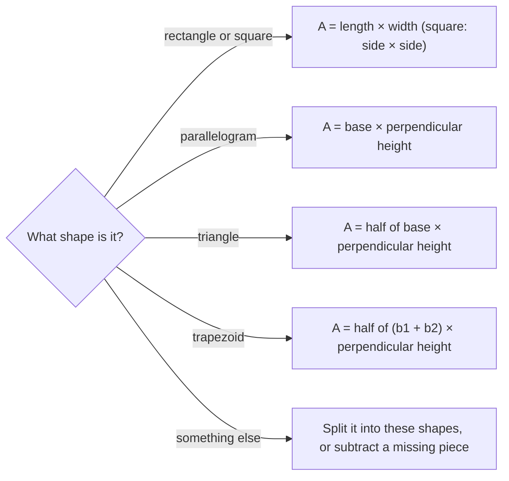

## Measuring the inside

Perimeter measures the distance around a shape; **area** measures the amount of surface inside it. Area is counted in **square units**: a square 1 cm on each side has an area of 1 square centimeter (1 cm²). To find an area is to count how many of these unit squares fit inside. This lesson builds the area formulas for the common polygons, each one from the one before, so you can rebuild any of them if you forget.

## Rectangles and squares

A rectangle 5 units long and 3 units wide holds 3 rows of 5 unit squares, or 15 squares in all.

```shape
{"polygons": [{"points": [[0, 0], [5, 0], [5, 3], [0, 3]]}], "segments": [{"from": [1, 0], "to": [1, 3]}, {"from": [2, 0], "to": [2, 3]}, {"from": [3, 0], "to": [3, 3]}, {"from": [4, 0], "to": [4, 3]}, {"from": [0, 1], "to": [5, 1]}, {"from": [0, 2], "to": [5, 2]}], "caption": "A 5 by 3 rectangle contains 15 unit squares"}
```

$$\text{Rectangle: } A = lw \qquad \text{Square: } A = s^2$$

The formula works for fractional and decimal sides too: a 2.5 m by 4 m rug covers 10 m².

## Parallelograms

A **parallelogram** is a quadrilateral whose opposite sides are parallel. Cut a right triangle off one end and slide it to the other end, and the parallelogram becomes a rectangle with the same base and the same height.

```shape
{"polygons": [{"points": [[0, 0], [6, 0], [8, 3], [2, 3]]}], "segments": [{"from": [2, 3], "to": [2, 0], "dashed": true, "label": "h"}, {"from": [0, -0.4], "to": [6, -0.4], "label": "b"}], "rightAngles": [[[2, 0], [3, 0], [2, 1]]], "caption": "A parallelogram with base b and height h"}
```

$$\text{Parallelogram: } A = bh$$

The **height** must be measured *perpendicular* to the base (the dashed line), not along the slanted side. The slanted side is longer than the height, and using it gives too big an area.

## Triangles

Two copies of any triangle fit together to make a parallelogram with the same base and height. So a triangle's area is half the parallelogram's:

$$\text{Triangle: } A = \tfrac12 bh$$

Again, the height is the perpendicular distance from the base to the opposite vertex. In a right triangle the two legs are a base and its height. In an obtuse triangle the height may fall outside the triangle.

### Example 1

Find the area of a triangle with base 14 cm and height 9 cm.

$A = \tfrac12(14)(9) = 63 \text{ cm}^2$.

### Example 2

A triangle has sides 13, 13 and 10 in, and its height to the 10-inch side is 12 in. Find the area and perimeter.

Area: $\tfrac12(10)(12) = 60 \text{ in}^2$. Perimeter: $13 + 13 + 10 = 36$ in. Notice that the 13-inch sides are not used for the area, and the height isn't used for the perimeter.

## Trapezoids

A **trapezoid** has exactly one pair of parallel sides, called the bases $b_1$ and $b_2$. The two sides that are not parallel are called its legs, and its height is the perpendicular distance between the bases.


Two copies of a trapezoid, one flipped, fit together to make a parallelogram with base $b_1 + b_2$ and the same height. Half of that is

$$\text{Trapezoid: } A = \tfrac12 (b_1 + b_2) h.$$

In words: the average of the two bases, times the height.

```shape
{"polygons": [{"points": [[0, 0], [9, 0], [7, 4], [2, 4]]}], "segments": [{"from": [0, -0.4], "to": [9, -0.4], "label": "b₁ = 9"}, {"from": [2, 4.4], "to": [7, 4.4], "label": "b₂ = 5"}, {"from": [2, 4], "to": [2, 0], "dashed": true, "label": "h = 4"}], "rightAngles": [[[2, 0], [3, 0], [2, 1]]], "caption": "Trapezoid with bases 9 and 5 and height 4"}
```

### Example 3

Find the area of the trapezoid in the figure.

$A = \tfrac12(9 + 5)(4) = \tfrac12(14)(4) = 28$ square units.

## Composite figures

Many real shapes are combinations of rectangles, triangles and trapezoids. Find the area by *splitting* the shape into simple pieces and adding, or by *subtracting* a missing piece from a larger shape.

This chart sums up which formula to reach for:



### Example 4

An L-shaped room is described by the figure. Find its floor area.

```shape
{"polygons": [{"points": [[0, 0], [12, 0], [12, 5], [5, 5], [5, 10], [0, 10]]}], "segments": [{"from": [0, -0.5], "to": [12, -0.5], "label": "12 ft"}, {"from": [12.5, 0], "to": [12.5, 5], "label": "5 ft"}, {"from": [-0.5, 0], "to": [-0.5, 10], "label": "10 ft"}, {"from": [0, 10.5], "to": [5, 10.5], "label": "5 ft"}, {"from": [5, 5], "to": [5, 0], "dashed": true}], "caption": "An L-shaped room"}
```

Split with the dashed line into a 5 ft by 10 ft rectangle on the left and a 7 ft by 5 ft rectangle on the right (the bottom is 12 ft, so the right part is $12 - 5 = 7$ ft wide).

$A = 5 \times 10 + 7 \times 5 = 50 + 35 = 85 \text{ ft}^2$.

Check by subtracting: the full 12 by 10 rectangle is 120 ft², and the missing top-right corner is $7 \times 5 = 35$ ft². $120 - 35 = 85$. ✓

### Example 5

Carpet costs \$4.25 per square foot. How much does it cost to carpet the room in Example 4?

$85 \times 4.25 = 361.25$, so \$361.25.

## Changing units of area

Recall from Lesson 30 that area units convert by the square of the length factor. A room of 85 ft² is $85 \div 9 \approx 9.44$ square yards, since 1 yd² = 9 ft².

## Area and perimeter are different

Two shapes with the same perimeter can have very different areas. A 1 ft by 11 ft rectangle and a 6 ft by 6 ft square both have perimeter 24 ft, but their areas are 11 ft² and 36 ft². Among rectangles with a given perimeter, the square has the largest area. Long, thin shapes have a lot of edge for very little inside.

### Example 6

A farmer has 40 m of fence for a rectangular pen. Compare a 5 m by 15 m pen with a 10 m by 10 m pen.

Both use $2(5) + 2(15) = 40$ m and $2(10) + 2(10) = 40$ m of fence. The areas are $5 \times 15 = 75$ m² and $10 \times 10 = 100$ m². The square pen encloses a third more ground with the same fence.

## Common mistakes

- *Using a slanted side as the height.* The height is always perpendicular to the base.
- *Forgetting the $\tfrac12$* for triangles and trapezoids.
- *Giving area in plain units.* Area is in square units: ft², cm², m².
- *Missing a hidden length* in a composite figure; find it from the lengths you know (like $12 - 5 = 7$).
- *Converting area with the length factor:* 1 yd² is 9 ft², not 3 ft².

## Key points

- Rectangle $A = lw$; square $A = s^2$; parallelogram $A = bh$.
- Triangle $A = \tfrac12 bh$; trapezoid $A = \tfrac12(b_1 + b_2)h$.
- Heights are perpendicular to the base.
- Composite figures: split into pieces and add, or subtract a missing piece.
- Area is measured in square units.
