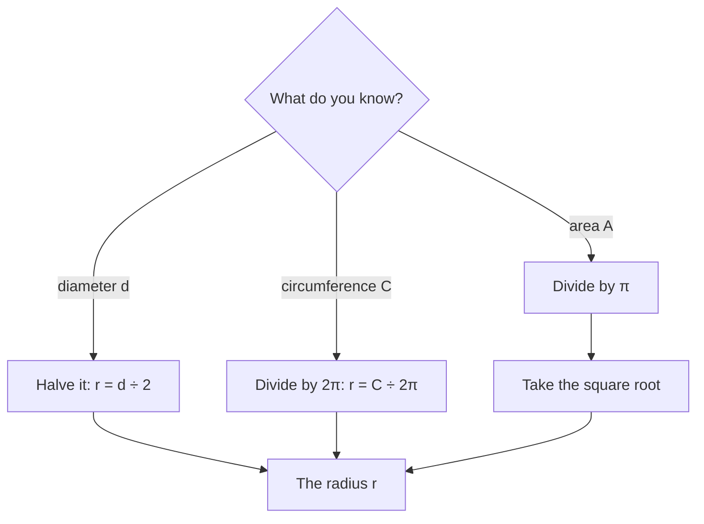

## Round shapes

Wheels, pizzas, pipes, clocks and running tracks are all built on circles. Unlike polygons, circles have no straight sides, so their perimeter and area need a new ingredient: the number $\pi$. This lesson introduces the parts of a circle, where $\pi$ comes from, and the formulas for circumference and area.

## Parts of a circle

A **circle** is the set of all points in a plane at the same distance from a fixed point, its **center**.

- The **radius** $r$ is the distance from the center to the circle.
- The **diameter** $d$ is the distance across the circle through the center. It's two radii: $d = 2r$, so $r = \tfrac{d}{2}$.
- The **circumference** $C$ is the distance around the circle (its perimeter).

```shape
{"circles": [{"center": [0, 0], "r": 3}], "points": [[0, 0]], "segments": [{"from": [0, 0], "to": [2.12, 2.12], "label": "r"}, {"from": [-3, 0], "to": [3, 0], "label": "d"}], "caption": "Radius r and diameter d = 2r"}
```

Here are all four parts in one picture. The circumference is the curve itself, the edge all the way around.


## Where π comes from

Wrap a string around any circular object, then compare its length to the diameter. A soup can, a bicycle wheel, a coin: the circumference is always a little more than 3 times the diameter. That ratio is the same for every circle, and it's called **pi** ($\pi$):

$$\pi = \frac{C}{d} \approx 3.14159\ldots$$

Pi is an irrational number: its decimal never ends or repeats. For calculations we use $\pi \approx 3.14$ or $\pi \approx \tfrac{22}{7}$, or the calculator's $\pi$ key. An answer left "in terms of $\pi$", like $10\pi$ cm, is exact.

## Circumference

Since $\dfrac{C}{d} = \pi$, multiplying by $d$ gives

$$C = \pi d = 2\pi r.$$

### Example 1

A bicycle wheel has a diameter of 26 inches. How far does the bike travel in one turn of the wheel? In 500 turns?

One turn: $C = \pi d = 26\pi \approx 81.7$ in. In 500 turns: $500 \times 81.68 \approx 40{,}841$ inches, which is about $40{,}841 \div 12 \approx 3{,}403$ feet.

### Example 2

A circular garden has a circumference of 44 m. What is its radius? (Use $\pi \approx \tfrac{22}{7}$.)

$C = 2\pi r$, so $44 = 2 \cdot \tfrac{22}{7} \cdot r = \tfrac{44}{7}r$. Multiply both sides by $\tfrac{7}{44}$: $r = 7$ m.

## Area

$$A = \pi r^2$$

Why? Cut a circle into many thin wedges like pizza slices and arrange them alternately point-up and point-down. They form a shape that is almost a parallelogram. Its height is the radius $r$, and its base is half the circumference (half the crust is on top, half on the bottom): $\tfrac12 \cdot 2\pi r = \pi r$. The more slices, the closer the shape is to a true parallelogram, with area base × height $= \pi r \cdot r = \pi r^2$.


Be careful: the area formula uses the *radius*. If you're given the diameter, halve it first.

### Example 3

A pizza has a 14-inch diameter. Find its area.

The radius is 7 in. $A = \pi(7)^2 = 49\pi \approx 153.9 \text{ in}^2$.

### Example 4

Which is more pizza: one 16-inch pizza or two 10-inch pizzas?

One 16-inch: $\pi(8)^2 = 64\pi \approx 201 \text{ in}^2$. Two 10-inch: $2 \cdot \pi(5)^2 = 50\pi \approx 157 \text{ in}^2$. The single large pizza has about 28% more. Doubling a circle's radius multiplies its area by 4, because the radius is squared.

## Semicircles and composite shapes

A **semicircle** is half a circle: half the area, $\tfrac12 \pi r^2$. Its curved edge is half the circumference, $\pi r$.

### Example 5

A window is a 4 ft by 3 ft rectangle with a semicircle on top whose diameter is the 4 ft side. Find the window's area and its perimeter (the frame around the outside).

```shape
{"polygons": [{"points": [[0, 0], [4, 0], [4, 3], [0, 3]]}], "curves": [{"x": "2 + 2*cos(t)", "y": "3 + 2*sin(t)", "t": [0, "pi"]}], "segments": [{"from": [0, -0.4], "to": [4, -0.4], "label": "4 ft"}, {"from": [4.4, 0], "to": [4.4, 3], "label": "3 ft"}], "caption": "A rectangle topped by a semicircle"}
```

Area: rectangle $4 \times 3 = 12$; semicircle with radius 2: $\tfrac12\pi(2)^2 = 2\pi \approx 6.28$. Total $\approx 18.28 \text{ ft}^2$.

Perimeter: the bottom and two sides, $4 + 3 + 3 = 10$ ft, plus the curved top, $\pi r = 2\pi \approx 6.28$ ft. Total $\approx 16.28$ ft. The top edge of the rectangle is inside the window, so it isn't part of the perimeter.

## Working backward

Sometimes you know the area or circumference and need the radius. Undo the formula step by step.



### Example 6

A circular patio has an area of about 113 square feet. What is its radius, to the nearest foot?

$\pi r^2 = 113$, so $r^2 = 113 \div \pi \approx 35.97$. Then $r = \sqrt{35.97} \approx 6$ feet. Check: $\pi(6)^2 = 36\pi \approx 113.1$. ✓

For circumference, divide by $2\pi$ instead: a circle with circumference 50 cm has radius $50 \div (2\pi) \approx 7.96$ cm. Notice that the area problem needs a square root at the end, because the radius is squared in the area formula.

## Common mistakes

- *Using the diameter in $A = \pi r^2$.* Halve it first.
- *Mixing up the formulas.* Circumference ($2\pi r$) is a length; area ($\pi r^2$) has square units. The squared $r$ goes with square units.
- *Squaring before multiplying incorrectly:* $\pi r^2$ means $\pi \times (r^2)$, not $(\pi r)^2$.
- *Rounding $\pi$ too early* in a multi-step problem. Keep $\pi$ until the end.
- *Including interior edges* in the perimeter of a composite figure.

## Key points

- $d = 2r$.
- $\pi = C/d \approx 3.14159$, the same for every circle.
- Circumference $C = \pi d = 2\pi r$; area $A = \pi r^2$.
- Exact answers keep $\pi$ (like $49\pi$); approximate answers use 3.14 or a calculator.
- A semicircle has half the area and half the curved length of the full circle.
