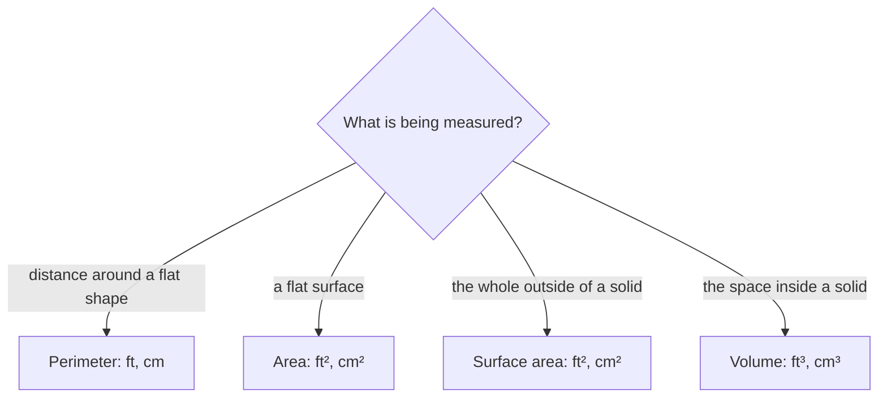

## Into three dimensions

Area measures flat surfaces. Real objects (boxes, tanks, cans, rooms) take up space, and two new questions arise: how much do they hold, and how much material covers them? The first is **volume**, the second **surface area**. This lesson handles the solids you'll meet most often: rectangular boxes, cubes, cylinders, and a few others for reference.

## Volume

**Volume** measures the space inside a solid, in **cubic units**: a cube 1 cm on each edge has a volume of 1 cubic centimeter (1 cm³). Finding a volume means counting how many unit cubes fit inside.

## Rectangular prisms (boxes)

A **rectangular prism** is a box shape with length $l$, width $w$ and height $h$.

```shape
{"polygons": [{"points": [[0, 0], [4, 0], [4, 2], [0, 2]]}, {"points": [[0, 2], [4, 2], [5.2, 2.9], [1.2, 2.9]]}, {"points": [[4, 0], [5.2, 0.9], [5.2, 2.9], [4, 2]]}], "segments": [{"from": [0, -0.35], "to": [4, -0.35], "label": "l"}, {"from": [4.45, 0.0], "to": [5.65, 0.9], "label": "w"}, {"from": [-0.35, 0], "to": [-0.35, 2], "label": "h"}], "caption": "A rectangular prism with length l, width w and height h"}
```

Picture filling it in layers. The bottom layer holds $l \times w$ unit cubes (the area of the base), and there are $h$ layers. So

$$V = lwh.$$

For a **cube** with edge $s$, all three dimensions are equal: $V = s^3$. (That's where "cubed" comes from.)

More generally, for any **prism** (a solid with two identical parallel bases and straight sides), the volume is the area of the base times the height: $V = Bh$, where $B$ is the base area.

### Example 1

A fish tank is 30 in long, 12 in wide and 16 in high. What is its volume? One gallon is about 231 in³; about how many gallons does it hold?

$V = 30 \times 12 \times 16 = 5{,}760 \text{ in}^3$. In gallons: $5{,}760 \div 231 \approx 24.9$, so about 25 gallons.

## Cylinders

A **cylinder** is like a prism with circular bases. Its base area is $\pi r^2$, so

$$V = \pi r^2 h.$$

### Example 2

A can has a diameter of 8 cm and a height of 11 cm. Find its volume.

The radius is 4 cm. $V = \pi(4)^2(11) = 176\pi \approx 552.9 \text{ cm}^3$.

Since 1 cm³ = 1 mL, the can holds about 553 mL.

## Other solids (for reference)

| Solid | Volume |
|---|---|
| Cone, radius $r$, height $h$ | $V = \tfrac13 \pi r^2 h$ |
| Pyramid, base area $B$, height $h$ | $V = \tfrac13 Bh$ |
| Sphere, radius $r$ | $V = \tfrac43 \pi r^3$ |

A cone holds exactly one third of the cylinder with the same base and height, and a pyramid one third of the matching prism.

## Surface area

**Surface area** is the total area of all the outside faces of a solid: how much paper it would take to wrap it. It's an area, so it's measured in square units.

For a rectangular prism, there are six rectangular faces in three matching pairs: top and bottom ($l \times w$ each), front and back ($l \times h$), and two sides ($w \times h$). So

$$SA = 2lw + 2lh + 2wh.$$

A cube has six identical square faces: $SA = 6s^2$.

One way to see this is to unfold the box into a flat pattern called a **net**: six rectangles you can measure separately and add.

### Example 3

A shipping box is 20 in by 14 in by 10 in. How much cardboard covers its surface?

$SA = 2(20)(14) + 2(20)(10) + 2(14)(10) = 560 + 400 + 280 = 1{,}240 \text{ in}^2$.

### Example 4

Find the surface area of a cylinder with radius 3 ft and height 10 ft.

Unroll it: two circles (top and bottom), each $\pi r^2 = 9\pi$, and a rectangle whose width is the circumference $2\pi r = 6\pi$ and whose height is 10. The rectangle's area is $6\pi \times 10 = 60\pi$.

The picture shows why the rectangle is that wide: its long edge wrapped once around the circular base.


Total: $SA = 2\pi r^2 + 2\pi r h = 18\pi + 60\pi = 78\pi \approx 245 \text{ ft}^2$.

## Volume vs surface area vs perimeter

| Measure | What it tells you | Units |
|---|---|---|
| Perimeter | distance around a flat shape | ft, cm (length) |
| Area | flat surface inside a shape | ft², cm² (square) |
| Surface area | total outside area of a solid | ft², cm² (square) |
| Volume | space inside a solid | ft³, cm³ (cubic) |

Painting a wall uses area; fencing a yard uses perimeter; filling a pool uses volume; wrapping a gift uses surface area.

When a word problem doesn't say which one it wants, ask what is being measured:



### Example 5

A sandbox is 6 ft by 4 ft and should be filled 1.5 ft deep. Sand is sold by the cubic yard. How many cubic yards are needed?

Volume: $6 \times 4 \times 1.5 = 36 \text{ ft}^3$. One cubic yard is $3 \times 3 \times 3 = 27 \text{ ft}^3$, so $36 \div 27 \approx 1.33$ yd³. If the supplier sells only whole or half cubic yards, buy 1.5 yd³ (1 yd³ would not be enough).

## Common mistakes

- *Using the diameter instead of the radius* in $\pi r^2 h$.
- *Confusing volume and surface area.* Volume is cubic units (how much it holds); surface area is square units (how much covers it).
- *Counting only three faces* of a box for surface area; there are six.
- *Converting cubic units with the length factor:* 1 yd³ = 27 ft³, not 3 ft³.
- *Mixing units* (feet and inches) in one formula.

## Key points

- Volume counts cubic units; prism $V = Bh$, box $V = lwh$, cube $V = s^3$, cylinder $V = \pi r^2 h$.
- Surface area adds the areas of all faces: box $SA = 2lw + 2lh + 2wh$, cube $SA = 6s^2$, cylinder $SA = 2\pi r^2 + 2\pi rh$.
- Volume is in cubic units, surface area in square units, perimeter in plain units.
