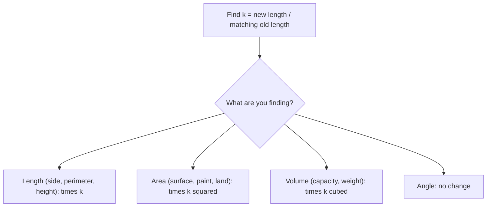

## Bigger in every direction

Lesson 16 introduced the **scale factor**: the number you multiply every length by to go from one similar figure to another. A 1 : 24 model car has every length $\tfrac{1}{24}$ of the real one. This module has dropped hints that areas and volumes don't follow the same rule: in Lesson 33, doubling a pizza's radius gave *four* times the pizza, and in the honors lesson on spheres, doubling the radius multiplied the volume by 8. This lesson explains the pattern behind those hints, uses it on maps and models, runs it backwards, and ends with a surprising consequence for living things: why a giant ant could not simply be a big copy of a small one.

Throughout, $k$ is the scale factor for lengths, going from the original figure to the new one. If $k > 1$ the copy is an enlargement; if $0 < k < 1$ it is a reduction.

## Lengths scale by k

When a figure is scaled by $k$, *every* length is multiplied by $k$: not only the sides, but the perimeter, the diagonals, the height, the radius and the circumference. A rectangle 3 cm by 5 cm has perimeter 16 cm; scaled by $k = 2$ it is 6 cm by 10 cm with perimeter 32 cm, also twice as much. Angles don't change at all, which is why the copy has the same shape.

## Areas scale by k²

Area is counted in unit squares (Lesson 32). Scale a unit square by $k$ and its sides become $k$ long, so it becomes a $k \times k$ square, which holds $k^2$ unit squares.


Any figure can be filled (exactly, or as closely as you like) with small squares. Scaling the figure scales every one of those little squares, and each one's area is multiplied by $k^2$, so the whole figure's area is multiplied by $k^2$:

$$\text{new area} = k^2 \times \text{old area}.$$

You can also see it in any formula. A rectangle's area $lw$ becomes $(kl)(kw) = k^2\,lw$; a circle's $\pi r^2$ becomes $\pi(kr)^2 = k^2\,\pi r^2$. Each area formula multiplies two lengths, so it picks up two factors of $k$. The number $k^2$ is the **area scale factor**.

### Example 1

A 4 in by 6 in photo is enlarged to 12 in by 18 in. How do its perimeter and area change?

The scale factor is $k = \tfrac{12}{4} = \tfrac{18}{6} = 3$. Perimeter: $20$ in becomes $60$ in, times 3. Area: $24$ in² becomes $216$ in², and $216 \div 24 = 9 = 3^2$. The enlargement needs 9 times as much paper and ink, not 3 times.

## Volumes scale by k³

Volume is counted in unit cubes (Lesson 34). Scale a unit cube by $k$ and it becomes a $k \times k \times k$ cube holding $k^3$ unit cubes.


The same filling argument gives

$$\text{new volume} = k^3 \times \text{old volume}.$$

In formulas, every volume multiplies three lengths: $lwh$ becomes $(kl)(kw)(kh) = k^3\,lwh$. The number $k^3$ is the **volume scale factor**. Anything that is proportional to volume scales by $k^3$ too: how much a container holds, and the weight of a solid object made of the same material. A solid's *surface* area is still an area, so it scales by $k^2$.

### Example 2

A box is 2 cm by 3 cm by 4 cm. A similar box has every edge doubled. Compare their volumes and surface areas.

Original: $V = 2 \cdot 3 \cdot 4 = 24$ cm³ and $SA = 2(6 + 8 + 12) = 52$ cm². New box, 4 cm by 6 cm by 8 cm: $V = 192$ cm³ and $SA = 2(24 + 32 + 48) = 208$ cm². Volume: $192 \div 24 = 8 = 2^3$. Surface area: $208 \div 52 = 4 = 2^2$. Same box, three different multipliers: 2 for the edges, 4 for the cardboard, 8 for what fits inside.

### Example 3

A solid chocolate bunny 10 cm tall weighs 100 g and is wrapped in 150 cm² of foil. A similar solid bunny is 15 cm tall. How much does it weigh, and how much foil does it need?

$k = \tfrac{15}{10} = 1.5$. Weight scales by $k^3 = 3.375$: $100 \times 3.375 = 337.5$ g. Foil scales by $k^2 = 2.25$: $150 \times 2.25 = 337.5$ cm². A bunny only half again as tall weighs more than three times as much.

## Which factor? A summary



## Maps and models

A map, floor plan or model is a **scale drawing** (or scale model): every length is the real length times the same small factor. A **map scale** like 1 : 50,000 is a ratio of *lengths*: 1 cm on the map stands for 50,000 cm on the ground, which is 500 m or 0.5 km. Model trains in the popular HO scale are built at about 1 : 87, so a real 12 m railcar becomes a model about $1{,}200 \div 87 \approx 13.8$ cm long.

Because the scale is for lengths, areas need the square of it. On a 1 : 50,000 map, a 1 cm by 1 cm square stands for a 0.5 km by 0.5 km square of land: $1 \text{ cm}^2$ on the map is $0.5^2 = 0.25 \text{ km}^2$ on the ground.

### Example 4

On a 1 : 50,000 map, a park covers 6 cm². What is its real area?

Each map square centimeter is 0.25 km² of land, so the park is $6 \times 0.25 = 1.5$ km². The tempting wrong answer, $6 \times 0.5 = 3$ km², uses the length scale on an area.

In ratio form: the scale factor from map to ground is $k = 50{,}000$, so areas are multiplied by $k^2 = 2{,}500{,}000{,}000$; $6 \text{ cm}^2 \times 2.5 \times 10^9 = 1.5 \times 10^{10} \text{ cm}^2$, which is the same 1.5 km² (since $1 \text{ km} = 10^5$ cm, $1 \text{ km}^2 = 10^{10}$ cm²). Converting the scale to "1 cm : 0.5 km" first is usually easier.

## Going backwards: from area to length

Sometimes you know how the areas compare and need the lengths. Since the area ratio is $k^2$, the length ratio is its square root:

$$k = \sqrt{\text{area ratio}}, \qquad k = \sqrt[3]{\text{volume ratio}}.$$

A square with 4 times the area has sides $\sqrt4 = 2$ times as long; a similar solid with 27 times the volume (or, made of the same material, the weight) is $\sqrt[3]{27} = 3$ times as tall. Use the square root only for an area ratio and the cube root only for a volume ratio, and only for similar figures: a rectangle can have 4 times the area by being 4 times as long and no wider.

### Example 5

Two similar rectangles have areas 20 cm² and 45 cm². The smaller is 4 cm wide. How wide is the larger?

Area ratio: $\tfrac{45}{20} = \tfrac94$. Length ratio: $k = \sqrt{\tfrac94} = \tfrac32$. Width: $4 \times \tfrac32 = 6$ cm. Check: the widths' ratio squared is $\left(\tfrac64\right)^2 = \tfrac94$. ✓

### Example 6

International paper sizes are designed so that two sheets of A4 side by side make one sheet of A3: A3 has exactly twice the area of A4, and the two are similar. An A4 sheet is 210 mm by 297 mm. What scale factor turns A4 into A3, and how big is A3?

Area ratio 2, so $k = \sqrt2 \approx 1.414$. The A3 sheet is about $210 \times 1.414 \approx 297$ mm by $297 \times 1.414 \approx 420$ mm (its official size is 297 mm by 420 mm). This is why a photocopier's "A4 → A3" button is labeled 141%, and "A3 → A4" is 71% ($\tfrac{1}{\sqrt2} \approx 0.707$). Doubling the area takes only about 41% more length in each direction.

## The square-cube law

Put the two rules side by side. Scale something up by $k$ and its areas grow by $k^2$ but its volume grows by $k^3$, faster. This mismatch is called the **square-cube law**, and it explains a lot about the sizes of real things. (Galileo described it in 1638, in his book *Two New Sciences*, to explain why a giant animal's bones would need to be much thicker than a scaled-up small animal's.)

*Strength versus weight.* The strength of a bone or a muscle depends mainly on its **cross-sectional area**: the area of the cut you would see if you sliced straight across it. So strength scales by $k^2$. An animal's weight depends on its volume, which scales by $k^3$. The load on each square centimeter of bone is weight ÷ area, which scales by $\tfrac{k^3}{k^2} = k$.

### Example 7

A movie giant is an exact copy of a 1.8 m, 80 kg person, scaled up 10 times to 18 m tall. What happens to the load on the giant's leg bones?

$k = 10$. Weight: $80 \times 10^3 = 80{,}000$ kg. Cross-section of each bone: $10^2 = 100$ times as large. Load on each square centimeter of bone: $\tfrac{1{,}000}{100} = 10$ times as much. Bone has some safety margin, but nowhere near tenfold: the giant's legs would be likely to break when it tried to walk. A real animal that large needs much thicker legs for its height, which is what you see comparing an elephant's legs with a gazelle's.

The same reasoning is why a giant ant can't be a scaled-up ant: its thin legs would buckle. Insects also have a second problem: they get oxygen through tiny air tubes that reach their tissues, a system that works well over short distances but poorly over long ones. (Hundreds of millions of years ago some insects were much bigger, such as dragonfly-like insects with wingspans of roughly 65 to 70 cm; one leading explanation is that the air then held more oxygen.)

*Small things cool faster.* Heat escapes through an object's surface, but the heat it holds (or, in a warm-blooded animal, produces) depends on its volume. Compare the **surface-area-to-volume ratio** of cubes:

| Edge | Surface area | Volume | Surface area ÷ volume |
|---|---|---|---|
| 1 cm | 6 cm² | 1 cm³ | 6 per cm |
| 2 cm | 24 cm² | 8 cm³ | 3 per cm |
| 10 cm | 600 cm² | 1,000 cm³ | 0.6 per cm |

For a cube with edge $s$ the ratio is $\tfrac{6s^2}{s^3} = \tfrac{6}{s}$: scaling by $k$ multiplies it by $\tfrac{k^2}{k^3} = \tfrac1k$. A small object has much more surface for each bit of its volume, so it loses (and gains) heat faster.

```plot
{"x": [0, 10], "y": [0, 12.5], "yAxisAt": "left", "xAxisAt": "bottom", "xLabel": "edge (cm)", "yLabel": "surface area ÷ volume (per cm)", "functions": [{"f": "6/x", "from": 0.6, "to": 8}], "points": [{"at": [1, 6], "label": "(1, 6)"}, {"at": [2, 3], "label": "(2, 3)"}, {"at": [6, 1], "label": "(6, 1)"}], "caption": "Surface area ÷ volume for a cube is 6 ÷ edge: bigger cubes have far less surface for each cubic centimeter"}
```

That is why chopped potatoes cool faster than a whole one, why crushed ice melts faster than a block, and why a mouse must eat far more food for its body weight than an elephant does, just to stay warm.

*Simplified:* real animals are not exact scaled copies of each other, bone strength depends on more than cross-sectional area, and measured patterns in animals (such as how energy use grows with body size) are close to, but not exactly, what this simple $k^2$-versus-$k^3$ reasoning predicts. The square-cube law explains the direction of the effect, not every detail.

## Common mistakes

- *Using $k$ for everything.* Doubling the lengths doubles the perimeter but quadruples the area and multiplies the volume by 8.
- *Using a map's length scale on an area.* On a 1 : 50,000 map, 1 cm² is 0.25 km², not 0.5 km².
- *Forgetting that surface area is an area.* A solid's surface scales by $k^2$, its volume by $k^3$.
- *Dividing an area ratio instead of taking its square root.* Similar figures with 9 times the area have sides 3 times as long, not 4.5 or 9.
- *Scaling figures that aren't similar.* The $k^2$ and $k^3$ rules need the same shape, with every length multiplied by the same $k$.
- *Weight from scale with a different material or a hollow object.* Weight scales by $k^3$ only for solid objects of the same material.

## Key points

- Scaling by $k$ multiplies every length by $k$, every area by $k^2$ and every volume by $k^3$; angles stay the same.
- Why: each unit square becomes $k \times k$ unit squares, and each unit cube becomes $k \times k \times k$ unit cubes.
- A map or model scale is a length ratio; square it for areas, cube it for volumes.
- Backwards: $k = \sqrt{\text{area ratio}}$ or $\sqrt[3]{\text{volume ratio}}$, for similar figures only.
- Square-cube law: when something is scaled up, its volume (and weight) grows faster than its areas (strength, surface). Big animals need thicker bones; small objects cool faster.
