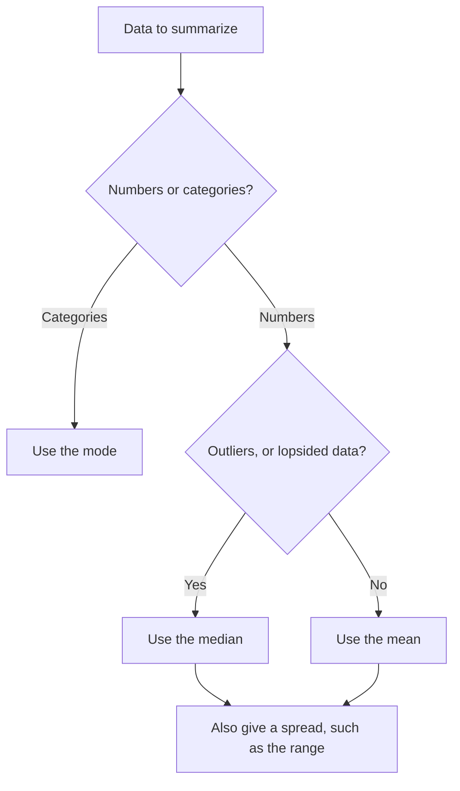

## Summarizing a list of numbers

A list of test scores, daily temperatures or house prices can be long and hard to take in. Statistics boils such a list down to a few numbers that describe it. The most common are a "typical" value, called a measure of center, and a measure of how spread out the values are. This lesson covers the three measures of center (mean, median, mode) and the simplest measure of spread (range), and when each one is the right choice.

A collection of numbers like this is called a **data set**, and each number in it is a data value.

## The mean

The **mean** (the everyday "average") is the sum of the values divided by how many there are:

$$\text{mean} = \frac{\text{sum of the values}}{\text{number of values}}$$

### Example 1

Find the mean of the quiz scores 8, 6, 10, 7, 9, 8.

Sum: $8 + 6 + 10 + 7 + 9 + 8 = 48$. There are 6 scores. Mean $= 48 \div 6 = 8$.

The mean is a *balance point*. If you place the values as weights on a number line, the mean is where it would balance. That's why the distances above the mean exactly cancel the distances below it: here the deviations are $0, -2, +2, -1, +1, 0$, which sum to zero.

Because the mean uses every value, one unusually large or small value, an **outlier**, can pull it a long way. If a seventh quiz score of 0 is added (a missed quiz), the mean drops to $48 \div 7 \approx 6.9$, below five of the seven scores.

## The median

The **median** is the middle value when the data are put in order.

- With an odd number of values, it's the one in the middle.
- With an even number, it's the mean of the two middle values.

### Example 2

Find the median of 14, 3, 9, 21, 6.

Order them: 3, 6, 9, 14, 21. The middle (third of five) is 9.

### Example 3

Find the median of 8, 6, 10, 7, 9, 8.

Order: 6, 7, 8, 8, 9, 10. The two middle values are the third and fourth, 8 and 8. Median $= \tfrac{8 + 8}{2} = 8$.

The median isn't affected much by outliers. Add the 0 from before: 0, 6, 7, 8, 8, 9, 10. The median is still 8. That's why medians are used for things like home prices and incomes, where a few very large values would make the mean misleading.

## The mode

The **mode** is the value that occurs most often. In 6, 7, 8, 8, 9, 10 the mode is 8. A data set can have more than one mode (if two values tie for most frequent) or no mode (if every value appears once). The mode is the only measure of center that works for non-numerical data: if more people pick blue than any other color, blue is the mode.

## The range

The **range** is the difference between the largest and smallest values:

$$\text{range} = \text{maximum} - \text{minimum}$$

It's a quick measure of spread. For 6, 7, 8, 8, 9, 10 the range is $10 - 6 = 4$. Two data sets can have the same mean but very different ranges: 50, 50, 50 and 0, 50, 100 both have mean 50, with ranges 0 and 100.

## Working backward with the mean

Since mean = sum ÷ count, the sum is mean × count. This lets you find a missing value.

### Example 4

Kai's first four test scores are 82, 75, 90 and 88. What score does he need on the fifth test to have a mean of 85?

For a mean of 85 over 5 tests, the total must be $85 \times 5 = 425$. His current total is $82 + 75 + 90 + 88 = 335$. He needs $425 - 335 = 90$.

### Example 5

The mean of six numbers is 12. When a seventh number is added, the mean becomes 13. What is the seventh number?

Total of six: $6 \times 12 = 72$. Total of seven: $7 \times 13 = 91$. The new number is $91 - 72 = 19$.

## Choosing a measure

| Situation | Best measure of center |
|---|---|
| Values fairly symmetric, no outliers | mean |
| Outliers or a lopsided (skewed) data set | median |
| Categories, or "most popular" | mode |

The same choice as a flowchart:

The picture below puts all four measures on one dot plot of the data 1, 7, 8, 9, 9, 10. The outlier, 1, drags the mean (about 7.3) to the left of the median (8.5), while the mode sits where the dots stack highest.

### Example 6

Five employees earn \$38,000, \$41,000, \$43,000, \$45,000 and \$250,000 (the owner). Which better describes a typical salary, the mean or the median?

Mean: $(38 + 41 + 43 + 45 + 250) \div 5 = 417 \div 5 = 83.4$ thousand, or \$83,400, which is higher than four of the five salaries. Median: \$43,000, the middle value. The median is the better description; the owner's salary is an outlier.

## Common mistakes

- *Finding the median without ordering the values first.*
- *Forgetting to average the two middle values* when the count is even.
- *Dividing by the wrong count* for the mean, especially after adding or removing a value.
- *Reporting the range as two numbers* ("6 to 10"). The range is the single difference, 4.
- *Thinking the mean must be one of the data values.* It often isn't (the mean of 1, 2, 4 is $\tfrac73$).

## Key points

- Mean = sum ÷ count; it uses every value and is pulled by outliers.
- Median = middle value of the ordered data (average the two middle values for an even count); resistant to outliers.
- Mode = most frequent value; can be none or several.
- Range = maximum − minimum.
- Sum = mean × count, which lets you find a missing value.
