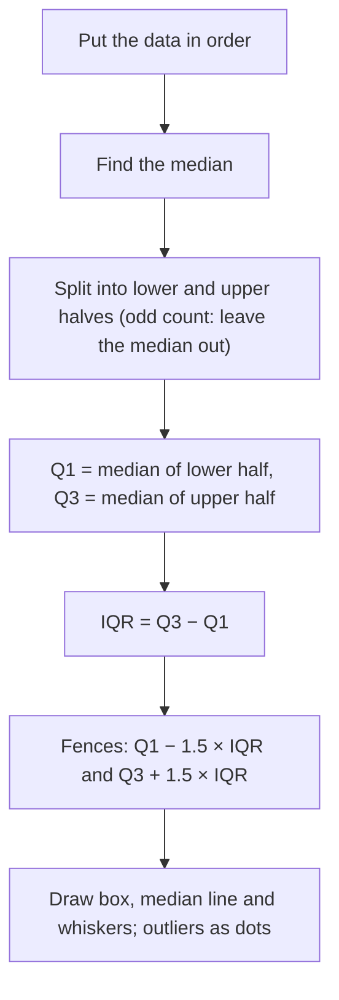

## Beyond the range

Lesson 36 gave one measure of spread, the range. It is quick, but it looks at only two values, the largest and the smallest, and ignores everything in between. Compare the daily high temperatures (°F) in two towns over six days:

| Town | Day 1 | Day 2 | Day 3 | Day 4 | Day 5 | Day 6 |
|---|---|---|---|---|---|---|
| A | 60 | 70 | 70 | 70 | 70 | 80 |
| B | 60 | 62 | 64 | 76 | 78 | 80 |

Both have mean 70 and range 20, yet Town A's days are almost all 70 while Town B's swing well above and below. The range can't see the difference. This honors lesson builds two better measures of spread: the mean absolute deviation, which goes with the mean, and the interquartile range, which goes with the median. Along the way you'll learn to draw and read a box plot, one of the most useful pictures in statistics, and a standard rule for deciding when a value counts as an outlier.

## Deviations, and why they cancel

A **deviation** is how far a value is from the mean, with a sign: value − mean. Values above the mean have positive deviations and values below have negative ones.

Lesson 36 showed that the mean is a balance point: the deviations always add to zero. Here is why. If $n$ values add to $S$, the mean is $\tfrac{S}{n}$. Adding the deviations means adding all the values and subtracting the mean $n$ times:

$$S - n \cdot \frac{S}{n} = S - S = 0.$$

So "the average deviation" is always 0, for every data set, and tells us nothing. The fix is to throw away the signs and average the *distances* instead. Distance from the mean is the absolute value of the deviation (Lesson 6).

## Mean absolute deviation

The **mean absolute deviation** (MAD) is the mean of the distances from the mean:

$$\text{MAD} = \frac{\text{sum of } |\text{value} - \text{mean}|}{\text{number of values}}.$$

It answers the question "on average, how far is a value from the mean?" Finding it takes four steps: find the mean, find each distance from the mean, add the distances, and divide by the count.

### Example 1

Find the MAD of the quiz scores 4, 6, 7, 9, 14.

*Mean:* $(4 + 6 + 7 + 9 + 14) \div 5 = 40 \div 5 = 8$.

*Deviations:* $-4, -2, -1, +1, +6$. (Check: they add to 0.)

*Distances:* 4, 2, 1, 1, 6, which add to 14.

*MAD:* $14 \div 5 = 2.8$. On average, a score is 2.8 points from the mean.

Notice that the distances on the left (4 + 2 + 1 = 7) equal the distances on the right (1 + 6 = 7). That is the balance property again, and it gives a quick check on your mean.

### Example 2

Find the MAD for each town in the table above.

*Town A:* mean 70. Distances: 10, 0, 0, 0, 0, 10, which add to 20. MAD $= 20 \div 6 \approx 3.3$ °F.

*Town B:* mean $(60 + 62 + 64 + 76 + 78 + 80) \div 6 = 420 \div 6 = 70$. Distances: 10, 8, 6, 6, 8, 10, which add to 48. MAD $= 48 \div 6 = 8$ °F.

Same mean, same range, but Town B's MAD is more than twice Town A's: a typical day in Town B is 8 degrees from its average, against about 3 in Town A. The MAD saw what the range missed.

In later statistics courses you will meet the **standard deviation**, which does the same job as the MAD but squares the deviations instead of taking absolute values. The idea, "a typical distance from the mean," is the same.

## Quartiles and the five-number summary

The median splits ordered data into two halves. **Quartiles** go one step further and split the data into four parts with about the same number of values in each:

- the **first quartile**, Q1, is the median of the lower half;
- the second quartile is the median itself;
- the **third quartile**, Q3, is the median of the upper half.

The halves are the values below the median and the values above it. When the count is odd, the median is the middle value, and it is left out of both halves. When the count is even, the data split evenly into two halves.

This "median of each half" method is the one most school courses use. Some calculators and spreadsheets use slightly different rules, so for a small data set they may report a slightly different Q1 or Q3. That's a difference of convention, not an error; with large data sets the rules nearly agree.

Together, the minimum, Q1, median, Q3 and maximum form the **five-number summary**. The **interquartile range** (IQR) is the spread of the middle half of the data:

$$\text{IQR} = Q_3 - Q_1.$$

### Example 3

Nine students reported the minutes they spent on homework: 12, 31, 18, 25, 40, 22, 15, 28, 60. Find the five-number summary and the IQR.

*Order:* 12, 15, 18, 22, 25, 28, 31, 40, 60.

*Median:* with 9 values, the 5th, which is 25.

*Halves:* leave the 25 out. Lower half: 12, 15, 18, 22. Upper half: 28, 31, 40, 60.

*Quartiles:* Q1 is the median of the lower half, $\tfrac{15 + 18}{2} = 16.5$. Q3 is the median of the upper half, $\tfrac{31 + 40}{2} = 35.5$.

*Summary:* 12, 16.5, 25, 35.5, 60. IQR $= 35.5 - 16.5 = 19$ minutes. The middle half of the students worked between 16.5 and 35.5 minutes.

### Example 4

The ages of ten children at a party are 9, 3, 14, 6, 30, 11, 5, 15, 8, 12. (The 30 is a camp counselor who was counted by mistake.) Find the five-number summary.

*Order:* 3, 5, 6, 8, 9, 11, 12, 14, 15, 30.

*Median:* the 5th and 6th values are 9 and 11, so the median is 10.

*Halves:* an even count splits evenly. Lower half: 3, 5, 6, 8, 9, so Q1 = 6. Upper half: 11, 12, 14, 15, 30, so Q3 = 14.

*Summary:* 3, 6, 10, 14, 30. IQR $= 14 - 6 = 8$ years.

## Box plots

A **box plot** (or box-and-whisker plot) draws the five-number summary above a number line. A box runs from Q1 to Q3, with a line across it at the median. Two **whiskers** reach out from the box to the minimum and the maximum. The statistician John Tukey made box plots popular in the 1970s, and they are now standard in science and in the news.

How to read one:

- Each of the four sections (left whisker, left part of the box, right part of the box, right whisker) holds about a quarter of the data.
- The box holds the middle half; its length is the IQR.
- A *long* section means the values in that quarter are spread out, not that it holds more values. In the picture, the right whisker (84 to 97) is longer than the left part of the box (68 to 75), but both hold about 25% of the scores.

### Example 5

The box plots show test scores in two classes. Compare them.

*Center:* Class B's median (78) is higher than Class A's (72).

*Spread:* Class A's IQR is $78 - 68 = 10$; Class B's is $87 - 62 = 25$. The ranges are $90 - 55 = 35$ and $99 - 45 = 54$. Class B's scores are much more spread out.

*A sharper comparison:* Class B's median, 78, equals Class A's Q3. So about half of Class B scored 78 or more, but only about a quarter of Class A did. Class B has more high scorers *and* more low scorers.

## Outliers: the 1.5 × IQR rule

"Much larger or smaller than the rest" (Lesson 36) is a judgment call. A common rule, also from Tukey, turns it into arithmetic. Compute two **fences**:

$$\text{lower fence} = Q_1 - 1.5 \times \text{IQR}, \qquad \text{upper fence} = Q_3 + 1.5 \times \text{IQR}.$$

A value below the lower fence or above the upper fence is flagged as an outlier. In a box plot, flagged values are drawn as separate dots, and the whisker stops at the most extreme value that is *not* flagged.

The 1.5 is a convention chosen because it works well in practice, not a law of nature. A flagged value should be checked (is it a typo? a different kind of case?), not automatically deleted.

### Example 6

Use the rule on Examples 3 and 4.

*Example 4 (ages):* IQR = 8, so $1.5 \times 8 = 12$. Fences: $6 - 12 = -6$ and $14 + 12 = 26$. The 30 is above 26, so it's flagged, which fits the story: the counselor isn't one of the children. In the box plot, the right whisker would end at 15 and the 30 would be a lone dot.

*Example 3 (homework):* IQR = 19, so $1.5 \times 19 = 28.5$. Fences: $16.5 - 28.5 = -12$ and $35.5 + 28.5 = 64$. The 60 looks far from the rest, but it is below 64, so it is *not* flagged. The rule is stricter than the eye.

## Which spread goes with which center

A measure is **resistant** if one extreme value can barely change it. The median and the IQR are resistant because they depend only on the middle of the ordered data. The mean and the MAD use every value, so an outlier pulls them.

Start with 11, 12, 14, 15, 18 and then add an outlier, 60:

| Measure | Without 60 | With 60 |
|---|---|---|
| Range | 7 | 49 |
| MAD | 2 | about 12.8 |
| IQR | 5 | 6 |

The range and the MAD jump; the IQR hardly moves. So pair them up: report the *mean with the MAD* for fairly symmetric data without outliers, and the *median with the IQR* when there are outliers or the data are lopsided. That matches the advice in Lesson 36 for choosing a center.

## Common mistakes

- *Averaging the signed deviations.* They always add to 0. Use distances (absolute values).
- *Forgetting to put the data in order* before finding the median or quartiles.
- *Including the median in both halves* when the count is odd. With the method in this lesson, it goes in neither half.
- *Reading a long whisker as "more data."* Every section of a box plot holds about 25%; length shows spread.
- *Writing the IQR as two numbers* ("68 to 84"). Like the range, it is one difference: 16.
- *Deleting every flagged outlier.* The 1.5 × IQR rule flags values to check; it doesn't prove they are mistakes.

## Key points

- Deviation = value − mean; the deviations always sum to 0.
- MAD = mean of the distances $|\text{value} - \text{mean}|$: the typical distance from the mean.
- Q1 and Q3 are the medians of the lower and upper halves (leave the median out when the count is odd). Five-number summary: min, Q1, median, Q3, max.
- IQR = Q3 − Q1, the spread of the middle half.
- A box plot draws the five-number summary; each of its four sections holds about 25% of the data.
- Outlier rule: below Q1 − 1.5 × IQR or above Q3 + 1.5 × IQR.
- Mean goes with MAD; median goes with IQR (resistant to outliers).
