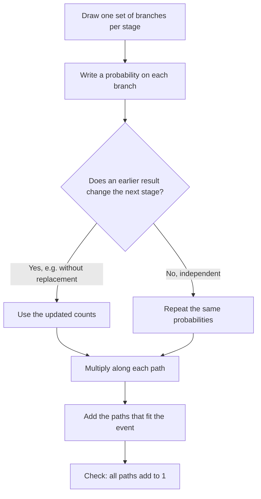

## Chance in several stages

Lesson 38 found probabilities by counting equally likely outcomes, and multiplied probabilities for independent events like a coin flip and a die roll. It ended with a warning: when you draw without putting the first item back, the second draw is different, and the simple product no longer works. This honors lesson handles that case and two more ideas that grow out of it. Tree diagrams organize any experiment that happens in stages. Dependent events are handled by updating the probabilities on later branches. And expected value tells you what a game, a raffle or an insurance policy is worth on average, which ties probability back to the mean from Lesson 36.

## Tree diagrams

A **tree diagram** draws one set of branches for each stage of an experiment. Each branch is labeled with its probability, and the branches leaving any one point add to 1, because exactly one of them happens. Following a route from the start to the end, a *path*, gives one combined outcome.

Two rules do all the work:

- *Multiply along a path.* The path "A then B" happens a fraction $P(A)$ of the time, and of *those* times B happens a fraction of the time. A fraction of a fraction is a product (Lesson 10).
- *Add across paths.* Different paths can't happen together, so if an event is made of several paths, add their probabilities.

Since every possible outcome is exactly one path, all the path probabilities together add to 1, which is a built-in check.

### Example 1

A basketball player makes 70% of her free throws. She takes two. Assuming the shots are independent (a simplification; real shooters can run hot or cold), find the probability that she makes both, exactly one, and neither.

The tree has two stages, each with branches "make" (0.7) and "miss" (0.3). The four paths:

| Path | Probability |
|---|---|
| make, make | $0.7 \times 0.7 = 0.49$ |
| make, miss | $0.7 \times 0.3 = 0.21$ |
| miss, make | $0.3 \times 0.7 = 0.21$ |
| miss, miss | $0.3 \times 0.3 = 0.09$ |

Both: 0.49. Exactly one: two paths, $0.21 + 0.21 = 0.42$. Neither: 0.09. Check: $0.49 + 0.42 + 0.09 = 1$. ✓

A common slip is to answer "exactly one" with 0.21, forgetting that the miss can come first or second.

## Dependent events

Two events are **dependent events** when one happening changes the probability of the other. The classic case is drawing **without replacement**: an item drawn is kept out, so the next draw is from a smaller, changed collection. Drawing **with replacement** (putting each item back and mixing) keeps the draws independent, as in Lesson 38.

For dependent events the multiplication still works, as long as the second probability is the one that holds *after* the first event:

$$P(A \text{ and } B) = P(A) \times P(B \text{ after } A).$$

This is the **general multiplication rule**. (Statistics books write $P(B \mid A)$, read "the probability of B given A," for the second factor.) In a tree, it just means the second-stage branches can carry different numbers depending on which first branch you're on.

### Example 2

A bag holds 5 red and 3 blue marbles. Two are drawn without replacement. Find the probability of each color combination.


*First draw:* 8 marbles, so red $\tfrac58$ and blue $\tfrac38$.

*Second draw after a red:* 7 marbles left, 4 red and 3 blue, so red $\tfrac47$ and blue $\tfrac37$.

*Second draw after a blue:* 7 left, 5 red and 2 blue, so red $\tfrac57$ and blue $\tfrac27$.

Multiplying along the paths:

- both red: $\tfrac58 \times \tfrac47 = \tfrac{20}{56} = \tfrac{5}{14}$;
- one of each: red then blue $\tfrac{15}{56}$, plus blue then red $\tfrac{15}{56}$, for $\tfrac{30}{56} = \tfrac{15}{28}$;
- both blue: $\tfrac38 \times \tfrac27 = \tfrac{6}{56} = \tfrac{3}{28}$.

Check: $20 + 15 + 15 + 6 = 56$, so the paths add to $\tfrac{56}{56} = 1$. ✓

Compare with replacement: both red would be $\tfrac58 \times \tfrac58 = \tfrac{25}{64} \approx 0.39$, a little more than $\tfrac{5}{14} \approx 0.36$. Taking a red out makes a second red less likely.



## "At least one": use the complement

"At least one" covers many paths: exactly one, exactly two, and so on. Its complement, "none," is a single path. So use Lesson 38's complement rule:

$$P(\text{at least one}) = 1 - P(\text{none}).$$

### Example 3

A box of 10 light bulbs contains 2 defective ones. An inspector picks 3 bulbs without replacement. What is the probability she finds at least one defective bulb?

"None defective" means all three are good. There are 8 good bulbs, and each pick removes one:

$$P(\text{none}) = \frac{8}{10} \times \frac{7}{9} \times \frac{6}{8} = \frac{336}{720} = \frac{7}{15}.$$

So $P(\text{at least one defective}) = 1 - \tfrac{7}{15} = \tfrac{8}{15} \approx 0.53$.

Going the long way would mean adding the paths for exactly one and exactly two defective bulbs, six paths in all. The complement needs one.

## Expected value

Lesson 37 found the mean of a frequency table by multiplying each value by its frequency, adding, and dividing by the total. Dividing each frequency by the total first turns it into a *relative frequency*, the fraction of the time each value occurs. Replace those observed fractions with probabilities and you get the **expected value**:

$$\text{expected value} = \text{sum of } (\text{value} \times \text{probability}).$$

It is the long-run average result per trial. Like the mean, it is a balance point, and it doesn't have to be a possible result.

### Example 4

Find the expected value of one roll of a fair die.

Each face has probability $\tfrac16$:

$$1 \cdot \tfrac16 + 2 \cdot \tfrac16 + 3 \cdot \tfrac16 + 4 \cdot \tfrac16 + 5 \cdot \tfrac16 + 6 \cdot \tfrac16 = \tfrac{21}{6} = 3.5.$$

You can never roll 3.5, but over many rolls the average roll will be close to 3.5.

### Example 5

A game costs \$3 to play. You spin a spinner: half of it pays nothing, a quarter pays \$4 and a quarter pays \$6. What is the expected value of a play?

*Expected prize:* $0 \cdot \tfrac12 + 4 \cdot \tfrac14 + 6 \cdot \tfrac14 = 0 + 1 + 1.5 = 2.5$ dollars.

*Expected net gain:* $2.50 - 3.00 = -0.50$. On average you lose 50 cents a play.

The same answer comes from listing net results (prize minus cost): $-3$ with probability $\tfrac12$, $+1$ with $\tfrac14$ and $+3$ with $\tfrac14$:

$$-3 \cdot \tfrac12 + 1 \cdot \tfrac14 + 3 \cdot \tfrac14 = -1.5 + 0.25 + 0.75 = -0.5.$$

```plot
{"x": [-4, 4], "y": [0, 0.6], "bars": [{"x": -3, "height": 0.5, "width": 0.8, "label": "-3"}, {"x": 1, "height": 0.25, "width": 0.8, "label": "+1"}, {"x": 3, "height": 0.25, "width": 0.8, "label": "+3"}], "points": [{"at": [-0.5, 0], "label": "expected value -0.5"}], "xLabel": "Net gain per play (dollars)", "yLabel": "Probability", "caption": "The spinner game: the bars balance at the expected value, -0.50 dollars"}
```

A game is a **fair game** when its expected net gain is 0. This one would be fair at a price of \$2.50.

### Example 6

A school sells 400 raffle tickets at \$5 each. There is one \$500 prize and four \$50 prizes. What is the expected value of one ticket?

*Expected prize:* $500 \cdot \tfrac{1}{400} + 50 \cdot \tfrac{4}{400} = \tfrac{500 + 200}{400} = 1.75$ dollars.

*Expected net gain:* $1.75 - 5.00 = -3.25$ dollars per ticket.

Check from the school's side: it takes in $400 \times 5 = 2{,}000$ dollars and pays out $500 + 200 = 700$, keeping $1{,}300$. Spread over 400 tickets, that is $1{,}300 \div 400 = 3.25$ dollars per ticket, exactly what buyers lose on average. For a fundraiser, that's the point.

## Expected value and the long run

Why should a single raffle ticket "be worth" \$1.75 when it will actually pay \$0, \$50 or \$500? Because expected value is a statement about many repetitions. The **law of large numbers** says that as an experiment is repeated more and more times, the average result gets closer and closer to the expected value. It's the same fact as Lesson 38's observation that experimental probability approaches theoretical probability.

This is how insurance companies and casinos stay in business. Each policy or bet is uncertain, but over many thousands of them the average is very close to the expected value, and they set prices so that the expected value favors them.

Two cautions. The law says nothing about the next few trials: after a string of losses, a game is not "due" to pay (the gambler's fallacy from Lesson 38). And it describes averages, so a game with a negative expected value can still pay off for some players; it just can't pay off on average for players as a group.

## Common mistakes

- *Adding along a path or multiplying across paths.* Multiply along a path; add separate paths.
- *Forgetting the second order.* "Exactly one red" in two draws is red-blue *or* blue-red.
- *Not updating after a draw without replacement.* Both the count of that color and the total go down by 1.
- *Computing "at least one" the long way,* or as $1 - P(\text{all})$. Its complement is "none."
- *Mixing up the expected prize and the expected net gain.* Subtract the cost to get the net.
- *Expecting the expected value to happen.* It's a long-run average, and may not be a possible result at all.

## Key points

- In a tree diagram, branches from one point add to 1; multiply along a path, add across paths, and check that all paths add to 1.
- Dependent events: $P(A \text{ and } B) = P(A) \times P(B \text{ after } A)$. Without replacement, update the counts.
- $P(\text{at least one}) = 1 - P(\text{none})$.
- Expected value = sum of value × probability: the long-run average per trial.
- A fair game has expected net gain 0.
- Law of large numbers: over many trials, the average result approaches the expected value.
