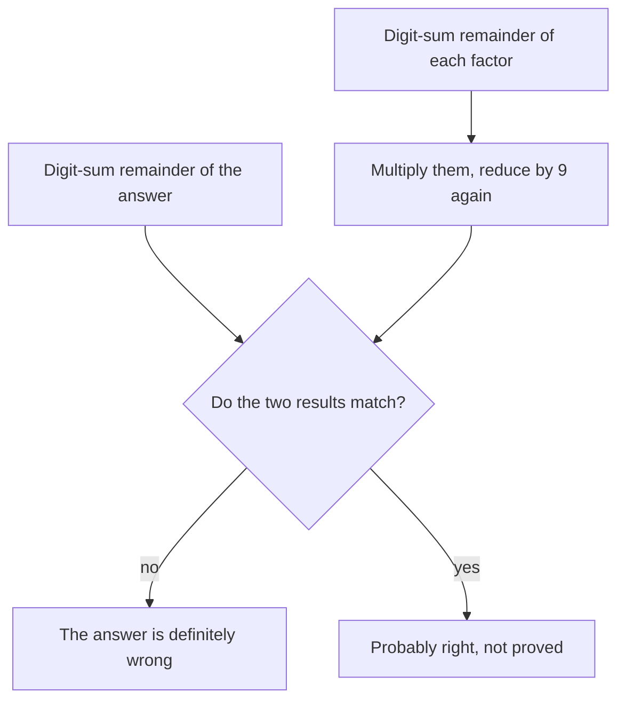

## When only the remainder matters

In the whole-number lessons, the remainder was the leftover part of a long division: $47 \div 6 = 7$ R 5. Usually we cared more about the quotient. This lesson turns that around. Many questions only need the remainder:

- Today is Tuesday. What day of the week will it be in 100 days? Only the leftover days after whole weeks matter.
- What is the last digit of $7^{2026}$? The last digit is the remainder after dividing by 10.
- Is a long multiplication you did by hand probably right? The remainder after dividing by 9 gives a quick check.

Working with remainders has its own arithmetic, and it is surprisingly powerful: you can find the remainder of a huge number without ever writing the number down. Mathematicians call it **modular arithmetic**, and the number you divide by is the **modulus**. A school-friendly name is "clock arithmetic", because a clock already works this way.

## Clocks are remainders

A 12-hour clock forgets whole trips around the dial. Five hours after 9 o'clock it is 2 o'clock, not 14 o'clock, because $9 + 5 = 14 = 12 + 2$. The clock keeps only the remainder after taking away 12s.

Days of the week work the same way with 7 in place of 12. Number the days Sunday = 0, Monday = 1, …, Saturday = 6. Moving forward 7 days brings you back to the same day, so moving forward any number of days only depends on the remainder when that number is divided by 7.

### Example 1

Today is Tuesday. What day of the week will it be 100 days from today? What day was it 100 days ago?

- Divide by 7: $100 = 14 \times 7 + 2$. Fourteen whole weeks bring you back to Tuesday; the leftover 2 days move you forward to **Thursday**.
- Going back 100 days is 14 weeks and 2 days *backward*: Tuesday → Monday → **Sunday**.

Check with numbers: Tuesday is 2. Forward: $2 + 100 = 102 = 14 \times 7 + 4$, and 4 is Thursday. Backward: going back 2 days from day 2 lands on day 0, Sunday.

## Writing remainders: congruence

Two whole numbers that leave the same remainder when divided by $m$ are called **congruent modulo m**, written

$$a \equiv b \pmod{m}.$$

For example $100 \equiv 2 \pmod 7$, because both leave remainder 2 when divided by 7. Also $38 \equiv 14 \pmod{12}$ (both leave 2) and $1{,}000 \equiv 0 \pmod 8$ (8 divides 1,000 exactly). A number is always congruent to its own remainder, so "$a \equiv r \pmod m$" is a short way to say "dividing $a$ by $m$ leaves $r$" when $r$ is between 0 and $m - 1$.

The symbol $\equiv$ is read "is congruent to". It is not an equals sign: $100$ and $2$ are different numbers that land on the same spot of the 7-position clock.

## The two rules that make it work

**Rule 1 (sums).** The remainder of a sum equals the remainder of the sum of the remainders.

**Rule 2 (products).** The remainder of a product equals the remainder of the product of the remainders.

Here is why, for division by 7. Take two numbers: $23 = 3 \times 7 + 2$ and $38 = 5 \times 7 + 3$. Then

$$23 \times 38 = (3 \times 7 + 2)(5 \times 7 + 3).$$

Use the distributive property to multiply out. Every piece except the last contains a factor of 7: $3 \times 7 \times 5 \times 7$, $3 \times 7 \times 3$ and $2 \times 5 \times 7$ are all multiples of 7. The only piece that can leave a remainder is $2 \times 3 = 6$. So $23 \times 38$ leaves remainder 6 when divided by 7. Check: $23 \times 38 = 874 = 124 \times 7 + 6$. ✓

The same argument works for any modulus and any two numbers, and the sum rule is even easier (add $(q_1 m + r_1) + (q_2 m + r_2)$ and group the multiples of $m$). If the combined remainder is $m$ or more, take the remainder again: for division by 7, remainders 5 and 4 give $5 \times 4 = 20 \equiv 6$.

Because products are repeated multiplication, Rule 2 also covers powers: to find the remainder of $a^n$, you may replace $a$ by its remainder before raising it to the power.

### Example 2

Find the remainder when $1{,}234 \times 5{,}678$ is divided by 9, without multiplying.

From the factors lesson, a number and its digit sum leave the same remainder when divided by 9 (each 10, 100, 1,000, … is 1 more than a multiple of 9).

- $1{,}234$: digit sum $1 + 2 + 3 + 4 = 10$, and $10 \equiv 1 \pmod 9$.
- $5{,}678$: digit sum $5 + 6 + 7 + 8 = 26$, and $26 = 2 \times 9 + 8$, so $26 \equiv 8$.
- Product of the remainders: $1 \times 8 = 8$.

So the remainder is **8**. Check: $1{,}234 \times 5{,}678 = 7{,}006{,}652$, whose digit sum is $7 + 0 + 0 + 6 + 6 + 5 + 2 = 26 \equiv 8$. ✓

## Checking arithmetic by casting out nines

Example 2 is the idea behind **casting out nines**, a check bookkeepers used long before calculators. To check a multiplication $A \times B = C$:

1. Find the remainder of $A$, of $B$ and of $C$ when divided by 9 (add digits until one digit is left; a 9 counts as 0).
2. Multiply the remainders of $A$ and $B$, and reduce by 9 again.
3. If this does not match the remainder of $C$, the answer is wrong. If it matches, the answer is *probably* right.

Why only "probably"? The check sees only remainders. If you wrote 7,006,562 instead of 7,006,652 (two digits swapped), the digit sum is still 26, so the error slips through. An answer that is off by exactly a multiple of 9 also passes. Casting out nines catches most single-digit slips, but it can never prove an answer correct.

## Cycles in the last digit

The last digit of a whole number is its remainder when divided by 10. By Rule 2, the last digit of a product depends only on the last digits of the factors. Watch the powers of 7:

| Power | $7^1$ | $7^2$ | $7^3$ | $7^4$ | $7^5$ | $7^6$ |
|---|---|---|---|---|---|---|
| Value | 7 | 49 | 343 | 2,401 | 16,807 | 117,649 |
| Last digit | 7 | 9 | 3 | 1 | 7 | 9 |

Each new last digit is the old last digit times 7, reduced to its last digit: $1 \times 7 = 7$ starts the pattern over. So the last digits repeat in a cycle of length 4: 7, 9, 3, 1, 7, 9, 3, 1, …

### Example 3

What is the last digit of $7^{2026}$?

The cycle has length 4, so divide the exponent by 4: $2026 = 506 \times 4 + 2$. After 506 full cycles we are at position 2 of the cycle (7, **9**, 3, 1). The last digit is **9**.

Careful with remainder 0. The last digit of $7^{2024}$: $2024 = 506 \times 4 + 0$, which means the exponent ends exactly at the end of a cycle, so the last digit is the *fourth* entry, 1, not "position 0".

### Example 4

What is the remainder when $2^{50}$ is divided by 7?

Find the cycle of remainders: $2^1 = 2$, $2^2 = 4$, $2^3 = 8 \equiv 1 \pmod 7$. Once a power gives remainder 1, the pattern restarts, so the cycle is 2, 4, 1 (length 3). Now $50 = 16 \times 3 + 2$, so $2^{50}$ sits at position 2 of the cycle: remainder **4**.

Another way to see it: $2^{50} = (2^3)^{16} \times 2^2$. Since $2^3 \equiv 1$, the first part is $1^{16} = 1$, leaving $2^2 = 4$.

Note that $2^{50}$ is about 1,126 trillion; we never needed it.

## Common mistakes

- *A remainder that is too big.* A remainder after dividing by $m$ is always 0 to $m - 1$. If you get 20 when dividing by 7, reduce again: $20 \equiv 6$.
- *Counting today as day 1.* "100 days from Tuesday" means adding 100 to Tuesday's number; the starting day itself counts as 0 days.
- *Misreading remainder 0 in a cycle.* Remainder 0 means the *last* entry of the cycle, not the first.
- *Reducing the exponent by the modulus instead of the cycle length.* For the last digit of $7^{2026}$, divide 2026 by the cycle length 4, not by 10.
- *Trusting casting out nines too much.* A match means "probably right"; swapped digits and errors of a multiple of 9 are not caught.
- *Treating $\equiv$ as $=$.* $100 \equiv 2 \pmod 7$ does not say $100 = 2$; it says they leave the same remainder.

## Key points

- Modular arithmetic works with remainders only; the modulus is the number you divide by.
- $a \equiv b \pmod m$ means $a$ and $b$ leave the same remainder when divided by $m$.
- The remainder of a sum or product can be found from the remainders of the parts (reduce again at the end).
- Days of the week are arithmetic modulo 7; last digits are arithmetic modulo 10.
- Powers repeat their remainders in a cycle: find the cycle, then divide the exponent by the cycle length.
- Casting out nines (digit sums, modulo 9) can show an answer is wrong, but never proves it right.
