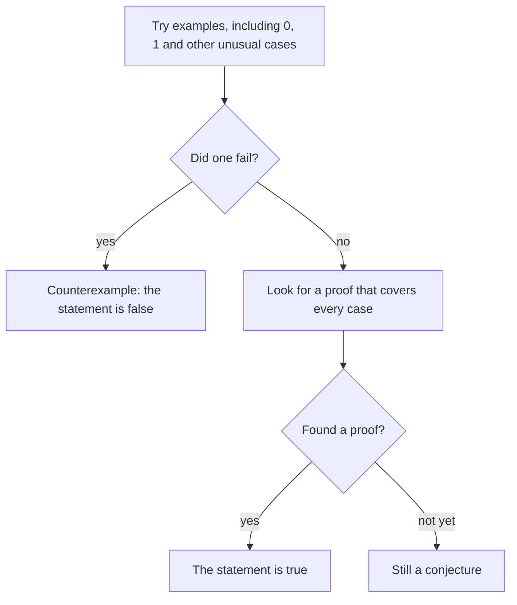

## From "it seems to work" to "it must work"

The factors lesson listed some handy facts: odd + odd = even, even + odd = odd, and a product is odd only if every factor is odd. You can check them on examples: $3 + 5 = 8$, $7 + 11 = 18$. But a few examples, or even a million, do not show that a fact holds for *every* whole number. This lesson shows how mathematicians make sure, using the simplest property a number has: whether it is even or odd. Along the way you will meet a trick for proving that something is impossible, and use the remainders from the previous lesson.

## Why examples are not enough

Try the expression $n^2 + n + 41$ for $n = 0, 1, 2, \ldots$:

| $n$ | 0 | 1 | 2 | 3 | 4 | 5 |
|---|---|---|---|---|---|---|
| $n^2 + n + 41$ | 41 | 43 | 47 | 53 | 61 | 71 |

All primes. In fact it gives a prime for every $n$ from 0 to 39, forty in a row, and Leonhard Euler wrote about this remarkable expression in the 1700s. It is tempting to guess that it always gives a prime. But at $n = 40$:

$$40^2 + 40 + 41 = 1{,}600 + 40 + 41 = 1{,}681 = 41 \times 41.$$

That is composite. Forty successes did not prove anything; one failure settled the question.

Some vocabulary:

- A **conjecture** is a statement that looks true but has not been proved.
- A **proof** is an argument that shows a statement is true in *every* case it covers, using definitions and facts already known.
- A **counterexample** is a single case where a statement fails. One counterexample is enough to show a general statement is false.

A famous open conjecture: *every even number greater than 2 is the sum of two primes* ($8 = 3 + 5$, $20 = 7 + 13$, $100 = 3 + 97$). Christian Goldbach proposed it in a letter to Euler in 1742, computers have checked it for every even number up to about $4 \times 10^{18}$, and still nobody has proved it. Until someone does, it is called **Goldbach's conjecture**, not Goldbach's theorem.

## Even and odd, written with letters

Whether a number is even or odd is called its **parity**. Two numbers have the same parity if both are even or both are odd.

To prove facts about *all* even or odd numbers, describe them with a letter:

- An even number is 2 times some whole number: $2k$. (0 = 2 × 0 is even.)
- An odd number is 1 more than an even number: $2k + 1$.

Now we can prove the fact from the factors lesson.

**Claim: odd + odd = even.** Take any two odd numbers. Write them as $2j + 1$ and $2k + 1$, using *different* letters because they may be different numbers. Their sum is

$$(2j + 1) + (2k + 1) = 2j + 2k + 2 = 2(j + k + 1).$$

That is 2 times a whole number, so it is even. Because $j$ and $k$ stand for *any* whole numbers, this covers every pair of odd numbers at once.

**Claim: odd × odd = odd.** Using the distributive property,

$$(2j + 1)(2k + 1) = 4jk + 2j + 2k + 1 = 2(2jk + j + k) + 1,$$

which is 1 more than an even number, so it is odd.

### Example 1

Prove that the sum of any three consecutive whole numbers is a multiple of 3.

Call the middle number $n$. Then the three numbers are $n - 1$, $n$ and $n + 1$ (with $n$ at least 1), and their sum is

$$(n - 1) + n + (n + 1) = 3n.$$

That is 3 times a whole number, a multiple of 3. (Check one: $14 + 15 + 16 = 45 = 3 \times 15$. The sum is always 3 times the middle number.)

Calling the middle number $n$ was a choice that made the algebra neat; starting from $n$, $n + 1$, $n + 2$ also works and gives $3n + 3 = 3(n + 1)$.

### Example 2

Prove that every perfect square leaves remainder 0 or 1 when divided by 4. Then show that 4,000,003 is not the sum of two perfect squares.

Every whole number is even or odd.

- Even: $(2k)^2 = 4k^2$, a multiple of 4, so the remainder is 0.
- Odd: $(2k + 1)^2 = 4k^2 + 4k + 1 = 4(k^2 + k) + 1$, so the remainder is 1.

Using the sum rule from the previous lesson, a sum of two squares has remainder $0 + 0$, $0 + 1$ or $1 + 1$: that is, 0, 1 or 2. Never 3. Now $4{,}000{,}003 = 1{,}000{,}000 \times 4 + 3$ leaves remainder 3. So it cannot be a sum of two squares, and we know this without trying a single pair.

Splitting into cases (even or odd) is a standard move: if a statement is true in every case, and the cases cover everything, it is true.

## Invariants: proving something is impossible

Some puzzles ask whether something can *ever* happen. Trying moves at random cannot answer "never". The tool is an **invariant**: a quantity that stays the same no matter which moves are made. If the invariant at the start differs from the invariant the goal would need, the goal is impossible.

### Example 3

Write the numbers 1 to 10 in a row. Put a + or a − sign in front of each one and add them up, for example $+1 - 2 + 3 + 4 - 5 + \cdots$. Can the total ever be 0?

Start with all plus signs: $1 + 2 + \cdots + 10 = 55$, which is odd. Now change the sign in front of some number $a$ from + to −. The total goes down by $2a$ (it loses $a$ and then subtracts $a$ more). Since $2a$ is even, the parity of the total does not change. Every possible choice of signs can be reached by such changes, one at a time, so every possible total is odd. The parity of the total is the invariant.

Zero is even, so the total can **never** be 0, whichever signs you choose.

### Example 4

A chessboard has two opposite corner squares cut off, leaving 62 squares. A domino covers exactly two squares that share a side. Can 31 dominoes cover the 62 squares with no overlaps?

Color matters here. Neighboring squares always have different colors, so *every* domino covers one light and one dark square, wherever it goes. Thirty-one dominoes would therefore cover 31 light and 31 dark squares.

But opposite corners have the same color. Removing two dark corners leaves 32 light squares and only 30 dark ones. The counts can never match, so the covering is **impossible**.

The invariant is "the dominoes placed so far cover equal numbers of light and dark squares". No amount of clever arranging can change it.

## Common mistakes

- *Proving with examples.* Checking $3 + 5$ and $7 + 9$ does not prove odd + odd = even; a letter argument covering every case does.
- *Using one letter for two different numbers.* Writing two odd numbers as $2k + 1$ and $2k + 1$ only covers the case where they are equal. Use $2j + 1$ and $2k + 1$.
- *Thinking a counterexample has to be common.* One failure, even at $n = 40$, is enough to make a general statement false.
- *Forgetting 0.* Zero is even ($0 = 2 \times 0$). Check unusual cases like 0 and 1 when testing a claim.
- *Calling a conjecture a fact.* Goldbach's conjecture has been checked enormously far but is not proved.
- *Trying to show impossibility by trial.* "I tried for an hour and it didn't work" is not a proof; an invariant is.

## Key points

- Parity means even or odd. Even numbers are $2k$; odd numbers are $2k + 1$.
- A proof covers every case; a counterexample is one case that breaks a general claim.
- A conjecture is unproved, however many examples support it.
- Splitting into cases (even or odd, each possible remainder) is a standard proof method.
- Every perfect square leaves remainder 0 or 1 when divided by 4.
- An invariant is a quantity that no allowed move changes; it proves that some goals are impossible.
