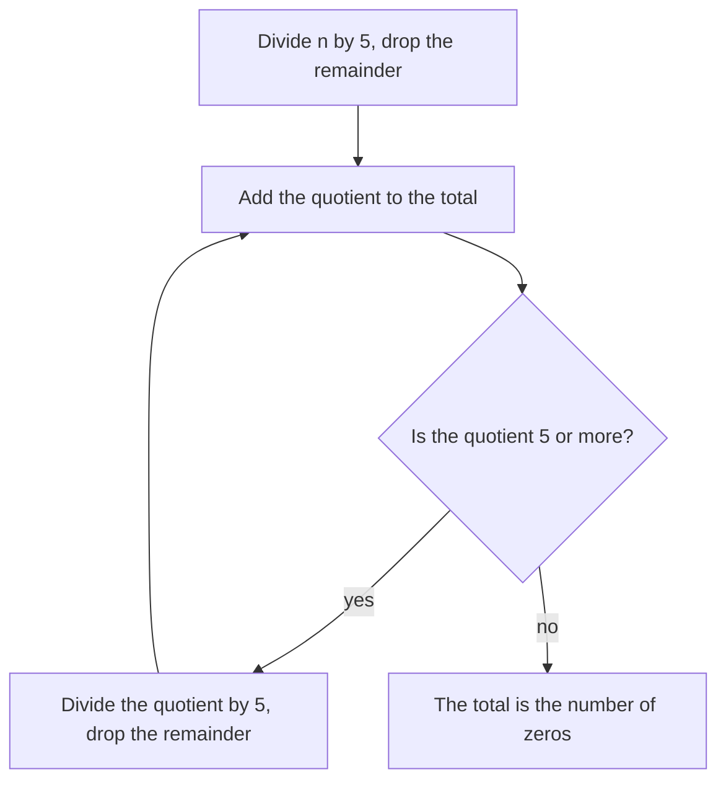

## Counting without listing

The factors lesson listed multiples: the multiples of 12 are 12, 24, 36, … forever. This lesson asks *how many* there are in a given range, and answers without writing them out. How many whole numbers from 1 to 1,000 are divisible by 4 or by 6? How many from 1 to 100 share no factor with 30? How many zeros are at the end of $1 \times 2 \times 3 \times \cdots \times 100$? Each question has a short answer that comes from division, the LCM from the GCF and LCM lesson, and one careful counting rule.

## How many multiples up to a number

The multiples of 7 up to 100 are $7 \times 1, 7 \times 2, \ldots$ and stop at $7 \times 14 = 98$, since $7 \times 15 = 105$ is too big. So there are 14 of them, and 14 is exactly the quotient of $100 \div 7 = 14$ R 2. In general:

**The number of multiples of $k$ from 1 to $N$ is the quotient of $N \div k$, ignoring the remainder.**

For a range that does not start at 1, count up to the top and subtract the ones below the bottom.

### Example 1

How many multiples of 6 are there from 100 to 300, including both ends?

- Multiples of 6 from 1 to 300: $300 \div 6 = 50$.
- Multiples of 6 from 1 to 99 (the ones we must leave out): $99 \div 6 = 16$ R 3, so 16.
- Answer: $50 - 16 = 34$.

Notice we subtracted the count up to **99**, not up to 100. Here it makes no difference, but if the range had been 102 to 300, subtracting the count up to 102 would wrongly remove 102 itself, which belongs in the range. Subtracting the count up to "one less than the bottom" is always safe. Check: the multiples run from $6 \times 17 = 102$ to $6 \times 50 = 300$, and $50 - 17 + 1 = 34$. ✓

## "Or": the inclusion–exclusion principle

How many numbers from 1 to 30 are divisible by 2 or by 3? There are 15 multiples of 2 and 10 multiples of 3, but the answer is not 25. The multiples of 6 (6, 12, 18, 24, 30) are multiples of *both*, and they were counted twice. Take them away once:

$$15 + 10 - 5 = 20.$$

A **Venn diagram** shows why: two overlapping circles, one for each property, with the numbers that have both in the overlap.

Counting region by region: 10 in the left part only, 5 in the overlap, 5 in the right part only, for 20 in all, and 10 outside both. This is the **inclusion–exclusion principle**:

$$\text{(number with A or B)} = \text{(number with A)} + \text{(number with B)} - \text{(number with both)}.$$

"Or" here means *at least one*, so numbers with both properties are included once.

The key fact for multiples: **a number is a multiple of both $a$ and $b$ exactly when it is a multiple of LCM($a$, $b$).** That is what "least common multiple" means, and every common multiple is a multiple of the LCM. When $a$ and $b$ share no factor, the LCM is the product $a \times b$; when they do, it is smaller, and using the product is a classic mistake.

### Example 2

How many whole numbers from 1 to 1,000 are divisible by 4 or by 6? How many are divisible by neither?

- Multiples of 4: $1{,}000 \div 4 = 250$.
- Multiples of 6: $1{,}000 \div 6 = 166$ R 4, so 166.
- Multiples of both: LCM(4, 6) = 12, not 24. $1{,}000 \div 12 = 83$ R 4, so 83.
- Divisible by 4 or 6: $250 + 166 - 83 = 333$.
- Divisible by neither: $1{,}000 - 333 = 667$.

(Using 24 would subtract only 41 and give 375, which counts 12, 36, 60, … twice.)

### Three properties

With three properties, add the three single counts, subtract the three "both" counts, then **add back** the count with all three. Why add back? A number with all three properties is counted 3 times in the first step and subtracted 3 times in the second, so it would end up not counted at all.

### Example 3

How many whole numbers from 1 to 100 are divisible by none of 2, 3 and 5? (These are exactly the numbers that share no factor except 1 with 30.)

| Count | Calculation | Result |
|---|---|---|
| Multiples of 2, of 3, of 5 | $50 + 33 + 20$ | 103 |
| Multiples of 6, of 10, of 15 (pairs) | $16 + 10 + 6$ | 32 |
| Multiples of 30 (all three) | $100 \div 30 = 3$ R 10 | 3 |

Divisible by at least one: $103 - 32 + 3 = 74$. Divisible by none: $100 - 74 = 26$.

You can check this by thinking in blocks of 30: in each block of 30 numbers, exactly 8 avoid 2, 3 and 5 (in 1 to 30 they are 1, 7, 11, 13, 17, 19, 23, 29). Three blocks give 24 up to 90, and 91 and 97 are the two more up to 100: 26. ✓

## Factorials and their zeros

The product of the whole numbers from 1 to $n$ is called **n factorial**, written $n!$:

$$5! = 1 \times 2 \times 3 \times 4 \times 5 = 120, \qquad 10! = 3{,}628{,}800.$$

Factorials grow very fast: $100!$ has 158 digits. Yet we can say exactly how many zeros it ends with.

Each zero at the end comes from a factor of 10, and $10 = 2 \times 5$. So we need to know how many 2s and how many 5s are in the prime factorization of $n!$. There are far more 2s than 5s (every second number gives a 2; only every fifth gives a 5), so **the number of zeros at the end of $n!$ equals the number of 5s in its prime factorization.**

To count the 5s, use the counting rule from the start of this lesson:

- Every multiple of 5 up to $n$ gives at least one 5.
- Every multiple of 25 ($= 5^2$) gives a second one.
- Every multiple of 125 ($= 5^3$) gives a third, and so on.

Add up: (multiples of 5) + (multiples of 25) + (multiples of 125) + ⋯. This way of counting the prime factors of a factorial is called **Legendre's formula**, after the French mathematician Adrien-Marie Legendre. A handy shortcut: divide $n$ by 5, then divide the *quotient* by 5 again, and so on, dropping remainders each time, and add all the quotients.

### Example 4

How many zeros are at the end of $100!$?

- Multiples of 5 up to 100: $100 \div 5 = 20$.
- Multiples of 25: $100 \div 25 = 4$ (these are 25, 50, 75, 100, each with a second 5).
- Multiples of 125: none.

Total: $20 + 4 = 24$ zeros. With the shortcut: $100 \div 5 = 20$, then $20 \div 5 = 4$, then $4 \div 5 = 0$; $20 + 4 = 24$.

### Example 5

How many zeros are at the end of $1{,}000!$?

$1{,}000 \div 5 = 200$, $200 \div 5 = 40$, $40 \div 5 = 8$, $8 \div 5 = 1$ R 3. Total: $200 + 40 + 8 + 1 = 249$.

The same method counts any prime. For example, the number of 2s in $20!$ is $10 + 5 + 2 + 1 = 18$, so $2^{18}$ divides $20!$ but $2^{19}$ does not.

## Common mistakes

- *Subtracting the wrong lower count.* For "from $A$ to $B$", subtract the count up to $A - 1$, not up to $A$.
- *Adding without subtracting the overlap.* "Divisible by 2 or 3" up to 30 is 20, not $15 + 10 = 25$.
- *Using the product instead of the LCM.* Numbers divisible by both 4 and 6 are the multiples of 12, not of 24.
- *Forgetting to add back the triple overlap* with three properties.
- *Counting only multiples of 5 for factorial zeros.* $100!$ has 24 zeros, not 20: each multiple of 25 brings a second 5.
- *Counting multiples of 10 instead of 5s.* Only 10 and 20 are multiples of 10 up to 25, yet $25!$ ends in 6 zeros ($5 + 1$): the 5s inside 5, 15 and 25 also pair with spare 2s to make 10s.

## Key points

- The number of multiples of $k$ from 1 to $N$ is the quotient of $N \div k$; for $A$ to $B$, subtract the count up to $A - 1$.
- Inclusion–exclusion: count with A or B $=$ count with A $+$ count with B $-$ count with both.
- Multiples of both $a$ and $b$ are the multiples of LCM($a$, $b$).
- For three properties: add singles, subtract pairs, add back the triple.
- $n! = 1 \times 2 \times \cdots \times n$; its number of end zeros equals its number of factors of 5: $\frac{n}{5} + \frac{n}{25} + \frac{n}{125} + \cdots$, dropping remainders.
