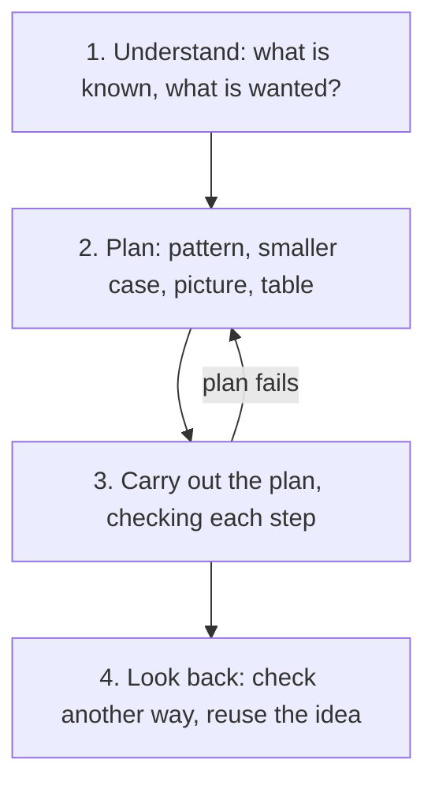

## A toolkit for problems you haven't seen

Most problems in this course came with a method: to add fractions, find a common denominator; to find a percent change, divide the change by the original. A real problem often arrives without a label saying which method to use. This last lesson of the honors module collects some general strategies that work across the whole course, and uses them on a family of problems about sums and patterns. The earlier lessons in this module used them already: Example 3 of the counting lesson checked an answer a second way, and the parity lesson tried small cases before looking for a proof.

## Pólya's four steps

The mathematician George Pólya described problem solving in four phases in his book *How to Solve It* (1945). They are still the standard advice.

Some plans that work again and again:

| Strategy | When it helps |
|---|---|
| Look for a pattern | the problem involves a list or sequence of numbers |
| Try a smaller case | the numbers are too big to work with directly |
| Draw a picture | there is a shape, an arrangement or a set of overlapping groups |
| Make a table or organized list | you need to count cases without missing any |
| Work backward | you know the end result and want the start |
| Solve it two ways | always, in step 4, to check |

## Adding 1 + 2 + 3 + ⋯ + 100

A popular story, told in many versions and probably improved with each retelling, says that the young Carl Friedrich Gauss was given a long addition like this one as busywork in school and answered almost at once. Whatever really happened, his trick is worth knowing.

Write the sum forward and backward, and add the two rows:

$$\begin{aligned} S &= 1 + 2 + 3 + \cdots + 99 + 100 \\ S &= 100 + 99 + 98 + \cdots + 2 + 1 \\ 2S &= 101 + 101 + 101 + \cdots + 101 + 101 \end{aligned}$$

There are 100 columns, each adding to 101, so $2S = 100 \times 101 = 10{,}100$ and $S = 5{,}050$.

The picture explains it: a staircase of blocks with 1, 2, 3, … in its columns, plus an upside-down copy, fills a rectangle.

The sums $1, 3, 6, 10, 15, \ldots$ are called **triangular numbers**, because that many dots can be arranged in a triangle. The $n$th triangular number is

$$1 + 2 + \cdots + n = \frac{n(n + 1)}{2}.$$

## Arithmetic sequences

Gauss's trick works for any list that goes up (or down) by the same amount each time, such as 7, 11, 15, 19, … This is an **arithmetic sequence**, and the fixed step (here 4) is its **common difference**. Pairing the first term with the last, the second with the second-to-last, and so on, every pair has the same sum, so

$$\text{sum} = \text{number of terms} \times \frac{\text{first} + \text{last}}{2}.$$

The hard part is usually counting the terms. From 15 to 83 there are not $83 - 15 = 68$ whole numbers but 69: subtracting counts the *gaps* between them, and there is always one more number than gaps (like fence posts and the spaces between them). In general,

$$\text{number of terms} = \frac{\text{last} - \text{first}}{\text{common difference}} + 1.$$

### Example 1

Find $7 + 11 + 15 + \cdots + 199$.

1. *Understand.* Each term is 4 more than the one before; the first is 7, the last is 199.
2. *Plan.* Count the terms, then use the pairing formula.
3. *Carry out.* Number of terms: $\dfrac{199 - 7}{4} + 1 = \dfrac{192}{4} + 1 = 48 + 1 = 49$. Sum: $49 \times \dfrac{7 + 199}{2} = 49 \times 103 = 5{,}047$.
4. *Look back.* Is 199 really a term? $7 + 48 \times 4 = 199$. ✓ Is the size reasonable? 49 terms averaging about 100 should give about 4,900. ✓

## Odd numbers make squares

Add the odd numbers in order and look at the totals: $1 = 1$, $1 + 3 = 4$, $1 + 3 + 5 = 9$, $1 + 3 + 5 + 7 = 16$. The totals are the perfect squares. A pattern like this is only a conjecture until we see *why*, and a picture does it: each new odd number is an L-shaped layer that turns an $n$-by-$n$ square into an $(n + 1)$-by-$(n + 1)$ square. The layer has $n$ squares along the top, $n$ down the side, and 1 in the corner: $2n + 1$, the next odd number.

So the sum of the first $n$ odd numbers is $n^2$. For example, the first 100 odd numbers run from 1 to 199 (the $n$th odd number is $2n - 1$), and their sum is $100^2 = 10{,}000$. The arithmetic-sequence formula agrees: $100 \times \dfrac{1 + 199}{2} = 10{,}000$.

## Try a smaller case

When a problem is too big to picture, shrink it, solve the small versions, and look for the pattern.

### Example 2

Ten people at a meeting each shake hands once with every other person. How many handshakes are there?

*Smaller cases.* With 2 people: 1 handshake. With 3: 3. With 4: 6. Each new person shakes hands with everyone already there, so adding the 4th person adds 3 handshakes, the 5th adds 4, and so on. With 10 people the total is

$$0 + 1 + 2 + \cdots + 9 = \frac{9 \times 10}{2} = 45.$$

*Look back with a second method.* Each of the 10 people shakes 9 hands, which gives $10 \times 9 = 90$ "hand-counts". But each handshake involves two people and was counted twice, so there are $90 \div 2 = 45$ handshakes. Two methods agree, which makes the answer much more trustworthy. For $n$ people the count is $\dfrac{n(n - 1)}{2}$, a triangular number.

### Example 3

How many squares of all sizes can you find on an 8-by-8 chessboard (counting 1-by-1, 2-by-2, …, up to the whole board)?

*Smaller cases.* A 2-by-2 board has four 1-by-1 squares and one 2-by-2: 5. A 3-by-3 board has nine 1-by-1, four 2-by-2 (the top-left corner of a 2-by-2 square can sit in 2 × 2 places) and one 3-by-3: $9 + 4 + 1 = 14$.

*Pattern.* On an $n$-by-$n$ board, a $k$-by-$k$ square's top-left corner can be in $(n - k + 1)$ columns and $(n - k + 1)$ rows. So the counts are perfect squares, from $n^2$ down to 1.

*Carry out.* For the 8-by-8 board:

$$64 + 49 + 36 + 25 + 16 + 9 + 4 + 1 = 204.$$

*Look back.* The 2-by-2 and 3-by-3 answers (5 and 14) fit the same formula, and the biggest square, the board itself, is counted once. ✓

## Common mistakes

- *Off-by-one (fence-post) errors.* From 15 to 83 there are $83 - 15 + 1 = 69$ numbers, not 68.
- *Halving at the wrong time.* $1 + 2 + \cdots + 100$ is $\frac{100 \times 101}{2}$, not $100 \times 101$ and not $\frac{100 \times 100}{2}$.
- *Trusting a pattern without a reason.* A pattern from small cases is a conjecture; a picture or algebra makes it a proof (recall $n^2 + n + 41$ from the parity lesson).
- *Double counting.* Counting each handshake from both people's side gives twice the answer; divide by 2.
- *Skipping step 4.* Plug the answer back in, estimate its size, or solve a second way.

## Key points

- Pólya's four steps: understand, plan, carry out, look back.
- Useful plans: find a pattern, try smaller cases, draw a picture, make an organized list, work backward.
- $1 + 2 + \cdots + n = \dfrac{n(n + 1)}{2}$, the $n$th triangular number.
- In an arithmetic sequence, number of terms $= \dfrac{\text{last} - \text{first}}{\text{difference}} + 1$, and sum $=$ number of terms $\times$ average of first and last.
- The sum of the first $n$ odd numbers is $n^2$.
- $n$ people shaking hands pairwise make $\dfrac{n(n - 1)}{2}$ handshakes.
