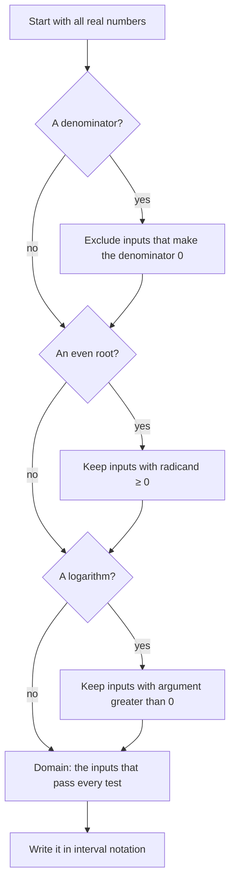

## Why start with functions again?

You met functions in Algebra 1 and Algebra 2. Precalculus returns to them because almost everything later in the course, and all of calculus, is a statement about functions: how fast they change, where they are undefined, what happens to them far out on the axis. This lesson tightens the vocabulary so the rest of the course can move quickly. By the end you should be able to evaluate any function written in notation, decide whether a relation is a function, and find the domain and range of a formula or a graph.

## What a function is

A **relation** is any set of ordered pairs $(x, y)$. A **function** is a relation in which every input $x$ has exactly one output $y$. The set of allowed inputs is the **domain**; the set of outputs that actually occur is the **range**.

The "exactly one output" rule is the whole point. If you feed a function the number 3, you should never have to ask "which answer did you mean?" Squaring is a function (3 always gives 9), but "a number whose square is $x$" is not, because 9 is the square of both 3 and $-3$.

On a graph, the rule becomes the **vertical line test**: a graph is the graph of a function exactly when no vertical line crosses it more than once. A vertical line $x = a$ collects every point with input $a$, so two crossings would mean two outputs for one input.

A **mapping diagram** shows the same rule with arrows. Each input in the domain sends exactly one arrow to the range. Two arrows may land on the same output, but no input may send out two arrows.


```plot
{"x": [-4, 6], "y": [-4, 4], "equal": true, "curves": [{"x": "t^2", "y": "t", "t": [-2, 2], "label": "x = y²"}], "segments": [{"from": [1, -4], "to": [1, 4], "dashed": true}], "points": [{"at": [1, 1]}, {"at": [1, -1]}], "caption": "x = y² fails the vertical line test: the line x = 1 meets it at (1, 1) and (1, −1)."}
```

## Function notation

Writing $f(x) = x^2 - 3x$ names the function $f$ and tells you what it does to an input. The parentheses do *not* mean multiplication. $f(4)$ means "the output of $f$ when the input is 4": replace every $x$ with 4.

$$f(4) = 4^2 - 3(4) = 16 - 12 = 4.$$

The input can be an expression, and this is where most errors happen. To find $f(a + 1)$, replace every $x$ with the whole quantity $(a + 1)$, parentheses included:

$$f(a+1) = (a+1)^2 - 3(a+1) = a^2 + 2a + 1 - 3a - 3 = a^2 - a - 2.$$

Notice that $f(a+1)$ is not $f(a) + 1$ and not $f(a) + f(1)$. Functions rarely distribute over addition.

### Example 1

Let $g(x) = 2x^2 - x + 5$. Find $g(-3)$ and $g(2h)$.

- $g(-3) = 2(-3)^2 - (-3) + 5 = 2(9) + 3 + 5 = 26$. Keep the parentheses around $-3$: without them, $-3^2$ would be read as $-9$.
- $g(2h) = 2(2h)^2 - 2h + 5 = 2(4h^2) - 2h + 5 = 8h^2 - 2h + 5$. The square applies to the whole input $2h$, giving $4h^2$, not $2h^2$.

## Finding the domain of a formula

When a function is given by a formula with no stated domain, its **implied domain** is every real number for which the formula produces a real output. In precalculus, three things restrict a domain:

| Feature | Restriction | Reason |
|---|---|---|
| A fraction | denominator $\ne 0$ | division by zero is undefined |
| An even root, $\sqrt{\;}$, $\sqrt[4]{\;}$, … | radicand $\ge 0$ | no real square root of a negative |
| A logarithm, $\log(\;)$ | argument $> 0$ | covered in Module 4 |

Odd roots like $\sqrt[3]{x}$ have no restriction: every real number has a real cube root.

The checks can be run in order, as a routine:



We write domains in **interval notation**. A square bracket includes an endpoint, a parenthesis excludes it, and $\infty$ always gets a parenthesis because it is not a number you can reach. The symbol $\cup$ (union) joins pieces.

| Inequality | Interval |
|---|---|
| $x \ge 2$ | $[2, \infty)$ |
| $-1 < x \le 4$ | $(-1, 4]$ |
| $x \ne 3$ | $(-\infty, 3) \cup (3, \infty)$ |

### Example 2

Find the domain of $h(x) = \dfrac{\sqrt{x + 4}}{x^2 - 9}$.

1. The square root needs $x + 4 \ge 0$, so $x \ge -4$.
2. The denominator needs $x^2 - 9 \ne 0$. Factor: $(x - 3)(x + 3) \ne 0$, so $x \ne 3$ and $x \ne -3$.
3. Combine: start from $[-4, \infty)$ and remove $-3$ and $3$, both of which lie in that interval.

$$\text{Domain: } [-4, -3) \cup (-3, 3) \cup (3, \infty).$$

Notice that $x = -4$ is included: the root of 0 is fine and the denominator there is $16 - 9 = 7 \ne 0$.

```numberline
{"x": [-6, 6], "points": [{"at": [-4, 0]}, {"at": [-3, 0], "open": true}, {"at": [3, 0], "open": true}], "segments": [{"from": [-4, 0], "to": [-3, 0]}, {"from": [-3, 0], "to": [3, 0]}, {"from": [3, 0], "to": [6, 0], "arrow": true}], "caption": "Domain of h: [−4, −3) ∪ (−3, 3) ∪ (3, ∞). Closed dot at −4, open dots at −3 and 3."}
```

### Example 3

Find the domain of $k(x) = \sqrt{6 - 2x} + \dfrac{1}{x}$.

The root needs $6 - 2x \ge 0$, so $-2x \ge -6$. Dividing by $-2$ flips the inequality: $x \le 3$. The fraction needs $x \ne 0$. Domain: $(-\infty, 0) \cup (0, 3]$.

## Finding the range

The range is usually harder than the domain, because it asks which outputs are possible. Three reliable methods:

1. *Read it from the graph.* Project the graph sideways onto the $y$-axis; the shadow is the range.
2. *Use what you know about the building blocks.* A square is never negative, a square root is never negative, and $|x| \ge 0$. Then track how the formula moves those values.
3. *Solve for $x$.* Set $y = f(x)$ and ask for which $y$ the equation has a solution $x$ in the domain.

For $f(x) = 3 - (x - 1)^2$: since $(x - 1)^2 \ge 0$, subtracting it from 3 gives at most 3, and every value $\le 3$ is reached. Range: $(-\infty, 3]$.

```plot
{"x": [-3, 5], "y": [-6, 5], "functions": [{"f": "3 - (x - 1)^2", "label": "y = 3 − (x − 1)²"}], "segments": [{"from": [-3, 3], "to": [5, 3], "dashed": true}], "points": [{"at": [1, 3], "label": "(1, 3)"}], "caption": "The graph never rises above y = 3, so the range is (−∞, 3]."}
```

### Example 4

Find the range of $r(x) = \dfrac{2x + 1}{x - 3}$.

Set $y = \dfrac{2x+1}{x-3}$ and solve for $x$: $y(x - 3) = 2x + 1$, so $yx - 3y = 2x + 1$, so $yx - 2x = 3y + 1$, so $x(y - 2) = 3y + 1$ and

$$x = \frac{3y + 1}{y - 2}.$$

This gives an $x$ for every $y$ except $y = 2$. (Check: that $x$ is never 3, because $x = 3$ would need $3y + 1 = 3y - 6$, which is impossible.) So the range is $(-\infty, 2) \cup (2, \infty)$. In Module 3 you will recognize $y = 2$ as a horizontal asymptote.

## Functions in context

In a word problem, the domain is often limited by meaning rather than algebra. If $A(w) = w(50 - w)$ is the area of a rectangle with width $w$ and perimeter 100, then the width must be positive and so must the length $50 - w$, so the practical domain is $0 < w < 50$, even though the formula works for any real $w$.

## Common mistakes

- *Dropping parentheses when substituting.* $f(-2)$ for $f(x) = x^2$ is $(-2)^2 = 4$, not $-2^2 = -4$.
- *Treating $f(a + h)$ as $f(a) + h$.* Substitute the whole input.
- *Excluding the endpoint of a square root.* $\sqrt{x - 5}$ is defined at $x = 5$; only a denominator zero is excluded.
- *Forgetting to flip the inequality* when dividing by a negative, as in Example 3.
- *Giving the domain when asked for the range.* The domain is about inputs ($x$), the range about outputs ($y$).

## Key points

- A function gives each input exactly one output; graphs pass the vertical line test.
- $f(\text{stuff})$ means: replace every $x$ with $(\text{stuff})$.
- Implied domain: exclude zeros of denominators, keep radicands of even roots $\ge 0$.
- Find a range from the graph, from known bounds on the pieces, or by solving $y = f(x)$ for $x$.
- Write answers in interval notation; brackets include, parentheses exclude.
