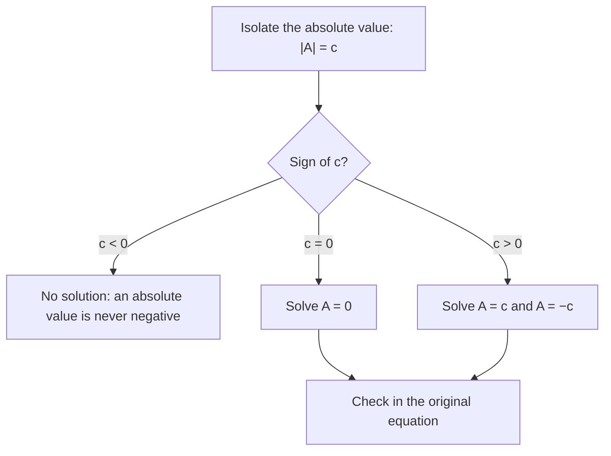

## Why piecewise functions matter

Many real rules change partway through. A phone plan charges a flat fee up to a data limit and then a per-gigabyte rate. A tax bracket applies one rate up to an income threshold and another above it. A **piecewise function** captures this by using different formulas on different parts of the domain. Piecewise functions also matter for calculus: they are the standard examples of graphs with jumps and corners, which is where limits and derivatives get interesting. This lesson builds on the last one, where you learned to evaluate functions and read domains.

## Notation and evaluation

A piecewise function lists each formula together with the condition that says when to use it:

$$f(x) = \begin{cases} x^2 & \text{if } x < 1 \\ 3 & \text{if } 1 \le x \le 4 \\ 7 - x & \text{if } x > 4 \end{cases}$$

The conditions must not overlap (otherwise some input would get two outputs, and $f$ would not be a function). To evaluate, first decide which condition the input satisfies, then use only that formula.

### Example 1

Using $f$ above, find $f(-2)$, $f(1)$, $f(4)$ and $f(6)$.

- $-2 < 1$, so use $x^2$: $f(-2) = (-2)^2 = 4$.
- $1$ satisfies $1 \le x \le 4$, so $f(1) = 3$. The first piece does not apply because its condition is strict: $1 < 1$ is false.
- $4$ satisfies $1 \le x \le 4$, so $f(4) = 3$.
- $6 > 4$, so $f(6) = 7 - 6 = 1$.

The endpoint inputs 1 and 4 are where people slip. Always read the inequality signs.

## Graphing piecewise functions

Graph each formula only over its own interval. At each boundary, use a **closed dot** if that endpoint belongs to the piece ($\le$ or $\ge$) and an **open dot** if it does not ($<$ or $>$).

```plot
{"x": [-3, 8], "y": [-2, 9], "functions": [{"f": "x^2", "to": 1}, {"f": "3", "from": 1, "to": 4}, {"f": "7 - x", "from": 4}], "points": [{"at": [1, 1], "open": true}, {"at": [1, 3]}, {"at": [4, 3]}], "caption": "The piecewise f: open dot at (1, 1), closed dots at (1, 3) and (4, 3). The last piece starts at (4, 3) too, so the graph is connected there."}
```

At $x = 1$ the graph jumps: the parabola heads toward height 1 but the function's value is 3. At $x = 4$ the middle piece ends at height 3 and the last piece $7 - x$ would start at $7 - 4 = 3$, so the pieces meet and there is no break. In Module 10 you will describe the first situation as a **jump discontinuity**.

Here is the same graph with its parts named.


## Absolute value as a piecewise function

The **absolute value** of a number is its distance from 0, which gives the piecewise definition

$$|x| = \begin{cases} x & \text{if } x \ge 0 \\ -x & \text{if } x < 0. \end{cases}$$

The second line is not saying absolute values are negative: if $x$ is negative, then $-x$ is positive. For example $|-5| = -(-5) = 5$.

Any absolute value expression can be rewritten piecewise by splitting where the inside is zero. For $|2x - 6|$, the inside is zero at $x = 3$:

$$|2x - 6| = \begin{cases} 2x - 6 & \text{if } x \ge 3 \\ 6 - 2x & \text{if } x < 3. \end{cases}$$

The same idea solves absolute value equations: $|A| = c$ with $c > 0$ means $A = c$ or $A = -c$.

The sign of $c$ decides which case you are in:



### Example 2

Solve $|3x - 4| = 11$.

The quantity inside is either $11$ or $-11$.

- $3x - 4 = 11 \Rightarrow 3x = 15 \Rightarrow x = 5$.
- $3x - 4 = -11 \Rightarrow 3x = -7 \Rightarrow x = -\tfrac{7}{3}$.

Check one: $|3(-\tfrac73) - 4| = |-7 - 4| = 11$. ✓ If the right side had been negative, there would be no solution, since an absolute value is never negative.

## Step functions

The **greatest integer function** (also called the **floor function**) $\lfloor x \rfloor$ gives the largest integer less than or equal to $x$. So $\lfloor 2.7 \rfloor = 2$, $\lfloor 5 \rfloor = 5$, and $\lfloor -1.3 \rfloor = -2$ (not $-1$, since $-1 > -1.3$). Its graph is a staircase of horizontal segments, each closed on the left and open on the right. Postage and parking rates ("\$3 per hour or part of an hour") are step functions.

```plot
{"x": [-3, 3.5], "y": [-4, 3], "segments": [{"from": [-3, -3], "to": [-2, -3]}, {"from": [-2, -2], "to": [-1, -2]}, {"from": [-1, -1], "to": [0, -1]}, {"from": [0, 0], "to": [1, 0]}, {"from": [1, 1], "to": [2, 1]}, {"from": [2, 2], "to": [3, 2]}], "points": [{"at": [-3, -3]}, {"at": [-2, -3], "open": true}, {"at": [-2, -2]}, {"at": [-1, -2], "open": true}, {"at": [-1, -1]}, {"at": [0, -1], "open": true}, {"at": [0, 0]}, {"at": [1, 0], "open": true}, {"at": [1, 1]}, {"at": [2, 1], "open": true}, {"at": [2, 2]}, {"at": [3, 2], "open": true}], "caption": "y = ⌊x⌋: each step is closed on the left and open on the right. For example ⌊−1.3⌋ = −2 is read from the step over [−2, −1)."}
```

## Reading information from a graph

A graph of $y = f(x)$ answers many questions without any formula:

| Question | Where to look |
|---|---|
| $f(a)$ | height of the graph above $x = a$ |
| solutions of $f(x) = c$ | $x$-values where the graph meets the line $y = c$ |
| **zeros** of $f$ | $x$-intercepts, where $f(x) = 0$ |
| where $f(x) > 0$ | $x$-values where the graph is above the $x$-axis |
| domain / range | horizontal / vertical shadow of the graph |

```plot
{"x": [-4, 5], "y": [-6, 7], "functions": [{"f": "(x+3)*(x-1)*(x-4)/4", "from": -3.5, "to": 4.6, "label": "y = g(x)"}], "points": [{"at": [-3, 0], "label": "(−3, 0)"}, {"at": [1, 0], "label": "(1, 0)"}, {"at": [4, 0], "label": "(4, 0)"}, {"at": [0, 3], "label": "(0, 3)"}], "caption": "Zeros of g at −3, 1 and 4; g > 0 on (−3, 1) and (4, ∞) in this view."}
```

### Example 3

From the graph of $g$ above: $g(0) = 3$; the zeros are $-3$, $1$ and $4$; $g(x) > 0$ for $-3 < x < 1$ and for $x > 4$; $g(x) < 0$ for $x < -3$ and for $1 < x < 4$. Notice that the answer to "where is $g$ positive?" is a set of $x$-values, not $y$-values.

## Common mistakes

- *Using the wrong piece at a boundary.* Read whether each condition is strict ($<$) or inclusive ($\le$).
- *Drawing a piece across the whole axis.* Each formula lives only on its own interval.
- *Thinking $|x| = -x$ makes a negative number.* For $x < 0$, $-x$ is positive.
- *Floor of a negative.* $\lfloor -2.5 \rfloor = -3$, because floor always rounds toward $-\infty$.
- *Answering "where" questions with heights.* "Where is $f$ increasing / positive?" asks for $x$-intervals.

## Key points

- A piecewise function uses different formulas on non-overlapping parts of the domain; evaluate by first choosing the piece.
- Closed dots include an endpoint, open dots exclude it.
- $|x|$ is piecewise: $x$ for $x \ge 0$, $-x$ for $x < 0$. $|A| = c > 0$ splits into $A = \pm c$.
- The floor function rounds down to the nearest integer and graphs as a staircase.
- Values, zeros, signs, domain and range can all be read directly from a graph.
