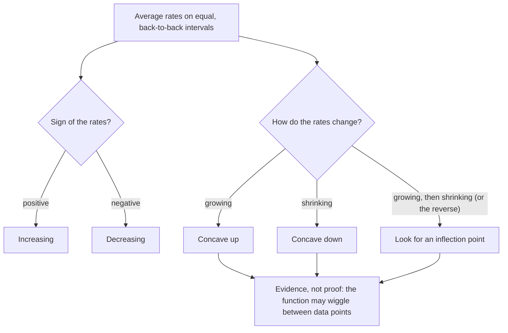

## Beyond "up or down"

Lesson 3 described a function by where it rises and falls and by its average rate of change on an interval. That is not the whole story. The curves $y = x^2$ and $y = \sqrt{x}$ both rise for $x > 0$, but one climbs faster and faster while the other climbs more and more slowly. The difference is in how the *rate itself* changes, and the word for it is **concavity**. This lesson measures concavity with nothing more than average rates of change, finds a shortcut for the rates of a quadratic, builds a better estimate of a rate at a single point, and locates the place where a cubic switches its bend. All of these ideas come back in calculus, where the rate of a rate is called the second derivative.

## Rates on successive intervals

Take $f(x) = x^2$ and compute its average rate of change on the intervals $[0, 1]$, $[1, 2]$, $[2, 3]$ and $[3, 4]$:

| Interval | $[0, 1]$ | $[1, 2]$ | $[2, 3]$ | $[3, 4]$ |
|---|---|---|---|---|
| Change in $f$ | $1 - 0$ | $4 - 1$ | $9 - 4$ | $16 - 9$ |
| Average rate | $1$ | $3$ | $5$ | $7$ |

Each rate is larger than the one before, so each secant line is steeper than the last. Joined end to end, the secant lines turn counterclockwise, and the graph bends upward like a cup. For $g(x) = \sqrt{x}$ on $[0, 1]$, $[1, 4]$, $[4, 9]$ the rates are $1$, $\tfrac13$, $\tfrac15$: still positive, so $g$ is increasing, but shrinking, so the graph bends the other way.

This only works if you compare intervals fairly. With a table of data, use **equally spaced** inputs (or at least intervals that follow one another), and remember that a few rates are evidence about the bend, not a proof: the function could wiggle between the data points.

## Concave up and concave down

A function is **concave up** on an interval if its graph bends upward there: every secant segment joining two points of the graph in that interval lies on or above the graph between those points. Equivalently, the slopes of secant lines increase as you move to the right. A function is **concave down** if the graph bends downward: secant segments lie on or below the graph, and secant slopes decrease from left to right. (These two descriptions really are equivalent, but proving it takes a careful argument with three secant lines; here we use whichever is convenient.)

```plot
{"x": [-1, 5], "y": [-1, 9], "functions": [{"f": "x^2/2", "from": -1, "to": 4.2, "label": "concave up"}], "segments": [{"from": [0, 0], "to": [3, 4.5]}], "points": [{"at": [0, 0]}, {"at": [3, 4.5]}], "caption": "Concave up: the secant segment from (0, 0) to (3, 4.5) lies above the curve y = x²/2 between its endpoints."}
```

Concavity and direction are separate questions, so a curve can combine them in four ways:

| Shape | Direction | Concavity | How the rate behaves | Example on $x > 0$ |
|---|---|---|---|---|
| rising, steeper and steeper | increasing | up | positive and growing | $y = x^2$ |
| rising, flatter and flatter | increasing | down | positive and shrinking | $y = \sqrt{x}$ |
| falling, flatter and flatter | decreasing | up | negative, moving toward 0 | $y = \tfrac1x$ |
| falling, steeper and steeper | decreasing | down | negative and moving away from 0 | $y = -x^2$ |

Notice that "the rate is growing" is about the rate's *value*, not its size: for $y = \tfrac1x$ the rates on $[1, 2]$ and $[2, 3]$ are $-\tfrac12$ and then $-\tfrac16$, which is an increase, so the curve is concave up even though it falls.

### Example 1: Reading the bend from data

A ball is thrown upward, and its height from Lesson 3, $h(t) = -4.9t^2 + 19.6t + 1.5$ meters, is recorded each second:

| $t$ (s) | 0 | 1 | 2 | 3 | 4 |
|---|---|---|---|---|---|
| $h$ (m) | 1.5 | 16.2 | 21.1 | 16.2 | 1.5 |

1. Average rates on the four one-second intervals: $\dfrac{16.2 - 1.5}{1} = 14.7$, then $4.9$, then $-4.9$, then $-14.7$ m/s.
2. The rates decrease, each by exactly $9.8$ m/s. Falling rates mean the graph is concave down.
3. Read the units: the rate drops by $9.8$ meters per second every second. This is the acceleration due to gravity, about $9.8 \text{ m/s}^2$ near Earth's surface, showing up as the "rate of the rate".

The ball rises (positive rates) while the rate shrinks, then falls (negative rates) faster and faster: concave down throughout, with the top between $t = 1$ and $t = 3$ (at $t = 2$, as Lesson 3 found).

## The rate of a quadratic depends only on the midpoint

For a quadratic $f(x) = ax^2 + bx + c$, the average rate of change on $[p, q]$ simplifies beautifully:

$$\frac{f(q) - f(p)}{q - p} = \frac{a(q^2 - p^2) + b(q - p)}{q - p} = \frac{a(q - p)(q + p) + b(q - p)}{q - p} = a(p + q) + b.$$

The constant $c$ cancels, and the width of the interval disappears. Writing $m = \dfrac{p + q}{2}$ for the midpoint, the rate is

$$a(p + q) + b = 2am + b.$$

Two consequences:

- **Any two intervals with the same midpoint give the same average rate.** On $y = x^2$, the intervals $[1, 3]$ and $[0, 4]$ both have midpoint 2 and both give rate 4.
- As the midpoint moves right, $2am + b$ grows if $a > 0$ and shrinks if $a < 0$. So every parabola that opens upward is concave up everywhere, and every one that opens downward is concave down everywhere. That matches Example 1: there $a = -4.9$, so each one-second step moves the midpoint by 1 and changes the rate by $2a = -9.8$.

### Example 2

Find the average rate of change of $f(x) = 3x^2 - 4x + 1$ on $[1, 5]$ without computing $f(5)$.

Using $a(p + q) + b$ with $a = 3$, $b = -4$, $p = 1$, $q = 5$: $3(1 + 5) - 4 = 18 - 4 = 14$.

Check the long way: $f(5) = 75 - 20 + 1 = 56$ and $f(1) = 0$, so the rate is $\dfrac{56 - 0}{4} = 14$. ✓

## A better estimate of the rate at a point

The difference quotient $\dfrac{f(x + h) - f(x)}{h}$ from Lesson 3 measures the rate on $[x, x + h]$, an interval that starts at $x$ and runs to the right. For a curve that is concave up, the secant slope over $[x, x + h]$ is larger than the rate "at" $x$, because the curve is getting steeper over that interval. Using an interval centered at $x$ balances the overestimate on the right against the underestimate on the left. That gives the **symmetric difference quotient**

$$\frac{f(x + h) - f(x - h)}{2h}, \qquad h \ne 0,$$

the slope of the secant line from $x - h$ to $x + h$. Its interval has midpoint exactly $x$, so for a quadratic the previous section says it equals $2ax + b$ *for every* $h$: no error at all. For other functions it is usually much more accurate than the one-sided quotient with the same $h$.

### Example 3

Estimate how fast $f(x) = x^3$ is changing at $x = 2$, using $h = 0.1$.

- One-sided (forward): $\dfrac{2.1^3 - 2^3}{0.1} = \dfrac{9.261 - 8}{0.1} = 12.61$.
- One-sided (backward): $\dfrac{2^3 - 1.9^3}{0.1} = \dfrac{8 - 6.859}{0.1} = 11.41$.
- Symmetric: $\dfrac{2.1^3 - 1.9^3}{0.2} = \dfrac{9.261 - 6.859}{0.2} = \dfrac{2.402}{0.2} = 12.01$.

Algebra shows why. Expanding, $\dfrac{(x + h)^3 - x^3}{h} = 3x^2 + 3xh + h^2$, while $\dfrac{(x + h)^3 - (x - h)^3}{2h} = 3x^2 + h^2$. As $h$ shrinks, both head toward $3x^2 = 12$, which Module 10 will identify as the instantaneous rate. The forward error, $3xh + h^2 = 0.61$, shrinks roughly in proportion to $h$; the symmetric error, $h^2 = 0.01$, shrinks like $h^2$, so halving $h$ cuts it to a quarter. Graphing calculators that report a "numerical derivative" typically use this symmetric formula for that reason.

## Inflection points

A point on a graph where the function is continuous and the concavity changes, from up to down or from down to up, is an **inflection point**. (Textbooks phrase the definition in slightly different ways; this is the common one.) Rates of change near an inflection point stop growing and start shrinking, or the reverse.

For $f(x) = x^3 - 3x^2$, the rates on $[-1, 0]$, $[0, 1]$, $[1, 2]$, $[2, 3]$ are $4$, $-2$, $-2$, $4$: they fall, level off, then rise. That suggests concave down on the left, concave up on the right, and a switch near $x = 1$. Coarse rates cannot pin the point down exactly, but for a cubic, algebra can.

```plot
{"x": [-1.5, 3.5], "y": [-6, 2], "functions": [{"f": "x^3 - 3*x^2", "label": "y = x³ − 3x²"}], "points": [{"at": [1, -2], "label": "inflection (1, −2)"}, {"at": [0, 0], "label": "local max (0, 0)"}, {"at": [2, -4], "label": "local min (2, −4)"}], "caption": "y = x³ − 3x² is concave down to the left of x = 1 and concave up to the right. The graph is symmetric about the inflection point (1, −2): a half-turn about that point maps the curve onto itself."}
```

### Example 4: The center of a cubic

Find the inflection point of $f(x) = x^3 - 6x^2 + 5x + 1$.

1. Shift the input so the $x^2$ term disappears. With $x = u + k$, the $u^2$ terms of $a(u + k)^3 + b(u + k)^2$ are $3aku^2 + bu^2$, which vanish when $k = -\dfrac{b}{3a}$. Here $k = -\dfrac{-6}{3} = 2$.
2. Substitute $x = u + 2$: $(u + 2)^3 - 6(u + 2)^2 + 5(u + 2) + 1 = u^3 - 7u - 5$. (Expand to check: the $u^2$ terms $6u^2 - 6u^2$ cancel.)
3. The part $g(u) = u^3 - 7u$ satisfies $g(-u) = -g(u)$, so its graph looks the same after a half-turn about the origin. (Lesson 4 calls this an odd function.) Its rate on $[s, t]$ is $s^2 + st + t^2 - 7$, which grows as an interval with $s, t \ge 0$ moves right, so $g$ is concave up for $u > 0$. The half-turn turns that cup upside down, so $g$ is concave down for $u < 0$.
4. So $f$ switches concavity at $u = 0$, that is at $x = 2$, where $f(2) = 8 - 24 + 10 + 1 = -5$.

The inflection point is $(2, -5)$, and it is the center of symmetry of the cubic. In general, a cubic $ax^3 + bx^2 + cx + d$ has exactly one inflection point, at $x = -\dfrac{b}{3a}$. Do not confuse this with the vertex formula $-\dfrac{b}{2a}$ for a quadratic.



## Rates in everyday language

News reports describe concavity all the time without the word. Translate each phrase into a direction and a bend:

- "Prices are still rising, but more slowly": increasing, concave down.
- "Sales are falling, and the decline is accelerating": decreasing, concave down.
- "The company is still losing customers, but the losses shrink each quarter": decreasing, concave up.
- "Growth is speeding up": increasing, concave up.

The common trap is to hear "slowing" and conclude "decreasing". A quantity whose growth is slowing is still growing.

## Common mistakes

- *Mixing up direction and concavity.* Increasing/decreasing is about the sign of the rates; concave up/down is about whether the rates grow or shrink.
- *Comparing rates over unequal, overlapping or out-of-order intervals.* Use back-to-back intervals moving left to right.
- *Reading a growing negative rate as "decreasing faster".* From $-4$ to $-1$ the rate increases, so the curve is concave up.
- *Dividing the symmetric difference quotient by $h$.* The interval from $x - h$ to $x + h$ has width $2h$.
- *Using $-\tfrac{b}{2a}$ for a cubic's inflection point.* It is $x = -\tfrac{b}{3a}$.
- *Treating a few data rates as a proof of concavity.* They are evidence about the bend between the data points, nothing more.

## Key points

- Concave up: secant slopes increase left to right, and the graph bends like a cup. Concave down: secant slopes decrease.
- Direction and concavity combine into four shapes; "rising more slowly" is increasing and concave down.
- For $f(x) = ax^2 + bx + c$, the average rate on $[p, q]$ is $a(p + q) + b$, which depends only on the midpoint. Parabolas are concave up everywhere if $a > 0$ and concave down everywhere if $a < 0$.
- The symmetric difference quotient $\dfrac{f(x + h) - f(x - h)}{2h}$ estimates the rate at $x$; it is exact for quadratics and its error shrinks like $h^2$ for cubics.
- An inflection point is where the concavity changes. A cubic $ax^3 + bx^2 + cx + d$ has one, at $x = -\tfrac{b}{3a}$, and is symmetric about it.
