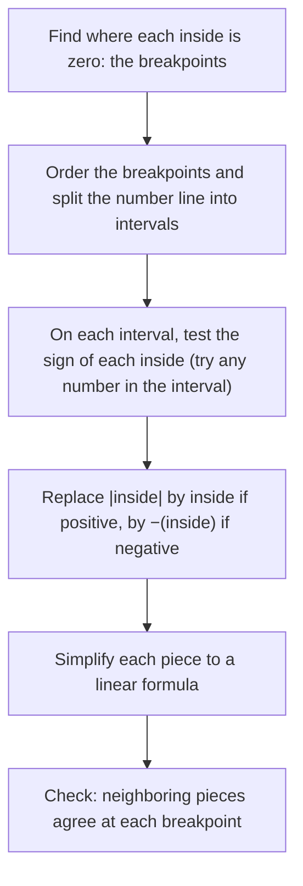

## Where the pieces come from

Lesson 2 handed you piecewise functions ready-made and showed how to evaluate and graph them. In practice the pieces are usually hidden. An expression with several absolute values is piecewise in disguise; a tax schedule is a list of rates that you must assemble into a formula; a rule like "one bus per 40 students" is a rounding function. This lesson builds those piecewise functions yourself and uses them to answer questions the formulas alone hide: where a total distance is smallest, why moving into a higher tax bracket does not lower take-home pay, and how to solve an equation involving the floor function.

## Sums of absolute values

Each absolute value $|x - a|$ changes formula at one input, $x = a$, where its inside is zero. A sum of several absolute values changes formula at each of those inputs. Call them the **breakpoints** of the expression. Between consecutive breakpoints, every inside has a fixed sign, so every absolute value can be replaced by its inside or by the negative of its inside, and the whole expression becomes an ordinary linear formula.



Take $f(x) = |x - 1| + |x + 2|$. The breakpoints are $x = 1$ and $x = -2$.

- For $x < -2$ (try $x = -3$): both insides are negative, so $f(x) = -(x - 1) - (x + 2) = -2x - 1$.
- For $-2 \le x < 1$ (try $x = 0$): $x - 1 < 0$ but $x + 2 \ge 0$, so $f(x) = -(x - 1) + (x + 2) = 3$.
- For $x \ge 1$: both insides are nonnegative, so $f(x) = (x - 1) + (x + 2) = 2x + 1$.

At $x = -2$ the first two pieces both give 3, and at $x = 1$ the last two both give 3: the graph is connected, as it must be, because absolute values never jump. The graph is a flat-bottomed valley.

```plot
{"x": [-5, 4], "y": [-1, 10], "functions": [{"f": "abs(x - 1) + abs(x + 2)", "label": "y = |x − 1| + |x + 2|"}], "points": [{"at": [-2, 3], "label": "(−2, 3)"}, {"at": [1, 3], "label": "(1, 3)"}], "caption": "Between the breakpoints −2 and 1 the graph is flat at height 3; outside them the slopes are −2 and 2."}
```

The flat bottom has a meaning. $|x - 1|$ is the distance from $x$ to 1 and $|x + 2|$ is the distance from $x$ to $-2$. Anywhere between $-2$ and 1, the two distances add up to the gap between those points, which is 3. Outside, you walk past one of the points and waste distance.

### Example 1

Write $g(x) = |2x - 4| - |x + 1|$ piecewise and solve $g(x) = 0$.

1. Breakpoints: $2x - 4 = 0$ at $x = 2$, and $x + 1 = 0$ at $x = -1$.
2. For $x < -1$: both insides negative. $g(x) = -(2x - 4) + (x + 1) = -x + 5$. (The minus sign in front of $|x + 1|$ stays: $-|x + 1| = -(-(x + 1)) = x + 1$.)
3. For $-1 \le x < 2$: $2x - 4 < 0$, $x + 1 \ge 0$. $g(x) = -(2x - 4) - (x + 1) = -3x + 3$.
4. For $x \ge 2$: both nonnegative. $g(x) = (2x - 4) - (x + 1) = x - 5$.
5. Check the joins: at $x = -1$, $-(-1) + 5 = 6$ and $-3(-1) + 3 = 6$ ✓; at $x = 2$, $-3(2) + 3 = -3$ and $2 - 5 = -3$ ✓.
6. Solve on each piece, keeping only solutions inside that piece's interval. $-x + 5 = 0$ gives $x = 5$, which is not less than $-1$: reject. $-3x + 3 = 0$ gives $x = 1$, inside $[-1, 2)$: keep. $x - 5 = 0$ gives $x = 5$, inside $[2, \infty)$: keep.

Solutions: $x = 1$ and $x = 5$. Check: $|2 - 4| - |2| = 0$ and $|6| - |6| = 0$. ✓ Step 6 is the one people skip; the rejected $x = 5$ from the first piece shows why it matters.

## Minimizing a total distance

Suppose stores sit at mile markers $a_1, a_2, \ldots, a_n$ along a straight highway, and a warehouse at mile $x$ ships to each. The total driving distance is

$$D(x) = |x - a_1| + |x - a_2| + \cdots + |x - a_n|.$$

Between breakpoints, each term contributes slope $+1$ if its store is to the left of $x$ (the distance grows as you move right) and $-1$ if its store is to the right. So the slope of $D$ at $x$ is

$$(\text{number of stores left of } x) - (\text{number of stores right of } x).$$

Moving right from far left, the slope starts at $-n$ and rises by 2 at each store. It is negative while more stores lie to the right and positive once more lie to the left. The lowest point is where that switch happens: at the **median** of the store positions, the middle value when they are listed in order. With an even number of stores, the slope is 0 on the whole interval between the two middle values, so every point there gives the same minimum.

### Example 2

Stores are at miles 2, 5 and 13. Where should the warehouse go to minimize total distance?

The median of 2, 5, 13 is 5. Total distance there: $3 + 0 + 8 = 11$ miles. Compare the mean, $\tfrac{2 + 5 + 13}{3} = \tfrac{20}{3} \approx 6.67$: there $D = 4.67 + 1.67 + 6.33 \approx 12.67$ miles, worse. The mean minimizes the sum of *squared* distances (the idea behind least-squares regression in Lesson 19); the median minimizes the sum of plain distances. Adding a fourth store at mile 9 would make every point from 5 to 9 optimal, with $D = 15$ there.

## Tiered rates

Many charges are applied in tiers: one rate on the first part of an amount, a higher rate on the next part, and so on. Income taxes in the United States and many other countries work this way. Each tier is a **tax bracket**, and the rate in the bracket containing your last dollar is your **marginal rate**. The total tax divided by the income is the **effective rate** (also called the average rate).

The schedule below is made up for teaching (real schedules have more brackets and come after deductions, credits and other adjustments):

| Taxable income | Rate on the income in this bracket |
|---|---|
| first \$20,000 | 10% |
| next \$30,000 (from \$20,000 to \$50,000) | 20% |
| above \$50,000 | 30% |

Build the total tax $T(x)$ one bracket at a time. A full first bracket costs $0.10(20{,}000) = 2{,}000$; a full second bracket adds $0.20(30{,}000) = 6{,}000$, for $8{,}000$ through \$50,000. So

$$T(x) = \begin{cases} 0.10x & 0 \le x \le 20{,}000 \\ 2{,}000 + 0.20(x - 20{,}000) & 20{,}000 < x \le 50{,}000 \\ 8{,}000 + 0.30(x - 50{,}000) & x > 50{,}000. \end{cases}$$

Each piece starts where the last one ended, so $T$ is continuous, and each slope is a bracket's rate: the marginal rate is the slope of $T$.

```plot
{"x": [0, 90000], "y": [0, 22000], "functions": [{"f": "0.1*x", "to": 20000}, {"f": "2000 + 0.2*(x - 20000)", "from": 20000, "to": 50000}, {"f": "8000 + 0.3*(x - 50000)", "from": 50000}], "points": [{"at": [20000, 2000], "label": "(20,000, 2,000)"}, {"at": [50000, 8000], "label": "(50,000, 8,000)"}], "xLabel": "taxable income (dollars)", "yLabel": "tax (dollars)", "caption": "The made-up tax schedule: three line pieces with slopes 0.10, 0.20 and 0.30, joined without jumps."}
```

### Example 3

Find the tax, the marginal rate and the effective rate on a taxable income of \$64,000, and decide whether a raise that crosses from \$49,000 to \$51,000 can lower after-tax income.

1. \$64,000 is in the top bracket: $T = 8{,}000 + 0.30(64{,}000 - 50{,}000) = 8{,}000 + 4{,}200 = 12{,}200$ dollars.
2. Marginal rate: 30%. Effective rate: $\tfrac{12{,}200}{64{,}000} \approx 0.191$, about 19.1%. Far less than 30%, because most of the income is taxed at 10% or 20%.
3. For the raise: $T(49{,}000) = 2{,}000 + 0.20(29{,}000) = 7{,}800$ and $T(51{,}000) = 8{,}000 + 0.30(1{,}000) = 8{,}300$. Tax rises by \$500 on a \$2,000 raise, so after-tax income rises by \$1,500.

The popular fear that "a raise into a higher bracket can cost you money" confuses marginal and effective rates: the 30% applies only to the dollars above \$50,000. As long as $T$ is continuous with every slope below 1, more income always means more income after tax. (Real systems can contain true jumps, such as a benefit that ends completely at an income limit. That kind of "cliff" is a jump discontinuity, and there extra income really can leave someone worse off.)

## Floor, ceiling and rounding

Lesson 2 introduced the floor function. Its partner is the **ceiling function** $\lceil x \rceil$, the smallest integer greater than or equal to $x$: $\lceil 2.1 \rceil = 3$, $\lceil 5 \rceil = 5$, $\lceil -2.7 \rceil = -2$. Useful facts, each checkable on a number line:

- $\lfloor x \rfloor \le x < \lfloor x \rfloor + 1$, and $\lceil x \rceil = -\lfloor -x \rfloor$.
- Adding an integer passes through: $\lfloor x + n \rfloor = \lfloor x \rfloor + n$ for any integer $n$. Multiplying does not: $\lfloor 2(0.5) \rfloor = 1$ but $2\lfloor 0.5 \rfloor = 0$.
- Rounding to the nearest integer (halves rounded up) is $\lfloor x + 0.5 \rfloor$.

The ceiling counts "how many containers": $n$ students need $\lceil n/40 \rceil$ buses of 40 seats, and parking at \$3 "per hour or part of an hour" for $t$ hours costs $3\lceil t \rceil$ dollars. Notice that $\lfloor n/40 \rfloor + 1$ is *not* the same rule: it orders an empty extra bus when $n$ is a multiple of 40.

The first fact turns floor equations into inequalities: $\lfloor A \rfloor = n$ exactly when $n \le A < n + 1$.

### Example 4

Solve $\lfloor 2x + 1 \rfloor = 5$.

1. Rewrite: $5 \le 2x + 1 < 6$.
2. Subtract 1: $4 \le 2x < 5$. Divide by 2: $2 \le x < 2.5$.
3. Answer: the interval $[2, 2.5)$. A floor equation usually has a whole interval of solutions, not one number. Check the ends: $\lfloor 2(2) + 1 \rfloor = 5$ ✓, while $x = 2.5$ gives $\lfloor 6 \rfloor = 6$ ✗, so 2.5 is excluded.

## Common mistakes

- *Keeping a solution from the wrong piece.* After solving on an interval, check that the solution lies in that interval.
- *Dropping the sign in front of an absolute value.* In $-|x + 1|$, replace $|x + 1|$ first, then apply the minus sign.
- *Using the mean to minimize total distance.* The median minimizes a sum of distances; the mean minimizes a sum of squared distances.
- *Applying the top bracket's rate to all income.* Each rate applies only to the income inside its bracket.
- *Confusing marginal and effective rates.* Marginal is the rate on the next dollar (the slope); effective is total tax divided by income.
- *Treating ceiling as floor plus 1.* They differ by 1 only at non-integers; at an integer, $\lceil n \rceil = \lfloor n \rfloor = n$.

## Key points

- A sum of absolute values is piecewise linear, with breakpoints where each inside is zero; rewrite it piece by piece and check the joins.
- When solving, keep only solutions that lie in their own piece's interval.
- $|x - a_1| + \cdots + |x - a_n|$ has slope (points to the left) − (points to the right) and is smallest at a median.
- A tiered tax is a continuous piecewise linear function whose slopes are the marginal rates; the effective rate is $T(x)/x$.
- $\lceil x \rceil$ rounds up and $\lfloor x \rfloor$ rounds down; $\lfloor A \rfloor = n$ means $n \le A < n + 1$.
