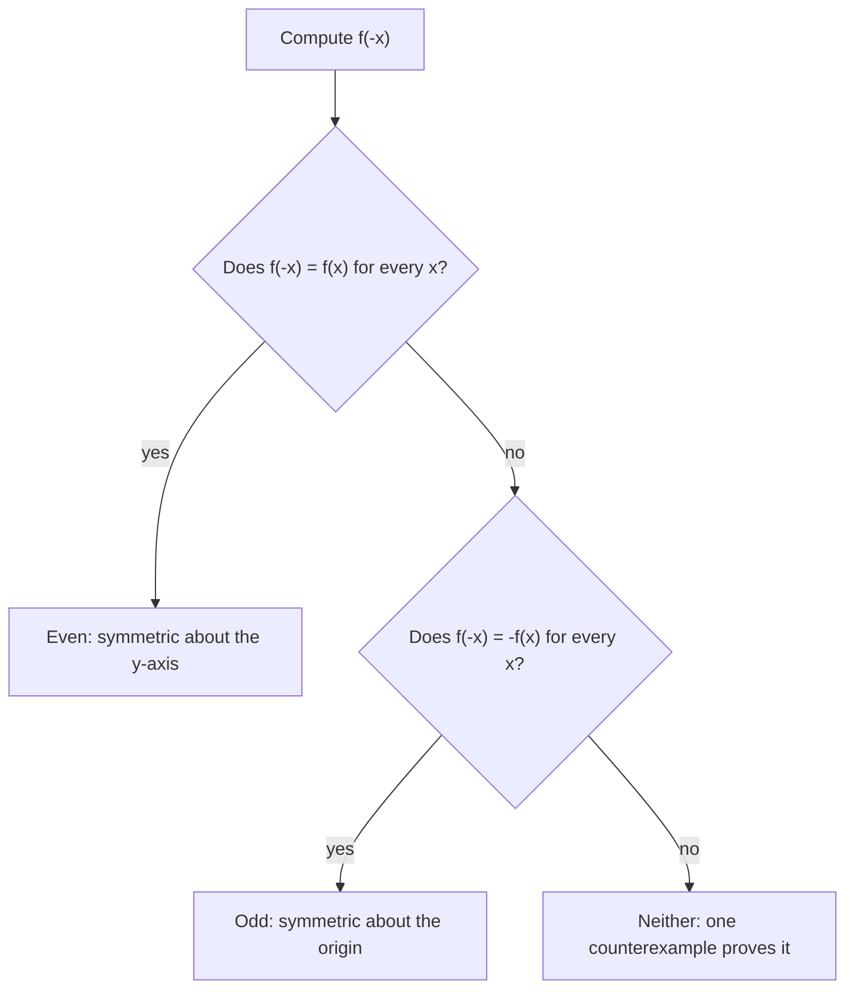

## A library of shapes

Module 1 treated functions one formula at a time. A faster way to think is to recognize that most functions you meet are a handful of basic shapes that have been moved, stretched or flipped. These basic shapes are the **parent functions**. If you know each parent's graph, domain, range and a few key points by heart, the next lesson's transformations let you sketch hundreds of graphs in seconds. This lesson builds that library and then adds one more tool for reading graphs: symmetry.

## The parent functions

| Name | Formula | Domain | Range | Key points |
|---|---|---|---|---|
| Constant | $f(x) = c$ | $\mathbb{R}$ | $\{c\}$ | horizontal line |
| Identity (linear) | $f(x) = x$ | $\mathbb{R}$ | $\mathbb{R}$ | $(0,0), (1,1)$ |
| Squaring | $f(x) = x^2$ | $\mathbb{R}$ | $[0, \infty)$ | $(0,0), (\pm1, 1), (\pm2, 4)$ |
| Cubing | $f(x) = x^3$ | $\mathbb{R}$ | $\mathbb{R}$ | $(0,0), (1,1), (-1,-1), (2, 8)$ |
| Square root | $f(x) = \sqrt{x}$ | $[0, \infty)$ | $[0, \infty)$ | $(0,0), (1,1), (4,2), (9,3)$ |
| Cube root | $f(x) = \sqrt[3]{x}$ | $\mathbb{R}$ | $\mathbb{R}$ | $(0,0), (\pm1, \pm1), (\pm8, \pm2)$ |
| Absolute value | $f(x) = \lvert x \rvert$ | $\mathbb{R}$ | $[0, \infty)$ | $(0,0), (\pm1, 1)$ |
| Reciprocal | $f(x) = \dfrac1x$ | $x \ne 0$ | $y \ne 0$ | $(1,1), (-1,-1)$ |
| Reciprocal squared | $f(x) = \dfrac{1}{x^2}$ | $x \ne 0$ | $(0, \infty)$ | $(\pm1, 1)$ |
| Exponential | $f(x) = b^x$, $b > 1$ | $\mathbb{R}$ | $(0, \infty)$ | $(0, 1), (1, b)$ |
| Logarithmic | $f(x) = \log_b x$, $b > 1$ | $(0, \infty)$ | $\mathbb{R}$ | $(1, 0), (b, 1)$ |
| Greatest integer | $f(x) = \lfloor x \rfloor$ | $\mathbb{R}$ | integers | steps |

($\mathbb{R}$ means all real numbers.) The exponential and logarithmic parents get their own module later; here it is enough to recognize their shapes.

```plot
{"x": [-4, 4], "y": [-3, 4], "equal": true, "functions": [{"f": "x^2", "label": "x²"}, {"f": "x^3", "label": "x³"}, {"f": "sqrt(x)", "label": "√x"}, {"f": "abs(x)", "label": "|x|", "dashed": true}], "caption": "Four parent functions: x², x³, √x and |x|. All four pass through (0, 0) and (1, 1)."}
```

Every one of the four shapes above passes through $(0, 0)$ and $(1, 1)$, which is a handy check when sketching. They differ in what they do for negative $x$ and how fast they grow.

Here are six of the parents side by side on the same window, so you can compare their shapes at a glance. Try covering the names and identifying each graph.


```plot
{"x": [-4, 4], "y": [-4, 4], "equal": true, "functions": [{"f": "1/x", "label": "1/x"}, {"f": "1/x^2", "label": "1/x²", "dashed": true}, {"f": "cbrt(x)", "label": "∛x"}], "caption": "The reciprocal 1/x, the reciprocal squared 1/x² (dashed), and the cube root."}
```

## Why the shapes look the way they do

You can explain each shape from its formula rather than memorizing a picture:

- $x^2$ is never negative and grows faster and faster, so the graph is a U that gets steeper.
- $\sqrt{x}$ undoes squaring on $x \ge 0$, so its graph is the right half of the parabola turned on its side: it rises quickly near 0 and then flattens.
- $\dfrac1x$ is huge when $x$ is near 0 and tiny when $x$ is large, so the graph hugs both axes. Its sign matches the sign of $x$.
- $\dfrac{1}{x^2}$ is like $\dfrac1x$ but always positive, so both branches sit above the $x$-axis.

## Symmetry: even and odd functions

Look again at $x^2$ and $|x|$: the left half of each graph is a mirror image of the right half across the $y$-axis. Look at $x^3$, $\frac1x$ and $\sqrt[3]{x}$: rotating each graph half a turn (180°) about the origin leaves it unchanged. These two kinds of symmetry have algebraic tests.

A function is **even** if

$$f(-x) = f(x) \quad \text{for every } x \text{ in the domain.}$$

Why this means $y$-axis symmetry: if $(a, b)$ is on the graph, then $f(-a) = f(a) = b$, so $(-a, b)$ is on the graph too, and that point is the mirror image of $(a, b)$ across the $y$-axis.

A function is **odd** if

$$f(-x) = -f(x) \quad \text{for every } x \text{ in the domain.}$$

If $(a, b)$ is on the graph, then $f(-a) = -b$, so $(-a, -b)$ is on the graph. That point is what you get by rotating $(a, b)$ by 180° about the origin. So odd functions have **origin symmetry**. One consequence: if an odd function is defined at 0, then $f(0) = -f(0)$, which forces $f(0) = 0$.

The names come from powers: $x^2, x^4, x^6$ are even functions and $x, x^3, x^5$ are odd. But be careful: a function can be *neither*, and most are.

### Example 1

Decide whether $f(x) = x^4 - 3x^2 + 1$ is even, odd or neither.

Compute $f(-x)$, replacing every $x$ with $(-x)$:

$$f(-x) = (-x)^4 - 3(-x)^2 + 1 = x^4 - 3x^2 + 1 = f(x).$$

Even powers erase the sign, so $f$ is even and its graph is symmetric about the $y$-axis.

### Example 2

Test $g(x) = x^3 - 5x$ and $h(x) = x^2 + x$.

- $g(-x) = (-x)^3 - 5(-x) = -x^3 + 5x = -(x^3 - 5x) = -g(x)$. So $g$ is odd.
- $h(-x) = (-x)^2 + (-x) = x^2 - x$. This is not $h(x) = x^2 + x$, and it is not $-h(x) = -x^2 - x$. So $h$ is neither.

To show a function is *not* even, one counterexample is enough: $h(1) = 2$ but $h(-1) = 0$.

The whole test fits in one flowchart. Always start by computing $f(-x)$, then compare it with $f(x)$ and with $-f(x)$.



### Example 3

Test $k(x) = \dfrac{x}{x^2 + 1}$.

$k(-x) = \dfrac{-x}{(-x)^2 + 1} = \dfrac{-x}{x^2 + 1} = -k(x)$. So $k$ is odd. Its graph passes through the origin, and knowing the right half ($x \ge 0$) gives the left half by rotating.

```plot
{"x": [-5, 5], "y": [-1, 1], "functions": [{"f": "x/(x^2 + 1)", "label": "y = x/(x² + 1)"}], "points": [{"at": [1, 0.5], "label": "(1, 0.5)"}, {"at": [-1, -0.5], "label": "(−1, −0.5)"}], "caption": "An odd function: (1, 0.5) on the graph forces (−1, −0.5)."}
```

## Using symmetry

Symmetry halves the work. If you know an even function's values for $x \ge 0$, you know them all; same for an odd function. It also catches errors: if you graph $x^4 - 3x^2 + 1$ and the two halves don't match, something is wrong.

A shortcut for polynomials: a polynomial is even if every power of $x$ is even (constants count as $x^0$), odd if every power is odd, and otherwise neither. So $5x^6 - x^2 + 7$ is even, $2x^5 + x$ is odd, and $x^3 + 1$ is neither (the constant 1 is an even power).

## Common mistakes

- *Testing with $-f(x)$ only.* You must compute $f(-x)$ first, then compare it with both $f(x)$ and $-f(x)$.
- *Forgetting the constant term.* $x^3 + 1$ is not odd: $f(0) = 1 \ne 0$.
- *Thinking every function is even or odd.* Most are neither.
- *Mixing up domain and range of $\sqrt{x}$ and $\frac{1}{x^2}$.* Write the key points; they reveal both.
- *Assuming $x^2$ and $\sqrt{x}$ have the same domain.* $x^2$ accepts any input; $\sqrt{x}$ needs $x \ge 0$.

## Key points

- Parent functions are the basic shapes; know each one's graph, domain, range and key points.
- Even: $f(-x) = f(x)$, mirror symmetry about the $y$-axis.
- Odd: $f(-x) = -f(x)$, 180° rotational symmetry about the origin; $f(0) = 0$ when defined.
- Polynomials with only even powers are even, only odd powers are odd; a mix is neither.
- One counterexample proves a function is not even (or not odd).
