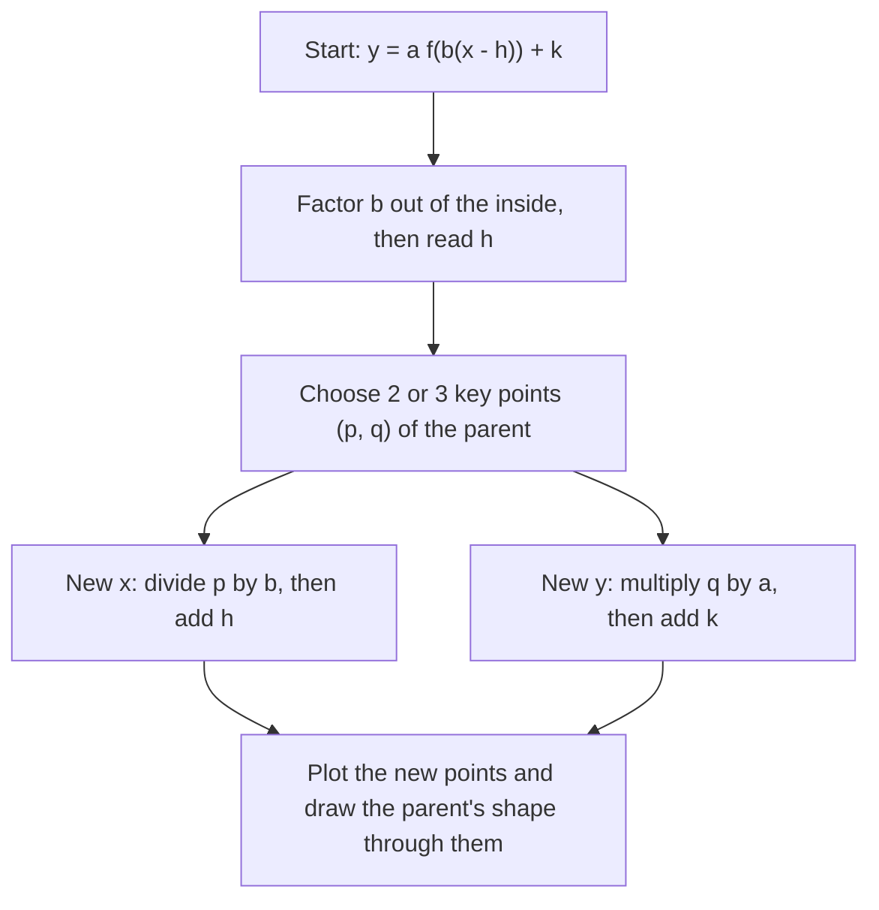

## Moving a known shape

You now know a dozen parent graphs. A **transformation** changes a graph's position, size or orientation in a predictable way, and almost every formula you'll graph in this course is a transformed parent. Learning the rules once means you can look at $y = -2\sqrt{x + 3} + 1$ and see the square root graph flipped, stretched and moved, without plotting a single point by brute force.

There are three families: shifts (**translations**), **reflections**, and stretches or compressions. Each comes in a vertical version (it changes the outputs) and a horizontal version (it changes the inputs).

## Vertical changes act on outputs

Changes *outside* the function act on $y$-values and behave exactly as you would expect.

- $y = f(x) + k$ adds $k$ to every output: a **vertical shift** up $k$ units (down if $k < 0$).
- $y = -f(x)$ negates every output: a reflection across the $x$-axis.
- $y = a f(x)$ with $a > 0$ multiplies every output by $a$: a **vertical stretch** if $a > 1$, a **vertical compression** if $0 < a < 1$. Points on the $x$-axis stay put.

## Horizontal changes act on inputs, and feel backwards

Changes *inside* the function, applied to $x$ before $f$ sees it, behave the opposite of what the symbols suggest.

- $y = f(x - h)$ is a **horizontal shift** *right* $h$ units. Why right? The new graph reaches the height $f(0)$ when $x - h = 0$, that is at $x = h$. Every feature of $f$ now happens $h$ units later.
- $y = f(-x)$ reflects across the $y$-axis: the new graph does at $x$ what $f$ did at $-x$.
- $y = f(bx)$ with $b > 1$ is a **horizontal compression** by a factor of $\frac1b$: the new graph reaches $f$'s value at $x = 2$ already at $x = \frac2b$. If $0 < b < 1$, it is a **horizontal stretch** by $\frac1b$.

The rule to remember: *inside the parentheses, do the opposite.* $f(x + 3)$ moves left 3; $f(2x)$ squeezes toward the $y$-axis by half.

The four panels below apply one change each to $y = \sqrt{x}$ (dashed), so you can compare an inside change with an outside one.


```plot
{"x": [-6, 4], "y": [-2, 6], "equal": true, "functions": [{"f": "x^2", "dashed": true, "label": "y = x²"}, {"f": "(x + 3)^2 + 1", "label": "y = (x + 3)² + 1"}], "points": [{"at": [0, 0]}, {"at": [-3, 1], "label": "(−3, 1)"}], "caption": "The parent x² (dashed) moved left 3 and up 1: the vertex goes from (0, 0) to (−3, 1)."}
```

## The combined form and the order of operations

Most problems combine several changes:

$$y = a\,f\big(b(x - h)\big) + k.$$

A point $(p, q)$ on the graph of $f$ moves to

$$\left(\frac{p}{b} + h,\; a q + k\right).$$

Read the formula like this. For the $x$-coordinate: divide by $b$ (the horizontal stretch/compression and, if $b < 0$, the reflection), then add $h$. For the $y$-coordinate: multiply by $a$ (stretch and, if $a < 0$, reflection), then add $k$. Stretches and reflections happen before shifts. That order matters: stretching then shifting is not the same as shifting then stretching.

A warning about factoring: $y = \sqrt{2x - 6}$ is $\sqrt{2(x - 3)}$, so the shift is 3 to the right, not 6. Always factor $b$ out of the inside before reading off $h$.

The procedure, step by step:



### Example 1

Describe and sketch $g(x) = -2\sqrt{x + 3} + 1$.

The parent is $\sqrt{x}$. Here $a = -2$, $b = 1$, $h = -3$, $k = 1$.

1. Stretch vertically by 2 and reflect across the $x$-axis ($a = -2$).
2. Shift left 3 ($h = -3$) and up 1 ($k = 1$).

Track the key points $(0, 0)$, $(1, 1)$, $(4, 2)$ with $(p, q) \mapsto (p - 3, -2q + 1)$:

| Parent point | New point |
|---|---|
| $(0, 0)$ | $(-3, 1)$ |
| $(1, 1)$ | $(-2, -1)$ |
| $(4, 2)$ | $(1, -3)$ |

```plot
{"x": [-5, 6], "y": [-5, 4], "equal": true, "functions": [{"f": "sqrt(x)", "dashed": true, "label": "y = √x"}, {"f": "-2sqrt(x + 3) + 1", "label": "y = −2√(x + 3) + 1"}], "points": [{"at": [-3, 1], "label": "(−3, 1)"}, {"at": [-2, -1]}, {"at": [1, -3], "label": "(1, −3)"}], "caption": "Parent √x (dashed) and the transformed graph: flipped, stretched, moved left 3 and up 1."}
```

The domain becomes $[-3, \infty)$ and the range $(-\infty, 1]$.

### Example 2

The point $(2, 5)$ is on the graph of $y = f(x)$. Find the matching point on $y = 3f(2x - 8) - 4$.

First factor the inside: $2x - 8 = 2(x - 4)$, so $b = 2$, $h = 4$, $a = 3$, $k = -4$. Apply the map:

$$x: \frac{2}{2} + 4 = 5, \qquad y: 3(5) - 4 = 11.$$

The point is $(5, 11)$. Check: at $x = 5$, $2x - 8 = 2$, so $3f(2) - 4 = 3 \cdot 5 - 4 = 11$. ✓

### Example 3

Write an equation for the absolute value graph with vertex $(2, -3)$ that opens downward and has slopes $\pm\tfrac12$.

Start from $|x|$ (vertex at the origin, slopes $\pm1$). Opening downward with slopes $\pm\tfrac12$ means $a = -\tfrac12$. The vertex moves to $(2, -3)$, so $h = 2$, $k = -3$:

$$y = -\tfrac12|x - 2| - 3.$$

## Transformations and symmetry

Transformations can create or destroy symmetry. The parent $x^2$ is even, but $(x - 1)^2$ is not even: its axis of symmetry moved to $x = 1$. Vertical stretches and reflections across either axis keep evenness and oddness; shifts usually break them.

## Common mistakes

- *Shifting the wrong way.* $f(x - 4)$ moves right, $f(x + 4)$ moves left.
- *Not factoring before reading $h$.* $f(3x + 6) = f(3(x + 2))$: the shift is 2 left, not 6.
- *Doing shifts before stretches.* Multiply by $a$ first, then add $k$; divide by $b$ first, then add $h$.
- *Confusing $-f(x)$ with $f(-x)$.* The first flips over the $x$-axis, the second over the $y$-axis.
- *Inverting the horizontal factor.* $f(2x)$ compresses by $\frac12$; it does not stretch by 2.

## Key points

- Outside changes ($a f(x) + k$) act on outputs and do what they say.
- Inside changes ($f(b(x - h))$) act on inputs and do the opposite of what they look like.
- $(p, q)$ on $f$ moves to $\left(\frac{p}{b} + h,\; aq + k\right)$ on $y = a f(b(x - h)) + k$.
- Stretch and reflect before shifting; factor the inside before reading the shift.
- Track two or three key points of the parent to sketch any transformed graph.
