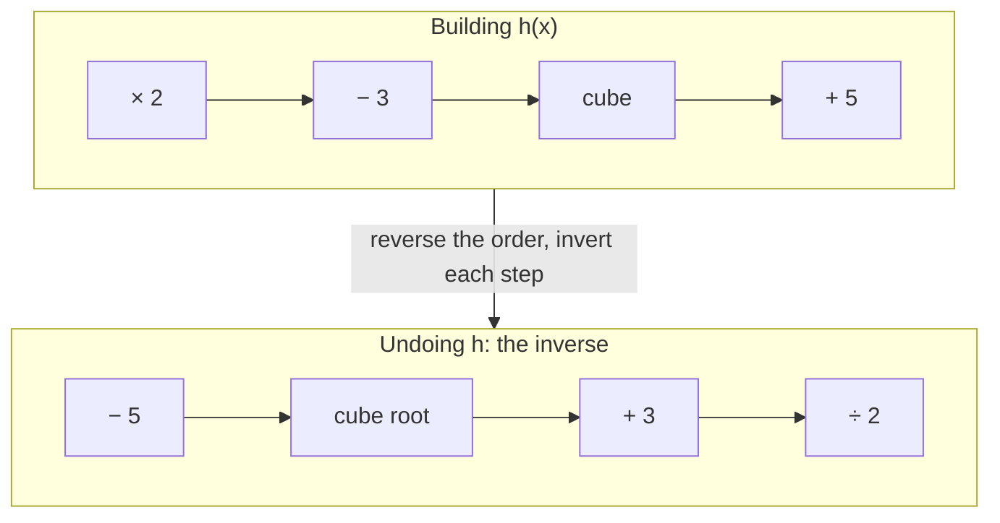

## Composition as an operation

Lessons 6 and 7 used composition to build functions and inverses to undo them. This honors lesson treats composition the way algebra treats multiplication: as an operation with its own rules, an identity element and inverses. That point of view answers practical questions (how do you invert a function built in several steps? what is the inverse of a transformed graph?) and leads to two ideas that run through higher mathematics: functions that are their own inverses, and **iteration**, applying the same function over and over.

## The rules of composition

Three facts, each checked by writing out what both sides do to an input $x$:

1. **Associative:** $(f \circ g) \circ h = f \circ (g \circ h)$, because both sides send $x$ to $f(g(h(x)))$. So we can drop the parentheses and write $f \circ g \circ h$.
2. **Not commutative:** in general $f \circ g \ne g \circ f$ (Lesson 6 showed $f(g(x)) = 9x^2 - 12x + 5$ but $g(f(x)) = 3x^2 + 1$ for one pair).
3. **Identity:** the **identity function** $I(x) = x$ changes nothing, so $f \circ I = I \circ f = f$. It plays the role that 1 plays for multiplication.

In this language, Lesson 7's definition of an inverse reads: $f^{-1} \circ f = I$ on the domain of $f$ and $f \circ f^{-1} = I$ on the domain of $f^{-1}$. That is exactly how $\tfrac13$ is the inverse of 3 under multiplication: $\tfrac13 \cdot 3 = 1$.

## The inverse of a composition

If $f$ and $g$ are both one-to-one, then $f \circ g$ is one-to-one and

$$(f \circ g)^{-1} = g^{-1} \circ f^{-1}.$$

The order reverses. Proof, using associativity: on the appropriate domain,

$$(f \circ g) \circ (g^{-1} \circ f^{-1}) = f \circ (g \circ g^{-1}) \circ f^{-1} = f \circ I \circ f^{-1} = f \circ f^{-1} = I,$$

and the same regrouping shows $(g^{-1} \circ f^{-1}) \circ (f \circ g) = I$. This is the socks-and-shoes rule: you put on socks, then shoes; to undo it you take off shoes first, then socks. The last step done is the first step undone.

### Example 1

Find the inverse of $h(x) = (2x - 3)^3 + 5$.

Read $h$ as a chain of one-to-one steps, inside out:

Undo the steps in reverse order, each with its own inverse:

$$h^{-1}(x) = \frac{\sqrt[3]{x - 5} + 3}{2}.$$

Check: $h(1) = (-1)^3 + 5 = 4$, and $h^{-1}(4) = \frac{\sqrt[3]{-1} + 3}{2} = \frac{-1 + 3}{2} = 1$. ✓ Solving $y = (2x - 3)^3 + 5$ for $x$ gives the same answer; the chain view just tells you the answer before you start.

## Inverting a transformed function

Lesson 5's general transformation $g(x) = a\,f\big(b(x - h)\big) + k$ (with $a \ne 0$, $b \ne 0$) is itself a chain: subtract $h$, multiply by $b$, apply $f$, multiply by $a$, add $k$. If $f$ is one-to-one, reversing the chain gives

$$g^{-1}(x) = h + \frac{1}{b}\, f^{-1}\!\left(\frac{x - k}{a}\right).$$

Look at what moved: the outside constants $a$ and $k$ now act *inside* $f^{-1}$, and the inside constants $b$ and $h$ now act *outside*. That matches the picture: reflecting across $y = x$ swaps horizontal and vertical, so vertical stretches and shifts of $f$ become horizontal stretches and shifts of $g^{-1}$.

### Example 2

Find the inverse of $g(x) = 2\sqrt{x - 1} + 3$.

Here $f(x) = \sqrt{x}$, whose inverse on its range $[0, \infty)$ is $f^{-1}(x) = x^2$ for $x \ge 0$; and $a = 2$, $b = 1$, $h = 1$, $k = 3$. The formula gives

$$g^{-1}(x) = 1 + \left(\frac{x - 3}{2}\right)^2, \qquad x \ge 3.$$

The domain restriction comes from the range of $g$, which is $[3, \infty)$ (the square root is never negative). Check: $g(5) = 2 \cdot 2 + 3 = 7$ and $g^{-1}(7) = 1 + 2^2 = 5$. ✓

## Linear fractional functions

A **linear fractional function** has the form

$$f(x) = \frac{ax + b}{cx + d}, \qquad ad - bc \ne 0.$$

(If $ad - bc = 0$, the numerator and denominator are proportional, so $f$ is constant wherever it is defined and has no inverse. For example, $\frac{2x + 4}{x + 2} = 2$ for $x \ne -2$.) Solving $x = \dfrac{ay + b}{cy + d}$ for $y$ as in Lesson 7 gives $x(cy + d) = ay + b$, then $y(cx - a) = b - dx$, so

$$f^{-1}(x) = \frac{dx - b}{-cx + a}.$$

The pattern is worth memorizing: **swap $a$ and $d$, and change the signs of $b$ and $c$.** If you have met $2 \times 2$ matrices, this is the same pattern as the inverse of $\begin{bmatrix} a & b \\ c & d \end{bmatrix}$ (up to the factor $\frac{1}{ad - bc}$, which cancels in the fraction). That is not a coincidence: composing two linear fractional functions corresponds to multiplying their coefficient matrices, an idea you can explore after the matrix module.

### Example 3

Find the inverse of $f(x) = \dfrac{3x - 1}{x + 2}$.

Here $a = 3$, $b = -1$, $c = 1$, $d = 2$, and $ad - bc = 6 + 1 = 7 \ne 0$. Swap $a$ and $d$, negate $b$ and $c$:

$$f^{-1}(x) = \frac{2x + 1}{-x + 3} = \frac{2x + 1}{3 - x}.$$

Check: $f(1) = \frac23$ and $f^{-1}\!\left(\frac23\right) = \dfrac{\frac43 + 1}{3 - \frac23} = \dfrac{7/3}{7/3} = 1$. ✓ Also notice that the domain of $f^{-1}$, $x \ne 3$, matches the range of $f$: $y = 3$ is the horizontal asymptote of $f$, a value $f$ never reaches.

## Functions that are their own inverse

An **involution** is a function with $f^{-1} = f$, that is, $f(f(x)) = x$ for every $x$ in its domain. Doing it twice gets you back where you started. Since the graph of $f^{-1}$ is the reflection of the graph of $f$ across $y = x$, an involution's graph is symmetric about the line $y = x$. Familiar examples: $f(x) = -x$, $f(x) = c - x$, and $f(x) = \dfrac1x$. By the swap-and-negate pattern, a linear fractional function is an involution whenever $d = -a$.

### Example 4

Show that $f(x) = \dfrac{2x + 5}{x - 2}$ is an involution.

Here $d = -2 = -a$, so the pattern predicts it. Directly, for $x \ne 2$:

$$f(f(x)) = \frac{2 \cdot \frac{2x + 5}{x - 2} + 5}{\frac{2x + 5}{x - 2} - 2} = \frac{\frac{4x + 10 + 5x - 10}{x - 2}}{\frac{2x + 5 - 2x + 4}{x - 2}} = \frac{9x}{9} = x. \;✓$$

## Iteration and fixed points

**Iteration** means feeding a function's output back in as its next input: start at $x_0$ and compute $x_1 = f(x_0)$, $x_2 = f(x_1)$, and so on, so $x_{n+1} = f(x_n)$. A notation warning: $f(f(x))$ is sometimes written $f^{2}(x)$, but in trigonometry $\sin^2 x$ means $(\sin x)^2$, so write out $f(f(x))$ when there is any doubt.

A **fixed point** of $f$ is an input $p$ with $f(p) = p$. Graphically, fixed points are where the graph of $f$ meets the line $y = x$. If the iterates settle down to a limit $p$ and $f$ has no breaks there, that limit must be a fixed point, because $x_{n+1} = f(x_n)$ becomes $p = f(p)$.

A **cobweb diagram** shows iteration on the graph: from $(x_0, 0)$ go vertically to the graph of $f$ (height $x_1$), then horizontally to the line $y = x$, arriving at the point $(x_1, x_1)$, which sits directly above $x_1$; from there go vertically to the graph again (height $x_2$), and repeat. Each vertical step applies $f$, and each horizontal step turns an output into the next input.

### Example 5

Iterate $f(x) = \sqrt{x + 6}$ starting from $x_0 = -5$, and find the fixed point.

$x_1 = \sqrt{1} = 1$, $x_2 = \sqrt{7} \approx 2.6458$, $x_3 = \sqrt{8.6458} \approx 2.9404$, $x_4 \approx 2.9900$, $x_5 \approx 2.9983$. The values close in on 3. Solve for the fixed point: $\sqrt{x + 6} = x$ requires $x \ge 0$; squaring gives $x^2 - x - 6 = 0$, so $x = 3$ or $x = -2$. Since a square root is never negative, $-2$ is extraneous: $f(-2) = 2 \ne -2$. The fixed point is 3.

Not every fixed point attracts. For a linear function $f(x) = mx + c$ with $m \ne 1$, the fixed point is $p = \frac{c}{1 - m}$, and subtracting $p = mp + c$ from $x_{n+1} = mx_n + c$ gives

$$x_{n+1} - p = m\,(x_n - p), \qquad \text{so} \qquad x_n - p = m^n (x_0 - p).$$

The distance to $p$ is multiplied by $\lvert m \rvert$ at every step. If $\lvert m \rvert < 1$ the iterates approach $p$; if $\lvert m \rvert > 1$ they run away. For $f(x) = 2x - 3$ ($p = 3$) starting at 4: $5, 7, 11, 19, \ldots$, doubling the distance each time. For curved graphs the same rule holds near $p$ with the steepness of the graph at $p$ in place of $m$; making that precise takes the derivative, so treat it as a preview.

## Where a function meets its inverse

It is tempting to say that $f$ and $f^{-1}$ can only meet on the line $y = x$. That is true when $f$ is *increasing*: if $f(a) = b$ and also $f^{-1}(a) = b$, then $f(b) = a$; if $a < b$, increasing would give $f(a) < f(b)$, that is $b < a$, a contradiction, and $a > b$ fails the same way. So $a = b$. But it fails for decreasing functions. With $f(x) = -x^3$ and $f^{-1}(x) = -\sqrt[3]{x}$, both graphs pass through $(1, -1)$ and $(-1, 1)$, which are not on $y = x$. (They also meet at the origin.)

## Common mistakes

- *Inverting a chain in the original order.* $(f \circ g)^{-1} = g^{-1} \circ f^{-1}$: the last step is undone first.
- *Keeping $a$ and $k$ outside when inverting $a f(b(x - h)) + k$.* They move inside $f^{-1}$: $g^{-1}(x) = h + \frac1b f^{-1}\!\left(\frac{x - k}{a}\right)$.
- *Negating the wrong coefficients.* For $\frac{ax + b}{cx + d}$ the inverse is $\frac{dx - b}{-cx + a}$: swap $a$ and $d$, negate $b$ and $c$.
- *Reading $f^{2}(x)$ as $f(f(x))$ when it means $(f(x))^2$*, or the reverse. Write out which one you mean.
- *Keeping an extraneous fixed point.* Squaring to solve $\sqrt{x + 6} = x$ can add a false root; check each one in $f$.
- *Assuming $f$ and $f^{-1}$ only meet on $y = x$.* True for increasing functions, false in general.

## Key points

- Composition is associative but not commutative; the identity function $I(x) = x$ is its neutral element.
- $(f \circ g)^{-1} = g^{-1} \circ f^{-1}$ (socks and shoes).
- The inverse of $a f(b(x - h)) + k$ is $h + \frac1b f^{-1}\!\left(\frac{x - k}{a}\right)$: outside and inside changes trade places.
- $\left(\frac{ax + b}{cx + d}\right)^{-1} = \frac{dx - b}{-cx + a}$ when $ad - bc \ne 0$; it is an involution when $d = -a$.
- Fixed points solve $f(p) = p$ and lie on $y = x$; iteration $x_{n+1} = f(x_n)$ can approach a fixed point or run away from it.
- For $f(x) = mx + c$, the distance to the fixed point is multiplied by $\lvert m \rvert$ each step.
