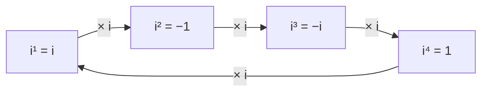

## Why we need more numbers

The last lesson divided polynomials by $(x - c)$ to peel off one zero at a time. Sooner or later that process leaves a quadratic like $x^2 + 9$, which has no real zeros: its graph never touches the $x$-axis. To finish the job, and to state the clean counting theorem of the next lesson ("degree $n$ means $n$ zeros"), we need numbers whose squares are negative. You met them in Algebra 2; this lesson is a refresher that makes the arithmetic automatic before we lean on it. Complex numbers are also everyday tools in electrical engineering (alternating current), signal processing and quantum physics, and they return in Module 7 in polar form.

## The imaginary unit

The **imaginary unit** $i$ is defined by

$$i^2 = -1.$$

No real number has this property, so $i$ is genuinely new. With it, every negative number has square roots: for $b > 0$,

$$\sqrt{-b} = i\sqrt{b}, \qquad\text{for example}\quad \sqrt{-25} = 5i, \quad \sqrt{-12} = i\sqrt{12} = 2i\sqrt3.$$

A **complex number** is a number of the form $a + bi$ with $a$ and $b$ real. This is its standard form. The number $a$ is its **real part** and $b$ (not $bi$) is its **imaginary part**. When $b = 0$ the number is simply the real number $a$, so the real numbers sit inside the complex numbers. When $a = 0$ and $b \ne 0$, as in $7i$, the number is **pure imaginary**. Two complex numbers are equal exactly when their real parts are equal and their imaginary parts are equal.

### Powers of $i$

Multiplying by $i$ again and again cycles through four values:

$$i^1 = i, \quad i^2 = -1, \quad i^3 = i^2 \cdot i = -i, \quad i^4 = (i^2)^2 = 1,$$

and then $i^5 = i^4 \cdot i = i$ starts the cycle over. So to simplify $i^n$, divide $n$ by 4 and keep only the remainder: $i^{43} = i^{40}\cdot i^3 = 1 \cdot (-i) = -i$, since $43 = 4 \cdot 10 + 3$.



## Adding, subtracting and multiplying

Treat $i$ like a variable, collect like terms, and replace every $i^2$ with $-1$ at the end.

- Add or subtract real parts and imaginary parts separately: $(3 + 4i) + (2 - 7i) = 5 - 3i$ and $(3 + 4i) - (2 - 7i) = 1 + 11i$.
- Multiply by distributing every term over every term:

$$(a + bi)(c + di) = ac + adi + bci + bd\,i^2 = (ac - bd) + (ad + bc)i.$$

Don't memorize that formula; just distribute and use $i^2 = -1$.

### Example 1

Write $(3 - 2i)(4 + 5i)$ in standard form.

1. Distribute: $3 \cdot 4 + 3 \cdot 5i - 2i \cdot 4 - 2i \cdot 5i = 12 + 15i - 8i - 10i^2$.
2. Replace $i^2$ with $-1$: $-10i^2 = -10(-1) = +10$.
3. Collect: real part $12 + 10 = 22$, imaginary part $15 - 8 = 7$.

$$(3 - 2i)(4 + 5i) = 22 + 7i.$$

One trap deserves a warning. The rule $\sqrt{a}\sqrt{b} = \sqrt{ab}$ holds for $a, b \ge 0$ but *fails* when both are negative. Correctly, $\sqrt{-4}\cdot\sqrt{-9} = (2i)(3i) = 6i^2 = -6$, not $\sqrt{36} = 6$. Always rewrite $\sqrt{-b}$ as $i\sqrt b$ *before* multiplying.

## Conjugates and division

The **complex conjugate** of $z = a + bi$ is $\bar z = a - bi$: same real part, opposite imaginary part. A number times its conjugate is always a nonnegative real number:

$$(a + bi)(a - bi) = a^2 - abi + abi - b^2 i^2 = a^2 + b^2.$$

That is the key to division. A quotient like $\dfrac{5 + i}{2 - 3i}$ is not in standard form because of the $i$ in the denominator. Multiply the top and bottom by the conjugate of the *denominator*: the denominator becomes the real number $c^2 + d^2$, and then you can split the fraction. (It's the same idea as rationalizing a denominator like $\frac{1}{2 - \sqrt3}$.)

### Example 2

Write $\dfrac{5 + i}{2 - 3i}$ in standard form.

1. The denominator's conjugate is $2 + 3i$. Multiply top and bottom by it:
$$\frac{5 + i}{2 - 3i}\cdot\frac{2 + 3i}{2 + 3i}.$$
2. Numerator: $(5 + i)(2 + 3i) = 10 + 15i + 2i + 3i^2 = 10 + 17i - 3 = 7 + 17i$.
3. Denominator: $(2 - 3i)(2 + 3i) = 2^2 + 3^2 = 13$.
4. Split: $\dfrac{7 + 17i}{13} = \dfrac{7}{13} + \dfrac{17}{13}i$.

Check by multiplying back: $(2 - 3i)\left(\frac{7}{13} + \frac{17}{13}i\right) = \frac{14 + 34i - 21i - 51i^2}{13} = \frac{65 + 13i}{13} = 5 + i$. ✓

A pure imaginary denominator is quicker: multiply by $i$. For instance $\dfrac{6}{2i} = \dfrac{6i}{2i^2} = \dfrac{6i}{-2} = -3i$.

## The complex plane

A real number is a point on a line. A complex number has two parts, so it needs a plane. In the **complex plane**, $a + bi$ is plotted at the point $(a, b)$: the horizontal axis is the real axis and the vertical axis is the imaginary axis.

The distance from the origin to $a + bi$ is its **modulus** (or absolute value),

$$|a + bi| = \sqrt{a^2 + b^2},$$

which is the Pythagorean theorem. For a real number this agrees with the usual absolute value: $|-5 + 0i| = 5$. Notice that $z\bar z = a^2 + b^2 = |z|^2$. Conjugation reflects a point across the real axis, and adding complex numbers adds their coordinates, just like adding vectors (Module 8).

Multiplying by $i$ has a picture too: $i(a + bi) = -b + ai$, which turns the point $(a, b)$ a quarter turn counterclockwise about the origin. Starting from $z = 3 + i$, the products $iz = -1 + 3i$, $i^2 z = -3 - i$ and $i^3 z = 1 - 3i$ go around the origin, and a fourth multiplication returns to $z$. This is the geometry behind the cycle of four powers of $i$.

```plot
{"x": [-5, 5], "y": [-4.5, 4.5], "equal": true, "xLabel": "real axis", "yLabel": "imaginary axis", "segments": [{"from": [3, 1], "to": [-1, 3], "arrow": true, "dashed": true}, {"from": [-1, 3], "to": [-3, -1], "arrow": true, "dashed": true}, {"from": [-3, -1], "to": [1, -3], "arrow": true, "dashed": true}, {"from": [1, -3], "to": [3, 1], "arrow": true, "dashed": true}], "points": [{"at": [3, 1], "label": "z = 3 + i"}, {"at": [-1, 3]}, {"at": [-3, -1]}, {"at": [1, -3]}], "labels": [{"at": [-2.3, 3.4], "text": "iz = −1 + 3i"}, {"at": [-3.4, -1.9], "text": "i²z = −3 − i"}, {"at": [2.5, -3.5], "text": "i³z = 1 − 3i"}], "caption": "Each multiplication by i is a quarter turn counterclockwise about 0; four turns bring z back."}
```

```plot
{"x": [-5, 6], "y": [-4, 5], "equal": true, "xLabel": "real axis", "yLabel": "imaginary axis", "segments": [{"from": [0, 0], "to": [3, 4], "label": "|z| = 5"}, {"from": [3, 4], "to": [3, -4], "dashed": true}], "points": [{"at": [3, 4], "label": "z = 3 + 4i"}, {"at": [3, -4], "label": "conjugate 3 − 4i"}, {"at": [-4, 2], "label": "−4 + 2i"}, {"at": [0, -2], "label": "−2i"}], "caption": "Complex numbers as points: z = 3 + 4i is 5 units from the origin, and its conjugate is its mirror image across the real axis."}
```

## Quadratic equations with complex solutions

The quadratic formula $x = \dfrac{-b \pm \sqrt{b^2 - 4ac}}{2a}$ works over the complex numbers too. When $b^2 - 4ac < 0$, the square root is imaginary and the two solutions are complex conjugates $p \pm qi$, which is a first glimpse of the conjugate pairs theorem in the next lesson.

### Example 3

Solve $x^2 - 4x + 13 = 0$.

1. $b^2 - 4ac = 16 - 52 = -36$, which is negative, so there are no real solutions (the parabola sits entirely above the $x$-axis).
2. $\sqrt{-36} = 6i$, so $x = \dfrac{4 \pm 6i}{2} = 2 \pm 3i$.
3. Check $x = 2 + 3i$: $(2 + 3i)^2 = 4 + 12i + 9i^2 = -5 + 12i$. Then $-5 + 12i - 4(2 + 3i) + 13 = -5 + 12i - 8 - 12i + 13 = 0$. ✓

The two solutions are $2 + 3i$ and $2 - 3i$, a conjugate pair, plotted as mirror images across the real axis.

## Common mistakes

- *Writing $i^2 = 1$.* The whole point of $i$ is $i^2 = -1$; forgetting this turns $22 + 7i$ in Example 1 into $2 + 7i$.
- *Multiplying square roots of negatives directly.* $\sqrt{-4}\sqrt{-9} = -6$, not 6. Convert to $i\sqrt b$ first.
- *Calling $bi$ the imaginary part.* The imaginary part of $3 - 5i$ is the real number $-5$.
- *Using the numerator's conjugate when dividing.* Multiply top and bottom by the conjugate of the *denominator*; that is what makes the denominator real.
- *Forgetting to divide both parts.* $\frac{7 + 17i}{13}$ is $\frac{7}{13} + \frac{17}{13}i$, not $\frac{7}{13} + 17i$.
- *Modulus without squaring.* $|3 - 4i| = \sqrt{9 + 16} = 5$, not $3 - 4 = -1$ or $\sqrt{3^2 - 4^2}$.

## Key points

- $i^2 = -1$; $\sqrt{-b} = i\sqrt b$ for $b > 0$; powers of $i$ repeat every 4: $i, -1, -i, 1$.
- Standard form $a + bi$: real part $a$, imaginary part $b$.
- Add and multiply like polynomials, replacing $i^2$ with $-1$.
- Conjugate of $a + bi$ is $a - bi$, and $(a + bi)(a - bi) = a^2 + b^2$.
- Divide by multiplying top and bottom by the conjugate of the denominator.
- In the complex plane $a + bi$ is the point $(a, b)$, with modulus $|a + bi| = \sqrt{a^2 + b^2}$.
- A quadratic with negative discriminant has two complex conjugate solutions.
