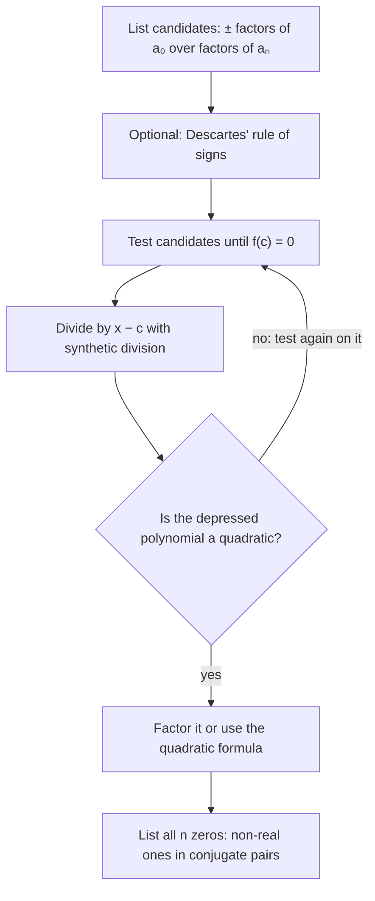

## The search problem

The factor theorem says that every zero gives a factor, and dividing out a factor lowers the degree. What's missing is a way to find that first zero. This lesson supplies a short list of candidates (the rational zero theorem), explains how many zeros to expect (the fundamental theorem of algebra), and shows how complex zeros come in pairs, using the complex-number arithmetic from the last lesson. Together with synthetic division from Lesson 9, these let you factor most polynomials you'll meet by hand.

## The rational zero theorem

Suppose $f(x) = a_n x^n + \dots + a_1 x + a_0$ has integer coefficients and $\frac{p}{q}$ (in lowest terms) is a zero. Then

$$p \text{ divides the constant term } a_0, \qquad q \text{ divides the leading coefficient } a_n.$$

This is the **rational zero theorem**. Why it's true: substitute $\frac pq$ and multiply by $q^n$ to clear fractions:

$$a_n p^n + a_{n-1}p^{n-1}q + \dots + a_1 p q^{n-1} + a_0 q^n = 0.$$

Every term except the last has a factor $p$, so $p$ divides $a_0 q^n$; since $p$ and $q$ share no factors, $p$ divides $a_0$. Every term except the first has a factor $q$, so by the same argument $q$ divides $a_n$.

The theorem gives a finite list of candidates, $\pm\dfrac{\text{factors of } a_0}{\text{factors of } a_n}$. It does not promise that any of them works (a polynomial may have no rational zeros at all), but if there is a rational zero, it's on the list.

### Example 1

Find all zeros of $f(x) = 2x^3 - 3x^2 - 11x + 6$.

1. Factors of $a_0 = 6$: $1, 2, 3, 6$. Factors of $a_n = 2$: $1, 2$. Candidates: $\pm1, \pm2, \pm3, \pm6, \pm\tfrac12, \pm\tfrac32$.
2. Test: $f(1) = -6$, $f(-1) = 12$, $f(2) = -12$, $f(3) = 54 - 27 - 33 + 6 = 0$. So 3 is a zero.
3. Divide by $x - 3$ synthetically: coefficients $2, -3, -11, 6$ give $2, 3, -2$ with remainder 0.
4. Factor the quotient: $2x^2 + 3x - 2 = (2x - 1)(x + 2)$.

$$f(x) = (x - 3)(2x - 1)(x + 2), \qquad \text{zeros } 3,\ \tfrac12,\ -2.$$

A sign change seen while testing helps too: $f(1) < 0 < f(-1)$ told us (by the IVT) that a zero lies between $-1$ and 1, which turned out to be $\tfrac12$.

## Descartes' rule of signs (a quick filter)

For a polynomial with real coefficients, write the terms in descending order of degree and count the sign changes between consecutive nonzero coefficients (skip any zero coefficients). **Descartes' rule of signs** says the number of positive real zeros, counted with multiplicity, equals that count or is less than it by an even number. Do the same for $f(-x)$ to bound the negative zeros. For $2x^3 - 3x^2 - 11x + 6$ the signs are $+ - - +$: two changes, so 2 or 0 positive zeros. (We found two: $3$ and $\tfrac12$.)

## The fundamental theorem of algebra

How many zeros should we expect? Allowing complex numbers settles it. The **fundamental theorem of algebra** states that every polynomial of degree $n \ge 1$ has at least one complex zero. Applying it repeatedly (divide out a zero, the quotient still has degree $\ge 1$, so it has a zero, and so on) gives the **linear factorization theorem**:

$$f(x) = a_n (x - c_1)(x - c_2)\cdots(x - c_n),$$

where the $c_k$ are complex numbers, not necessarily different. So a degree-$n$ polynomial has *exactly* $n$ complex zeros when counted with multiplicity. Some may be real, some not.

## Complex zeros come in conjugate pairs

If $f$ has *real* coefficients and $a + bi$ is a zero, then its **complex conjugate** $a - bi$ is also a zero. This is the **conjugate pairs theorem**. The reason: conjugating both sides of $f(a + bi) = 0$ leaves the real coefficients alone and turns $a + bi$ into $a - bi$, so $f(a - bi) = \overline{0} = 0$.

Multiplying a conjugate pair's factors always gives a real quadratic:

$$(x - (a + bi))(x - (a - bi)) = (x - a)^2 - (bi)^2 = x^2 - 2ax + (a^2 + b^2).$$

A consequence: a real polynomial of odd degree must have at least one real zero, since non-real zeros pair off. That matches the graph: an odd-degree polynomial's ends go in opposite directions, so it has to cross the axis.

### Example 2

Find all zeros of $g(x) = x^4 - 2x^3 + 6x^2 - 18x - 27$.

1. Candidates: $\pm1, \pm3, \pm9, \pm27$. $g(3) = 81 - 54 + 54 - 54 - 27 = 0$. Divide: coefficients $1, -2, 6, -18, -27$ by $c = 3$ give $1, 1, 9, 9$, remainder 0.
2. The depressed cubic is $x^3 + x^2 + 9x + 9$. Factor by grouping: $x^2(x + 1) + 9(x + 1) = (x + 1)(x^2 + 9)$.
3. $x^2 + 9 = 0$ gives $x = \pm 3i$.

Zeros: $3, -1, 3i, -3i$. Four zeros for degree 4, with the non-real ones a conjugate pair. Only $3$ and $-1$ show up as $x$-intercepts on the graph.

```plot
{"x": [-3, 4.5], "y": [-60, 30], "functions": [{"f": "x^4 - 2x^3 + 6x^2 - 18x - 27", "label": "y = g(x)"}], "points": [{"at": [-1, 0], "label": "−1"}, {"at": [3, 0], "label": "3"}], "caption": "Only the real zeros −1 and 3 are visible as x-intercepts; ±3i are not on the graph."}
```

### Example 3

Write a polynomial with real coefficients, leading coefficient 1 and lowest possible degree, whose zeros include $2$ and $1 - i$.

Real coefficients force $1 + i$ to be a zero too. The pair gives $x^2 - 2(1)x + (1^2 + 1^2) = x^2 - 2x + 2$. So

$$f(x) = (x - 2)(x^2 - 2x + 2) = x^3 - 4x^2 + 6x - 4.$$

Its graph crosses the $x$-axis only once, at $2$; the zeros $1 \pm i$ do not appear on it.

```plot
{"x": [-1, 4], "y": [-12, 10], "functions": [{"f": "x^3 - 4x^2 + 6x - 4", "label": "y = x³ − 4x² + 6x − 4"}], "points": [{"at": [2, 0]}, {"at": [0, -4]}], "labels": [{"at": [1.6, 2], "text": "(2, 0)"}, {"at": [-0.55, -4.6], "text": "(0, −4)"}], "caption": "One real zero (2) and a conjugate pair 1 ± i that the graph does not show."}
```

The whole search can be summed up in one chart.



## Common mistakes

- *Inverting the rational zero list.* Numerators come from the constant term, denominators from the leading coefficient.
- *Forgetting negative candidates.* Every candidate has a $\pm$.
- *Forgetting the conjugate.* With real coefficients, $1 - i$ as a zero means $1 + i$ is one too.
- *Expecting $n$ real zeros.* Degree $n$ guarantees $n$ complex zeros, not $n$ $x$-intercepts.
- *Stopping at one zero.* After finding a zero, divide and keep going on the depressed polynomial.

## Key points

- Rational zero candidates: $\pm\dfrac{\text{factors of the constant}}{\text{factors of the leading coefficient}}$.
- Test candidates (by substitution or synthetic division), divide out each zero found, and factor what remains.
- Fundamental theorem of algebra: degree $n$ means exactly $n$ complex zeros, counting multiplicity.
- Real coefficients: non-real zeros come in conjugate pairs $a \pm bi$, giving the real factor $x^2 - 2ax + a^2 + b^2$.
- Descartes' rule of signs bounds the number of positive and negative real zeros.
