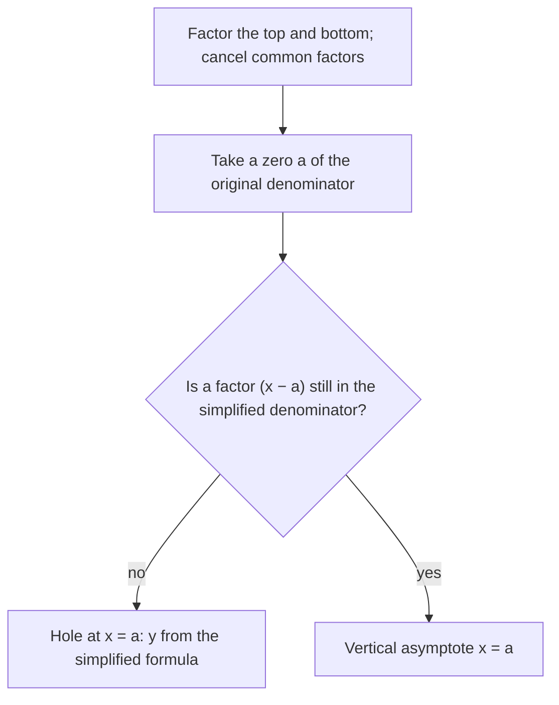

## Quotients of polynomials

A **rational function** is a quotient of two polynomials,

$$R(x) = \frac{p(x)}{q(x)}, \qquad q \text{ not the zero polynomial}.$$

Unlike polynomials, rational functions can blow up to $\pm\infty$ near certain inputs and level off far away. Those behaviors are described by asymptotes, lines the graph approaches. Rational functions model averages and rates ("cost per item when making $x$ items"), and they are the main source of examples for limits in Module 10. This lesson finds the features; the next one assembles them into complete graphs.

The parent rational function is $\frac1x$: as $x \to 0^+$ (from the right) it shoots up to $\infty$, as $x \to 0^-$ (from the left) it drops to $-\infty$, and as $x \to \pm\infty$ it approaches 0.

## Domain first

The domain of $R$ is every real number except the zeros of the denominator $q$. At each such excluded value something special happens: either a vertical asymptote or a hole. Which one depends on whether the factor cancels.

## Holes

If a factor $(x - a)$ appears in both the numerator and the denominator, it cancels, and the graph has a **hole** (a removable discontinuity) at $x = a$: the graph looks just like the simplified function, except the single point at $x = a$ is missing.

To locate the hole: cancel the common factor, then plug $a$ into the simplified expression for the $y$-coordinate.

The chart sorts each excluded value into a hole or a vertical asymptote (the next section explains asymptotes).



### Example 1

$R(x) = \dfrac{x^2 - 4}{x^2 - x - 2}$.

Factor: $\dfrac{(x - 2)(x + 2)}{(x - 2)(x + 1)}$. The factor $(x - 2)$ cancels, leaving $\dfrac{x + 2}{x + 1}$ for $x \ne 2$. So there is a hole at $x = 2$ with $y = \dfrac{2 + 2}{2 + 1} = \dfrac43$: the point $\left(2, \tfrac43\right)$ is missing from the graph.

## Vertical asymptotes

After cancelling all common factors, each remaining zero $a$ of the denominator gives a **vertical asymptote** $x = a$. Near such an $a$, the denominator is tiny but the numerator is not, so the quotient becomes huge in size: $|R(x)| \to \infty$ as $x \to a$.

The sign on each side is decided by the signs of the factors. For $R(x) = \dfrac{x + 2}{x + 1}$ near $x = -1$: just to the right ($x = -0.9$), the numerator is about 1.1 and the denominator is $0.1$, so $R \approx 11$, heading to $+\infty$. Just to the left ($x = -1.1$), the denominator is $-0.1$, so $R \approx -9$, heading to $-\infty$. A factor with an even power in the denominator, such as $(x + 1)^2$, has the same sign on both sides, so the graph goes the same way on both sides of that asymptote.

A graph never crosses a vertical asymptote, since the function isn't defined there.

## Horizontal asymptotes

A **horizontal asymptote** $y = L$ describes the end behavior: $R(x) \to L$ as $x \to \infty$ or $x \to -\infty$. Compare the degrees of the numerator and denominator, $n = \deg p$ and $m = \deg q$:

| Case | Horizontal asymptote | Why |
|---|---|---|
| $n < m$ | $y = 0$ | the denominator grows faster |
| $n = m$ | $y = \dfrac{a_n}{b_m}$ (ratio of leading coefficients) | the leading terms dominate and their ratio is constant |
| $n > m$ | none | $R$ grows without bound (if $n = m + 1$, there's a slant asymptote: next lesson) |

The middle row comes from dividing the top and bottom by $x^n$. For example,

$$\frac{3x^2 - 5x + 1}{2x^2 + 7} = \frac{3 - \frac5x + \frac{1}{x^2}}{2 + \frac{7}{x^2}} \to \frac{3 - 0 + 0}{2 + 0} = \frac32 \text{ as } x \to \pm\infty.$$

Unlike a vertical asymptote, a graph *can* cross its horizontal asymptote; the asymptote only describes what happens far out.

### Example 2

Find all asymptotes and holes of $R(x) = \dfrac{2x^2 - 8}{x^2 - 5x + 6}$.

1. Factor: $\dfrac{2(x - 2)(x + 2)}{(x - 2)(x - 3)}$.
2. Hole: $(x - 2)$ cancels. Simplified: $\dfrac{2(x + 2)}{x - 3}$. At $x = 2$: $\dfrac{2 \cdot 4}{-1} = -8$, so a hole at $(2, -8)$.
3. Vertical asymptote: the remaining denominator zero, $x = 3$.
4. Horizontal asymptote: degrees $2 = 2$, so $y = \dfrac{2}{1} = 2$.

```plot
{"x": [-8, 12], "y": [-14, 16], "functions": [{"f": "2(x + 2)/(x - 3)", "label": "y = R(x)"}, {"f": "2", "dashed": true}], "segments": [{"from": [3, -14], "to": [3, 16], "dashed": true}], "points": [{"at": [2, -8], "open": true, "label": "hole (2, −8)"}], "caption": "R(x) = (2x² − 8)/(x² − 5x + 6): vertical asymptote x = 3, horizontal asymptote y = 2, hole at (2, −8)."}
```

### Example 3

Find the asymptotes of $S(x) = \dfrac{5x}{x^2 + 4}$.

The denominator $x^2 + 4$ is never zero, so there are no vertical asymptotes and no holes: the domain is all reals. Degrees $1 < 2$, so the horizontal asymptote is $y = 0$. The graph rises above the axis for $x > 0$, falls below for $x < 0$, and flattens toward $y = 0$ at both ends.

## All the features on one graph

Here is every feature of this lesson on one picture, for $R(x) = \dfrac{2x^2 + 4x - 6}{x^2 + 4x + 3} = \dfrac{2(x - 1)(x + 3)}{(x + 1)(x + 3)}$. The factor $(x + 3)$ cancels, leaving $\dfrac{2(x - 1)}{x + 1}$: a hole at $x = -3$ with $y = \dfrac{2(-4)}{-2} = 4$, a vertical asymptote $x = -1$, a horizontal asymptote $y = 2$ (equal degrees, ratio $\tfrac21$), an $x$-intercept at $1$ and a $y$-intercept at $R(0) = -2$.


## Common mistakes

- *Calling every denominator zero an asymptote.* Cancel first; a cancelled factor is a hole.
- *Getting the hole's $y$-value from the original formula.* That gives $\frac00$. Use the simplified formula.
- *Using the constant terms for the horizontal asymptote.* Use the leading coefficients, and only when the degrees are equal.
- *Thinking graphs never cross horizontal asymptotes.* They can, in the middle; only vertical asymptotes are never crossed.
- *Forgetting the $n < m$ case gives $y = 0$*, not "none."

## Key points

- Domain: exclude the zeros of the denominator.
- Common factor $(x - a)$ that cancels: hole at $x = a$; find its $y$ from the simplified formula.
- Remaining denominator zero: vertical asymptote; the graph goes to $\pm\infty$ there.
- Horizontal asymptote by degrees: $n < m \Rightarrow y = 0$; $n = m \Rightarrow y = \frac{a_n}{b_m}$; $n > m \Rightarrow$ none.
- Graphs may cross a horizontal asymptote but never a vertical one.
