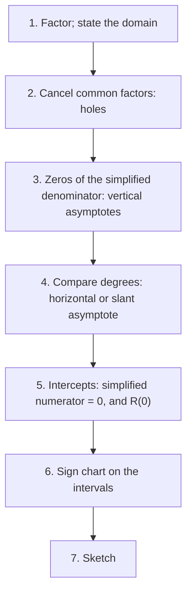

## Putting the features together

The last lesson found the pieces of a rational function's graph one at a time: holes, vertical asymptotes, horizontal asymptotes. This lesson adds the last kind of asymptote (slant) and then combines everything with intercepts and a sign analysis into a reliable graphing routine. The sign analysis is also the engine of the next lesson on inequalities.

## Slant asymptotes

When the numerator's degree is exactly one more than the denominator's, there is no horizontal asymptote; instead the graph approaches a tilted line, a **slant asymptote** (or oblique asymptote). Division explains it. If

$$R(x) = \frac{p(x)}{q(x)} = mx + b + \frac{r(x)}{q(x)}, \qquad \deg r < \deg q,$$

then as $x \to \pm\infty$ the fraction $\frac{r(x)}{q(x)} \to 0$ (smaller degree on top), so $R(x)$ gets closer and closer to the line $y = mx + b$. The slant asymptote is the quotient, and the remainder is thrown away.

### Example 1

Find the slant asymptote of $R(x) = \dfrac{x^2 - x - 6}{x - 1}$.

Synthetic division by $x - 1$ on $1, -1, -6$: bring down 1; $1 \cdot 1 = 1$, $-1 + 1 = 0$; $0 \cdot 1 = 0$, $-6 + 0 = -6$. So

$$R(x) = x + \frac{-6}{x - 1}.$$

Slant asymptote $y = x$. For large positive $x$ the fraction $\frac{-6}{x-1}$ is slightly negative, so the graph sits just below the line; for large negative $x$ it sits just above.

The other features: vertical asymptote $x = 1$; $x$-intercepts from the numerator $(x - 3)(x + 2)$: $x = 3$ and $x = -2$; $y$-intercept $R(0) = \frac{-6}{-1} = 6$.

```plot
{"x": [-8, 10], "y": [-12, 14], "functions": [{"f": "(x^2 - x - 6)/(x - 1)", "label": "y = R(x)"}, {"f": "x", "dashed": true, "label": "y = x"}], "segments": [{"from": [1, -12], "to": [1, 14], "dashed": true}], "points": [{"at": [-2, 0], "label": "−2"}, {"at": [3, 0], "label": "3"}, {"at": [0, 6], "label": "(0, 6)"}], "caption": "R(x) = (x² − x − 6)/(x − 1) with slant asymptote y = x and vertical asymptote x = 1."}
```

If the numerator's degree is two or more above the denominator's, the end behavior follows a polynomial of degree 2 or more (a parabola-like curve), which we don't call an asymptote in this course.

## A graphing routine

For $R(x) = \dfrac{p(x)}{q(x)}$:

1. *Factor* numerator and denominator completely. State the domain.
2. *Holes*: cancel common factors; find each hole's $y$-value from the simplified form.
3. *Vertical asymptotes*: zeros of the simplified denominator.
4. *Horizontal or slant asymptote*: compare degrees (divide if the top is one degree higher).
5. *Intercepts*: $x$-intercepts are zeros of the simplified numerator; the $y$-intercept is $R(0)$ if 0 is in the domain.
6. *Sign chart*: mark every $x$-intercept and vertical asymptote on a number line and test one value in each interval.
7. *Sketch*: follow the signs, approach the asymptotes, and pass through the intercepts.

The same routine as a flowchart:



The sign chart is the step that prevents most errors: it tells you on which side of the axis each piece of the graph lives, and so which way it goes at each vertical asymptote.

### Example 2

Graph $R(x) = \dfrac{2x^2 - 2}{x^2 - 4}$.

1. Factor: $\dfrac{2(x - 1)(x + 1)}{(x - 2)(x + 2)}$. Domain: $x \ne \pm 2$.
2. No common factors, so no holes.
3. Vertical asymptotes: $x = 2$ and $x = -2$.
4. Equal degrees: horizontal asymptote $y = \frac21 = 2$.
5. $x$-intercepts $\pm 1$; $y$-intercept $R(0) = \frac{-2}{-4} = \frac12$.
6. Sign chart, with break points $-2, -1, 1, 2$:

| Interval | Test $x$ | Sign of $R$ |
|---|---|---|
| $(-\infty, -2)$ | $-3$ | $\frac{2(-4)(-2)}{(-5)(-1)} > 0$ |
| $(-2, -1)$ | $-1.5$ | $\frac{2(-2.5)(-0.5)}{(-3.5)(0.5)} < 0$ |
| $(-1, 1)$ | $0$ | $+\tfrac12 > 0$ |
| $(1, 2)$ | $1.5$ | $< 0$ (by symmetry with $(-2, -1)$) |
| $(2, \infty)$ | $3$ | $> 0$ |

7. Sketch: on the far left the graph is above the axis, approaching $y = 2$, and rises to $+\infty$ as $x \to -2^-$. Between $-2$ and $-1$ it is negative: it comes up from $-\infty$ and reaches 0 at $x = -1$. It peaks at $\left(0, \tfrac12\right)$ between the intercepts, and the right half mirrors the left. ($R$ is even: only even powers appear.)

```plot
{"x": [-6, 6], "y": [-8, 10], "functions": [{"f": "(2x^2 - 2)/(x^2 - 4)", "label": "y = R(x)"}, {"f": "2", "dashed": true}], "segments": [{"from": [-2, -8], "to": [-2, 10], "dashed": true}, {"from": [2, -8], "to": [2, 10], "dashed": true}], "points": [{"at": [-1, 0]}, {"at": [1, 0]}, {"at": [0, 0.5], "label": "(0, ½)"}], "caption": "R(x) = (2x² − 2)/(x² − 4): asymptotes x = ±2 and y = 2, intercepts ±1 and ½."}
```

Does the graph ever cross $y = 2$? Solve $\frac{2x^2 - 2}{x^2 - 4} = 2$: $2x^2 - 2 = 2x^2 - 8$, i.e. $-2 = -8$, impossible. So it never does.

## Behavior near a vertical asymptote

The sign chart answers "up or down?" at each vertical asymptote: if $R > 0$ on the interval next to the asymptote, the graph goes up to $+\infty$ there; if $R < 0$, down to $-\infty$. With a squared factor like $(x - 3)^2$ in the denominator, the sign does not change across $x = 3$, so both sides go the same way, like $\frac{1}{x^2}$.

The two graphs below show the difference: an odd power flips sign across the asymptote, an even power does not.

```plot
{"x": [-1, 7], "y": [-8, 8], "functions": [{"f": "1/(x - 3)"}, {"f": "1/(x - 3)^2", "dashed": true}], "segments": [{"from": [3, -8], "to": [3, 8], "dashed": true}], "labels": [{"at": [5.3, -3.5], "text": "solid: y = 1/(x − 3)"}, {"at": [5.3, -5.5], "text": "dashed: y = 1/(x − 3)²"}], "caption": "Near x = 3: 1/(x − 3) goes down on the left and up on the right; 1/(x − 3)² goes up on both sides."}
```

## Common mistakes

- *Using the remainder in the slant asymptote.* The asymptote is the quotient only.
- *Skipping the sign chart.* It is the fastest way to know which way each branch goes.
- *Forgetting holes when listing intercepts.* A cancelled zero of the numerator is a hole, not an intercept.
- *Expecting a horizontal and a slant asymptote together.* A rational function has at most one of the two.
- *Plotting the $y$-intercept when $0$ isn't in the domain.*

## Key points

- If $\deg p = \deg q + 1$, divide: the quotient $y = mx + b$ is the slant asymptote.
- Graph routine: factor, holes, vertical asymptotes, horizontal/slant asymptote, intercepts, sign chart, sketch.
- Every $x$-intercept and vertical asymptote is a potential sign change; test each interval.
- Even powers of a factor don't change sign; odd powers do.
- Check whether the graph crosses a horizontal asymptote by solving $R(x) = L$.
