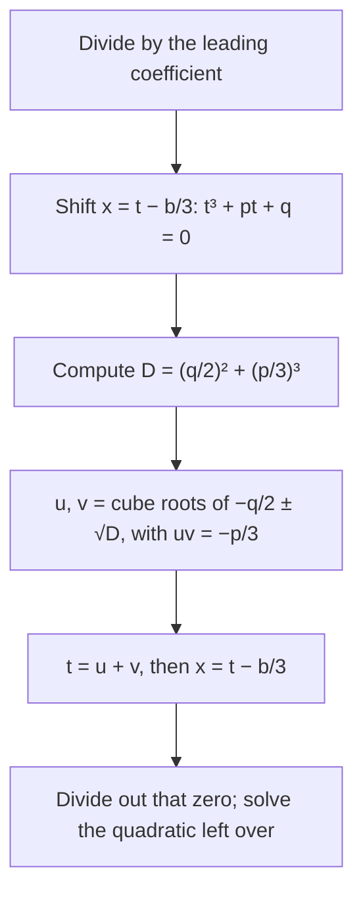

## Beyond the rational zero theorem

Lesson 11 found the zeros of a polynomial by testing rational candidates and dividing. That works only when a rational zero exists. The cubic $x^3 + 3x^2 + 6x + 2$ has none (its candidates $\pm1, \pm2$ all fail), yet its graph plainly crosses the $x$-axis once, since every odd-degree real polynomial has a real zero. Is there an exact formula for that zero, the way the quadratic formula handles every quadratic?

There is, and its story is one of the most famous in mathematics. Finding it in sixteenth-century Italy also forced mathematicians to take square roots of negative numbers seriously, long before anyone was comfortable with them. This lesson derives the cubic formula, uses it, and shows exactly where complex numbers became unavoidable.

## A short history

The dates and roles below are the standard account; some details rest on Cardano's and Tartaglia's own (conflicting) testimony.

- Around 1515, Scipione del Ferro of Bologna solved cubics of the form "cube plus things equals number" ($x^3 + px = q$ with $p, q > 0$; negative coefficients were not yet in use). He kept the method secret and passed it to his student Antonio Fior.
- In 1535 Fior challenged Niccolò Tartaglia to a problem-solving contest. Tartaglia found the method himself shortly before the contest and won.
- In 1539 Tartaglia told Gerolamo Cardano the rule, reportedly after Cardano promised not to publish it. After seeing del Ferro's papers, Cardano published the method, with full credit to both men, in his book *Ars Magna* (1545). The same book included Lodovico Ferrari's solution of the quartic.
- In 1572 Rafael Bombelli's *Algebra* showed how to calculate with the strange square roots of negatives that the formula sometimes produced.

## Step 1: depress the cubic

Divide by the leading coefficient so the cubic is $x^3 + bx^2 + cx + d$. The $x^2$ term is the nuisance, and a shift removes it. Substitute $x = t - \dfrac{b}{3}$. Expanding (a good exercise) gives

$$t^3 + pt + q = 0, \qquad p = c - \frac{b^2}{3}, \qquad q = \frac{2b^3}{27} - \frac{bc}{3} + d.$$

A cubic with no squared term is called a **depressed cubic** (the same word as the depressed polynomial of Lesson 9, meaning "lowered"). The shift is a horizontal translation of the graph, from Module 2: it moves the graph so that its center of symmetry (every cubic graph has one, at the inflection point) lies on the vertical axis.

### Example 1

Depress $x^3 + 3x^2 + 6x + 2 = 0$.

Here $b = 3$, $c = 6$, $d = 2$, so $x = t - 1$. Then $p = 6 - \tfrac{9}{3} = 3$ and $q = \tfrac{2 \cdot 27}{27} - \tfrac{18}{3} + 2 = 2 - 6 + 2 = -2$. The equation becomes

$$t^3 + 3t - 2 = 0.$$

Check by substituting directly: $(t-1)^3 + 3(t-1)^2 + 6(t-1) + 2 = t^3 - 3t^2 + 3t - 1 + 3t^2 - 6t + 3 + 6t - 6 + 2 = t^3 + 3t - 2$. ✓

## Step 2: split the unknown in two

Here is the key idea. Look for a solution of the form $t = u + v$. Cubing,

$$(u + v)^3 = u^3 + v^3 + 3uv(u + v), \quad\text{so}\quad t^3 - 3uv\,t - (u^3 + v^3) = 0.$$

Compare with $t^3 + pt + q = 0$. It is enough to choose $u$ and $v$ with

$$3uv = -p \qquad\text{and}\qquad u^3 + v^3 = -q.$$

Cube the first condition: $u^3 v^3 = -\dfrac{p^3}{27}$. Now we know the sum and the product of the two numbers $u^3$ and $v^3$, so they are the two roots of a quadratic in $z$:

$$z^2 + qz - \frac{p^3}{27} = 0, \qquad z = -\frac{q}{2} \pm \sqrt{\left(\frac{q}{2}\right)^2 + \left(\frac{p}{3}\right)^3}.$$

A cubic has been reduced to a quadratic. Taking cube roots gives **Cardano's formula**:

$$t = \sqrt[3]{-\frac q2 + \sqrt{D}} + \sqrt[3]{-\frac q2 - \sqrt{D}}, \qquad D = \left(\frac{q}{2}\right)^2 + \left(\frac{p}{3}\right)^3.$$

One condition hides in the derivation: the two cube roots must multiply to $-\tfrac p3$ (that was $3uv = -p$). When $D \ge 0$ everything is real and the real cube roots satisfy it automatically.



### Example 2

Solve $t^3 + 3t - 2 = 0$, and so $x^3 + 3x^2 + 6x + 2 = 0$.

1. $p = 3$, $q = -2$: $D = (-1)^2 + 1^3 = 2$.
2. $t = \sqrt[3]{1 + \sqrt2} + \sqrt[3]{1 - \sqrt2}$. Numerically, $\sqrt[3]{2.41421} \approx 1.34151$ and $\sqrt[3]{-0.41421} \approx -0.74544$, so $t \approx 0.59607$. (Check the product: $\sqrt[3]{(1 + \sqrt2)(1 - \sqrt2)} = \sqrt[3]{-1} = -1 = -\tfrac p3$. ✓)
3. $x = t - 1 \approx -0.40393$.

So the real zero is exactly $x = \sqrt[3]{1 + \sqrt2} + \sqrt[3]{1 - \sqrt2} - 1$, about $-0.404$. Dividing it out leaves a quadratic with negative discriminant, so the other two zeros are a conjugate pair (about $-1.298 \pm 1.807i$).

### Example 3

Solve $t^3 + 6t - 20 = 0$, a classic from Cardano's book.

$p = 6$, $q = -20$: $D = 100 + 8 = 108$ and $\sqrt{108} = 6\sqrt3$, so

$$t = \sqrt[3]{10 + 6\sqrt3} + \sqrt[3]{10 - 6\sqrt3}.$$

That looks irrational, but a calculator gives $2.7321 + (-0.7321) = 2$. In fact $(1 + \sqrt3)^3 = 1 + 3\sqrt3 + 9 + 3\sqrt3 = 10 + 6\sqrt3$, so the cube roots are $1 + \sqrt3$ and $1 - \sqrt3$, whose sum is $2$. The rational zero theorem would have found $t = 2$ faster. The lesson: Cardano's formula always works, but its answer can be a disguised simple number. Dividing, $t^3 + 6t - 20 = (t - 2)(t^2 + 2t + 10)$, and the other zeros are $-1 \pm 3i$.

## The irreducible case: where complex numbers became necessary

What happens when $D < 0$? Then $\sqrt D$ is imaginary, and sixteenth-century mathematicians, Cardano included, concluded that the formula failed. Bombelli looked at

$$x^3 = 15x + 4, \quad\text{that is}\quad t^3 - 15t - 4 = 0.$$

It has the obvious solution $t = 4$ ($64 - 60 - 4 = 0$). But with $p = -15$, $q = -4$: $D = 4 + (-5)^3 = -121$, and the formula says

$$t = \sqrt[3]{2 + 11i} + \sqrt[3]{2 - 11i}.$$

Bombelli's insight was to calculate anyway, treating $\sqrt{-1}$ by the ordinary rules. He found that $(2 + i)^3 = 8 + 12i + 6i^2 + i^3 = 8 + 12i - 6 - i = 2 + 11i$. So one cube root is $2 + i$, the other is $2 - i$ (their product is $5 = -\tfrac p3$, as required), and

$$t = (2 + i) + (2 - i) = 4.$$

The imaginary parts cancel and the formula gives the real answer. The other two roots, from $t^2 + 4t + 1 = 0$, are $-2 \pm \sqrt3$: also real.

```plot
{"x": [-5, 5.5], "y": [-30, 30], "functions": [{"f": "x^3 - 15x - 4", "label": "y = t³ − 15t − 4"}], "points": [{"at": [4, 0]}, {"at": [-3.732, 0]}, {"at": [-0.268, 0]}], "labels": [{"at": [3.5, 4], "text": "4"}, {"at": [-2.8, -11], "text": "−2 − √3"}, {"at": [-1.5, -6], "text": "−2 + √3"}], "xLabel": "t", "caption": "Bombelli's cubic has three real roots, yet Cardano's formula reaches them through 2 ± 11i."}
```

This is the **casus irreducibilis** (Latin for "irreducible case"): when $D < 0$ the cubic has three different real roots, and the formula can only reach them through non-real numbers. It was proved in the 1800s that no formula using only real radicals can avoid this. So complex numbers were not invented to solve $x^2 = -1$ (people were happy to say that has no solution); they were accepted because they were needed to reach *real* answers.

## What the sign of D tells you

For a depressed cubic with real $p$ and $q$:

| $D = \left(\tfrac q2\right)^2 + \left(\tfrac p3\right)^3$ | Real roots |
|---|---|
| $D > 0$ | one real root and two non-real conjugates |
| $D = 0$ | all real, with a repeated root |
| $D < 0$ | three different real roots (the irreducible case) |

(The usual **discriminant of a cubic** is $\Delta = -4p^3 - 27q^2 = -108D$, so the signs are reversed: $\Delta > 0$ means three real roots.) Checks: Example 2 had $D = 2 > 0$ and one real root; Bombelli's cubic had $D = -121 < 0$ and three. For $t^3 - 3t + 2 = (t - 1)^2(t + 2)$, $D = 1 + (-1)^3 = 0$, and $1$ is a double root.

## After the cubic

Ferrari's quartic method reduces a degree-4 equation to a cubic, so quartics also have a formula in radicals. For degree 5 the search failed for centuries, and for good reason: Paolo Ruffini (1799, with a gap) and Niels Henrik Abel (1824) proved that no formula built from $+, -, \times, \div$ and roots can solve every quintic. Évariste Galois then explained which polynomial equations *can* be solved that way. In practice, scientists and calculators solve cubics and higher-degree equations numerically, by methods like the bisection of Lesson 8, because even the cubic formula is clumsy to evaluate.

## Common mistakes

- *Skipping the shift.* Cardano's formula is for $t^3 + pt + q$; with an $x^2$ term, depress first, and remember to shift back ($x = t - \tfrac b3$).
- *Sign slips in $q$.* The formula uses $-\tfrac q2$. For $t^3 + 3t - 2$, $q = -2$, so $-\tfrac q2 = +1$.
- *Taking the real cube root of a negative wrongly.* $\sqrt[3]{-0.414} \approx -0.745$; a cube root of a negative number is negative.
- *Thinking $D < 0$ means no real roots.* It means three real roots. That is the opposite of the quadratic case.
- *Expecting the formula to look simple.* It can give $\sqrt[3]{10 + 6\sqrt3} + \sqrt[3]{10 - 6\sqrt3}$ for the number 2; check rational candidates first.

## Key points

- Shift $x = t - \tfrac b3$ to remove the $x^2$ term: $t^3 + pt + q = 0$.
- Write $t = u + v$ with $3uv = -p$ and $u^3 + v^3 = -q$; then $u^3$ and $v^3$ solve a quadratic.
- Cardano's formula: $t = \sqrt[3]{-\tfrac q2 + \sqrt D} + \sqrt[3]{-\tfrac q2 - \sqrt D}$, with $D = \left(\tfrac q2\right)^2 + \left(\tfrac p3\right)^3$.
- $D > 0$: one real root; $D = 0$: a repeated root; $D < 0$: three real roots, reached only through complex numbers.
- The irreducible case is why complex numbers were accepted. Degree 5 and up have no general formula in radicals.
