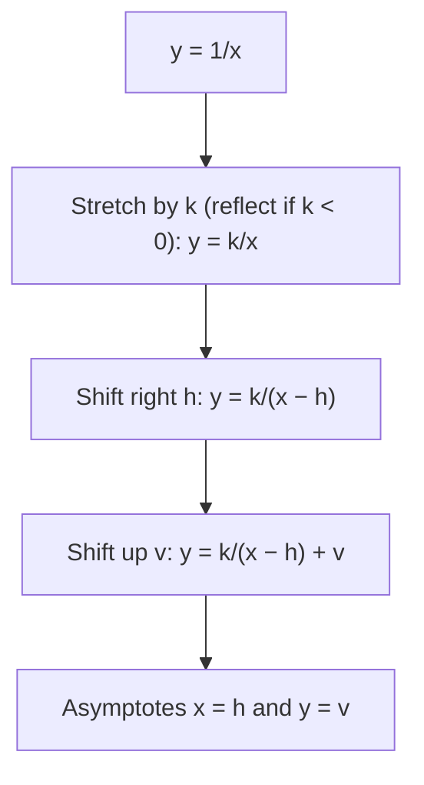

## The simplest rational functions

Lessons 12 and 13 found asymptotes and graphed rational functions of every shape. The simplest nontrivial ones are quotients of two linear expressions,

$$f(x) = \frac{ax + b}{cx + d}, \qquad c \ne 0,$$

called **linear fractional functions**. You have graphed many of them, and they always seem to look the same: two branches hugging a vertical and a horizontal asymptote, like $y = \frac1x$. This lesson proves that this is no accident. Every such function is $\frac1x$ moved by the transformations of Module 2. The same algebra explains their inverses and compositions, and it shows up in physics: the thin-lens equation of optics is a linear fractional function.

## Dividing it out

Divide $ax + b$ by $cx + d$ (Lesson 9): the quotient is $\frac ac$ and the remainder is $b - \frac{ad}{c}$. So

$$\frac{ax + b}{cx + d} = \frac ac + \frac{b - \frac{ad}{c}}{cx + d} = \frac ac + \frac{\frac{bc - ad}{c^2}}{x + \frac dc}.$$

Name the pieces $h = -\dfrac dc$, $v = \dfrac ac$ and $k = \dfrac{bc - ad}{c^2}$:

$$f(x) = \frac{k}{x - h} + v.$$

Read this as a chain of transformations of $y = \frac1x$:



The asymptotes of $\frac1x$, the two axes, move to $x = h$ and $y = v$: the same answers as Lesson 12 ($x = -\frac dc$ from the denominator, $y = \frac ac$ from the leading coefficients), now with a reason.

Two special cases:
- If $ad - bc = 0$, then $k = 0$ and $f$ is the constant $\frac ac$ (with a hole at $x = h$). For example, $\frac{2x + 6}{x + 3} = 2$ for $x \ne -3$.
- Otherwise $k$ has the same sign as $bc - ad$, and that sign decides whether the graph sits in the upper-right and lower-left quarters around the center ($k > 0$, like $\frac1x$) or in the other two ($k < 0$).

### Example 1

Write $f(x) = \dfrac{2x + 1}{x - 3}$ as a transformation of $\frac1x$.

1. Divide: $2x + 1 = 2(x - 3) + 7$, so $f(x) = 2 + \dfrac{7}{x - 3}$.
2. Read off $k = 7$, $h = 3$, $v = 2$: stretch $\frac1x$ by 7, shift right 3 and up 2.
3. Asymptotes $x = 3$ and $y = 2$. Since $k > 0$, the graph lies above and to the right of the point $(3, 2)$ and below and to the left of it.

Check with the formula: $a = 2$, $b = 1$, $c = 1$, $d = -3$ give $k = \frac{(1)(1) - (2)(-3)}{1} = 7$. ✓

```plot
{"x": [-4, 10], "y": [-6, 10], "functions": [{"f": "(2x + 1)/(x - 3)", "label": "y = (2x + 1)/(x − 3)"}, {"f": "2", "dashed": true}], "segments": [{"from": [3, -6], "to": [3, 10], "dashed": true}], "points": [{"at": [3, 2], "open": true, "label": "center (3, 2)"}, {"at": [4, 9], "label": "(4, 9)"}, {"at": [2, -5], "label": "(2, −5)"}], "caption": "f(x) = 2 + 7/(x − 3): the graph of 1/x stretched by 7 and centered at (3, 2). Points 1 unit either side of 3 are mirror images through the center."}
```

## The center of symmetry

The graph of $\frac1x$ is symmetric about the origin (it is odd: Lesson 4). Transformations carry that symmetry to the point $(h, v)$, the **center of symmetry** where the asymptotes cross. In symbols, for every $s \ne 0$,

$$f(h + s) + f(h - s) = 2v,$$

because $\frac{k}{s} + v$ and $\frac{k}{-s} + v$ add to $2v$. In Example 1, $f(4) = 9$ and $f(2) = -5$, and $9 + (-5) = 4 = 2 \cdot 2$. ✓ So after plotting one branch, you can draw the other by reflecting through the center.

## Inverses stay in the family

Solve $y = \dfrac{ax + b}{cx + d}$ for $x$:

$$y(cx + d) = ax + b \implies cxy - ax = b - dy \implies x = \frac{dy - b}{-cy + a}.$$

So the inverse is again linear fractional:

$$f^{-1}(x) = \frac{dx - b}{-cx + a}.$$

The pattern is easy to remember: swap $a$ and $d$, and change the signs of $b$ and $c$. Because an inverse reflects the graph across $y = x$ (Lesson 7), the asymptotes trade places: $f^{-1}$ has vertical asymptote $x = \frac ac$ and horizontal asymptote $y = -\frac dc$. Every linear fractional function with $ad - bc \ne 0$ is one-to-one, as its graph shows (each branch is strictly increasing or strictly decreasing, and the two branches cover different $y$-values).

### Example 2

Find the inverse of $f(x) = \dfrac{2x + 1}{x - 3}$ and check it.

1. Swap $a = 2$ and $d = -3$, change the signs of $b$ and $c$: $f^{-1}(x) = \dfrac{-3x - 1}{-x + 2} = \dfrac{3x + 1}{x - 2}$.
2. Asymptotes of $f^{-1}$: $x = 2$ and $y = 3$, the asymptotes of $f$ swapped.
3. Check: $f(4) = 9$, and $f^{-1}(9) = \dfrac{27 + 1}{9 - 2} = \dfrac{28}{7} = 4$. ✓

## Compositions stay in the family too

Compose two linear fractional functions and clear the small fractions: the result is linear fractional again. A striking example is $g(x) = \dfrac{1}{1 - x}$:

$$g(g(x)) = \frac{1}{1 - \frac{1}{1 - x}} = \frac{1 - x}{(1 - x) - 1} = \frac{x - 1}{x}, \qquad g(g(g(x))) = \frac{1}{1 - \frac{x - 1}{x}} = \frac{x}{x - (x - 1)} = x.$$

Applying $g$ three times gives back $x$ (for $x \ne 0, 1$): starting at 2, the values cycle $2 \to -1 \to \tfrac12 \to 2$. (In Module 6 you will multiply matrices; composing $\frac{ax + b}{cx + d}$ functions turns out to match multiplying the matrices $\begin{bmatrix} a & b \\ c & d \end{bmatrix}$, which is one reason these functions matter in higher mathematics.)

## An application: the thin-lens equation

For a thin converging lens with **focal length** $f$, an object at distance $d_o$ from the lens produces a sharp image at distance $d_i$ on the other side, where

$$\frac{1}{d_o} + \frac{1}{d_i} = \frac{1}{f}.$$

This is the standard thin-lens model; real lenses only approximately obey it. Solving for the image distance gives a linear fractional function of $d_o$:

$$d_i = \frac{f\,d_o}{d_o - f} = f + \frac{f^2}{d_o - f}.$$


### Example 3

A lens has $f = 10$ cm. Describe $d_i$ as a function of $d_o$.

1. $d_i = \dfrac{10 d_o}{d_o - 10} = 10 + \dfrac{100}{d_o - 10}$: the graph of $\frac{100}{x}$ centered at $(10, 10)$.
2. Values: $d_o = 30$ gives $d_i = 15$ (the picture above); $d_o = 20$ gives $20$; $d_o = 15$ gives $30$.
3. Horizontal asymptote $d_i = 10$: very distant objects focus at the focal length. That is why a lens can focus sunlight to a point one focal length away.
4. Vertical asymptote $d_o = 10$: as the object approaches the focal point, the image moves off toward infinity.
5. For $d_o < 10$, $d_i$ is negative; for example $d_o = 5$ gives $d_i = -10$. In the usual sign convention a negative $d_i$ means a virtual image on the same side as the object: what you see through a magnifying glass held close.

The center of symmetry also has meaning here: $d_o = 20$ and $d_i = 20$ (twice the focal length on each side) is the point where object and image distances are equal.

## Common mistakes

- *Dividing incorrectly.* Check $f(x) = v + \frac{k}{x - h}$ by recombining: $2 + \frac{7}{x - 3} = \frac{2(x - 3) + 7}{x - 3} = \frac{2x + 1}{x - 3}$.
- *Getting $h$'s sign wrong.* The vertical asymptote of $\frac{ax + b}{cx + d}$ is $x = -\frac dc$, so $\frac{1}{x + 4}$ is shifted *left* 4.
- *Inverse pattern errors.* Swap $a$ and $d$; negate $b$ and $c$. Don't negate everything.
- *Forgetting the degenerate case.* If $ad - bc = 0$ the function is constant (with a hole), not a hyperbola.
- *Reading negative image distances as errors.* In the lens model they mean virtual images.

## Key points

- $\dfrac{ax + b}{cx + d} = v + \dfrac{k}{x - h}$ with $h = -\dfrac dc$, $v = \dfrac ac$, $k = \dfrac{bc - ad}{c^2}$: a stretched, shifted $\frac1x$.
- The asymptotes $x = h$, $y = v$ cross at the center of symmetry: $f(h + s) + f(h - s) = 2v$.
- $ad - bc = 0$ gives a constant; otherwise $f$ is one-to-one.
- Inverse: $\dfrac{dx - b}{-cx + a}$; the asymptotes swap. Compositions are again linear fractional.
- Thin lens: $d_i = \dfrac{f d_o}{d_o - f}$, with asymptotes $d_o = f$ and $d_i = f$.
