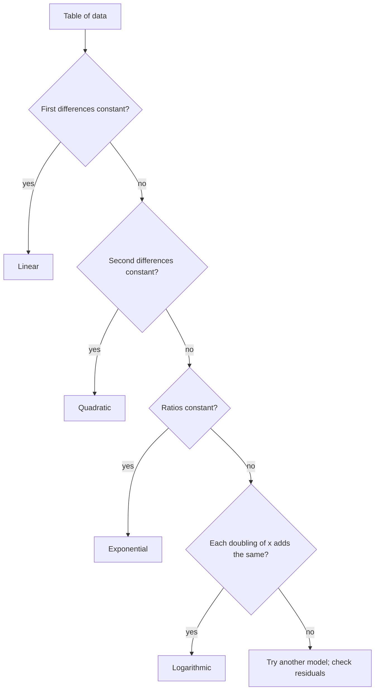

## From data to a formula

In the last lesson every model arrived with its shape already chosen: "assume exponential growth," "use Newton's law of cooling." Real work usually starts one step earlier, with a description or a table of measurements, and the first job is to decide which kind of function fits. This lesson covers both halves of that job: building a function from a verbal description, and fitting linear, quadratic, exponential and logarithmic models to data, then checking the fit with residuals. It closes the module by pulling together every family of functions you've studied so far.

## Building a model from a description

When a problem describes a situation in words, name one variable, write every other quantity in terms of it, and state a domain that makes physical sense.

### Example 1

A farmer has 200 m of fencing for a rectangular pen. Write the area as a function of one side length and find the largest possible area.

1. Let $x$ be the length of one side. The perimeter is $2x + 2w = 200$, so the other side is $w = 100 - x$.
2. Area: $A(x) = x(100 - x) = -x^2 + 100x$.
3. Domain: both sides must be positive, so $0 < x < 100$.
4. $A$ is a downward parabola with vertex at $x = -\dfrac{100}{2(-1)} = 50$. The best pen is a $50 \times 50$ square with area $A(50) = 2{,}500\text{ m}^2$.

## Fitting a line to data

Measured data rarely lie exactly on a curve. A **scatter plot** of the points shows the trend, and **regression** finds the function of a chosen type that fits best. For a line $\hat y = mx + b$ (read "$y$-hat," the predicted value), each data point has a **residual**,

$$\text{residual} = y - \hat y = \text{observed} - \text{predicted}.$$

A positive residual means the point lies above the line. The **least-squares regression line** is the line that makes the sum of the squared residuals as small as possible. Squaring keeps positive and negative misses from cancelling and penalizes big misses heavily. Calculus or algebra shows the best line has

$$m = \frac{\sum (x - \bar x)(y - \bar y)}{\sum (x - \bar x)^2}, \qquad b = \bar y - m\bar x,$$

where $\bar x$ and $\bar y$ are the means. The second formula says the line always passes through the point $(\bar x, \bar y)$, and its residuals always add to 0. Calculators (LinReg) and spreadsheets (trendlines) do this arithmetic for you, along with the **correlation coefficient** $r$: a number from $-1$ to $1$ whose sign matches the slope and whose size measures how tightly the points hug a line.

### Example 2

A small store's weekly sales (in hundreds of items) for five weeks are $(1, 3)$, $(2, 5)$, $(3, 6)$, $(4, 9)$, $(5, 10)$. Find the least-squares line and predict week 7.

1. Means: $\bar x = 3$, $\bar y = \frac{3 + 5 + 6 + 9 + 10}{5} = 6.6$.
2. Deviations: $x - \bar x = -2, -1, 0, 1, 2$ and $y - \bar y = -3.6, -1.6, -0.6, 2.4, 3.4$.
3. $\sum(x - \bar x)(y - \bar y) = 7.2 + 1.6 + 0 + 2.4 + 6.8 = 18$ and $\sum(x - \bar x)^2 = 4 + 1 + 0 + 1 + 4 = 10$.
4. $m = \frac{18}{10} = 1.8$ and $b = 6.6 - 1.8(3) = 1.2$, so $\hat y = 1.8x + 1.2$.
5. Week 7: $\hat y = 1.8(7) + 1.2 = 13.8$, about 1,380 items.

The residuals are $0, 0.2, -0.6, 0.6, -0.2$; they add to 0, as promised, and show no pattern. Here $r \approx 0.99$. Predicting inside the range of the data ($1 \le x \le 5$) is **interpolation**; week 7 is outside it, which is **extrapolation**, and it is only as trustworthy as the assumption that the trend continues.

```plot
{"x": [0, 8], "y": [0, 16], "xLabel": "week", "yLabel": "sales (hundreds)", "functions": [{"f": "1.8x + 1.2", "label": "ŷ = 1.8x + 1.2"}], "points": [{"at": [1, 3]}, {"at": [2, 5]}, {"at": [3, 6]}, {"at": [4, 9]}, {"at": [5, 10]}, {"at": [7, 13.8], "open": true, "label": "prediction"}], "caption": "The least-squares line through the five weeks of data, extended to predict week 7 (open dot)."}
```

## Choosing the type of model

Four families cover most precalculus data. When the $x$-values are equally spaced, simple tests on the table point to the right one:

| Pattern in the data | Model | Calculator |
|---|---|---|
| constant first differences in $y$ | linear $y = mx + b$ | LinReg |
| constant second differences in $y$ | quadratic $y = ax^2 + bx + c$ | QuadReg |
| constant ratios $y_{k+1}/y_k$ | exponential $y = ab^x$ | ExpReg |
| each doubling of $x$ adds about the same amount | logarithmic $y = a + b\ln x$ | LnReg |

The tests can be run in order, as a decision chart:



Why these tests work: a line adds the same amount per step; a quadratic's differences grow linearly; an exponential multiplies by $b$ per step; and since $\ln(2x) = \ln x + \ln 2$, a logarithm adds $b\ln 2$ every time $x$ doubles.

Exponential and logarithmic fits are found by turning them into lines. Taking logs of $y = ab^x$ gives $\ln y = \ln a + x\ln b$, so $\ln y$ against $x$ is linear. For $y = a + b\ln x$, $y$ against $\ln x$ is linear. This is called **linearizing** the data, and it is exactly what ExpReg and LnReg do behind the scenes. When a model must pass through two given points exactly, divide instead: for $y = ab^x$ through $(x_1, y_1)$ and $(x_2, y_2)$, the $a$ cancels and $b^{x_2 - x_1} = \frac{y_2}{y_1}$; then either point gives $a$.

### Example 3

A bacteria count at hourly intervals reads $200, 260, 338, 439, 571$. Which model fits, and what does it predict at 6 hours?

1. First differences: $60, 78, 101, 132$. Not constant, so not linear.
2. Second differences: $18, 23, 31$. Not constant, so not quadratic.
3. Ratios: $\frac{260}{200} = 1.30$, $\frac{338}{260} = 1.30$, $\frac{439}{338} \approx 1.30$, $\frac{571}{439} \approx 1.30$. Constant: exponential.
4. Model: $N(t) = 200(1.3)^t$, starting value 200 and growth factor 1.3 (30% per hour).
5. Prediction: $N(6) = 200(1.3)^6 \approx 965$ bacteria.

Linearizing confirms it. Plot $\ln N$ against $t$: the values $\ln 200 \approx 5.298$, $5.561$, $5.823$, $6.084$, $6.347$ go up by about $0.262 = \ln 1.3$ each hour, so they lie on the line $\ln N = \ln 200 + t\ln 1.3$.

```plot
{"x": [-0.5, 5], "y": [5, 6.6], "xLabel": "t (hours)", "yLabel": "ln N", "functions": [{"f": "ln(200) + x*ln(1.3)", "label": "ln N = ln 200 + t ln 1.3"}], "points": [{"at": [0, 5.298]}, {"at": [1, 5.561]}, {"at": [2, 5.823]}, {"at": [3, 6.084]}, {"at": [4, 6.347]}], "caption": "After taking ln of the counts, the exponential data lie on a straight line with slope ln 1.3 ≈ 0.262."}
```

### Example 4

A plant's height (cm) at $x = 1, 2, 4, 8, 16$ weeks is $4.0, 6.1, 7.9, 10.0, 12.1$. Fit a model and predict week 30.

The $x$-values double each time and the heights rise by about 2 each time, the logarithmic signature. Use $y = a + b\ln x$. At $x = 1$, $\ln 1 = 0$, so $a = 4.0$. Using $(16, 12.1)$: $12.1 = 4.0 + b\ln 16$, so $b = \frac{8.1}{\ln 16} \approx 2.92$. Prediction: $y(30) = 4.0 + 2.92\ln 30 \approx 13.9$ cm. (LnReg on all five points gives $y \approx 4.00 + 2.90\ln x$, nearly the same.) Note the slowing growth: a logarithmic model rises forever, but more and more slowly.

## Residual plots: checking the fit

A good model leaves residuals that look like random noise. Plot each residual against $x$ in a **residual plot**: a shapeless scatter around 0 means the model has captured the trend; a curved pattern means the model is the wrong type.

### Example 5

The data $(0, 1)$, $(1, 2)$, $(2, 5)$, $(3, 10)$, $(4, 17)$ have least-squares line $\hat y = 4x - 1$, with $r \approx 0.96$. Is a line a good model?

Predictions: $-1, 3, 7, 11, 15$. Residuals: $1 - (-1) = 2$, then $-1, -2, -1, 2$. The pattern is a U: positive, negative, negative, negative, positive. The line is too high in the middle and too low at both ends, so the data bend. Second differences of $y$ ($1, 3, 5, 7$ give $2, 2, 2$) are constant, so a quadratic fits, and in fact $y = x^2 + 1$ exactly. A high $r$ alone did not reveal the problem; the residual plot did.

```plot
{"x": [-0.5, 4.5], "y": [-3, 3], "xLabel": "x", "yLabel": "residual", "functions": [{"f": "0", "dashed": true}], "points": [{"at": [0, 2]}, {"at": [1, -1]}, {"at": [2, -2]}, {"at": [3, -1]}, {"at": [4, 2]}], "caption": "Residuals from the line ŷ = 4x − 1 form a U shape, so a curved model fits better."}
```

## Common mistakes

- *Residual backward.* It is observed minus predicted, $y - \hat y$; a point above the line has a positive residual.
- *Trusting $r$ alone.* Curved data can have $r$ near 1; always look at the residual plot.
- *Extrapolating too far.* A model fitted to weeks 1 to 5 says little about week 50.
- *Testing ratios on unequally spaced $x$.* The difference and ratio tests need equally spaced $x$-values.
- *Forgetting the domain.* A side length, a count or a time must stay in a sensible range.
- *Mixing up exponential and logarithmic shapes.* Exponential growth speeds up; logarithmic growth slows down.

## Key points

- Model from words: one variable, everything in terms of it, a sensible domain.
- Residual $= y - \hat y$; least squares minimizes the sum of squared residuals.
- The regression line passes through $(\bar x, \bar y)$, with $m = \frac{\sum(x - \bar x)(y - \bar y)}{\sum(x - \bar x)^2}$.
- Constant differences: linear. Constant second differences: quadratic. Constant ratios: exponential. Equal steps per doubling of $x$: logarithmic.
- $\ln y$ vs. $x$ linear means exponential; $y$ vs. $\ln x$ linear means logarithmic.
- A good model leaves a patternless residual plot.
