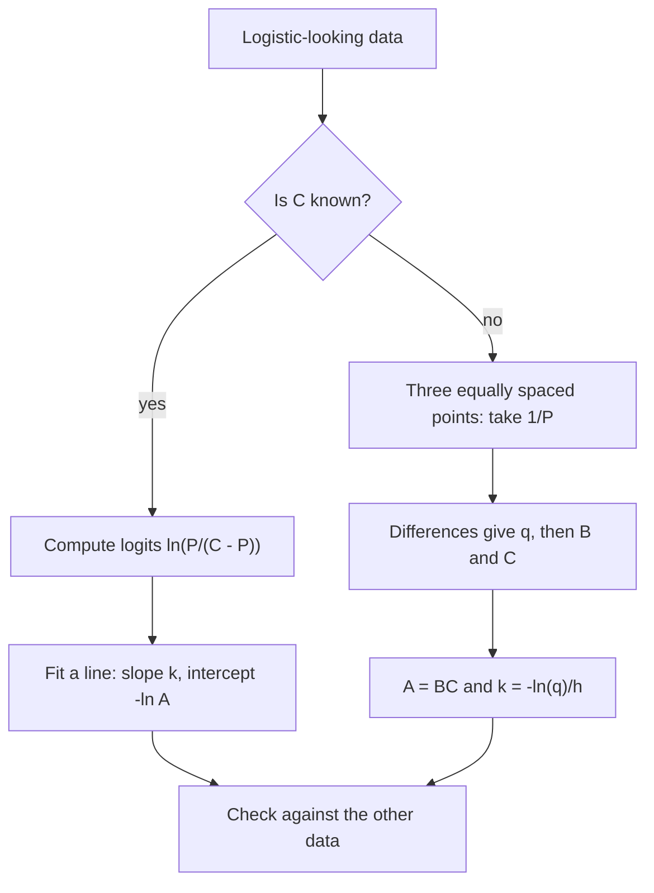

## Beyond plugging in

Lesson 18 introduced the logistic model $P(t) = \dfrac{C}{1 + Ae^{-kt}}$ and used it with the constants already supplied. Lesson 19 showed how to find an exponential model from data by **linearizing**: taking $\ln y$ turns $y = ab^x$ into a straight line. This honors lesson does the same for the logistic model. You'll see that the S-curve has an exact symmetry, that it can be solved for $t$ in one line, that a clever logarithm called the logit turns it into a straight line, and that three equally spaced measurements are enough to recover all three constants. It ends with a famous forecast that went wrong, a reminder of what any fitted model can and can't tell you.

## The midpoint form

Growth is fastest at half capacity, $P = \frac C2$, which happens when $Ae^{-kt} = 1$, at time $t_m = \frac{\ln A}{k}$ (Lesson 18). Call $t_m$ the **logistic midpoint**. Since $A = e^{kt_m}$,

$$Ae^{-kt} = e^{kt_m}e^{-kt} = e^{-k(t - t_m)},$$

so the same model can be written

$$P(t) = \frac{C}{1 + e^{-k(t - t_m)}}.$$

This **midpoint form** shows that every logistic curve is the basic curve $\frac{1}{1 + e^{-t}}$ stretched vertically by $C$, scaled horizontally by a factor $\frac1k$, and shifted right by $t_m$: transformations from Module 2. Each constant now has a plain meaning: $C$ is the ceiling, $t_m$ is when the curve is half full, and $k$ sets how quickly it climbs.

## The S-curve is symmetric

Pick any time $s$ and compare the population $s$ units after the midpoint with the population $s$ units before it. With $w = e^{-ks}$,

$$P(t_m + s) + P(t_m - s) = \frac{C}{1 + w} + \frac{C}{1 + \frac1w} = \frac{C}{1 + w} + \frac{Cw}{w + 1} = C.$$

The two values always add to $C$: if the curve is 20% full one year before the midpoint, it is 80% full one year after. Geometrically, the graph is symmetric about the point $\left(t_m, \frac C2\right)$: rotating it half a turn about that point lands it on itself. The slow start and the slow finish are mirror images.

```plot
{"x": [0, 14], "y": [0, 1100], "xLabel": "t", "yLabel": "P", "functions": [{"f": "1000/(1 + exp(-0.8(x - 7)))", "label": "P(t)"}, {"f": "1000", "dashed": true}], "points": [{"at": [7, 500]}, {"at": [5, 168]}, {"at": [9, 832]}], "segments": [{"from": [5, 168], "to": [9, 832], "dashed": true}], "caption": "The curve P = 1000/(1 + e^(−0.8(t − 7))). Points 2 units before and after the midpoint have P-values adding to 1000; the segment joining them passes through the midpoint.", "labels": [{"at": [6.6, 110], "text": "(5, 168)"}, {"at": [7.6, 900], "text": "(9, 832)"}, {"at": [9.4, 420], "text": "midpoint (7, 500)"}]}
```

## Solving for time

To ask "when will $P$ reach a given value?", solve the model for $t$. From $P\left(1 + Ae^{-kt}\right) = C$:

$$Ae^{-kt} = \frac{C}{P} - 1 = \frac{C - P}{P} \implies t = \frac1k\ln\frac{AP}{C - P}.$$

This works for any $0 < P < C$. As $P$ approaches $C$, the fraction blows up and $t \to \infty$: the curve never actually reaches its ceiling.

### Example 1

The rumor model from Lesson 18 is $P(t) = \dfrac{1000}{1 + 9e^{-0.5t}}$. When have 900 students heard the rumor?

$$t = \frac{1}{0.5}\ln\frac{9 \cdot 900}{100} = 2\ln 81 \approx 8.79 \text{ days}.$$

Symmetry check: the curve starts at 100, which is 10% of 1,000, at $t = 0$, and the midpoint is $t_m = \frac{\ln 9}{0.5} \approx 4.39$. Reaching 90% should take exactly as long after the midpoint as 10% took before it, so it should happen at $2t_m \approx 8.79$. ✓

## The logit: straightening the S

Rearranging the same equation the other way puts everything involving $P$ on one side and a simple expression in $t$ on the other:

$$\ln\frac{P}{C - P} = kt - \ln A.$$

The left side is called the **logit** of $P$ (relative to $C$). The equation says the logit is a *linear* function of $t$ with slope $k$ and intercept $-\ln A$. So if you know the carrying capacity, you can linearize logistic data just as Lesson 19 linearized exponential data: compute $\ln\frac{P}{C - P}$ for each measurement and look for a straight line.

The quantity $\frac{P}{C - P}$ is the ratio of "already" to "not yet": people who have heard the rumor to people who haven't. In a logistic model that ratio grows *exactly* exponentially, multiplying by $e^k$ every unit of time, even while $P$ itself levels off. Statisticians call $\frac{p}{1 - p}$ the *odds* of a probability $p$, so the logit is also called the log-odds.

### Example 2

A pond is stocked with fish, and biologists estimate it can support 500. Counts every two years are:

| $t$ (years) | 0 | 2 | 4 | 6 |
|---|---|---|---|---|
| $P$ | 20 | 61 | 157 | 302 |

Fit a logistic model with $C = 500$.

1. Logits $\ln\frac{P}{500 - P}$: $\ln\frac{20}{480} \approx -3.178$, $\ln\frac{61}{439} \approx -1.974$, $\ln\frac{157}{343} \approx -0.781$, $\ln\frac{302}{198} \approx 0.422$.
2. Successive differences: $1.204$, $1.192$, $1.204$. Nearly constant, so the logits lie close to a line and the logistic model fits.
3. Slope from the first and last points: $k \approx \frac{0.422 - (-3.178)}{6 - 0} = \frac{3.600}{6} = 0.600$ per year.
4. Intercept: $-\ln A \approx -3.178$, so $A \approx e^{3.178} \approx 24.0$. (Check: $P(0) = \frac{500}{25} = 20$ ✓.)

Model: $P(t) = \dfrac{500}{1 + 24e^{-0.6t}}$. Its midpoint is $t_m = \frac{\ln 24}{0.6} \approx 5.30$ years, and the pond reaches 90% of capacity (450 fish) at $t = \frac{1}{0.6}\ln\frac{24 \cdot 450}{50} \approx 8.96$ years. A least-squares line through all four logits (Lesson 19) gives almost the same $k$ and $A$.

```plot
{"x": [-0.5, 8], "y": [-4, 1.5], "xLabel": "t (years)", "yLabel": "logit ln(P/(500 − P))", "functions": [{"f": "0.6x - ln(24)", "label": "slope 0.6"}], "points": [{"at": [0, -3.178]}, {"at": [2, -1.974]}, {"at": [4, -0.781]}, {"at": [6, 0.422]}], "caption": "The pond counts after the logit transformation lie on a straight line with slope k = 0.6 and intercept −ln 24 ≈ −3.18."}
```

## When the ceiling is unknown: three equally spaced points

Often $C$ is exactly what you want to find. Take reciprocals of the model:

$$\frac1P = \frac{1 + Ae^{-kt}}{C} = \frac1C + \frac AC e^{-kt}.$$

So $\frac1P$ is an exponential *plus a constant*. Suppose you have three measurements $P_0, P_1, P_2$ at equally spaced times $0, h, 2h$, and let $y_n = \frac{1}{P_n}$. Then $y_n = c + Bq^n$ with $c = \frac1C$, $B = \frac AC$ and $q = e^{-kh}$. The constant cancels in the differences:

$$d_1 = y_1 - y_0 = B(q - 1), \qquad d_2 = y_2 - y_1 = Bq(q - 1), \qquad \text{so } q = \frac{d_2}{d_1}.$$

Then $B = \frac{d_1}{q - 1}$, $c = y_0 - B$, $C = \frac1c$, $A = BC$ and $k = -\frac{\ln q}{h}$. (Doing the algebra once and for all gives the formula $C = \dfrac{P_1(P_0P_1 + P_1P_2 - 2P_0P_2)}{P_1^2 - P_0P_2}$, but the step-by-step route is easier to remember.)



### Example 3

A new app has 40, 200 and 600 thousand users at weeks 0, 5 and 10. Fit a logistic model.

1. Reciprocals: $y_0 = \frac1{40}$, $y_1 = \frac1{200}$, $y_2 = \frac1{600}$.
2. Differences: $d_1 = \frac{1}{200} - \frac{1}{40} = -\frac{1}{50}$ and $d_2 = \frac{1}{600} - \frac{1}{200} = -\frac{1}{300}$, so $q = \frac{-1/300}{-1/50} = \frac16$.
3. $B = \dfrac{-1/50}{\frac16 - 1} = \dfrac{-1/50}{-5/6} = \dfrac{3}{125}$, and $c = \frac{1}{40} - \frac{3}{125} = \frac{25 - 24}{1000} = \frac{1}{1000}$, so $C = 1000$ thousand: a ceiling of one million users.
4. $A = BC = 24$ and $k = -\frac{\ln(1/6)}{5} = \frac{\ln 6}{5} \approx 0.358$ per week.

Model: $P(t) = \dfrac{1000}{1 + 24e^{-0.358t}}$, with midpoint $t_m = \frac{\ln 24}{k} \approx 8.87$ weeks. Prediction for week 15: $q^3 = \frac{1}{216}$, so $P(15) = \frac{1000}{1 + 24/216} = 900$ thousand.

This three-point method is exact for perfect data, but it is *sensitive*: small measurement errors in the three values can move $C$ a lot, especially early in the growth when the curve still looks exponential. In practice scientists fit all the data at once with software (nonlinear least squares), but the idea is the same.

## Rise time

How long does a logistic process take to go from 10% to 90% of capacity? At 10%, $\frac{P}{C - P} = \frac19$; at 90%, it is $9$. The logit rises from $-\ln 9$ to $\ln 9$, a change of $\ln 81$, at rate $k$, so

$$\text{time from 10\% to 90\%} = \frac{\ln 81}{k} \approx \frac{4.39}{k},$$

whatever $C$ and $A$ are. Like a half-life, it is a property of $k$ alone.

### Example 4

For the pond in Example 2 ($k = 0.6$ per year), the rise from 50 to 450 fish takes $\frac{\ln 81}{0.6} \approx 7.32$ years. For the app ($k \approx 0.358$ per week), the rise from 100 thousand to 900 thousand users takes about $\frac{4.394}{0.358} \approx 12.3$ weeks.

## A cautionary tale

The Belgian mathematician Pierre-François Verhulst introduced the logistic equation in 1838 as a model of population growth. In 1920 the biologists Raymond Pearl and Lowell Reed fitted a logistic curve to U.S. census counts from 1790 to 1910 and concluded that the population would level off at about 197 million. The fit to the past was excellent. The forecast was not: the U.S. passed 200 million in 1967, and the 2020 census counted over 330 million. Birth rates, immigration and technology changed, so the "carrying capacity" was not a fixed constant at all. The lesson is the one from Lesson 19 about extrapolation, sharpened: the ceiling $C$ is the hardest constant to estimate, because the data before the midpoint barely depend on it.

## Common mistakes

- *Using $\ln\frac{P}{C}$ instead of $\ln\frac{P}{C - P}$.* The logit compares what has happened to what has not.
- *Expecting the curve to reach $C$.* The time formula shows $t \to \infty$ as $P \to C$.
- *Using unequally spaced points* in the three-point method. The differences only have ratio $q$ when the times are equally spaced.
- *Forgetting that $q = e^{-kh}$.* Divide $\ln q$ by the spacing $h$, and mind the minus sign: $k = -\frac{\ln q}{h}$.
- *Trusting a ceiling fitted from early data.* Before the midpoint, very different values of $C$ fit about equally well.

## Key points

- Midpoint form: $P = \dfrac{C}{1 + e^{-k(t - t_m)}}$ with $t_m = \frac{\ln A}{k}$.
- Symmetry: $P(t_m + s) + P(t_m - s) = C$.
- Time to reach $P$: $t = \frac1k\ln\frac{AP}{C - P}$.
- The logit $\ln\frac{P}{C - P} = kt - \ln A$ is linear in $t$: slope $k$, intercept $-\ln A$.
- $\frac1P$ is an exponential plus a constant, so three equally spaced points determine $C$, $A$ and $k$.
- From 10% to 90% of capacity takes $\frac{\ln 81}{k}$.
