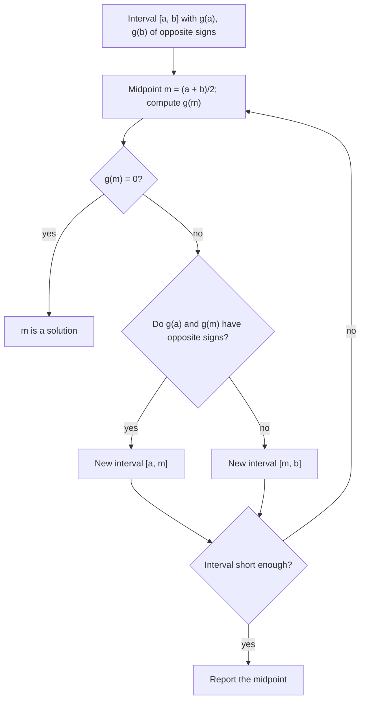

## Who wins, and when?

Lesson 15 claimed that an exponential with base greater than 1 eventually beats *any* polynomial, and Lesson 16 noted that logarithms grow "very slowly". This honors lesson makes those claims precise and puts them to work. You'll use logarithms to compare numbers far too large for a calculator, count the digits of a number like $2^{127}$ without writing it out, prove that logarithms lose to every power and powers lose to every exponential, and find where two growing functions cross even when no algebra can solve the equation. The last tool, bisection, which Lesson 8 previewed in one example, is studied here as a full numerical method: a way to get an answer to any accuracy you like, with a predictable number of steps.

## Comparing huge numbers with logarithms

The logarithm functions are increasing, so for positive numbers

$$a < b \iff \log a < \log b \iff \ln a < \ln b.$$

Comparing logarithms is often far easier than comparing the numbers, because the power rule turns towering exponents into ordinary products.

### Example 1

Which is larger, $2^{300}$ or $3^{200}$? By roughly what factor?

Take common logs: $\log 2^{300} = 300\log 2 \approx 90.309$ and $\log 3^{200} = 200\log 3 \approx 95.424$. So $3^{200}$ is larger, by a factor of about $10^{95.424 - 90.309} = 10^{5.115} \approx 130{,}000$.

(Here there is also a slicker route: $2^{300} = (2^3)^{100} = 8^{100}$ and $3^{200} = (3^2)^{100} = 9^{100}$. But logs work even when no common exponent is available, as in $20^{100}$ versus $100^{20}$, where $100\log 20 \approx 130.1$ beats $20\log 100 = 40$.)

## How many digits?

A positive whole number $N$ has $d$ digits exactly when $10^{d - 1} \le N < 10^d$. Taking common logs, $d - 1 \le \log N < d$, so

$$\text{number of digits of } N = \lfloor \log N \rfloor + 1,$$

where $\lfloor\ \rfloor$ means round down to a whole number. The fractional part of $\log N$ gives the leading digits too: if $\log N = 38.2308$, then $N = 10^{0.2308} \times 10^{38} \approx 1.701 \times 10^{38}$.

### Example 2

In 1876 the French mathematician Édouard Lucas proved that $2^{127} - 1$ is prime. It stayed the largest known prime for 75 years. How many digits does it have, and what are its first digits?

1. $\log 2^{127} = 127\log 2 \approx 38.2308$, so $2^{127}$ has $38 + 1 = 39$ digits.
2. Subtracting 1 changes the digit count only when $2^{127}$ is a power of 10, and it isn't (it's not divisible by 5). So $2^{127} - 1$ also has 39 digits.
3. Leading digits: $10^{0.2308} \approx 1.701$, so $2^{127} - 1 \approx 1.701 \times 10^{38}$.

(The exact value, 170141183460469231731687303715884105727, confirms all three facts.)

## The growth hierarchy

Say that $f$ **dominates** $g$ if $\dfrac{f(x)}{g(x)}$ grows without bound as $x \to \infty$: eventually $f$ is not just bigger but bigger by any factor you name. The standard ranking, for any power $p > 0$ and any base $b > 1$, is

$$\ln x \ \ll\ x^p \ \ll\ b^x,$$

where $\ll$ means "is dominated by". Even $\sqrt[10]{x}$ eventually dominates $\ln x$, and even $1.0001^x$ eventually dominates $x^{100}$. Here is why, using one inequality.

**The key inequality.** The graph of $y = e^u$ lies above its tangent line at $(0, 1)$, which is $y = 1 + u$; so $e^u \ge 1 + u$ for every $u$. (The graph makes this believable; calculus proves it.) Taking $\ln$ of both sides when $1 + u > 0$ and writing $y = 1 + u$ gives

$$\ln y \le y - 1 \quad \text{for all } y > 0.$$

**Logarithms lose to powers.** Apply the inequality to $y = \sqrt{x}$: $\ln x = 2\ln\sqrt x \le 2(\sqrt x - 1) < 2\sqrt x$. Dividing by $x$,

$$0 < \frac{\ln x}{x} < \frac{2}{\sqrt x} \quad (x > 1),$$

and $\frac{2}{\sqrt x}$ shrinks toward 0. At $x = 10^6$, for example, $\frac{\ln x}{x} \approx 0.0000138$, comfortably below the bound $0.002$. The same trick with $y = x^{p/2}$ shows $\frac{\ln x}{x^p} < \frac{2}{p}x^{-p/2}$, which also shrinks to 0 for any $p > 0$.

**Powers lose to exponentials.** Compare logarithms of $b^x$ and $x^p$:

$$\ln\frac{b^x}{x^p} = x\ln b - p\ln x = x\left(\ln b - p\,\frac{\ln x}{x}\right).$$

Since $\frac{\ln x}{x} \to 0$, the bracket eventually exceeds $\frac12\ln b$, which is positive. Then $\ln\frac{b^x}{x^p} > \frac{x\ln b}{2}$, which grows without bound, and so does $\frac{b^x}{x^p}$.

The word "eventually" is doing real work, though, as the next example shows.

## Crossover points

A **crossover point** is an input where one function overtakes another, a solution of $f(x) = g(x)$ where the order changes.

### Example 3

The hierarchy says $1.1^x$ eventually beats $x^{10}$. When?

Compare common logs, $x\log 1.1$ against $10\log x$:

| $x$ | $\log 1.1^x = x\log 1.1$ | $\log x^{10} = 10\log x$ | larger |
|---|---|---|---|
| 100 | 4.14 | 20.00 | $x^{10}$ |
| 500 | 20.70 | 26.99 | $x^{10}$ |
| 700 | 28.97 | 28.45 | $1.1^x$ |
| 1000 | 41.39 | 30.00 | $1.1^x$ |

At $x = 100$, $x^{10} = 10^{20}$ while $1.1^{100}$ is only about 13,781. The crossover lies between 500 and 700; a numerical method (below) puts it at $x \approx 685.08$. The two functions also cross near $x \approx 1.0097$, just above 1, so $x^{10}$ is the larger one from about 1.01 to about 685, and $1.1^x$ wins forever after.

```plot
{"x": [0, 1000], "y": [0, 45], "xLabel": "x", "yLabel": "common log of the value", "functions": [{"f": "x*log10(1.1)", "label": "log of 1.1ˣ"}, {"f": "10*log10(x)", "from": 1}], "points": [{"at": [685.08, 28.36]}], "caption": "Comparing logs: the straight line x·log 1.1 overtakes the slowly rising 10·log x near x = 685, after which 1.1ˣ is larger than x¹⁰ forever.", "labels": [{"at": [250, 27.5], "text": "log of x¹⁰"}, {"at": [840, 22], "text": "crossover x ≈ 685"}]}
```

No sequence of algebra steps and logarithms isolates $x$ in an equation like $x\log 1.1 = 10\log x$, where $x$ appears both inside and outside a logarithm. (Some such equations can be written with a special function called the Lambert W function, but that only gives the answer a name; its decimal value still comes from a numerical method.)

## Bisection

The **bisection method** finds a solution of $g(x) = 0$ by repeated halving. It rests on the intermediate value theorem (Lesson 8): if $g$ is continuous on $[a, b]$ and $g(a)$ and $g(b)$ have opposite signs, then $g$ has a zero between $a$ and $b$.



Each step halves the interval, so after $n$ steps an interval of width $w$ has shrunk to $\frac{w}{2^n}$. That makes the cost predictable: to shrink an interval of width 1 below $10^{-4}$ you need $2^n > 10^4$, so $n > \frac{4}{\log 2} \approx 13.3$, that is, 14 steps. Each extra decimal place costs about $3.3$ more steps.

### Example 4

Solve $2^x = x + 3$ for $x > 0$ by bisection.

Let $g(x) = 2^x - x - 3$. Then $g(2) = -1 < 0$ and $g(3) = 2 > 0$, so a solution lies in $[2, 3]$.

| Step | Interval | Midpoint $m$ | $g(m)$ | Keep |
|---|---|---|---|---|
| 1 | $[2, 3]$ | 2.5 | $+0.157$ | $[2, 2.5]$ |
| 2 | $[2, 2.5]$ | 2.25 | $-0.493$ | $[2.25, 2.5]$ |
| 3 | $[2.25, 2.5]$ | 2.375 | $-0.188$ | $[2.375, 2.5]$ |
| 4 | $[2.375, 2.5]$ | 2.4375 | $-0.020$ | $[2.4375, 2.5]$ |
| 5 | $[2.4375, 2.5]$ | 2.46875 | $+0.067$ | $[2.4375, 2.46875]$ |

After five steps the solution is pinned inside an interval of width $\frac{1}{32} = 0.03125$; its midpoint, about 2.453, is within 0.016 of the true value. Continuing gives $x \approx 2.4449$. (The equation has one more solution, a negative one near $x \approx -2.8625$; try $[-3, -2]$.)

### Example 5

A computer does $10^9$ operations per second. In one hour, how large a problem can it finish if the work takes $2^n$ operations? If it takes $n^3$?

One hour allows $3600 \times 10^9 = 3.6 \times 10^{12}$ operations.

- $2^n \le 3.6 \times 10^{12}$: $n \le \log_2(3.6 \times 10^{12}) = \frac{\ln(3.6 \times 10^{12})}{\ln 2} \approx 41.7$, so $n = 41$.
- $n^3 \le 3.6 \times 10^{12}$: $n \le \sqrt[3]{3.6 \times 10^{12}} \approx 15{,}326$.

Now buy a computer twice as fast. The $n^3$ problem grows by a factor $\sqrt[3]{2} \approx 1.26$, to about 19,300. The $2^n$ problem grows by one: $n = 42$. This is why computer scientists treat exponential-time algorithms as impractical for large inputs.

## Common mistakes

- *Comparing exponents only.* $2^{300}$ has the bigger exponent but the smaller value; compare $300\log 2$ with $200\log 3$.
- *Digits $= \log N$.* It is $\lfloor\log N\rfloor + 1$: $\log 1000 = 3$, but 1000 has 4 digits.
- *Reading the hierarchy as "always".* $x^{10}$ is larger than $1.1^x$ for a long stretch; "dominates" is about what happens eventually.
- *Bisecting without a sign change.* If $g(a)$ and $g(b)$ have the same sign, the interval may contain no zero (or two); the method has nothing to work with.
- *Using bisection on a discontinuous function.* $\frac1x$ changes sign on $[-1, 1]$ but has no zero; the intermediate value theorem needs continuity.

## Key points

- Logs are increasing, so compare huge positive numbers by comparing their logs.
- A positive whole number $N$ has $\lfloor\log N\rfloor + 1$ digits; the fractional part of $\log N$ gives its leading digits.
- For $p > 0$ and $b > 1$: $\ln x \ll x^p \ll b^x$; the proof uses $\ln y \le y - 1$.
- Crossover points of exponentials and powers usually need numerical methods.
- Bisection halves an interval with a sign change each step: width $\frac{w}{2^n}$ after $n$ steps.
