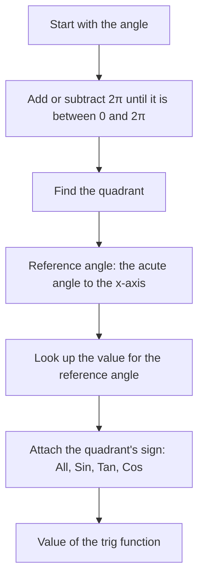

## A compact review

Erudior has a separate Trigonometry course, so this module is a focused review of the trig you need for the rest of precalculus and for calculus: radian measure, the unit circle, the graphs of sine and cosine, and a handful of identities. Polar coordinates, parametric curves and vectors later in this course all lean on it. If any of this is new, the Trigonometry course covers it in depth.

## Radian measure

Degrees divide a full turn into 360 parts, a choice inherited from ancient astronomy. Calculus prefers a measure that comes from the circle itself. On a circle of radius $r$, an angle at the center that cuts off an arc of length $s$ has **radian** measure

$$\theta = \frac{s}{r}.$$

One radian is the angle whose arc equals the radius. A full turn has arc length $2\pi r$, so a full turn is $2\pi$ radians:

$$360^\circ = 2\pi \text{ rad}, \qquad 180^\circ = \pi \text{ rad}.$$

To convert degrees to radians multiply by $\frac{\pi}{180}$; to convert radians to degrees multiply by $\frac{180}{\pi}$. Rearranging the definition gives the **arc length** formula $s = r\theta$ (with $\theta$ in radians), which is the main practical reason to use radians.

The picture shows the three pieces of the definition: the radius $r$, the arc $s$ that the angle cuts off, and the central angle $\theta = \frac{s}{r}$. Because $\theta$ is a length divided by a length, a radian has no units, and the same angle gives the same ratio on a circle of any size.


| Degrees | 30° | 45° | 60° | 90° | 120° | 135° | 150° | 180° | 270° |
|---|---|---|---|---|---|---|---|---|---|
| Radians | $\frac{\pi}{6}$ | $\frac{\pi}{4}$ | $\frac{\pi}{3}$ | $\frac{\pi}{2}$ | $\frac{2\pi}{3}$ | $\frac{3\pi}{4}$ | $\frac{5\pi}{6}$ | $\pi$ | $\frac{3\pi}{2}$ |

### Example 1

Convert $225^\circ$ to radians and $\frac{7\pi}{6}$ to degrees. How long is the arc cut off by a $225^\circ$ angle on a circle of radius 4?

- $225 \cdot \frac{\pi}{180} = \frac{225\pi}{180} = \frac{5\pi}{4}$.
- $\frac{7\pi}{6} \cdot \frac{180}{\pi} = 210^\circ$.
- $s = r\theta = 4 \cdot \frac{5\pi}{4} = 5\pi \approx 15.71$.

## The unit circle definitions

Draw the **unit circle** $x^2 + y^2 = 1$ and an angle $\theta$ in **standard position**: vertex at the origin, starting side along the positive $x$-axis, rotating counterclockwise for positive angles. The ending side meets the circle at a point $P$. Then by definition

$$\cos\theta = x\text{-coordinate of } P, \qquad \sin\theta = y\text{-coordinate of } P, \qquad \tan\theta = \frac{\sin\theta}{\cos\theta}.$$

```plot
{"x": [-1.5, 1.5], "y": [-1.3, 1.3], "equal": true, "curves": [{"x": "cos(t)", "y": "sin(t)", "t": [0, "2pi"]}], "segments": [{"from": [0, 0], "to": [0.5, 0.866]}, {"from": [0.5, 0], "to": [0.5, 0.866], "dashed": true}], "points": [{"at": [0.5, 0.866], "label": "(cos θ, sin θ)"}], "labels": [{"at": [0.25, -0.12], "text": "cos θ"}, {"at": [0.62, 0.4], "text": "sin θ"}, {"at": [0.15, 0.12], "text": "θ"}], "caption": "On the unit circle the point at angle θ is (cos θ, sin θ); here θ = π/3."}
```

For an acute angle this agrees with SOH-CAH-TOA: the triangle under $P$ has hypotenuse 1, so the adjacent side is $\cos\theta$ and the opposite side is $\sin\theta$. The unit circle version works for every angle, including obtuse, negative and very large ones. The **reciprocal functions** are $\sec\theta = \frac{1}{\cos\theta}$, $\csc\theta = \frac{1}{\sin\theta}$ and $\cot\theta = \frac{\cos\theta}{\sin\theta}$.

Immediate consequences:

- $-1 \le \sin\theta \le 1$ and $-1 \le \cos\theta \le 1$, since $P$ is on a circle of radius 1.
- $\sin^2\theta + \cos^2\theta = 1$, because $x^2 + y^2 = 1$.
- Adding $2\pi$ brings you back to the same point, so $\sin(\theta + 2\pi) = \sin\theta$ and $\cos(\theta + 2\pi) = \cos\theta$.

## Special angles

From the 45-45-90 and 30-60-90 triangles (hypotenuse 1):

| $\theta$ | $0$ | $\frac{\pi}{6}$ | $\frac{\pi}{4}$ | $\frac{\pi}{3}$ | $\frac{\pi}{2}$ |
|---|---|---|---|---|---|
| $\sin\theta$ | $0$ | $\frac12$ | $\frac{\sqrt2}{2}$ | $\frac{\sqrt3}{2}$ | $1$ |
| $\cos\theta$ | $1$ | $\frac{\sqrt3}{2}$ | $\frac{\sqrt2}{2}$ | $\frac12$ | $0$ |
| $\tan\theta$ | $0$ | $\frac{\sqrt3}{3}$ | $1$ | $\sqrt3$ | undefined |

A memory aid: the sines read $\frac{\sqrt0}{2}, \frac{\sqrt1}{2}, \frac{\sqrt2}{2}, \frac{\sqrt3}{2}, \frac{\sqrt4}{2}$, and the cosines are the same list backward.

## Reference angles and quadrant signs

The **reference angle** of $\theta$ is the acute angle between its ending side and the $x$-axis. The trig values of $\theta$ have the same size as those of its reference angle; only the signs differ, and the signs come from the quadrant (the signs of $x$ and $y$ there):

| Quadrant | I | II | III | IV |
|---|---|---|---|---|
| Positive | all | $\sin$ | $\tan$ | $\cos$ |

To evaluate: find the reference angle, take its value from the table, and attach the quadrant's sign.

The picture puts the table on the coordinate plane. In each quadrant the signs of $x$ (cosine) and $y$ (sine) decide which functions are positive; the red arc shows the reference angle of $150^\circ$.


The whole routine, for any angle, fits in one chart:



### Example 2

Find $\sin\frac{5\pi}{6}$, $\cos\frac{4\pi}{3}$ and $\tan\left(-\frac{\pi}{4}\right)$.

- $\frac{5\pi}{6}$ is in Quadrant II with reference angle $\pi - \frac{5\pi}{6} = \frac{\pi}{6}$. Sine is positive in QII: $\sin\frac{5\pi}{6} = \frac12$.
- $\frac{4\pi}{3}$ is in Quadrant III with reference angle $\frac{4\pi}{3} - \pi = \frac{\pi}{3}$. Cosine is negative in QIII: $\cos\frac{4\pi}{3} = -\frac12$.
- $-\frac{\pi}{4}$ is in Quadrant IV with reference angle $\frac{\pi}{4}$. Tangent is negative in QIV: $\tan\left(-\frac{\pi}{4}\right) = -1$.

### Example 3

$\sin\theta = -\frac{3}{5}$ and $\theta$ is in Quadrant IV. Find $\cos\theta$ and $\tan\theta$.

$\cos^2\theta = 1 - \frac{9}{25} = \frac{16}{25}$, so $\cos\theta = \pm\frac45$. Cosine is positive in QIV, so $\cos\theta = \frac45$ and $\tan\theta = \frac{-3/5}{4/5} = -\frac34$.

## Common mistakes

- *Calculator in the wrong mode.* $\sin 30 \approx -0.988$ in radian mode; $\sin 30^\circ = 0.5$.
- *Using $s = r\theta$ with degrees.* The formula needs radians.
- *Reference angle measured from the $y$-axis.* Always measure to the $x$-axis.
- *Wrong sign from the quadrant.* Decide the quadrant first, then the sign.
- *Mixing up which coordinate is which.* Cosine is $x$, sine is $y$ (alphabetical: c before s, x before y).

## Key points

- $180^\circ = \pi$ radians; $s = r\theta$ with $\theta$ in radians.
- On the unit circle, the point at angle $\theta$ is $(\cos\theta, \sin\theta)$.
- $\sin^2\theta + \cos^2\theta = 1$; sine and cosine repeat every $2\pi$.
- Know the special values at $0, \frac{\pi}{6}, \frac{\pi}{4}, \frac{\pi}{3}, \frac{\pi}{2}$.
- Any angle: reference angle for the size, quadrant for the sign.
