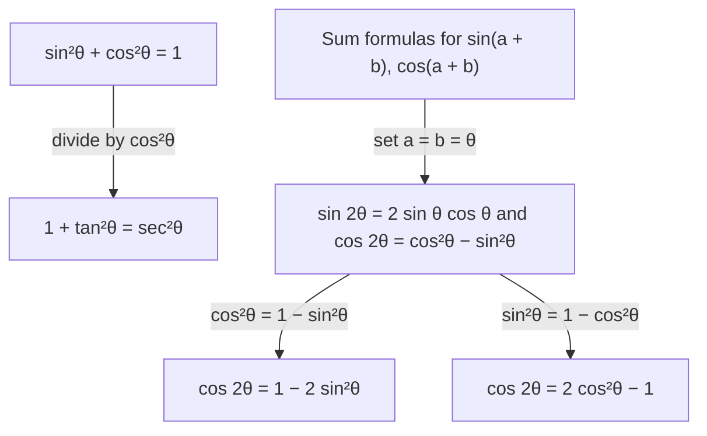

## From the circle to the graph

The last lesson defined sine and cosine as coordinates of a point moving around the unit circle. Plotting those coordinates against the angle produces waves, and waves model anything periodic: tides, sound, alternating current, daylight hours, a rotating wheel. This lesson reviews the graphs, the transformations of Module 2 applied to them, a brief note on inverse trig functions, and the identities you'll use most in calculus.

## The graphs of sine and cosine

As $\theta$ goes from 0 to $2\pi$, the $y$-coordinate $\sin\theta$ goes $0 \to 1 \to 0 \to -1 \to 0$, and the $x$-coordinate $\cos\theta$ goes $1 \to 0 \to -1 \to 0 \to 1$. Then everything repeats. Both functions are **periodic** with **period** $2\pi$, domain all reals and range $[-1, 1]$. The cosine graph is the sine graph shifted left $\frac{\pi}{2}$: $\cos x = \sin\left(x + \frac{\pi}{2}\right)$.

```plot
{"x": [-1, 7], "y": [-1.6, 1.6], "functions": [{"f": "sin(x)", "label": "y = sin x"}, {"f": "cos(x)", "label": "y = cos x", "dashed": true}], "points": [{"at": [1.5708, 1], "label": "(π/2, 1)"}, {"at": [3.1416, 0], "label": "π"}, {"at": [6.2832, 0], "label": "2π"}], "caption": "One period of sine and cosine, 0 to 2π."}
```

Symmetry: cosine is even, $\cos(-x) = \cos x$, and sine is odd, $\sin(-x) = -\sin x$, which you can see from the unit circle (reflecting a point across the $x$-axis keeps $x$ and negates $y$).

## Sinusoids: amplitude, period, phase shift, midline

A **sinusoid** is a transformed sine or cosine:

$$y = A\sin\big(B(x - C)\big) + D \quad \text{or} \quad y = A\cos\big(B(x - C)\big) + D, \qquad B > 0.$$

| Feature | Value | Comes from |
|---|---|---|
| **Amplitude** | $\lvert A \rvert$ | vertical stretch |
| Period | $\dfrac{2\pi}{B}$ | horizontal compression by $\frac1B$ |
| **Phase shift** | $C$ (right if $C > 0$) | horizontal shift |
| **Midline** | $y = D$ | vertical shift |

A note on conventions: this course always factors $B$ out first, so the phase shift is the number $C$ inside $B(x - C)$. Many textbooks instead write $y = A\sin(Bx - C) + D$ without factoring; in that form the phase shift is $\frac{C}{B}$. Both describe the same shift, so if a source's numbers look different, check which form it uses.

The picture labels each feature on the graph of $y = 2\sin x + 1$, where $A = 2$, $B = 1$, $C = 0$ and $D = 1$.


The period formula is the transformation rule in disguise: one full cycle needs the inside $B(x - C)$ to run through an interval of length $2\pi$, which takes $x$-length $\frac{2\pi}{B}$. The maximum is $D + |A|$ and the minimum is $D - |A|$.

### Example 1

Find the amplitude, period, phase shift and midline of $y = 3\sin\left(2x - \frac{\pi}{2}\right) + 1$, and its maximum and minimum.

First factor the inside: $2x - \frac{\pi}{2} = 2\left(x - \frac{\pi}{4}\right)$. So $A = 3$, $B = 2$, $C = \frac{\pi}{4}$, $D = 1$:

- amplitude 3; period $\frac{2\pi}{2} = \pi$; phase shift $\frac{\pi}{4}$ to the right; midline $y = 1$;
- maximum $1 + 3 = 4$, minimum $1 - 3 = -2$.

```plot
{"x": [-1, 7], "y": [-3, 5], "functions": [{"f": "sin(x)", "dashed": true}, {"f": "3sin(2x - pi/2) + 1", "label": "y = 3 sin(2x − π/2) + 1"}, {"f": "1", "dashed": true}], "points": [{"at": [0.7854, 1], "label": "start (π/4, 1)"}], "caption": "The parent sine (dashed) and the transformed sinusoid: amplitude 3, period π, shifted right π/4, midline y = 1."}
```

### Example 2

Daylight in a city varies between 9.2 hours (shortest day) and 15.0 hours (longest day) over a 365-day year, with the longest day on day 172. Write a cosine model.

- Midline: $D = \frac{15.0 + 9.2}{2} = 12.1$. Amplitude: $A = \frac{15.0 - 9.2}{2} = 2.9$.
- Period 365, so $B = \frac{2\pi}{365}$.
- Cosine starts at a maximum, so put the maximum at day 172: $C = 172$.

$$H(t) = 2.9\cos\left(\frac{2\pi}{365}(t - 172)\right) + 12.1.$$

## The tangent graph and inverse trig, briefly

$\tan x = \frac{\sin x}{\cos x}$ is undefined where $\cos x = 0$, so its graph has vertical asymptotes at $x = \frac{\pi}{2} + k\pi$. It has period $\pi$ and range all reals.

```plot
{"x": [-4.8, 4.8], "y": [-4, 4], "functions": [{"f": "tan(x)", "from": -4.6, "to": -1.67, "label": "y = tan x"}, {"f": "tan(x)", "from": -1.47, "to": 1.47}, {"f": "tan(x)", "from": 1.67, "to": 4.6}], "segments": [{"from": [-4.7124, -4], "to": [-4.7124, 4], "dashed": true}, {"from": [-1.5708, -4], "to": [-1.5708, 4], "dashed": true}, {"from": [1.5708, -4], "to": [1.5708, 4], "dashed": true}, {"from": [4.7124, -4], "to": [4.7124, 4], "dashed": true}], "points": [{"at": [0, 0], "label": "(0, 0)"}, {"at": [0.7854, 1], "label": "(π/4, 1)"}], "caption": "y = tan x: one full copy of the graph between neighboring asymptotes (dashed, at x = ±π/2 and ±3π/2), so the period is π."}
```

Sine is not one-to-one, so to invert it we restrict its domain (Lesson 7). With sine restricted to $\left[-\frac{\pi}{2}, \frac{\pi}{2}\right]$, its inverse $\sin^{-1}x$ (also written $\arcsin x$) returns the angle in that interval whose sine is $x$. Similarly $\cos^{-1}x \in [0, \pi]$ and $\tan^{-1}x \in \left(-\frac{\pi}{2}, \frac{\pi}{2}\right)$. For example $\sin^{-1}\frac12 = \frac{\pi}{6}$, not $\frac{5\pi}{6}$, because only $\frac{\pi}{6}$ lies in the restricted interval.

## Key identities

An **identity** is an equation true for every input where both sides are defined. The ones calculus uses most:

| Name | Identity |
|---|---|
| Pythagorean | $\sin^2\theta + \cos^2\theta = 1$; $\ 1 + \tan^2\theta = \sec^2\theta$ |
| Even/odd | $\cos(-\theta) = \cos\theta$; $\ \sin(-\theta) = -\sin\theta$ |
| Sum and difference | $\sin(a \pm b) = \sin a\cos b \pm \cos a\sin b$ |
| | $\cos(a \pm b) = \cos a\cos b \mp \sin a\sin b$ |
| Double angle | $\sin 2\theta = 2\sin\theta\cos\theta$ |
| | $\cos 2\theta = \cos^2\theta - \sin^2\theta = 1 - 2\sin^2\theta = 2\cos^2\theta - 1$ |

The second Pythagorean identity comes from dividing the first by $\cos^2\theta$. The double-angle identities come from the sum identities with $a = b = \theta$. The three forms of $\cos 2\theta$ come from replacing $\cos^2\theta$ or $\sin^2\theta$ using the Pythagorean identity.

The identities aren't a list of separate facts to memorize: almost all of them grow from two roots, the Pythagorean identity and the sum formulas.



### Example 3

Find the exact value of $\cos 75^\circ$.

$75^\circ = 45^\circ + 30^\circ$, so

$$\cos 75^\circ = \cos 45^\circ\cos 30^\circ - \sin 45^\circ \sin 30^\circ = \frac{\sqrt2}{2}\cdot\frac{\sqrt3}{2} - \frac{\sqrt2}{2}\cdot\frac12 = \frac{\sqrt6 - \sqrt2}{4} \approx 0.2588.$$

### Example 4

If $\sin\theta = \frac{5}{13}$ and $\theta$ is in Quadrant II, find $\sin 2\theta$ and $\cos 2\theta$.

First $\cos\theta = -\sqrt{1 - \frac{25}{169}} = -\frac{12}{13}$ (negative in QII). Then

$$\sin 2\theta = 2\cdot\frac{5}{13}\cdot\left(-\frac{12}{13}\right) = -\frac{120}{169}, \qquad \cos 2\theta = 1 - 2\cdot\frac{25}{169} = \frac{119}{169}.$$

### Example 5

Verify that $\dfrac{\sin 2x}{1 + \cos 2x} = \tan x$.

Work on the left side: $\dfrac{2\sin x\cos x}{1 + (2\cos^2 x - 1)} = \dfrac{2\sin x \cos x}{2\cos^2 x} = \dfrac{\sin x}{\cos x} = \tan x$. ✓ Choosing the form $2\cos^2 x - 1$ was deliberate: it cancels the 1.

## Common mistakes

- *Forgetting to factor $B$* before reading the phase shift: $\sin(2x - \pi)$ shifts by $\frac{\pi}{2}$, not $\pi$.
- *Period $= 2\pi B$.* It's $\frac{2\pi}{B}$; a bigger $B$ means a shorter period.
- *$\sin 2\theta = 2\sin\theta$.* Use $2\sin\theta\cos\theta$.
- *$\sin(a + b) = \sin a + \sin b$.* False; use the sum identity.
- *$\sin^{-1}x = \frac{1}{\sin x}$.* The inverse is not the reciprocal ($\csc x$ is).

## Key points

- $\sin$ and $\cos$ have period $2\pi$ and range $[-1, 1]$; $\tan$ has period $\pi$ and asymptotes at $\frac{\pi}{2} + k\pi$.
- $y = A\sin(B(x - C)) + D$: amplitude $|A|$, period $\frac{2\pi}{B}$, phase shift $C$, midline $y = D$.
- Inverse trig functions use restricted domains, so $\sin^{-1}x \in \left[-\frac{\pi}{2}, \frac{\pi}{2}\right]$.
- Know the Pythagorean, sum/difference and double-angle identities.
- Find missing trig values with the Pythagorean identity, then fix the sign by quadrant.
