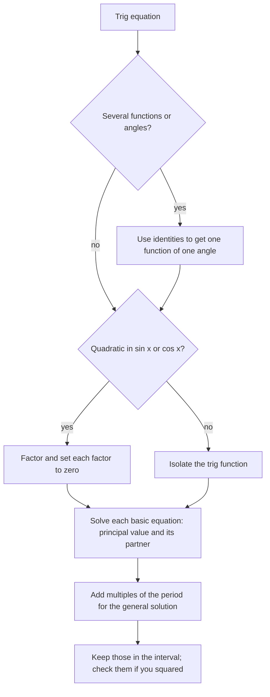

## From one answer to all of them

Lesson 21 introduced the inverse trig functions: $\sin^{-1}\frac12 = \frac{\pi}{6}$, one angle, chosen from a restricted interval. But the equation $\sin x = \frac12$ is true at $\frac{\pi}{6}$, at $\frac{5\pi}{6}$, and at every angle you reach from those two by whole turns: infinitely many solutions. A **trigonometric equation** is an equation whose unknown sits inside trig functions. Unlike an identity, which holds for every input, it holds only for particular angles, and the job is to find all of them, or all of them in a stated interval such as $[0, 2\pi)$.

This lesson builds the method in layers: first the basic equations $\sin x = c$, $\cos x = c$, $\tan x = c$; then equations with a multiple angle such as $\sin 2x$; then equations that factor, equations that need an identity first, and the trap of squaring both sides. The same skills come back in calculus, where finding the high and low points of a wave means solving an equation like $\cos x = 0$.

## Two solutions per turn

Start on the unit circle. $\sin x = c$ asks for the points whose $y$-coordinate is $c$. If $-1 < c < 1$, the horizontal line $y = c$ crosses the circle at exactly two points, and they are mirror images across the $y$-axis. If one is at angle $\alpha$, the mirror point is at angle $\pi - \alpha$.


The inverse function supplies one of them, $\alpha = \sin^{-1}c$, called the **principal value**: the answer in $\left[-\frac{\pi}{2}, \frac{\pi}{2}\right]$, which is also what a calculator returns. The mirror supplies the other, and adding whole turns supplies the rest. A formula that lists every solution is called the **general solution**:

$$\sin x = c: \qquad x = \alpha + 2k\pi \quad\text{or}\quad x = \pi - \alpha + 2k\pi, \qquad \alpha = \sin^{-1}c,\ k \text{ any integer}.$$

Cosine works the same way with a vertical line $x = c$. The two crossing points are mirror images across the $x$-axis, at angles $\beta$ and $-\beta$:

$$\cos x = c: \qquad x = \pm\beta + 2k\pi, \qquad \beta = \cos^{-1}c.$$

Tangent repeats every $\pi$, not $2\pi$, and in each stretch of length $\pi$ between its asymptotes it takes every value exactly once. So there is one family:

$$\tan x = c: \qquad x = \tan^{-1}c + k\pi.$$

Two edge cases. If $c = 1$ or $c = -1$, the line just touches the circle, the two points merge, and there is one solution per turn ($\sin x = 1$ only at $x = \frac{\pi}{2} + 2k\pi$). If $|c| > 1$, sine and cosine have no solution at all, because no point of the unit circle has a coordinate bigger than 1 in size.

### Example 1

Solve $2\sin x + 1 = 0$: give the general solution and the solutions in $[0, 2\pi)$.

1. Isolate the trig function: $\sin x = -\frac12$.
2. Principal value: $\alpha = \sin^{-1}\left(-\frac12\right) = -\frac{\pi}{6}$.
3. Partner: $\pi - \alpha = \pi + \frac{\pi}{6} = \frac{7\pi}{6}$.
4. General solution: $x = -\frac{\pi}{6} + 2k\pi$ or $x = \frac{7\pi}{6} + 2k\pi$.
5. In $[0, 2\pi)$: the first family needs $k = 1$, giving $\frac{11\pi}{6}$; the second gives $\frac{7\pi}{6}$ with $k = 0$.

So $x = \frac{7\pi}{6}$ or $x = \frac{11\pi}{6}$. Check with Lesson 20's method: sine is negative in Quadrants III and IV, and the reference angle for $\frac12$ is $\frac{\pi}{6}$, which gives $\pi + \frac{\pi}{6}$ and $2\pi - \frac{\pi}{6}$. The graph shows the same thing: the line $y = -\frac12$ crosses one period of $y = \sin x$ twice.

```plot
{"x": [-0.5, 7], "y": [-1.6, 1.6], "functions": [{"f": "sin(x)", "label": "y = sin x"}, {"f": "-0.5", "dashed": true}], "points": [{"at": [3.6652, -0.5], "label": "7π/6"}, {"at": [5.7596, -0.5]}], "labels": [{"at": [0.9, -0.8], "text": "y = −1/2"}, {"at": [5.25, -0.4], "text": "11π/6"}], "caption": "y = sin x meets y = −1/2 twice in [0, 2π): at x = 7π/6 and x = 11π/6."}
```

## When the value isn't special

For a value like $0.3$, use the inverse function on a calculator (in radian mode) for the principal value, then build the partner from the symmetry. Don't expect the calculator to give the second solution: it only ever returns the principal value.

### Example 2

Solve $\cos x = 0.3$ and $\sin x = -0.4$ on $[0, 2\pi)$, to 4 decimal places.

- $\cos x = 0.3$: $\beta = \cos^{-1}0.3 \approx 1.2661$, which is already in the interval. The partner is $-\beta$, and adding $2\pi$ brings it into the interval: $2\pi - 1.2661 \approx 5.0171$.
- $\sin x = -0.4$: $\alpha = \sin^{-1}(-0.4) \approx -0.4115$, which is negative, so add $2\pi$: $5.8717$. The partner is $\pi - \alpha \approx \pi + 0.4115 = 3.5531$.

Sanity check: both sine solutions, $3.5531$ and $5.8717$, lie between $\pi \approx 3.14$ and $2\pi \approx 6.28$, in Quadrants III and IV, where sine is negative.

## Multiple angles

In $\sin 2x = c$, the angle is $2x$, not $x$. Call it $u = 2x$. As $x$ runs through $[0, 2\pi)$, $u$ runs through $[0, 4\pi)$: two full turns, so there are twice as many solutions. The safe method is to solve for $u$ on its own, longer interval and divide at the end.

### Example 3

Solve $\sin 2x = \frac{\sqrt3}{2}$ on $[0, 2\pi)$.

1. Let $u = 2x$, so $u$ is in $[0, 4\pi)$.
2. $\sin u = \frac{\sqrt3}{2}$ in the first turn: $u = \frac{\pi}{3}$ or $u = \pi - \frac{\pi}{3} = \frac{2\pi}{3}$.
3. Second turn (add $2\pi$): $u = \frac{7\pi}{3}$ or $u = \frac{8\pi}{3}$.
4. Divide by 2: $x = \frac{\pi}{6}, \frac{\pi}{3}, \frac{7\pi}{6}, \frac{4\pi}{3}$.

Check one: $\sin\left(2\cdot\frac{7\pi}{6}\right) = \sin\frac{7\pi}{3} = \sin\frac{\pi}{3} = \frac{\sqrt3}{2}$. ✓ In general, for a positive whole number $B$ and $-1 < c < 1$, the equation $\sin(Bx) = c$ has $2B$ solutions in $[0, 2\pi)$, and so does $\cos(Bx) = c$. Counting first is a good guard against stopping early.

## Equations that factor

When an equation is quadratic in $\sin x$ or $\cos x$, treat the trig function as the unknown, factor, and set each factor to zero.

### Example 4

Solve $2\cos^2 x - \cos x - 1 = 0$ on $[0, 2\pi)$.

1. With $u = \cos x$ this is $2u^2 - u - 1 = 0$, which factors as $(2u + 1)(u - 1) = 0$.
2. So $\cos x = -\frac12$ or $\cos x = 1$.
3. $\cos x = -\frac12$: reference angle $\frac{\pi}{3}$ in Quadrants II and III, so $x = \frac{2\pi}{3}$ or $\frac{4\pi}{3}$.
4. $\cos x = 1$: only $x = 0$ in the interval ($2\pi$ is excluded).

Solutions: $0, \frac{2\pi}{3}, \frac{4\pi}{3}$.

Never divide both sides by a trig expression to simplify: whatever made that expression zero gets thrown away. Move everything to one side and factor instead.

### Example 5

Solve $\sin 2x = \cos x$ on $[0, 2\pi)$.

1. Use the double-angle identity so every function has the same angle: $2\sin x\cos x = \cos x$.
2. Move everything to one side: $2\sin x\cos x - \cos x = 0$.
3. Factor: $\cos x\,(2\sin x - 1) = 0$.
4. $\cos x = 0$ gives $x = \frac{\pi}{2}, \frac{3\pi}{2}$; $\sin x = \frac12$ gives $x = \frac{\pi}{6}, \frac{5\pi}{6}$.

Four solutions. Dividing by $\cos x$ in step 1 would have kept only $\frac{\pi}{6}$ and $\frac{5\pi}{6}$.

## Using an identity to reach one function

If an equation mixes $\sin^2 x$ with $\cos x$, the Pythagorean identity converts one into the other. For $2\sin^2 x + 3\cos x - 3 = 0$, replace $\sin^2 x$ with $1 - \cos^2 x$:

$$2 - 2\cos^2 x + 3\cos x - 3 = 0 \quad\Longrightarrow\quad 2\cos^2 x - 3\cos x + 1 = 0 \quad\Longrightarrow\quad (2\cos x - 1)(\cos x - 1) = 0.$$

So $\cos x = \frac12$ or $\cos x = 1$, and on $[0, 2\pi)$ the solutions are $0, \frac{\pi}{3}, \frac{5\pi}{3}$. The chart collects the whole strategy.



## Squaring can create false solutions

Sometimes the only way to get a single function is to square both sides, and squaring can create an **extraneous solution**: a value that solves the squared equation but not the original.

### Example 6

Solve $\sin x + \cos x = 1$ on $[0, 2\pi)$.

1. Square both sides: $\sin^2 x + 2\sin x\cos x + \cos^2 x = 1$, so $1 + \sin 2x = 1$ and $\sin 2x = 0$.
2. $2x$ runs over $[0, 4\pi)$, so $2x = 0, \pi, 2\pi, 3\pi$ and $x = 0, \frac{\pi}{2}, \pi, \frac{3\pi}{2}$.
3. Check each in the original equation: at $0$, $0 + 1 = 1$ ✓; at $\frac{\pi}{2}$, $1 + 0 = 1$ ✓; at $\pi$, $0 + (-1) = -1$ ✗; at $\frac{3\pi}{2}$, $-1 + 0 = -1$ ✗.

The solutions are $0$ and $\frac{\pi}{2}$. The two rejects solve $\sin x + \cos x = -1$, which squares to the same equation; squaring can't tell the two apart. (The next honors lesson shows a way to solve this equation without squaring.)

## A question a model can answer

Lesson 21 modeled daylight as $H(t) = 2.9\cos\left(\frac{2\pi}{365}(t - 172)\right) + 12.1$ hours on day $t$. On which days are there 13 hours of daylight? (The model is a simplification: real daylight curves are close to, but not exactly, sinusoidal.)

1. $2.9\cos\theta + 12.1 = 13$ with $\theta = \frac{2\pi}{365}(t - 172)$, so $\cos\theta = \frac{0.9}{2.9} \approx 0.3103$.
2. $\theta = \pm\cos^{-1}(0.3103) \approx \pm 1.2552$. Within one year, $\theta$ stays between about $-2.9$ and $3.3$, so other turns don't matter here.
3. Undo the scaling: $t - 172 = \pm 1.2552 \cdot \frac{365}{2\pi} \approx \pm 72.9$, so $t \approx 99.1$ or $t \approx 244.9$.

Daylight reaches 13 hours around day 99 (early April) and falls back to 13 hours around day 245 (early September), with more than 13 hours in between.

## Common mistakes

- *Stopping at the calculator answer.* $\sin^{-1}$, $\cos^{-1}$ and $\tan^{-1}$ return one value; sine and cosine equations usually have two per turn.
- *Using the wrong partner.* For sine the partner of $\alpha$ is $\pi - \alpha$; for cosine it is $-\beta$ (or $2\pi - \beta$). Mixing them gives angles where the function has the wrong sign.
- *Adding $2\pi$ to tangent solutions only.* Tangent repeats every $\pi$, so $\tan x = c$ has two solutions in $[0, 2\pi)$, $\pi$ apart.
- *Solving a multiple-angle equation on the wrong interval.* For $\sin 2x = c$ on $[0, 2\pi)$, solve for $2x$ on $[0, 4\pi)$ before dividing by 2.
- *Dividing by $\sin x$ or $\cos x$.* Factor instead, or you lose the solutions where that factor is 0.
- *Not checking after squaring.* Every candidate must be tested in the original equation.
- *Degree mode.* With a calculator, make sure answers meant in radians come out in radians.

## Key points

- $\sin x = c$: $x = \alpha + 2k\pi$ or $\pi - \alpha + 2k\pi$ with $\alpha = \sin^{-1}c$.
- $\cos x = c$: $x = \pm\beta + 2k\pi$ with $\beta = \cos^{-1}c$. $\tan x = c$: $x = \tan^{-1}c + k\pi$.
- No solution when $|c| > 1$ for sine or cosine; one per turn when $c = \pm1$.
- For $\sin(Bx) = c$, solve for $Bx$ over $B$ turns, then divide; expect $2B$ solutions in $[0, 2\pi)$ when $-1 < c < 1$.
- Factor rather than divide; use identities to reach one function of one angle; check every answer after squaring.
