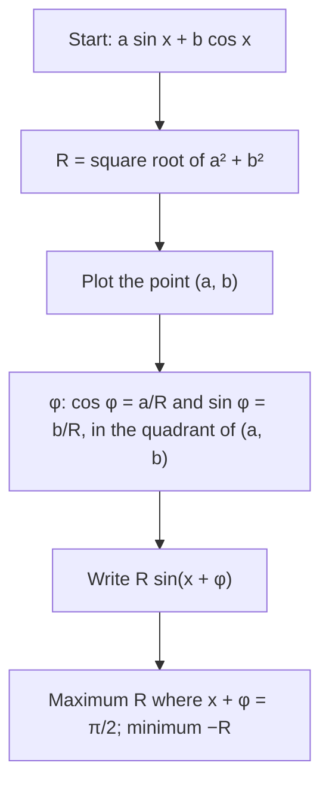

## Two waves, one wave

Lesson 21 used the sum identity $\sin(a + b) = \sin a\cos b + \cos a\sin b$ to *expand* a sine. This lesson runs it backward. Add a sine wave and a cosine wave with the same period, say $y = \sin x + \sqrt3\cos x$, and graph the result: you get another perfectly smooth wave with the same period, just taller and shifted. That is not a coincidence, and knowing exactly which wave you get answers practical questions: how far a vibrating spring travels, where a combined signal peaks, how to solve $a\sin x + b\cos x = c$ without squaring. The second half of the lesson adds waves with *different* periods, which produces the pulsing sound musicians call beats.

```plot
{"x": [-0.5, 7], "y": [-2.5, 2.5], "functions": [{"f": "sin(x)", "dashed": true, "label": "sin x"}, {"f": "sqrt(3)*cos(x)", "dashed": true, "label": "√3 cos x"}, {"f": "sin(x) + sqrt(3)*cos(x)", "label": "sum"}], "points": [{"at": [0.5236, 2], "label": "max (π/6, 2)"}], "caption": "Adding sin x and √3 cos x gives a single sinusoid, 2 sin(x + π/3), with amplitude 2 and its first maximum at x = π/6."}
```

## The amplitude-phase form

The claim: for any numbers $a$ and $b$, not both zero,

$$a\sin x + b\cos x = R\sin(x + \varphi), \qquad R = \sqrt{a^2 + b^2},\quad \cos\varphi = \frac{a}{R},\quad \sin\varphi = \frac{b}{R}.$$

Writing a combination this way puts it in **amplitude-phase form**; $R$ is its amplitude and $\varphi$ is its **phase angle**.

**Why it's true.** Expand the right side with the sum identity:

$$R\sin(x + \varphi) = R\sin x\cos\varphi + R\cos x\sin\varphi = (R\cos\varphi)\sin x + (R\sin\varphi)\cos x.$$

For this to equal $a\sin x + b\cos x$ for every $x$, the coefficients must match: $R\cos\varphi = a$ and $R\sin\varphi = b$. Squaring and adding gives $R^2(\cos^2\varphi + \sin^2\varphi) = a^2 + b^2$, so $R = \sqrt{a^2 + b^2}$. And the two equations say exactly that the point $(a, b)$ is at distance $R$ from the origin in direction $\varphi$. In other words, $R$ and $\varphi$ are the polar coordinates of the point $(a, b)$.


Note the pairing, which surprises people: $a$, the coefficient of *sine*, goes with $\cos\varphi$. Because $(a, b)$ can be in any quadrant, find $\varphi$ from its point, not from $\tan^{-1}\frac{b}{a}$ alone: that formula is right only when $a > 0$. When $a < 0$, add $\pi$ to it.

How does this fit the form $A\sin(B(x - C)) + D$ of Lesson 21? Here $R\sin(x + \varphi) = R\sin(x - (-\varphi))$, so the amplitude is $R$, the period is still $2\pi$, and the phase shift is $C = -\varphi$: a positive $\varphi$ shifts the sine graph *left* by $\varphi$.



### Example 1

Write $\sin x + \sqrt3\cos x$ in amplitude-phase form, and find its maximum.

1. $a = 1$, $b = \sqrt3$, so $R = \sqrt{1 + 3} = 2$.
2. $\cos\varphi = \frac12$ and $\sin\varphi = \frac{\sqrt3}{2}$: the point $(1, \sqrt3)$ is in Quadrant I, so $\varphi = \frac{\pi}{3}$.
3. $\sin x + \sqrt3\cos x = 2\sin\left(x + \frac{\pi}{3}\right)$.
4. The maximum is 2, where $x + \frac{\pi}{3} = \frac{\pi}{2}$, that is at $x = \frac{\pi}{6}$. Check: $\sin\frac{\pi}{6} + \sqrt3\cos\frac{\pi}{6} = \frac12 + \frac32 = 2$. ✓

### Example 2

Write $3\sin x - 4\cos x$ in amplitude-phase form.

1. $R = \sqrt{9 + 16} = 5$.
2. $\cos\varphi = \frac35$, $\sin\varphi = -\frac45$. The point $(3, -4)$ is in Quadrant IV and $a > 0$, so $\varphi = \tan^{-1}\left(-\frac43\right) \approx -0.9273$.
3. $3\sin x - 4\cos x \approx 5\sin(x - 0.9273)$: amplitude 5, the sine graph shifted right by about $0.9273$.
4. Maximum 5 where $x - 0.9273 = \frac{\pi}{2}$, at $x \approx 2.4981$; minimum $-5$.

### Example 3

Write $-\sin x + \cos x$ in amplitude-phase form.

1. $R = \sqrt{1 + 1} = \sqrt2$.
2. $\cos\varphi = -\frac{1}{\sqrt2}$, $\sin\varphi = \frac{1}{\sqrt2}$. The point $(-1, 1)$ is in Quadrant II, so $\varphi = \frac{3\pi}{4}$.
3. $-\sin x + \cos x = \sqrt2\sin\left(x + \frac{3\pi}{4}\right)$.

The tempting shortcut $\tan^{-1}\frac{b}{a} = \tan^{-1}(-1) = -\frac{\pi}{4}$ gives $\sqrt2\sin\left(x - \frac{\pi}{4}\right) = \sin x - \cos x$, the *negative* of what we want. Because $a < 0$, the correct angle is $-\frac{\pi}{4} + \pi = \frac{3\pi}{4}$.

## Other periods and the cosine version

Nothing changes if both terms have the same inner factor $B$: $a\sin(Bx) + b\cos(Bx) = R\sin(Bx + \varphi)$ with the same $R$ and $\varphi$, and the period is $\frac{2\pi}{B}$. Some books prefer a cosine version, $R\cos(x - \delta)$ with $\cos\delta = \frac{b}{R}$ and $\sin\delta = \frac{a}{R}$; it describes the same wave with a different reference point, and the amplitude $R$ is the same either way.

### Example 4

A weight bobs on a spring, and its position in centimeters after $t$ seconds is $y = 4\sin 2t + 3\cos 2t$. (This is the idealized model with no friction, so the motion never dies down.) How far does it swing, and when does it first reach the top?

1. $R = \sqrt{16 + 9} = 5$, and $(4, 3)$ is in Quadrant I, so $\varphi = \tan^{-1}\frac34 \approx 0.6435$.
2. $y = 5\sin(2t + 0.6435)$: it swings 5 cm each side of rest, with period $\frac{2\pi}{2} = \pi \approx 3.14$ seconds.
3. The first top is where $2t + 0.6435 = \frac{\pi}{2}$: $t = \frac{1.5708 - 0.6435}{2} \approx 0.464$ seconds.

### Example 5

Solve $\sin x + \cos x = 1$ on $[0, 2\pi)$ without squaring.

1. $R = \sqrt2$ and $\varphi = \frac{\pi}{4}$, so the equation is $\sqrt2\sin\left(x + \frac{\pi}{4}\right) = 1$, or $\sin\left(x + \frac{\pi}{4}\right) = \frac{\sqrt2}{2}$.
2. With $u = x + \frac{\pi}{4}$ in $\left[\frac{\pi}{4}, \frac{9\pi}{4}\right)$: $u = \frac{\pi}{4}$ or $u = \frac{3\pi}{4}$.
3. Subtract $\frac{\pi}{4}$: $x = 0$ or $x = \frac{\pi}{2}$.

These are the same answers squaring gives after the false ones are thrown out, but here no false solutions ever appear, because every step is reversible.

## Different periods: sum-to-product and beats

When the periods differ, the sum is not a sinusoid. A different identity takes over. Add the sum and difference identities:

$$\sin(u + v) + \sin(u - v) = 2\sin u\cos v.$$

Read left to right, this is a **product-to-sum formula**: $\sin u\cos v = \frac12\left[\sin(u + v) + \sin(u - v)\right]$. Now set $A = u + v$ and $B = u - v$, so $u = \frac{A + B}{2}$ and $v = \frac{A - B}{2}$, and read it right to left. That gives the **sum-to-product formulas**:

$$\sin A + \sin B = 2\sin\frac{A + B}{2}\cos\frac{A - B}{2}, \qquad \cos A + \cos B = 2\cos\frac{A + B}{2}\cos\frac{A - B}{2}.$$

(The cosine one comes the same way from the two cosine sum identities.)

### Example 6

Two tuning forks sound pure tones at 440 and 444 vibrations per second. What does a listener hear?

Pressure from a tone with **frequency** $f$ (cycles per second, or hertz, Hz; frequency is 1 divided by the period) can be modeled as $\sin(2\pi f t)$. With equal loudness, the sum-to-product formula gives

$$\sin(2\pi\cdot 444\,t) + \sin(2\pi\cdot 440\,t) = 2\cos(2\pi\cdot 2\,t)\,\sin(2\pi\cdot 442\,t).$$

The factor $\sin(2\pi\cdot 442\,t)$ is a tone at the average frequency, 442 Hz. The factor $2\cos(2\pi\cdot 2t)$ changes slowly and acts as a varying amplitude, or envelope. The sound is loudest whenever that envelope is $2$ *or* $-2$, which happens twice in each of its cycles. The envelope has frequency 2 Hz, so the loudness swells $2 \times 2 = 4$ times per second. These pulses are called **beats**, and in general the **beat frequency** is the difference $|f_1 - f_2|$. Musicians use this to tune: as two strings approach the same pitch, the beats slow down and disappear. (The model assumes pure tones of equal loudness; real instruments add overtones, but the beats are still heard.)

```plot
{"x": [0, 6.3], "y": [-2.5, 2.5], "functions": [{"f": "sin(10x) + sin(12x)", "label": "sin 10x + sin 12x"}, {"f": "2*cos(x)", "dashed": true, "label": "envelope ±2 cos x"}, {"f": "-2*cos(x)", "dashed": true}], "caption": "sin 10x + sin 12x = 2 sin(11x) cos x: a fast wave inside the slow envelope ±2 cos x. The loudness peaks twice per cycle of cos x."}
```

## Common mistakes

- *$R = a + b$.* The amplitude is $\sqrt{a^2 + b^2}$; for $3\sin x + 4\cos x$ it is 5, not 7.
- *Taking $\varphi = \tan^{-1}\frac{b}{a}$ when $a < 0$.* That lands in the wrong quadrant; add $\pi$, or read the angle from the point $(a, b)$.
- *Swapping the roles of $a$ and $b$.* In $R\sin(x + \varphi)$, $\cos\varphi = \frac{a}{R}$ where $a$ multiplies $\sin x$.
- *Reading the shift backward.* $R\sin(x + \varphi)$ is the sine graph moved *left* by $\varphi$.
- *Combining different periods into one sinusoid.* $\sin x + \sin 2x$ has no amplitude-phase form; use sum-to-product, or leave it as it is.
- *Beat frequency as half the difference.* The envelope's frequency is half the difference, but the loudness peaks twice per envelope cycle, so the beat frequency is the full difference $|f_1 - f_2|$.

## Key points

- $a\sin x + b\cos x = R\sin(x + \varphi)$ with $R = \sqrt{a^2 + b^2}$, $\cos\varphi = \frac{a}{R}$, $\sin\varphi = \frac{b}{R}$.
- $(R, \varphi)$ are the polar coordinates of the point $(a, b)$; choose $\varphi$ in that point's quadrant.
- The combination ranges from $-R$ to $R$; its maximum is where $x + \varphi = \frac{\pi}{2}$.
- The same works with $\sin(Bx)$ and $\cos(Bx)$; the period stays $\frac{2\pi}{B}$.
- Different frequencies: $\sin A + \sin B = 2\sin\frac{A + B}{2}\cos\frac{A - B}{2}$; nearby tones beat $|f_1 - f_2|$ times per second.
