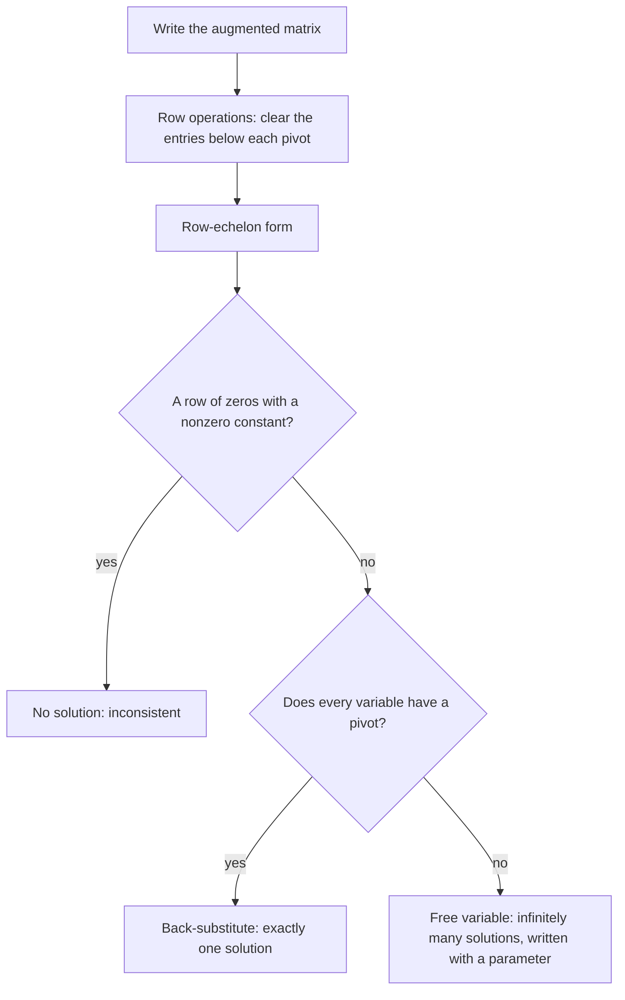

## Beyond two equations

Algebra 2 solved systems of two linear equations by substitution or elimination. Real problems often have more unknowns: mixing three ingredients to hit three nutritional targets, fitting a parabola through three points, balancing currents in a circuit. This module develops the matrix tools that scale to any size. This first lesson turns elimination into a systematic procedure, Gaussian elimination, that a person or a computer can follow on any linear system. The module ends by trading equations for inequalities, in linear programming.

## Linear systems in three variables

A **linear equation** in $x, y, z$ has the form $ax + by + cz = d$; its graph is a plane in space. A **system of linear equations** asks for points that satisfy every equation at once. For three planes, there are three possibilities:

- they meet at exactly one point: *one solution*;
- they have no point in common (for instance two are parallel): *no solution*, an **inconsistent system**;
- they share a whole line (or are the same plane): *infinitely many solutions*, a **dependent system**.

As with two variables, these are the only options: a linear system has 0, 1 or infinitely many solutions, never exactly 2.

Planes in space are hard to draw, but the two-variable version shows the same three cases, with lines in place of planes:


## Augmented matrices

A **matrix** is a rectangular array of numbers. A system can be stored as an **augmented matrix**: one row per equation, one column per variable, and a final column for the constants. The system

$$\begin{cases} x + y + z = 6 \\ 2x - y + z = 3 \\ x + 2y - z = 2 \end{cases} \quad\text{becomes}\quad \left[\begin{array}{ccc|c} 1 & 1 & 1 & 6 \\ 2 & -1 & 1 & 3 \\ 1 & 2 & -1 & 2 \end{array}\right].$$

Writing only the numbers removes clutter and makes the procedure mechanical.

## Elementary row operations

Three **row operations** change a system into an equivalent one (same solutions):

1. Swap two rows. ($R_i \leftrightarrow R_j$)
2. Multiply a row by a nonzero constant. ($kR_i \to R_i$)
3. Add a multiple of one row to another row. ($R_i + kR_j \to R_i$)

Each corresponds to something legal you can do to equations: reorder them, scale one, or add a multiple of one equation to another (the elimination method). None of them can create or destroy a solution, because each can be undone by another row operation.

## Row-echelon form and back-substitution

The goal of **Gaussian elimination** is **row-echelon form** (REF): a staircase shape where

- any all-zero rows are at the bottom,
- the first nonzero entry of each row (its **pivot**, or leading entry) is to the right of the pivot in the row above,
- everything below each pivot is zero.

Then the last row has one variable, which you solve and substitute upward: **back-substitution**.

### Example 1

Solve the system above.

1. Clear column 1 below the top pivot: $R_2 - 2R_1 \to R_2$ and $R_3 - R_1 \to R_3$.
$$\left[\begin{array}{ccc|c} 1 & 1 & 1 & 6 \\ 0 & -3 & -1 & -9 \\ 0 & 1 & -2 & -4 \end{array}\right]$$
2. Swap $R_2$ and $R_3$ to get a 1 as the next pivot (optional, but it avoids fractions).
$$\left[\begin{array}{ccc|c} 1 & 1 & 1 & 6 \\ 0 & 1 & -2 & -4 \\ 0 & -3 & -1 & -9 \end{array}\right]$$
3. Clear below the second pivot: $R_3 + 3R_2 \to R_3$ gives $\begin{bmatrix} 0 & 0 & -7 & -21 \end{bmatrix}$.
4. Back-substitute: $-7z = -21$ so $z = 3$. Row 2: $y - 2z = -4$ so $y = 2$. Row 1: $x + y + z = 6$ so $x = 1$.

Solution $(1, 2, 3)$. Check in the original second equation: $2 - 2 + 3 = 3$. ✓

## Reduced row-echelon form

**Reduced row-echelon form** (RREF) goes further: every pivot is 1 and every other entry in a pivot's column is 0. Then the solution can be read off directly. Continuing elimination upward to reach RREF is called **Gauss-Jordan elimination**. For Example 1, the RREF is

$$\left[\begin{array}{ccc|c} 1 & 0 & 0 & 1 \\ 0 & 1 & 0 & 2 \\ 0 & 0 & 1 & 3 \end{array}\right],$$

which says $x = 1$, $y = 2$, $z = 3$. Calculators and software usually report RREF.

## Recognizing no solution and infinitely many

### Example 2

Solve $\begin{cases} x + 2y - z = 4 \\ 2x + y + z = 5 \\ 3x + 3y = 10 \end{cases}$.

$R_2 - 2R_1$ and $R_3 - 3R_1$ give rows $\begin{bmatrix} 0 & -3 & 3 & -3 \end{bmatrix}$ and $\begin{bmatrix} 0 & -3 & 3 & -2 \end{bmatrix}$. Then $R_3 - R_2$ gives

$$\begin{bmatrix} 0 & 0 & 0 & 1 \end{bmatrix}, \quad\text{meaning}\quad 0x + 0y + 0z = 1.$$

That's impossible, so the system is inconsistent: *no solution*. A row of zeros with a nonzero constant is the signal.

### Example 3

Change the last constant to 9: $\begin{cases} x + 2y - z = 4 \\ 2x + y + z = 5 \\ 3x + 3y = 9 \end{cases}$.

Now the same steps produce $\begin{bmatrix} 0 & 0 & 0 & 0 \end{bmatrix}$, the equation $0 = 0$, which is always true. Only two independent equations remain for three unknowns, so there are infinitely many solutions. Let $z = t$ (a **free variable**, also called a parameter). Row 2, $-3y + 3z = -3$, gives $y = 1 + t$. Row 1 gives $x = 4 - 2(1 + t) + t = 2 - t$. The solutions are

$$(x, y, z) = (2 - t,\ 1 + t,\ t), \qquad t \text{ any real number}.$$

For instance $t = 0$ gives $(2, 1, 0)$ and $t = 1$ gives $(1, 2, 1)$; both satisfy all three equations.

The whole procedure, including how to read the three outcomes from the echelon form, fits in one chart:



## An application

### Example 4

Find the parabola $y = ax^2 + bx + c$ through $(1, 4)$, $(2, 9)$ and $(-1, 6)$.

Each point gives a linear equation in $a, b, c$: $a + b + c = 4$, $4a + 2b + c = 9$, $a - b + c = 6$. Subtracting the first from the third: $-2b = 2$, so $b = -1$. Then $a + c = 5$ and $4a + c = 11$, so $3a = 6$, $a = 2$, $c = 3$. The parabola is $y = 2x^2 - x + 3$.

```plot
{"x": [-2, 3], "y": [0, 12], "functions": [{"f": "2x^2 - x + 3"}], "points": [{"at": [1, 4]}, {"at": [2, 9], "label": "(2, 9)"}, {"at": [-1, 6], "label": "(-1, 6)"}], "labels": [{"at": [1.45, 3.1], "text": "(1, 4)"}], "caption": "Example 4: the parabola y = 2x² − x + 3 passes through all three given points."}
```

## A note on nonlinear systems

Row reduction only works when every equation is linear. When an equation contains $x^2$, $xy$ or similar terms, go back to substitution (or to eliminating a whole squared term). For example, to intersect the circle $x^2 + y^2 = 25$ with the line $y = x + 1$, substitute: $x^2 + (x + 1)^2 = 25$ gives $2x^2 + 2x - 24 = 0$, so $x^2 + x - 12 = (x + 4)(x - 3) = 0$. The intersection points are $(3, 4)$ and $(-4, -3)$, as the picture shows.

```plot
{"x": [-7, 7], "y": [-6, 6], "equal": true, "curves": [{"x": "5cos(t)", "y": "5sin(t)", "t": [0, "2pi"]}], "functions": [{"f": "x + 1"}], "points": [{"at": [3, 4]}, {"at": [-4, -3]}], "labels": [{"at": [5.0, 3.4], "text": "(3, 4)"}, {"at": [-5.9, -2.2], "text": "(-4, -3)"}], "caption": "The circle x² + y² = 25 and the line y = x + 1 meet at two points."}
```

Unlike a linear system, a nonlinear system can have exactly two solutions, or three, or four: a line meets a circle 0, 1 or 2 times, and two different conics can meet up to 4 times.

## Common mistakes

- *Arithmetic in the constants column.* Every row operation applies to the whole row, including the last column.
- *Changing a row using itself scaled by 0.* Multiplying a row by 0 is not allowed.
- *Misreading $[0\ 0\ 0 \mid 0]$ as no solution.* That row means "always true"; $[0\ 0\ 0 \mid c]$ with $c \ne 0$ means no solution.
- *Giving one solution of a dependent system.* Give the general form with a parameter.
- *Losing track of which operation was done.* Write $R_2 - 2R_1 \to R_2$ beside each step.

## Key points

- A linear system has no solution, exactly one, or infinitely many.
- Store it as an augmented matrix; use swaps, scalings and row replacements.
- Gaussian elimination reaches row-echelon form; back-substitute to solve.
- Gauss-Jordan elimination reaches RREF, where the solution can be read directly.
- $[0 \cdots 0 \mid c]$, $c \ne 0$: inconsistent. A zero row with free variables: infinitely many solutions.
