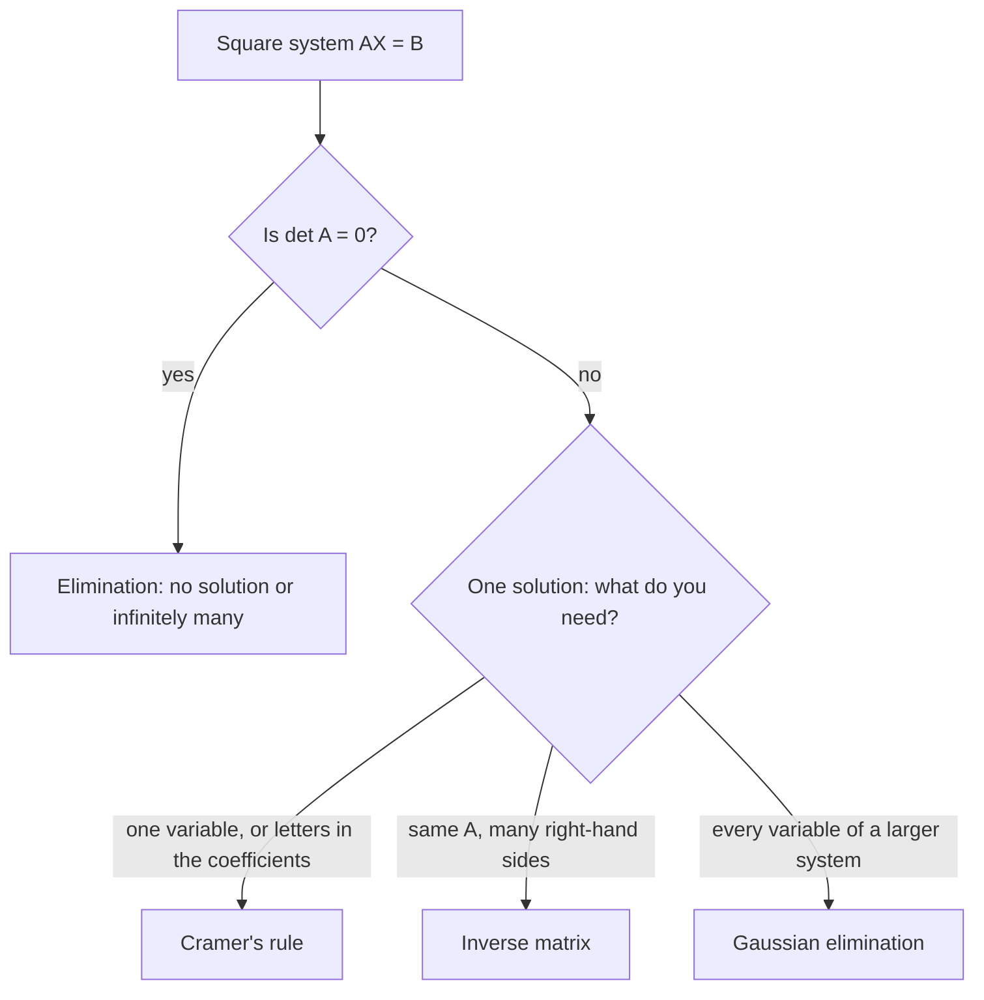

## One number that says a lot

The last lesson met the determinant of a $2 \times 2$ matrix as the number $ad - bc$ that decides whether an inverse exists. Every square matrix has a determinant, and it carries a lot of information: whether the matrix is invertible, whether a system has a unique solution, and even areas and volumes. This lesson computes determinants of $3 \times 3$ matrices and uses them to solve systems with Cramer's rule, a formula that writes each unknown as a ratio of determinants.

## $2 \times 2$ determinants

$$\begin{vmatrix} a & b \\ c & d \end{vmatrix} = ad - bc.$$

Main diagonal product minus the other diagonal product. For example $\begin{vmatrix} 5 & -2 \\ 3 & 4 \end{vmatrix} = 20 - (-6) = 26$.

## $3 \times 3$ determinants by cofactor expansion

The **minor** $M_{ij}$ of an entry is the $2 \times 2$ determinant left after crossing out that entry's row and column. The **cofactor** is the minor with a sign attached: $C_{ij} = (-1)^{i + j}M_{ij}$. The signs follow a checkerboard:

$$\begin{bmatrix} + & - & + \\ - & + & - \\ + & - & + \end{bmatrix}.$$

The determinant is found by **cofactor expansion** along any row or column: multiply each entry by its cofactor and add. Along the first row,

$$\det A = a_{11}M_{11} - a_{12}M_{12} + a_{13}M_{13}.$$

Every row and column gives the same answer, so expand along whichever has the most zeros.

The picture shows one minor and cofactor for the matrix of Example 1.


### Example 1

Find $\det\begin{bmatrix} 2 & -1 & 3 \\ 0 & 4 & 1 \\ 5 & 2 & -2 \end{bmatrix}$.

Along row 1:

- $a_{11} = 2$: minor $\begin{vmatrix} 4 & 1 \\ 2 & -2 \end{vmatrix} = -8 - 2 = -10$; sign $+$.
- $a_{12} = -1$: minor $\begin{vmatrix} 0 & 1 \\ 5 & -2 \end{vmatrix} = 0 - 5 = -5$; sign $-$.
- $a_{13} = 3$: minor $\begin{vmatrix} 0 & 4 \\ 5 & 2 \end{vmatrix} = 0 - 20 = -20$; sign $+$.

$$\det A = 2(-10) - (-1)(-5) + 3(-20) = -20 - 5 - 60 = -85.$$

(Expanding down column 1, which has a zero, gives $2(-10) - 0 + 5\begin{vmatrix} -1 & 3 \\ 4 & 1 \end{vmatrix} = -20 + 5(-13) = -85$, the same.)

## Useful properties

- $A$ is invertible exactly when $\det A \ne 0$.
- Swapping two rows changes the sign of the determinant.
- Multiplying one row by $k$ multiplies the determinant by $k$.
- Adding a multiple of one row to another doesn't change the determinant.
- A row (or column) of zeros, or two equal rows, makes the determinant 0.
- For a triangular matrix (all zeros below or above the diagonal), the determinant is the product of the diagonal entries.
- $\det(AB) = \det A \cdot \det B$.

## Cramer's rule

Consider $AX = B$ with $\det A = D \ne 0$. For each variable, form a new matrix by replacing that variable's column of $A$ with the constant column $B$. Call the determinants $D_x$, $D_y$, $D_z$. Then **Cramer's rule** says

$$x = \frac{D_x}{D}, \qquad y = \frac{D_y}{D}, \qquad z = \frac{D_z}{D}.$$

For two equations you can check it directly: eliminating $y$ from $ax + by = e$, $cx + dy = f$ (multiply by $d$ and $b$ and subtract) gives $(ad - bc)x = ed - bf$, which is exactly $x = \frac{D_x}{D}$.

### Example 2

Solve $\begin{cases} 2x + 3y = 7 \\ 4x - y = 7 \end{cases}$ by Cramer's rule.

$$D = \begin{vmatrix} 2 & 3 \\ 4 & -1 \end{vmatrix} = -2 - 12 = -14,\quad D_x = \begin{vmatrix} 7 & 3 \\ 7 & -1 \end{vmatrix} = -7 - 21 = -28,\quad D_y = \begin{vmatrix} 2 & 7 \\ 4 & 7 \end{vmatrix} = 14 - 28 = -14.$$

So $x = \frac{-28}{-14} = 2$ and $y = \frac{-14}{-14} = 1$. Check: $4(2) - 1 = 7$. ✓

### Example 3

For the system $x + y + z = 6$, $2x - y + z = 3$, $x + 2y - z = 2$ (Lesson 22), find $z$ alone.

$D = \begin{vmatrix} 1 & 1 & 1 \\ 2 & -1 & 1 \\ 1 & 2 & -1 \end{vmatrix} = 1(1 - 2) - 1(-2 - 1) + 1(4 + 1) = -1 + 3 + 5 = 7.$

Replace the third column with the constants:

$D_z = \begin{vmatrix} 1 & 1 & 6 \\ 2 & -1 & 3 \\ 1 & 2 & 2 \end{vmatrix} = 1(-2 - 6) - 1(4 - 3) + 6(4 + 1) = -8 - 1 + 30 = 21.$

$z = \frac{21}{7} = 3$, matching Lesson 22. Cramer's rule shines when you need one variable, or when the coefficients contain parameters; for full solutions of large systems, elimination is faster.

If $D = 0$, Cramer's rule doesn't apply: the system has no solution or infinitely many, and elimination tells which.

This module now has three ways to solve a square system. The chart suggests when each one is the natural choice:



## Determinants and area

The area of the triangle with vertices $(x_1, y_1)$, $(x_2, y_2)$, $(x_3, y_3)$ is

$$\text{Area} = \frac12\left|\det\begin{bmatrix} x_1 & y_1 & 1 \\ x_2 & y_2 & 1 \\ x_3 & y_3 & 1 \end{bmatrix}\right|.$$

### Example 4

Find the area of the triangle with vertices $(1, 2)$, $(4, 5)$, $(2, 7)$.

$\det\begin{bmatrix} 1 & 2 & 1 \\ 4 & 5 & 1 \\ 2 & 7 & 1 \end{bmatrix} = 1(5 - 7) - 2(4 - 2) + 1(28 - 10) = -2 - 4 + 18 = 12$, so the area is $\frac12|12| = 6$. A determinant of 0 would mean the three points lie on one line.

```shape
{"polygons": [{"points": [[1, 2], [4, 5], [2, 7]]}], "points": [{"at": [1, 2], "label": "(1, 2)"}, {"at": [4, 5], "label": "(4, 5)"}, {"at": [2, 7], "label": "(2, 7)"}], "caption": "Triangle with area 6, found from a determinant."}
```

## Common mistakes

- *Forgetting the checkerboard signs.* The middle term of a first-row expansion is subtracted.
- *Replacing the wrong column* in Cramer's rule. $D_x$ replaces the $x$-column.
- *Putting $D$ on top.* It's $\frac{D_x}{D}$, not $\frac{D}{D_x}$.
- *Using Cramer's rule when $D = 0$.*
- *Sign slips inside minors.* Compute each $2 \times 2$ carefully: $ad - bc$.

## Key points

- $\det\begin{bmatrix} a & b \\ c & d \end{bmatrix} = ad - bc$.
- $3 \times 3$: expand along a row or column with checkerboard signs; choose one with zeros.
- $\det A \ne 0 \iff A$ is invertible $\iff$ $AX = B$ has a unique solution.
- Cramer's rule: $x_i = \frac{D_i}{D}$, where $D_i$ replaces column $i$ with the constants.
- Triangle area $= \frac12|\det|$ of the coordinate matrix with a column of 1s.
