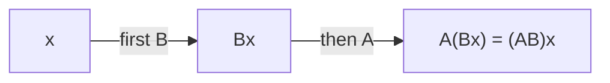

## From tables of numbers to motions

In this module a matrix has been bookkeeping for a system (Lesson 22) and an object you can multiply (Lesson 23). Lesson 23 also noticed that a $2 \times 2$ matrix times a column $\begin{bmatrix} x \\ y \end{bmatrix}$ gives another column. Read that as a point going in and a point coming out, and every $2 \times 2$ matrix becomes a way of moving the whole plane: stretching it, flipping it, turning it or slanting it. This picture explains facts that looked like pure algebra: why $AB \ne BA$, why a matrix with determinant 0 has no inverse, and what the number $ad - bc$ actually measures. It is also how computer graphics, robotics and image processing use matrices every day.

## A matrix moves points

Write a point $(x, y)$ as a column vector. The matrix $A = \begin{bmatrix} a & b \\ c & d \end{bmatrix}$ sends it to

$$A\begin{bmatrix} x \\ y \end{bmatrix} = \begin{bmatrix} ax + by \\ cx + dy \end{bmatrix}.$$

For example $\begin{bmatrix} 2 & 1 \\ 0 & 1 \end{bmatrix}$ sends $(1, 2)$ to $(2 + 2,\ 0 + 2) = (4, 2)$. The rule $T(\mathbf{x}) = A\mathbf{x}$ is called a **linear transformation**. Because matrix multiplication distributes, it has two properties:

$$A(\mathbf{u} + \mathbf{v}) = A\mathbf{u} + A\mathbf{v}, \qquad A(k\mathbf{u}) = k(A\mathbf{u}).$$

So the origin stays put ($A\mathbf{0} = \mathbf{0}$), straight lines go to straight lines (or collapse to a point), parallel lines stay parallel when $\det A \ne 0$, and the midpoint of a segment goes to the midpoint of the image. A square grid becomes a grid of parallelograms. A shift such as "move everything 3 units right" is *not* linear, because it moves the origin; we come back to that at the end.

## The columns tell the whole story

Feed in the two unit vectors:

$$A\begin{bmatrix} 1 \\ 0 \end{bmatrix} = \begin{bmatrix} a \\ c \end{bmatrix} \text{ (the first column)}, \qquad A\begin{bmatrix} 0 \\ 1 \end{bmatrix} = \begin{bmatrix} b \\ d \end{bmatrix} \text{ (the second column)}.$$

Every point is a combination of these, $(x, y) = x(1, 0) + y(0, 1)$, so by linearity it goes to $x(\text{first column}) + y(\text{second column})$. That gives a recipe that works in both directions: *to find the matrix of a transformation, ask where $(1, 0)$ and $(0, 1)$ go, and write those images as the columns.*

![Left: the unit square with arrows along (1, 0) and (0, 1). Right: after multiplying by A = [3 1; 1 2], the square becomes a parallelogram whose sides are the arrows (3, 1) and (1, 2), the columns of A. Its area is |det A| = 5.](images/pc-m6-unit-square-map.svg)

Using the recipe on familiar motions gives this gallery.

| Transformation | Where $(1, 0)$ goes | Where $(0, 1)$ goes | Matrix |
|---|---|---|---|
| Stretch by $h$ horizontally, $k$ vertically | $(h, 0)$ | $(0, k)$ | $\begin{bmatrix} h & 0 \\ 0 & k \end{bmatrix}$ |
| Reflection across the $x$-axis | $(1, 0)$ | $(0, -1)$ | $\begin{bmatrix} 1 & 0 \\ 0 & -1 \end{bmatrix}$ |
| Reflection across $y = x$ | $(0, 1)$ | $(1, 0)$ | $\begin{bmatrix} 0 & 1 \\ 1 & 0 \end{bmatrix}$ |
| Rotation by $\theta$ counterclockwise | $(\cos\theta, \sin\theta)$ | $(-\sin\theta, \cos\theta)$ | $\begin{bmatrix} \cos\theta & -\sin\theta \\ \sin\theta & \cos\theta \end{bmatrix}$ |
| Horizontal shear by $k$ | $(1, 0)$ | $(k, 1)$ | $\begin{bmatrix} 1 & k \\ 0 & 1 \end{bmatrix}$ |
| Projection onto the $x$-axis | $(1, 0)$ | $(0, 0)$ | $\begin{bmatrix} 1 & 0 \\ 0 & 0 \end{bmatrix}$ |

The **rotation matrix** comes straight from the unit circle (Lesson 20): turning $(1, 0)$ by $\theta$ lands on $(\cos\theta, \sin\theta)$, and turning $(0, 1)$, which starts a quarter turn further on, lands on $(\cos(\theta + 90°), \sin(\theta + 90°)) = (-\sin\theta, \cos\theta)$. A **shear** slides each point sideways by an amount proportional to its height, the way a deck of cards slants when you push its top; horizontal lines stay horizontal and the $x$-axis doesn't move.


### Example 1: Rotating a triangle

Rotate the triangle with vertices $(1, 1)$, $(4, 1)$, $(1, 3)$ by $90°$ counterclockwise.

With $\theta = 90°$, $\cos\theta = 0$ and $\sin\theta = 1$, so $R = \begin{bmatrix} 0 & -1 \\ 1 & 0 \end{bmatrix}$ and $R\begin{bmatrix} x \\ y \end{bmatrix} = \begin{bmatrix} -y \\ x \end{bmatrix}$.

- $(1, 1) \to (-1, 1)$
- $(4, 1) \to (-1, 4)$
- $(1, 3) \to (-3, 1)$

You can put all three vertices in one matrix and multiply once: $R\begin{bmatrix} 1 & 4 & 1 \\ 1 & 1 & 3 \end{bmatrix} = \begin{bmatrix} -1 & -1 & -3 \\ 1 & 4 & 1 \end{bmatrix}$. The side from $(1, 1)$ to $(4, 1)$ was horizontal with length 3; its image runs from $(-1, 1)$ to $(-1, 4)$, vertical with length 3, as a quarter turn should give.

```plot
{"x": [-4, 5], "y": [-1, 5], "equal": true, "polygons": [{"points": [[1, 1], [4, 1], [1, 3]], "fill": true}, {"points": [[-1, 1], [-1, 4], [-3, 1]], "fill": true}], "points": [{"at": [4, 1], "label": "(4, 1)"}, {"at": [-1, 4]}], "labels": [{"at": [-2.0, 4.25], "text": "(-1, 4)"}], "caption": "Example 1: the triangle (right) and its image after a 90° counterclockwise rotation about the origin (left)."}
```

## Doing one transformation after another

If $B$ acts first and then $A$, a point $\mathbf{x}$ goes to $B\mathbf{x}$ and then to $A(B\mathbf{x})$. Because multiplication is associative, that equals $(AB)\mathbf{x}$: *the composition is the product $AB$*, with the transformation done first written on the *right*, exactly as in function composition $f(g(x))$.



### Example 2: Order matters

Let $F = \begin{bmatrix} 1 & 0 \\ 0 & -1 \end{bmatrix}$ (reflect across the $x$-axis) and $R = \begin{bmatrix} 0 & -1 \\ 1 & 0 \end{bmatrix}$ (rotate $90°$). Compare "reflect, then rotate" with "rotate, then reflect".

*Reflect first, then rotate:* $RF = \begin{bmatrix} 0 & -1 \\ 1 & 0 \end{bmatrix}\begin{bmatrix} 1 & 0 \\ 0 & -1 \end{bmatrix} = \begin{bmatrix} 0 & 1 \\ 1 & 0 \end{bmatrix}$, the reflection across $y = x$.

*Rotate first, then reflect:* $FR = \begin{bmatrix} 1 & 0 \\ 0 & -1 \end{bmatrix}\begin{bmatrix} 0 & -1 \\ 1 & 0 \end{bmatrix} = \begin{bmatrix} 0 & -1 \\ -1 & 0 \end{bmatrix}$, the reflection across $y = -x$.

Check with the point $(1, 0)$. Reflecting leaves it at $(1, 0)$ and rotating takes it to $(0, 1)$, the first column of $RF$. Rotating first takes it to $(0, 1)$ and reflecting takes that to $(0, -1)$, the first column of $FR$. Two different results: this is the geometric reason matrix multiplication is not commutative. Putting on socks and then shoes is not the same as shoes and then socks, and turning a page and then flipping the book over is not the same as the reverse.

### Rotations add, and the angle-addition formulas fall out

Rotating by $\beta$ and then by $\alpha$ is a rotation by $\alpha + \beta$, so $R(\alpha)R(\beta) = R(\alpha + \beta)$. Multiply out the left side and compare first columns:

$$\begin{bmatrix} \cos\alpha & -\sin\alpha \\ \sin\alpha & \cos\alpha \end{bmatrix}\begin{bmatrix} \cos\beta \\ \sin\beta \end{bmatrix} = \begin{bmatrix} \cos\alpha\cos\beta - \sin\alpha\sin\beta \\ \sin\alpha\cos\beta + \cos\alpha\sin\beta \end{bmatrix} = \begin{bmatrix} \cos(\alpha + \beta) \\ \sin(\alpha + \beta) \end{bmatrix}.$$

That is a complete proof of the sum formulas for sine and cosine, from nothing but the meaning of a matrix.

## The determinant measures area

The unit square has sides $(1, 0)$ and $(0, 1)$. Its image is the parallelogram with sides along the two columns, $(a, c)$ and $(b, d)$. Its area is $|ad - bc|$, the absolute value of the determinant. Here is why, when both columns point into the first quadrant with $(a, c)$ below $(b, d)$: the parallelogram sits inside a rectangle of width $a + b$ and height $c + d$, and the leftover corners are two triangles of area $\tfrac12 ac$, two of area $\tfrac12 bd$ and two rectangles of area $bc$.


$$(a + b)(c + d) - 2 \cdot \tfrac12 ac - 2 \cdot \tfrac12 bd - 2bc = ad + bc - 2bc = ad - bc.$$

(Other arrangements of the columns give the same result up to sign; we show this one case.) Since every region can be approximated by tiny squares, and each tiny square is scaled the same way, a linear transformation multiplies *every* area by $|\det A|$.

The *sign* of the determinant carries information too. If $\det A > 0$, the transformation keeps orientation: a shape traced counterclockwise still traces counterclockwise, and the letter F still reads as an F. If $\det A < 0$, orientation is reversed, as in a mirror. The reflections in the gallery have determinant $-1$; rotations have determinant $\cos^2\theta + \sin^2\theta = 1$; a shear has determinant 1, so it slants shapes without changing their area.

If $\det A = 0$, the whole plane is squashed onto a line (or a point), and area becomes 0. The projection in the gallery does this. Many points land on the same image, so there is no way to undo the transformation: this is the geometric meaning of "a matrix with determinant 0 has no inverse." Finally, doing $B$ and then $A$ scales areas by $|\det B|$ and then by $|\det A|$, which is why $\det(AB) = \det A \cdot \det B$ (Lesson 25).

### Example 3: Areas of images

Let $A = \begin{bmatrix} 3 & 1 \\ 1 & 2 \end{bmatrix}$, so $\det A = 6 - 1 = 5$.

- The unit square goes to the parallelogram with vertices $(0, 0)$, $(3, 1)$, $(4, 3)$, $(1, 2)$ (the fourth vertex is the sum of the columns). Its area is 5.
- The triangle with vertices $(0, 0)$, $(2, 0)$, $(0, 3)$ has area 3, so its image has area $5 \times 3 = 15$.
- The unit circle (area $\pi$) goes to an ellipse of area $5\pi$.

Since $\det A > 0$, none of these images is flipped over.

## Undoing a transformation

The inverse matrix is the transformation that undoes $A$. Geometry often tells you $A^{-1}$ without any computation:

- rotating by $-\theta$ undoes rotating by $\theta$, so $R(\theta)^{-1} = R(-\theta) = \begin{bmatrix} \cos\theta & \sin\theta \\ -\sin\theta & \cos\theta \end{bmatrix}$;
- a reflection undoes itself: $F^2 = I$, so $F^{-1} = F$;
- shearing by $-k$ undoes shearing by $k$: $\begin{bmatrix} 1 & k \\ 0 & 1 \end{bmatrix}^{-1} = \begin{bmatrix} 1 & -k \\ 0 & 1 \end{bmatrix}$.

### Example 4: Where did it come from?

The matrix $A = \begin{bmatrix} 3 & 1 \\ 1 & 2 \end{bmatrix}$ moved some point to $(5, 4)$. Find the original point.

We need $\mathbf{x}$ with $A\mathbf{x} = \begin{bmatrix} 5 \\ 4 \end{bmatrix}$, so $\mathbf{x} = A^{-1}\begin{bmatrix} 5 \\ 4 \end{bmatrix}$. With $\det A = 5$,

$$A^{-1} = \frac15\begin{bmatrix} 2 & -1 \\ -1 & 3 \end{bmatrix}, \qquad \mathbf{x} = \frac15\begin{bmatrix} 10 - 4 \\ -5 + 12 \end{bmatrix} = \begin{bmatrix} 6/5 \\ 7/5 \end{bmatrix}.$$

Check: $3(1.2) + 1.4 = 5$ and $1.2 + 2(1.4) = 4$. ✓ The original point was $(1.2, 1.4)$.

## A note on shifts and computer graphics

A translation $(x, y) \to (x + 3, y - 1)$ moves the origin, so no $2 \times 2$ matrix can do it. Graphics software gets around this with **homogeneous coordinates**: it writes the point $(x, y)$ as $(x, y, 1)$ and uses $3 \times 3$ matrices, so that

$$\begin{bmatrix} 1 & 0 & 3 \\ 0 & 1 & -1 \\ 0 & 0 & 1 \end{bmatrix}\begin{bmatrix} x \\ y \\ 1 \end{bmatrix} = \begin{bmatrix} x + 3 \\ y - 1 \\ 1 \end{bmatrix}.$$

Rotations, stretches and shifts then all become matrix products, and a whole sequence of motions can be multiplied together once and applied to millions of points. (Three-dimensional graphics does the same with $4 \times 4$ matrices.)

## Common mistakes

- *Writing the images of $(1, 0)$ and $(0, 1)$ as rows.* They are the *columns* of the matrix.
- *Reading a product in the wrong order.* In $AB\mathbf{x}$, $B$ acts first.
- *Rotating clockwise by mistake.* The standard rotation matrix turns counterclockwise for positive $\theta$; the $-\sin\theta$ is in the top row.
- *Forgetting the absolute value.* Area scales by $|\det A|$; a negative determinant means a flip, not a negative area.
- *Expecting a $2 \times 2$ matrix to shift a shape.* Linear transformations always fix the origin.

## Key points

- A $2 \times 2$ matrix moves the plane: $(x, y) \to (ax + by,\ cx + dy)$. Lines go to lines and the origin stays fixed.
- The columns of $A$ are the images of $(1, 0)$ and $(0, 1)$; that is how to build the matrix of a transformation.
- Rotation by $\theta$: $\begin{bmatrix} \cos\theta & -\sin\theta \\ \sin\theta & \cos\theta \end{bmatrix}$. Reflections, stretches, shears and projections have simple matrices too.
- Doing $B$ then $A$ is the product $AB$; order matters.
- $|\det A|$ is the area scale factor; a negative determinant reverses orientation; $\det A = 0$ squashes the plane onto a line, so $A$ has no inverse.
- $A^{-1}$ is the transformation that undoes $A$.
