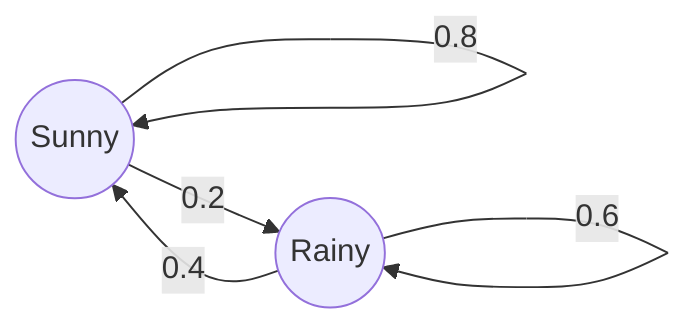
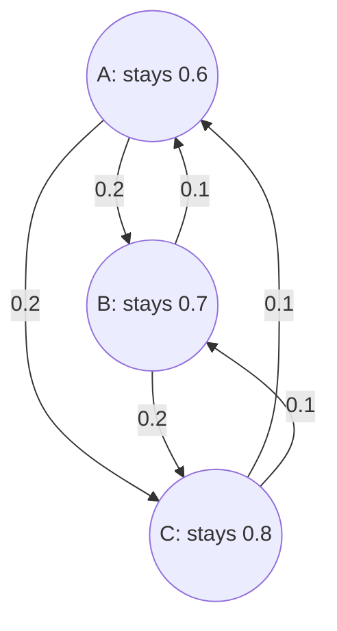

## Matrices that model change

Many things move between a few conditions over time. A day is sunny or rainy; a shared bike sits at one of three stations; a customer uses one of two phone carriers; a web surfer is on one of a billion pages. If the chance of moving from one condition to another stays the same from step to step, a single matrix describes the whole process, and matrix multiplication (Lesson 23) predicts the future. The question "where does it settle in the long run?" then turns into a linear system (Lesson 22). These models are called Markov chains. They are among the most widely used applications of matrices, in fields from genetics and queueing to finance and speech recognition.

## States and transition probabilities

A **Markov chain** is a process that is always in one of finitely many **states** and moves at each step (each day, each year) according to fixed probabilities that depend only on the *current* state, not on how it got there. The probability of going from state $j$ to state $i$ in one step is a **transition probability**.

Here is a simple weather model. If today is sunny, tomorrow is sunny with probability 0.8 and rainy with probability 0.2. If today is rainy, tomorrow is sunny with probability 0.4 and rainy with probability 0.6. A transition diagram shows this as arrows labeled with probabilities.



Collect the probabilities in the **transition matrix** $P$, with one column for each state you're coming *from* and one row for each state you're going *to*:

$$P = \begin{bmatrix} 0.8 & 0.4 \\ 0.2 & 0.6 \end{bmatrix} \quad \begin{matrix} \leftarrow \text{to sunny} \\ \leftarrow \text{to rainy} \end{matrix}$$

with the first column "from sunny" and the second "from rainy". The entry in row $i$, column $j$ is the probability of moving from state $j$ to state $i$. Every entry is between 0 and 1, and each *column* adds to 1, because from any state the process must go somewhere.

*A warning about conventions.* Many books, especially in finite mathematics and statistics, write the transpose: each *row* is a "from" state, rows add to 1, and the state is a row vector multiplied on the left, $\mathbf{x}P$. Both conventions give the same answers. This lesson uses columns, so that it matches $A\mathbf{x}$ everywhere else in the module; when you read another source, check which one it uses before multiplying.

## Stepping forward with matrix multiplication

A **state vector** lists the probability of being in each state at a given step; its entries are nonnegative and add to 1. If $\mathbf{x}_0 = \begin{bmatrix} s \\ r \end{bmatrix}$ gives the chances that today is sunny or rainy, then

$$P(\text{sunny tomorrow}) = 0.8s + 0.4r, \qquad P(\text{rainy tomorrow}) = 0.2s + 0.6r,$$

because you can reach "sunny tomorrow" from a sunny today or from a rainy today, and you add the chances of the two routes. Those two sums are exactly the rows of $P$ times $\mathbf{x}_0$. So

$$\mathbf{x}_1 = P\mathbf{x}_0, \qquad \mathbf{x}_2 = P\mathbf{x}_1 = P^2\mathbf{x}_0, \qquad \mathbf{x}_n = P^n\mathbf{x}_0.$$

The entries of $P^2$ are two-step transition probabilities, the entries of $P^3$ three-step ones, and so on.

### Example 1: Two days ahead

Today is sunny. Find the probability that it is sunny two days from now.

Start with $\mathbf{x}_0 = \begin{bmatrix} 1 \\ 0 \end{bmatrix}$.

$$\mathbf{x}_1 = \begin{bmatrix} 0.8 & 0.4 \\ 0.2 & 0.6 \end{bmatrix}\begin{bmatrix} 1 \\ 0 \end{bmatrix} = \begin{bmatrix} 0.8 \\ 0.2 \end{bmatrix}, \qquad \mathbf{x}_2 = \begin{bmatrix} 0.8 & 0.4 \\ 0.2 & 0.6 \end{bmatrix}\begin{bmatrix} 0.8 \\ 0.2 \end{bmatrix} = \begin{bmatrix} 0.64 + 0.08 \\ 0.16 + 0.12 \end{bmatrix} = \begin{bmatrix} 0.72 \\ 0.28 \end{bmatrix}.$$

The probability is 0.72. In terms of routes: sunny–sunny–sunny has probability $0.8 \times 0.8 = 0.64$ and sunny–rainy–sunny has $0.2 \times 0.4 = 0.08$, for a total of 0.72. Equivalently, $P^2 = \begin{bmatrix} 0.72 & 0.56 \\ 0.28 & 0.44 \end{bmatrix}$, whose first column is the two-step outlook from a sunny day.

Keep going and something striking happens. Starting from a sunny day, the chance of sun on days $0, 1, 2, \dots, 6$ is $1, 0.8, 0.72, 0.688, 0.675, 0.670, 0.668$. Starting from a rainy day it is $0, 0.4, 0.56, 0.624, 0.650, 0.660, 0.664$. Both sequences close in on the same number, about $0.667$.

```plot
{"x": [-0.5, 8.5], "y": [0, 1.05], "xLabel": "day n", "yLabel": "probability of sun", "functions": [{"f": "2/3", "dashed": true}], "points": [{"at": [0, 1]}, {"at": [1, 0.8]}, {"at": [2, 0.72]}, {"at": [3, 0.688]}, {"at": [4, 0.6752]}, {"at": [5, 0.67008]}, {"at": [6, 0.668032]}, {"at": [7, 0.6672128]}, {"at": [8, 0.66688512]}, {"at": [0, 0], "open": true}, {"at": [1, 0.4], "open": true}, {"at": [2, 0.56], "open": true}, {"at": [3, 0.624], "open": true}, {"at": [4, 0.6496], "open": true}, {"at": [5, 0.65984], "open": true}, {"at": [6, 0.663936], "open": true}, {"at": [7, 0.6655744], "open": true}, {"at": [8, 0.66622976], "open": true}], "caption": "Chance of sun on day n, starting from a sunny day (filled dots) or a rainy day (open dots). Both approach 2/3 (dashed line)."}
```

## The steady state

A **steady-state vector** is a state vector $\mathbf{q}$ that the chain leaves unchanged:

$$P\mathbf{q} = \mathbf{q}, \qquad \text{entries of } \mathbf{q} \text{ add to } 1.$$

Rewrite $P\mathbf{q} = \mathbf{q}$ as $P\mathbf{q} - I\mathbf{q} = \mathbf{0}$, that is $(P - I)\mathbf{q} = \mathbf{0}$: a homogeneous linear system. Its equations are always dependent (the columns of $P - I$ add to zero), so it has infinitely many solutions, and the condition "entries add to 1" picks out one of them.

For the weather chain, $P - I = \begin{bmatrix} -0.2 & 0.4 \\ 0.2 & -0.4 \end{bmatrix}$. Both rows say $-0.2s + 0.4r = 0$, so $s = 2r$. With $s + r = 1$: $3r = 1$, so $r = \tfrac13$ and $s = \tfrac23$. The steady state is $\mathbf{q} = \begin{bmatrix} 2/3 \\ 1/3 \end{bmatrix}$, the value the plot was approaching. Check: $0.8(\tfrac23) + 0.4(\tfrac13) = \tfrac{1.6 + 0.4}{3} = \tfrac23$. ✓

The steady state has two readings. It is the long-run probability: far in the future, the chance of sun is about $\tfrac23$ whatever today is like. And it is the long-run fraction of time: over many years, about two days in three are sunny in this model.

When can you count on settling down? A transition matrix is **regular** if some power of it has all entries positive, meaning that after some fixed number of steps every state can be reached from every state. The weather matrix is regular already ($P^1$ has no zeros). The key theorem, stated here without proof (it is part of the Perron–Frobenius theory of positive matrices):

> If $P$ is regular, it has exactly one steady-state vector $\mathbf{q}$, and $P^n\mathbf{x}_0 \to \mathbf{q}$ for every starting state vector $\mathbf{x}_0$. Every column of $P^n$ approaches $\mathbf{q}$.

### Example 2: Three bike stations

A city has 1,000 shared bikes and three stations. Each day a bike at station A ends the day at A with probability 0.6 and at B or C with probability 0.2 each; a bike at B stays with probability 0.7, goes to A with probability 0.1 and to C with probability 0.2; a bike at C stays with probability 0.8 and goes to A or B with probability 0.1 each.



(a) All bikes start at A. How many are at each station after two days? (b) How many are at each station in the long run?

The columns are "from A", "from B", "from C":

$$P = \begin{bmatrix} 0.6 & 0.1 & 0.1 \\ 0.2 & 0.7 & 0.1 \\ 0.2 & 0.2 & 0.8 \end{bmatrix}.$$

Each column adds to 1. Multiplying $P$ by a vector of bike *counts* gives the expected counts the next day.

(a) $\mathbf{x}_0 = (1000, 0, 0)$. Then $\mathbf{x}_1 = P\mathbf{x}_0 = (600, 200, 200)$, the first column times 1,000. Next,

$$\mathbf{x}_2 = P\mathbf{x}_1 = \begin{bmatrix} 0.6(600) + 0.1(200) + 0.1(200) \\ 0.2(600) + 0.7(200) + 0.1(200) \\ 0.2(600) + 0.2(200) + 0.8(200) \end{bmatrix} = \begin{bmatrix} 400 \\ 280 \\ 320 \end{bmatrix}.$$

After two days we expect about 400 bikes at A, 280 at B and 320 at C. The total is still 1,000, as it must be.

(b) Solve $(P - I)\mathbf{q} = \mathbf{0}$ with $\mathbf{q} = (a, b, c)$. Multiplying each equation by 10 to clear decimals:

$$-4a + b + c = 0, \qquad 2a - 3b + c = 0, \qquad 2a + 2b - 2c = 0.$$

Divide the third equation by 2: $a + b - c = 0$, so $c = a + b$. Put that into the first: $-4a + b + a + b = 0$, so $2b = 3a$ and $b = 1.5a$. Then $c = 2.5a$. (The second equation, $2a - 4.5a + 2.5a = 0$, holds automatically: it is the redundant one.) The entries must add to 1: $a + 1.5a + 2.5a = 5a = 1$, so $a = 0.2$, $b = 0.3$, $c = 0.5$.

In the long run about 20% of the bikes, 200, are at A; 300 are at B; and 500 are at C. Station C needs the most docks, and the operator might truck bikes from C back to A. Every entry of $P$ is positive, so the chain is regular and these numbers are approached from any starting distribution.

## When a chain doesn't settle

Not every chain is regular.

- *Periodic chains.* With $P = \begin{bmatrix} 0 & 1 \\ 1 & 0 \end{bmatrix}$ the process switches state every step. Starting in state 1, the state vectors alternate $(1, 0), (0, 1), (1, 0), \dots$ forever. A steady state $(\tfrac12, \tfrac12)$ exists, but the chain never approaches it. No power of $P$ is all positive: the powers alternate between $P$ and $I$.
- *Absorbing states.* A state you can enter but never leave (its column has a 1 on the diagonal and 0s elsewhere) is an **absorbing state**. Think of a game that ends when a player runs out of money. A chain with an absorbing state that can be reached from every other state ends up absorbed with probability 1, and the interesting questions become "how long does it take?" and "which absorbing state wins?", which lead to further matrix methods.

## Where Markov chains came from, and where they went

The Russian mathematician Andrey Markov introduced these chains in 1906, to show that the law of large numbers can hold even when events depend on one another. In 1913 he applied the idea to text, classifying 20,000 letters of Pushkin's novel in verse *Eugene Onegin* as vowels or consonants and estimating how likely a vowel was to follow a vowel or a consonant.

A famous modern application is Google's original PageRank (Brin and Page, 1998). Picture a surfer who, at each step, usually clicks a random link on the current page and occasionally jumps to a random page anywhere on the web (the paper suggests continuing to click with probability about 0.85). The random jumps make the chain regular, and a page's rank is its entry in the steady-state vector: the long-run fraction of time the surfer spends there. This description is simplified; search engines today combine many more signals.

## Common mistakes

- *Mixing up rows and columns.* In this lesson's convention, column $j$ lists where state $j$ goes, and columns add to 1. If the rows add to 1, the book is using the other convention.
- *Multiplying in the wrong order.* With columns, the next state is $P\mathbf{x}$, not $\mathbf{x}P$.
- *Forgetting the "add to 1" condition.* $(P - I)\mathbf{q} = \mathbf{0}$ alone has infinitely many solutions.
- *Confusing $\mathbf{x}_n$ with the steady state.* After a few steps the state is close to $\mathbf{q}$, not equal to it.
- *Assuming every chain settles down.* That needs a regular matrix; periodic and absorbing chains behave differently.

## Key points

- A Markov chain moves between states with fixed transition probabilities that depend only on the current state.
- Transition matrix: entry $(i, j)$ is the probability of going from state $j$ to state $i$; columns add to 1.
- $\mathbf{x}_{n+1} = P\mathbf{x}_n$, so $\mathbf{x}_n = P^n\mathbf{x}_0$; the entries of $P^n$ are $n$-step probabilities.
- A steady state solves $(P - I)\mathbf{q} = \mathbf{0}$ with entries adding to 1.
- For a regular chain the steady state is unique, and every starting state approaches it.
