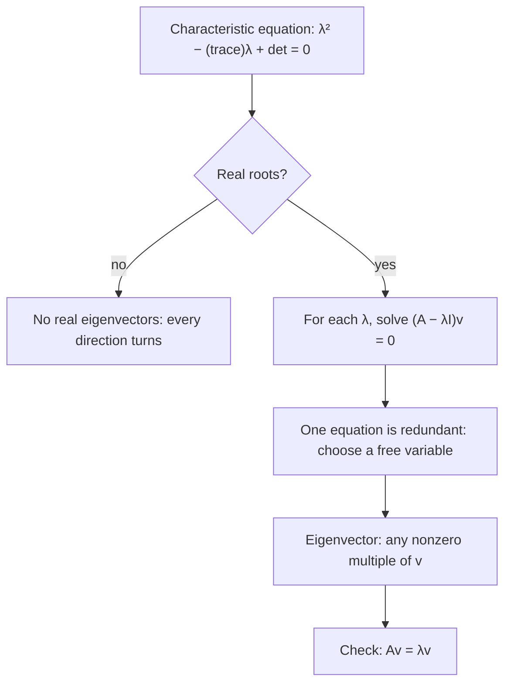

## Directions that don't turn

The first honors lesson of this module showed a $2 \times 2$ matrix moving the whole plane. Most vectors get turned to a new direction. But for many matrices a few special directions are only stretched or shrunk, never turned. Those directions, and the stretch factors that go with them, are the eigenvectors and eigenvalues of the matrix (from the German *eigen*, "own" or "characteristic"). They explain the long-run behavior of the Markov chains in the previous lesson, and they sit at the center of linear algebra: vibration modes of bridges, population models, Google's PageRank, the energy levels of atoms in quantum mechanics and data compression all come down to eigenvalues. This lesson finds them for $2 \times 2$ matrices using two tools from the core lessons: determinants and dependent linear systems.

## The definition

A nonzero vector $\mathbf{v}$ is an **eigenvector** of a square matrix $A$ if

$$A\mathbf{v} = \lambda\mathbf{v}$$

for some number $\lambda$ (the Greek letter lambda). The number $\lambda$ is the **eigenvalue** that goes with $\mathbf{v}$. In words: multiplying by $A$ does the same thing to $\mathbf{v}$ as multiplying by a plain number. Geometrically, $A\mathbf{v}$ lies on the same line through the origin as $\mathbf{v}$, and $\lambda$ says what happens along that line: $\lambda > 1$ stretches, $0 < \lambda < 1$ shrinks, $\lambda < 0$ also flips to the opposite direction, and $\lambda = 0$ squashes $\mathbf{v}$ to the origin.

The zero vector is excluded, since $A\mathbf{0} = \lambda\mathbf{0}$ for every $\lambda$ and would tell us nothing. Any nonzero multiple of an eigenvector is again an eigenvector with the same eigenvalue, because $A(k\mathbf{v}) = kA\mathbf{v} = \lambda(k\mathbf{v})$. So really an eigenvector stands for a whole line of them.

![Arrows from the origin for the matrix A = [4 1; 2 3]. The vector v = (1, 1) goes to Av = (5, 5), five times as long on the same dashed line. The vector w = (1, −2) goes to Aw = (2, −4), twice as long on its dashed line. The vector u = (0, 1) goes to Au = (1, 3), which points in a new direction.](images/pc-m6-eigen-directions.svg)

## Finding the eigenvalues

Rewrite $A\mathbf{v} = \lambda\mathbf{v}$ as $A\mathbf{v} - \lambda I\mathbf{v} = \mathbf{0}$, that is

$$(A - \lambda I)\mathbf{v} = \mathbf{0}.$$

(The identity matrix is needed: $A - \lambda$ would mean subtracting a number from a matrix, which isn't defined.) This is a square linear system with zero constants. It always has the solution $\mathbf{v} = \mathbf{0}$; we want a *nonzero* solution, which means the system must not have a unique solution. By Lessons 24 and 25 that happens exactly when the matrix $A - \lambda I$ is singular:

$$\det(A - \lambda I) = 0.$$

This is called the **characteristic equation of the matrix** $A$. For $A = \begin{bmatrix} a & b \\ c & d \end{bmatrix}$,

$$\det\begin{bmatrix} a - \lambda & b \\ c & d - \lambda \end{bmatrix} = (a - \lambda)(d - \lambda) - bc = \lambda^2 - (a + d)\lambda + (ad - bc).$$

The number $a + d$, the sum of the main-diagonal entries, is the **trace** of $A$. So for every $2 \times 2$ matrix,

$$\lambda^2 - (\text{trace})\,\lambda + \det A = 0.$$

A quadratic has two roots, counted with multiplicity, so a $2 \times 2$ matrix has two eigenvalues, which may be equal or complex. Reading the quadratic backward (the sum and product of its roots) gives a quick check: *the eigenvalues add to the trace and multiply to the determinant.*

## Finding the eigenvectors

For each eigenvalue, solve $(A - \lambda I)\mathbf{v} = \mathbf{0}$. Because $\det(A - \lambda I) = 0$, the two equations are multiples of each other (Lesson 22's dependent system), so one of them can be dropped. Let one component be free, solve for the other, and pick any convenient nonzero value.

### Example 1: Two real eigenvalues

Find the eigenvalues and eigenvectors of $A = \begin{bmatrix} 4 & 1 \\ 2 & 3 \end{bmatrix}$.

*Eigenvalues.* The trace is $4 + 3 = 7$ and $\det A = 12 - 2 = 10$, so

$$\lambda^2 - 7\lambda + 10 = (\lambda - 5)(\lambda - 2) = 0, \qquad \lambda = 5 \text{ or } \lambda = 2.$$

Check: $5 + 2 = 7$, the trace, and $5 \times 2 = 10$, the determinant.

*Eigenvectors for $\lambda = 5$.* $A - 5I = \begin{bmatrix} -1 & 1 \\ 2 & -2 \end{bmatrix}$. The first row says $-x + y = 0$; the second, $2x - 2y = 0$, is the same equation times $-2$. So $y = x$; take $x = 1$: $\mathbf{v} = (1, 1)$. Check: $A\begin{bmatrix} 1 \\ 1 \end{bmatrix} = \begin{bmatrix} 5 \\ 5 \end{bmatrix} = 5\begin{bmatrix} 1 \\ 1 \end{bmatrix}$. ✓

*Eigenvectors for $\lambda = 2$.* $A - 2I = \begin{bmatrix} 2 & 1 \\ 2 & 1 \end{bmatrix}$. Both rows say $2x + y = 0$, so $y = -2x$; take $x = 1$: $\mathbf{w} = (1, -2)$. Check: $A\begin{bmatrix} 1 \\ -2 \end{bmatrix} = \begin{bmatrix} 4 - 2 \\ 2 - 6 \end{bmatrix} = \begin{bmatrix} 2 \\ -4 \end{bmatrix} = 2\begin{bmatrix} 1 \\ -2 \end{bmatrix}$. ✓

These are exactly the two dashed lines in the picture above: along the line $y = x$ the matrix stretches by 5, and along $y = -2x$ it stretches by 2. Every other direction gets turned.

### Example 2: Reading eigenvalues from geometry

Some matrices from the transformations lesson can be done by thinking instead of computing.

- *Reflection across $y = x$*, $\begin{bmatrix} 0 & 1 \\ 1 & 0 \end{bmatrix}$. Vectors on the mirror line don't move: $(1, 1)$ has $\lambda = 1$. Vectors perpendicular to the mirror flip: $(1, -1)$ has $\lambda = -1$. The formula agrees: trace 0, determinant $-1$, so $\lambda^2 - 1 = 0$.
- *Rotation by $90°$*, $\begin{bmatrix} 0 & -1 \\ 1 & 0 \end{bmatrix}$. Every nonzero vector is turned, so there can be no real eigenvector. The formula agrees: trace 0, determinant 1, so $\lambda^2 + 1 = 0$ and $\lambda = \pm i$. The eigenvalues are complex numbers (Lesson 10), and they encode the rotation.
- *Shear*, $\begin{bmatrix} 1 & 1 \\ 0 & 1 \end{bmatrix}$. Trace 2, determinant 1: $\lambda^2 - 2\lambda + 1 = (\lambda - 1)^2 = 0$, a repeated eigenvalue $\lambda = 1$. Solving $(A - I)\mathbf{v} = \mathbf{0}$ gives only $y = 0$: the $x$-axis is the one line that stays put. A repeated eigenvalue can come with only one line of eigenvectors.
- *Triangular matrices.* For $\begin{bmatrix} a & b \\ 0 & d \end{bmatrix}$ the characteristic equation is $(a - \lambda)(d - \lambda) = 0$, so the eigenvalues are the diagonal entries $a$ and $d$.

A useful consequence of "the eigenvalues multiply to the determinant": $A$ is singular exactly when 0 is one of its eigenvalues. A zero eigenvalue means some direction is squashed to the origin.

## Why eigenvectors make powers easy

Multiplying an eigenvector by $A$ just multiplies it by $\lambda$, so multiplying by $A$ repeatedly multiplies by $\lambda$ repeatedly:

$$A^n\mathbf{v} = \lambda^n\mathbf{v}.$$

If a starting vector can be written as a combination of eigenvectors, $\mathbf{x}_0 = c_1\mathbf{v}_1 + c_2\mathbf{v}_2$, then

$$A^n\mathbf{x}_0 = c_1\lambda_1^n\mathbf{v}_1 + c_2\lambda_2^n\mathbf{v}_2.$$

No matrix powers need to be computed. In the long run the term with the larger $|\lambda|$ takes over.

### Example 3: The weather chain, solved exactly

The previous lesson's weather chain has $P = \begin{bmatrix} 0.8 & 0.4 \\ 0.2 & 0.6 \end{bmatrix}$. Find the probability of sun on day $n$, starting from a sunny day.

*Eigenvalues.* The trace is 1.4 and $\det P = 0.48 - 0.08 = 0.4$, so $\lambda^2 - 1.4\lambda + 0.4 = (\lambda - 1)(\lambda - 0.4) = 0$: $\lambda = 1$ and $\lambda = 0.4$.

*Eigenvectors.* For $\lambda = 1$: $P - I = \begin{bmatrix} -0.2 & 0.4 \\ 0.2 & -0.4 \end{bmatrix}$ gives $x = 2y$, so $\mathbf{v}_1 = (2, 1)$. For $\lambda = 0.4$: $P - 0.4I = \begin{bmatrix} 0.4 & 0.4 \\ 0.2 & 0.2 \end{bmatrix}$ gives $y = -x$, so $\mathbf{v}_2 = (1, -1)$.

*Split the start.* Solve $(1, 0) = c_1(2, 1) + c_2(1, -1)$: the second components give $c_1 = c_2$, and then the first gives $3c_1 = 1$. So $c_1 = c_2 = \tfrac13$.

*Raise to the $n$th power.*

$$\mathbf{x}_n = \frac13(1)^n\begin{bmatrix} 2 \\ 1 \end{bmatrix} + \frac13(0.4)^n\begin{bmatrix} 1 \\ -1 \end{bmatrix} = \begin{bmatrix} \tfrac23 + \tfrac13(0.4)^n \\[2pt] \tfrac13 - \tfrac13(0.4)^n \end{bmatrix}.$$

The chance of sun on day $n$ is $\tfrac23 + \tfrac13(0.4)^n$. For $n = 1$ that is $\tfrac23 + 0.1\overline{3} = 0.8$, and for $n = 2$ it is $\tfrac23 + \tfrac{0.16}{3} = 0.72$, matching the step-by-step computation. As $n$ grows, $(0.4)^n \to 0$ and the probability approaches $\tfrac23$. The formula also says *how fast*: the gap from the steady state shrinks by a factor of 0.4 every day.

This explains the steady state in general. Every transition matrix has $\lambda = 1$ as an eigenvalue: the columns of $P$ add to 1, so the columns of $P - I$ add to 0, which means the rows of $P - I$ add up to a row of zeros. The rows are dependent, so $\det(P - I) = 0$. The steady-state vector is the eigenvector for $\lambda = 1$, scaled so its entries add to 1. For a regular chain, every other eigenvalue has $|\lambda| < 1$, so those terms fade away.

## Growth rates: Fibonacci and the golden ratio

The Fibonacci numbers $1, 1, 2, 3, 5, 8, 13, \dots$ follow $F_{n+1} = F_n + F_{n-1}$. As a matrix step,

$$\begin{bmatrix} F_{n+1} \\ F_n \end{bmatrix} = \begin{bmatrix} 1 & 1 \\ 1 & 0 \end{bmatrix}\begin{bmatrix} F_n \\ F_{n-1} \end{bmatrix}.$$

This matrix has trace 1 and determinant $-1$, so its eigenvalues solve $\lambda^2 - \lambda - 1 = 0$:

$$\lambda = \frac{1 + \sqrt5}{2} \approx 1.618 \quad\text{and}\quad \lambda = \frac{1 - \sqrt5}{2} \approx -0.618.$$

The first is the golden ratio $\varphi$. Since $|-0.618| < 1$, that part fades, and in the long run each Fibonacci number is about $\varphi$ times the one before: $\tfrac{89}{55} \approx 1.61818$, $\tfrac{144}{89} \approx 1.61798$, $\tfrac{233}{144} \approx 1.61806$, closing in on $1.61803\ldots$ Working the combination out exactly gives Binet's formula, $F_n = \dfrac{\varphi^n - (1 - \varphi)^n}{\sqrt5}$, which the Module 9 honors lesson on recurrence relations derives another way (its "characteristic equation" $x^2 = x + 1$ is this one in disguise). The same idea predicts the long-run growth rate of any population model of the form $\mathbf{x}_{n+1} = A\mathbf{x}_n$: it is the eigenvalue with the largest absolute value.

## Common mistakes

- *Forgetting the $I$.* Write $A - \lambda I$: subtract $\lambda$ from the diagonal entries only.
- *Accepting $\mathbf{v} = \mathbf{0}$.* An eigenvector must be nonzero; if your system seems to force $\mathbf{v} = \mathbf{0}$, recheck the eigenvalue.
- *Thinking the eigenvector is unique.* Any nonzero multiple works; $(1, 1)$ and $(-3, -3)$ are the same answer.
- *Sign slips in the characteristic equation.* It is $\lambda^2 - (\text{trace})\lambda + \det$; check that the eigenvalues add to the trace and multiply to the determinant.
- *Expecting real eigenvalues every time.* A negative discriminant means complex eigenvalues, and the matrix turns every real direction.

## Key points

- $\mathbf{v} \ne \mathbf{0}$ is an eigenvector with eigenvalue $\lambda$ when $A\mathbf{v} = \lambda\mathbf{v}$: $A$ only stretches, shrinks or flips it.
- Eigenvalues solve $\det(A - \lambda I) = 0$; for $2 \times 2$, $\lambda^2 - (\text{trace})\lambda + \det A = 0$.
- Eigenvalues add to the trace and multiply to the determinant; $A$ is singular exactly when 0 is an eigenvalue.
- Eigenvectors solve the dependent system $(A - \lambda I)\mathbf{v} = \mathbf{0}$; any nonzero multiple works.
- $A^n\mathbf{v} = \lambda^n\mathbf{v}$, so eigenvectors make powers and long-run behavior easy. A transition matrix always has $\lambda = 1$, and its eigenvector is the steady state.
