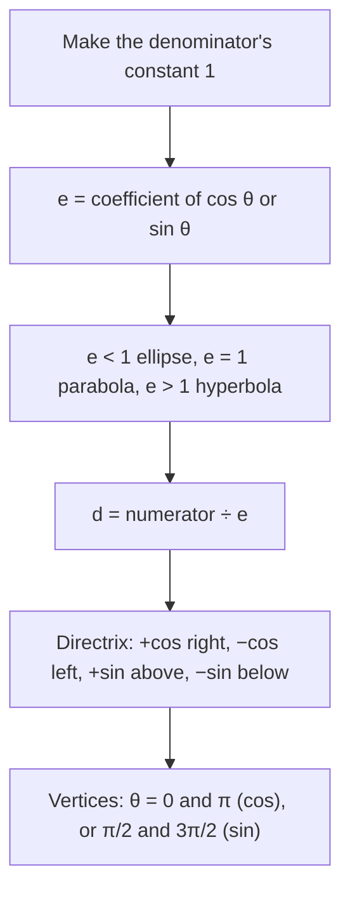

## One equation for all three

In rectangular coordinates, parabolas, ellipses and hyperbolas each have their own standard form. In polar coordinates, with a focus at the pole, all three share a single equation, and one number, the eccentricity, decides which conic you get. This is the form astronomers use for orbits, because the sun sits at a focus. The lesson combines the conics of Lessons 28 to 30 with the polar coordinates of Lesson 32.

## The focus-directrix definition

Fix a point $F$ (the focus), a line (the directrix) not through $F$, and a positive number $e$, the eccentricity. The set of points $P$ with

$$\frac{\text{distance from } P \text{ to } F}{\text{distance from } P \text{ to the directrix}} = e$$

is a conic:

| Eccentricity | Conic |
|---|---|
| $0 < e < 1$ | ellipse |
| $e = 1$ | parabola |
| $e > 1$ | hyperbola |

For $e = 1$ this is exactly the parabola definition from Lesson 28. For ellipses and hyperbolas it is a different-looking but equivalent definition, and the $e$ here matches $e = \frac ca$ from before.

## Deriving the polar equation

Put the focus at the pole and the directrix at $x = d$ (to the right, $d > 0$). For a point $P = (r, \theta)$, the distance to the focus is $r$, and the distance to the directrix is $d - r\cos\theta$. The definition says $r = e(d - r\cos\theta)$, so $r + er\cos\theta = ed$ and

$$r = \frac{ed}{1 + e\cos\theta}.$$

Other directrix positions change the sign or the trig function:

| Directrix | Equation |
|---|---|
| $x = d$ (right of the pole) | $r = \dfrac{ed}{1 + e\cos\theta}$ |
| $x = -d$ (left) | $r = \dfrac{ed}{1 - e\cos\theta}$ |
| $y = d$ (above) | $r = \dfrac{ed}{1 + e\sin\theta}$ |
| $y = -d$ (below) | $r = \dfrac{ed}{1 - e\sin\theta}$ |

To read an equation, first make the constant in the denominator equal 1 (divide top and bottom by it). Then the coefficient of the trig function is $e$, and the numerator is $ed$.



### Example 1

Identify $r = \dfrac{10}{3 + 2\cos\theta}$ and find its vertices.

Divide top and bottom by 3: $r = \dfrac{10/3}{1 + \frac23\cos\theta}$. So $e = \frac23$: an ellipse. $ed = \frac{10}{3}$ gives $d = 5$, so the directrix is $x = 5$.

The vertices lie on the polar axis (the trig function is cosine):

- $\theta = 0$: $r = \frac{10}{5} = 2$, the point $(2, 0)$.
- $\theta = \pi$: $r = \frac{10}{1} = 10$, the point 10 units left, $(-10, 0)$ in rectangular coordinates.

The major axis runs from $-10$ to $2$, so $2a = 12$, $a = 6$, and the center is at $x = -4$. The focus at the pole is $c = 4$ from the center, and indeed $\frac ca = \frac46 = \frac23 = e$. ✓

```plot
{"x": [-11, 6], "y": [-6.5, 6.5], "equal": true, "curves": [{"x": "10cos(t)/(3 + 2cos(t))", "y": "10sin(t)/(3 + 2cos(t))", "t": [0, "2pi"]}], "segments": [{"from": [5, -6.5], "to": [5, 6.5], "dashed": true}], "labels": [{"at": [3.6, 5.6], "text": "x = 5"}, {"at": [-1.8, 0.9], "text": "focus"}], "points": [{"at": [0, 0]}, {"at": [2, 0], "label": "(2, 0)"}, {"at": [-10, 0], "label": "(−10, 0)"}], "caption": "r = 10/(3 + 2 cos θ): an ellipse with e = 2/3, one focus at the pole and directrix x = 5."}
```

### Example 2

Identify $r = \dfrac{4}{1 - \sin\theta}$.

The constant is already 1, and $e = 1$: a parabola. $ed = 4$ gives $d = 4$, and "$- \sin\theta$" puts the directrix below: $y = -4$. The vertex is halfway between the focus (pole) and directrix: at $\theta = \frac{3\pi}{2}$, $r = \frac{4}{1 - (-1)} = 2$, the point $(0, -2)$. The parabola opens upward, away from its directrix. (At $\theta = \frac{\pi}{2}$ the denominator is 0: that's the open end.)

Keeping the focus at the pole and the directrix at $x = 2$ and changing only $e$ shows all three conics at once: $r = \dfrac{2e}{1 + e\cos\theta}$ for $e = \frac12$, $1$ and $2$.

```plot
{"x": [-7, 8], "y": [-6, 6], "equal": true, "curves": [{"x": "cos(t)/(1 + 0.5cos(t))", "y": "sin(t)/(1 + 0.5cos(t))", "t": [0, "2pi"]}, {"x": "2cos(t)/(1 + cos(t))", "y": "2sin(t)/(1 + cos(t))", "t": [-2.45, 2.45], "dashed": true}, {"x": "4cos(t)/(1 + 2cos(t))", "y": "4sin(t)/(1 + 2cos(t))", "t": [-1.85, 1.85]}, {"x": "4cos(t)/(1 + 2cos(t))", "y": "4sin(t)/(1 + 2cos(t))", "t": [2.4, 3.88]}], "segments": [{"from": [2, -6], "to": [2, 6], "dashed": true}], "points": [{"at": [0, 0]}], "labels": [{"at": [2.9, 5.4], "text": "x = 2"}, {"at": [-3.4, 0.6], "text": "e = 1/2"}, {"at": [-4.2, 3.4], "text": "e = 1"}, {"at": [1.0, 4.4], "text": "e = 2"}], "caption": "Same focus (the dot at the pole) and directrix: e = 1/2 gives an ellipse, e = 1 a parabola (dashed), e = 2 a hyperbola with a second branch beyond the directrix."}
```

### Example 3

Identify $r = \dfrac{6}{1 + 2\cos\theta}$ and find its vertices.

$e = 2 > 1$: a hyperbola, with $ed = 6$, so $d = 3$ and directrix $x = 3$.

- $\theta = 0$: $r = \frac{6}{3} = 2$, the point $(2, 0)$.
- $\theta = \pi$: $r = \frac{6}{1 - 2} = -6$. A negative $r$ at angle $\pi$ points the other way, to $(6, 0)$.

So the vertices are $(2, 0)$ and $(6, 0)$, the center is $(4, 0)$, $a = 2$ and $c = 4$ (the pole is a focus): $\frac ca = 2 = e$. ✓ The denominator is 0 when $\cos\theta = -\frac12$; those directions are parallel to the asymptotes.

## Writing an equation

### Example 4

Write a polar equation for the ellipse with a focus at the pole, eccentricity $\frac12$ and directrix $x = 6$.

Directrix to the right: $r = \dfrac{ed}{1 + e\cos\theta} = \dfrac{\frac12 \cdot 6}{1 + \frac12\cos\theta} = \dfrac{3}{1 + \frac12\cos\theta}$, or, multiplying top and bottom by 2, $r = \dfrac{6}{2 + \cos\theta}$.

## Orbits

A planet's orbit is an ellipse with the sun at a focus. The closest point (perihelion) and farthest point (aphelion) are the vertices. In the polar form with the sun at the pole, they occur at $\theta = 0$ and $\theta = \pi$, at distances $\frac{ed}{1 + e}$ and $\frac{ed}{1 - e}$. A comet with $e$ close to 1 has an extremely elongated orbit: very close at perihelion, very far at aphelion.


## Common mistakes

- *Reading $e$ before making the constant 1.* In $\frac{10}{3 + 2\cos\theta}$, $e = \frac23$, not 2.
- *Confusing $ed$ with $d$.* The numerator is $ed$; divide by $e$ to get $d$.
- *Directrix on the wrong side.* $+\cos$: right; $-\cos$: left; $+\sin$: above; $-\sin$: below.
- *Mishandling negative $r$* when finding hyperbola vertices.
- *Thinking $e = 1$ is an ellipse.* It's a parabola; ellipses have $e < 1$.

## Key points

- Focus-directrix definition: $\frac{PF}{PD} = e$; $e < 1$ ellipse, $e = 1$ parabola, $e > 1$ hyperbola.
- With a focus at the pole: $r = \dfrac{ed}{1 \pm e\cos\theta}$ or $\dfrac{ed}{1 \pm e\sin\theta}$.
- Normalize the denominator's constant to 1, then read $e$ and $ed$.
- Vertices come from $\theta = 0, \pi$ (cosine) or $\frac{\pi}{2}, \frac{3\pi}{2}$ (sine).
- Orbits are polar conics with the sun at the pole.
