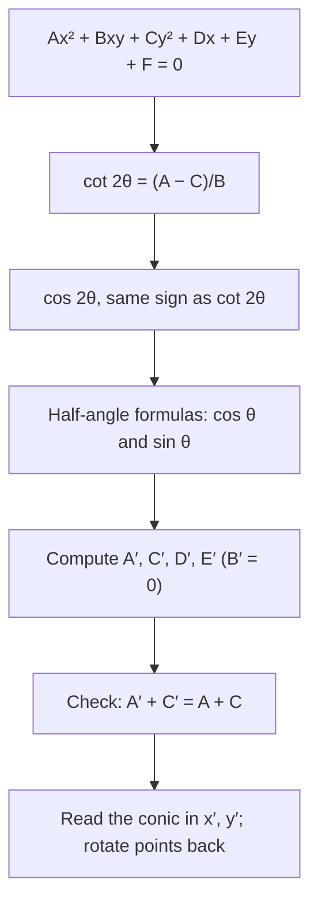

## Tilted conics

Lesson 30 showed that an $xy$ term tilts a conic, and that the discriminant $B^2 - 4AC$ tells you which conic it is. It also gave, without proof, the angle that removes the tilt: $\cot 2\theta = \frac{A - C}{B}$. This lesson fills in the reasons. You will derive the rotation formulas, see exactly where that angle comes from, find the new equation of a tilted conic, and read off its vertices and foci. Along the way you will meet two quantities that never change when you rotate, which explain why the discriminant works at all.

The idea, called **rotation of axes**, is to keep the curve where it is and turn the coordinate system instead. If we pick new axes $x'$ and $y'$ that line up with the conic's own axes of symmetry, the equation in the new coordinates has no $x'y'$ term and we can read it like the standard forms of Lessons 28 to 30.

## The rotation formulas

Turn the axes counterclockwise by an angle $\theta$. A point $P$ stays put but gets new coordinates $(x', y')$. Polar coordinates make the relationship easy. If $P$ is at distance $r$ from the origin and at angle $\varphi$ from the $x$-axis, then it is at angle $\varphi - \theta$ from the $x'$-axis, so

$$x' = r\cos(\varphi - \theta), \qquad y' = r\sin(\varphi - \theta).$$

Going the other way, $x = r\cos\varphi = r\cos\big((\varphi - \theta) + \theta\big)$. Expanding with the sum formulas and using $r\cos(\varphi - \theta) = x'$, $r\sin(\varphi - \theta) = y'$ gives the **rotation formulas**

$$x = x'\cos\theta - y'\sin\theta, \qquad y = x'\sin\theta + y'\cos\theta.$$

These are the ones you substitute into an equation in $x$ and $y$ to rewrite it in $x'$ and $y'$.

## What happens to the coefficients

Substitute the rotation formulas into $Ax^2 + Bxy + Cy^2 + Dx + Ey + F = 0$ and collect terms. The result has the same shape, $A'x'^2 + B'x'y' + C'y'^2 + D'x' + E'y' + F' = 0$, with

$$A' = A\cos^2\theta + B\sin\theta\cos\theta + C\sin^2\theta,$$

$$C' = A\sin^2\theta - B\sin\theta\cos\theta + C\cos^2\theta,$$

$$B' = B\cos 2\theta - (A - C)\sin 2\theta,$$

$$D' = D\cos\theta + E\sin\theta, \qquad E' = -D\sin\theta + E\cos\theta, \qquad F' = F.$$

The $B'$ line comes from collecting the $x'y'$ terms and using the double-angle identities $\cos^2\theta - \sin^2\theta = \cos 2\theta$ and $2\sin\theta\cos\theta = \sin 2\theta$ from Module 5. Notice that $F$ never changes: rotating about the origin doesn't move the origin.

We want $B' = 0$, so $B\cos 2\theta = (A - C)\sin 2\theta$. When $B \ne 0$, divide by $B\sin 2\theta$:

$$\cot 2\theta = \frac{A - C}{B}.$$

Cotangent takes every real value exactly once for $0 < 2\theta < 180°$, so there is always exactly one $\theta$ between $0°$ and $90°$ that works. In particular, $A = C$ gives $\cot 2\theta = 0$, so $\theta = 45°$.

## From the cotangent to sine and cosine

The formulas need $\sin\theta$ and $\cos\theta$, not $\theta$ itself. Draw $2\theta$ in a right-triangle picture: if $\cot 2\theta = \frac{A - C}{B}$, then $\cos 2\theta = \frac{A - C}{B} \big/ \sqrt{1 + \left(\frac{A - C}{B}\right)^2}$, with the same sign as $\cot 2\theta$ (because $\sin 2\theta > 0$ for $0 < 2\theta < 180°$). Then the half-angle formulas give

$$\cos\theta = \sqrt{\frac{1 + \cos 2\theta}{2}}, \qquad \sin\theta = \sqrt{\frac{1 - \cos 2\theta}{2}},$$

both positive because $\theta$ is acute.

### Example 1

Identify and describe $5x^2 - 6xy + 5y^2 = 8$.

Here $A = C = 5$, so $\cot 2\theta = 0$ and $\theta = 45°$, with $\sin\theta = \cos\theta = \frac{1}{\sqrt2}$. Then $\sin^2\theta = \cos^2\theta = \sin\theta\cos\theta = \frac12$:

$$A' = \tfrac12(5) + \tfrac12(-6) + \tfrac12(5) = 2, \qquad C' = \tfrac12(5) - \tfrac12(-6) + \tfrac12(5) = 8.$$

The equation becomes $2x'^2 + 8y'^2 = 8$, or $\dfrac{x'^2}{4} + \dfrac{y'^2}{1} = 1$: an ellipse with $a = 2$ along the $x'$-axis (the line $y = x$) and $b = 1$. Its vertices are $(x', y') = (\pm 2, 0)$. Rotating back, $x = 2\cos 45° = \sqrt2$ and $y = 2\sin 45° = \sqrt2$, so the vertices are $(\sqrt2, \sqrt2)$ and $(-\sqrt2, -\sqrt2)$. The discriminant agrees: $B^2 - 4AC = 36 - 100 < 0$.

### Example 2

Rotate $8x^2 + 12xy + 17y^2 = 20$ to remove the $xy$ term.

$\cot 2\theta = \frac{8 - 17}{12} = -\frac34$. A cotangent of $-\frac34$ with $\sin 2\theta > 0$ means $\cos 2\theta = -\frac35$ (think of a 3-4-5 triangle). The half-angle formulas give

$$\cos\theta = \sqrt{\frac{1 - \frac35}{2}} = \frac{1}{\sqrt5}, \qquad \sin\theta = \sqrt{\frac{1 + \frac35}{2}} = \frac{2}{\sqrt5},$$

so $\theta = \tan^{-1} 2 \approx 63.4°$. Now $\cos^2\theta = \frac15$, $\sin^2\theta = \frac45$ and $\sin\theta\cos\theta = \frac25$:

$$A' = 8\cdot\tfrac15 + 12\cdot\tfrac25 + 17\cdot\tfrac45 = \tfrac{8 + 24 + 68}{5} = 20, \qquad C' = 8\cdot\tfrac45 - 12\cdot\tfrac25 + 17\cdot\tfrac15 = \tfrac{32 - 24 + 17}{5} = 5.$$

So $20x'^2 + 5y'^2 = 20$, that is $x'^2 + \dfrac{y'^2}{4} = 1$: an ellipse whose major axis ($a = 2$) lies along the $y'$-axis.

## Invariants: a shortcut and a check

Some combinations of coefficients come out the same for every angle. Adding the formulas for $A'$ and $C'$ and using $\sin^2\theta + \cos^2\theta = 1$ gives the first one; a longer computation gives the second. These **invariants** are

$$A' + C' = A + C, \qquad B'^2 - 4A'C' = B^2 - 4AC.$$

The second one is why the discriminant test of Lesson 30 works: after the rotation $B' = 0$, and then $-4A'C'$ is negative, zero or positive exactly when $A'$ and $C'$ have the same sign, one is zero, or they have opposite signs, which is the no-$xy$-term test for an ellipse, parabola or hyperbola. In Example 2, $A' + C' = 25 = 8 + 17$ and $-4(20)(5) = -400 = 144 - 4(8)(17)$. ✓

With $B' = 0$ the invariants say that $A'$ and $C'$ have sum $A + C$ and product $AC - \frac{B^2}{4}$, so they are the two roots of

$$\lambda^2 - (A + C)\lambda + \left(AC - \frac{B^2}{4}\right) = 0.$$

Which root is $A'$? Working through the formulas shows $A' - C' = (A - C)\cos 2\theta + B\sin 2\theta$, and for the acute $\theta$ chosen above this has the same sign as $B$. So with $B > 0$, $A'$ is the larger root; with $B < 0$, it is the smaller one. (In Example 1, $B = -6$ and $A' = 2$ is the smaller root.)

(Simplified for now: in linear algebra, $A'$ and $C'$ turn out to be the *eigenvalues* of the matrix $\begin{bmatrix} A & B/2 \\ B/2 & C \end{bmatrix}$, and the new axes point along its eigenvectors. You don't need that language here.)

### Example 3

Identify $x^2 + 4xy - 2y^2 = 6$ and find its equation after the rotation, using the invariants.

$B^2 - 4AC = 16 + 8 = 24 > 0$: a hyperbola. The new coefficients solve $\lambda^2 - (-1)\lambda + (-2 - 4) = \lambda^2 + \lambda - 6 = 0$, so $\lambda = 2$ or $\lambda = -3$. Since $B = 4 > 0$, $A' = 2$ and $C' = -3$:

$$2x'^2 - 3y'^2 = 6, \qquad \frac{x'^2}{3} - \frac{y'^2}{2} = 1.$$

The angle: $\cot 2\theta = \frac{1 - (-2)}{4} = \frac34$, so $\cos 2\theta = \frac35$, $\cos\theta = \frac{2}{\sqrt5}$, $\sin\theta = \frac{1}{\sqrt5}$, $\theta \approx 26.6°$. Direct substitution confirms $A' = 1\cdot\frac45 + 4\cdot\frac25 - 2\cdot\frac15 = 2$. The hyperbola opens along the $x'$-axis, with $a = \sqrt3$, $b = \sqrt2$ and $c = \sqrt5$; its foci are at $(x', y') = (\pm\sqrt5, 0)$, which rotate back to $(x, y) = (\pm 2, \pm 1)$ (same signs).

### Example 4

Identify $x^2 + 2xy + y^2 - 8x + 8y = 0$ and find its focus.

$B^2 - 4AC = 4 - 4 = 0$: a parabola. $A = C$, so $\theta = 45°$. Then $A' = \frac12 + 1 + \frac12 = 2$, $C' = \frac12 - 1 + \frac12 = 0$, and the linear terms matter now:

$$D' = \frac{-8 + 8}{\sqrt2} = 0, \qquad E' = \frac{-(-8) + 8}{\sqrt2} = \frac{16}{\sqrt2} = 8\sqrt2.$$

The equation becomes $2x'^2 + 8\sqrt2\,y' = 0$, or $x'^2 = -4\sqrt2\,y'$. This is the parabola $x'^2 = 4py'$ with $p = -\sqrt2$: vertex at the origin, opening in the negative $y'$ direction, focus at $(x', y') = (0, -\sqrt2)$. Rotate back:

$$x = 0 - (-\sqrt2)\tfrac{1}{\sqrt2} = 1, \qquad y = 0 + (-\sqrt2)\tfrac{1}{\sqrt2} = -1.$$

The focus is $(1, -1)$, and the directrix $y' = \sqrt2$ is the line $y - x = 2$. You can check the original equation by setting the squared distance to $(1, -1)$ equal to the squared distance to $x - y + 2 = 0$, which is $\frac{(x - y + 2)^2}{2}$; expanding both sides gives back $x^2 + 2xy + y^2 - 8x + 8y = 0$.

## Common mistakes

- *Substituting the wrong direction.* Replace $x$ and $y$ with $x'\cos\theta - y'\sin\theta$ and $x'\sin\theta + y'\cos\theta$, not the other way around.
- *Using $\theta$ where the formula has $2\theta$.* $\cot 2\theta = \frac{A - C}{B}$ gives the double angle; halve it at the end, or use the half-angle formulas.
- *Wrong sign for $\cos 2\theta$.* Take $0 < 2\theta < 180°$; then $\cos 2\theta$ has the sign of $\frac{A - C}{B}$.
- *Mixing up $A'$ and $C'$ from the invariant shortcut.* With an acute $\theta$, $A' - C'$ has the same sign as $B$.
- *Forgetting the linear terms.* $D$ and $E$ change too; only $F$ stays the same.
- *Reporting vertices in the new coordinates* when the question asks for $x$ and $y$. Rotate points back with the rotation formulas.

## Key points

- Rotation formulas: $x = x'\cos\theta - y'\sin\theta$, $y = x'\sin\theta + y'\cos\theta$.
- The $x'y'$ term vanishes when $\cot 2\theta = \frac{A - C}{B}$; $A = C$ means $\theta = 45°$.
- Get $\cos 2\theta$ (sign of the cotangent), then $\cos\theta$ and $\sin\theta$ by the half-angle formulas.
- Invariants: $A' + C' = A + C$ and $B'^2 - 4A'C' = B^2 - 4AC$; they explain the discriminant test and give $A'$, $C'$ as roots of $\lambda^2 - (A + C)\lambda + AC - \frac{B^2}{4} = 0$.
- $F$ never changes; $D' = D\cos\theta + E\sin\theta$, $E' = -D\sin\theta + E\cos\theta$.
