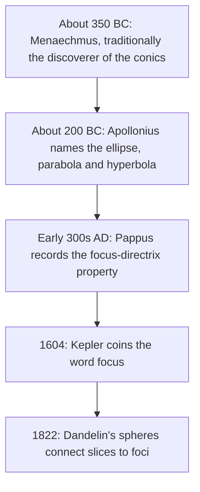

## Three definitions, one family of curves

This module has given the conics three different definitions. Lesson 28 introduced them as slices of a double cone. Lessons 28 to 30 defined them by distances: equal distances to a focus and a directrix for the parabola, a constant sum of distances to two foci for the ellipse, a constant difference for the hyperbola. Lesson 33 used a single focus-directrix ratio $e$ for all three. Nothing so far has shown that these definitions describe the *same* curves, or why a parabola sends light to its focus. This lesson proves both, with tools no harder than tangent lines and similar triangles.

Conics have a long history, and the proofs here come from several centuries:

Apollonius's names describe how each curve compares with a reference length: *ellipsis* means "falling short," *parabole* "laying alongside" (exactly equal), and *hyperbole* "excess." Kepler took *focus* from the Latin for "hearth," the place where the fire is, fitting for the point where a mirror gathers sunlight.

## Dandelin spheres

A double cone is made of straight lines through its apex; each of these lines is a **generator** of the cone, and the two halves on either side of the apex are its **nappes**. Slice one nappe with a tilted plane that cuts all the way across, so the edge of the slice is a closed curve. Now drop a ball into the cone above the plane and let it grow until it touches both the cone and the plane; do the same with a larger ball below the plane. These two spheres are the **Dandelin spheres**. Each one touches the cone along a horizontal circle and touches the plane at a single point; call those points $F_1$ (small sphere) and $F_2$ (large sphere).

**Claim.** For every point $P$ on the curve, $PF_1 + PF_2$ is the same. So the slice is an ellipse with foci $F_1$ and $F_2$.

**Proof.** The key fact is about tangent segments: all the segments from an outside point to the points where they touch a sphere have the same length (just as two tangent segments from a point to a circle are equal).

1. $PF_1$ is tangent to the small sphere, because the plane touches that sphere at $F_1$.
2. The generator through $P$ is also tangent to the small sphere; it touches it at the point $Q_1$ where the generator crosses the small sphere's circle. So $PF_1 = PQ_1$.
3. In the same way, $PF_2 = PQ_2$, where $Q_2$ is where the generator crosses the large sphere's circle.
4. $P$ lies between $Q_1$ and $Q_2$ on the generator, so $PF_1 + PF_2 = PQ_1 + PQ_2 = Q_1Q_2$.
5. $Q_1Q_2$ is the distance between the two circles measured along a generator, and that is the same for every generator. ∎

In the figure, the gold and blue segments are $PQ_1$ and $PQ_2$ for the point $P$ at the right end of the curve; they add up to the slant distance between the two dashed circles.

### The directrix appears too

The same spheres give the focus-directrix property. The plane of the small sphere's circle meets the cutting plane in a line; that line is a directrix. If the cone's generators make an angle $\alpha$ with its axis and the cutting plane makes an angle $\beta$ with the axis, then a point $P$ at height $h$ above or below the circle's plane has $PF_1 = PQ_1 = \frac{h}{\cos\alpha}$ (slanting along a generator) and distance $\frac{h}{\cos\beta}$ to the directrix (slanting within the cutting plane). Their ratio is the same for every $P$:

$$e = \frac{PF_1}{PD} = \frac{\cos\beta}{\cos\alpha}.$$

This sketch explains the classification by slicing. A plane perpendicular to the axis has $\beta = 90°$, so $e = 0$: a circle. A plane tilted less than the generators (closer to horizontal), $\beta > \alpha$, gives $e < 1$: an ellipse. A plane parallel to a generator, $\beta = \alpha$, gives $e = 1$: a parabola. A plane closer to the axis than the generators, $\beta < \alpha$, cuts both nappes and gives $e > 1$: a hyperbola. For example, a cone with $\alpha = 30°$ cut at $\beta = 60°$ gives $e = \frac{\cos 60°}{\cos 30°} = \frac{1}{\sqrt3} \approx 0.577$.

## Focal radii: the algebra behind it

The segments $PF_1$ and $PF_2$ from a point on a conic to its foci are its **focal radii**. For an ellipse they have a remarkably simple form. Take $\frac{x^2}{a^2} + \frac{y^2}{b^2} = 1$ with foci $F_1 = (-c, 0)$, $F_2 = (c, 0)$, $e = \frac ca$, and a point $P = (x_0, y_0)$ on it. Then

$$PF_2^2 = (x_0 - c)^2 + y_0^2 = x_0^2 - 2cx_0 + c^2 + b^2\left(1 - \frac{x_0^2}{a^2}\right).$$

Using $b^2 = a^2 - c^2$, this simplifies to $\frac{c^2}{a^2}x_0^2 - 2cx_0 + a^2 = \left(a - ex_0\right)^2$. Since $|x_0| \le a$ and $e < 1$, $a - ex_0 > 0$, so

$$PF_2 = a - ex_0, \qquad PF_1 = a + ex_0.$$

They add to $2a$, the sum definition. And $PF_2 = e\left(\frac ae - x_0\right)$, where $\frac ae - x_0$ is the distance from $P$ to the line $x = \frac ae$: the focus-directrix definition, with directrix $x = \frac{a}{e} = \frac{a^2}{c}$.

### Example 1

For $\frac{x^2}{25} + \frac{y^2}{9} = 1$, find the focal radii of $P = \left(3, \frac{12}{5}\right)$ and the directrix that goes with the right focus.

$a = 5$, $c = 4$, $e = \frac45$. Then $PF_2 = 5 - \frac45(3) = \frac{13}{5} = 2.6$ and $PF_1 = 5 + \frac{12}{5} = \frac{37}{5} = 7.4$, which add to $10 = 2a$. Directly: $PF_2 = \sqrt{(3 - 4)^2 + 2.4^2} = \sqrt{6.76} = 2.6$. ✓ The directrix is $x = \frac{25}{4} = 6.25$; $P$ is $3.25$ from it, and $\frac45(3.25) = 2.6$. ✓

## The reflective property of the parabola

The **reflective property** of a conic says how its tangent line meets the focal radii. For a parabola: a ray parallel to the axis reflects off the curve through the focus. Light reflects off a curve as it would off the tangent line at that point, with equal angles on both sides, so we need the tangent.

Take $x^2 = 4py$ and a point $P = (x_0, y_0)$ on it. A non-vertical line $y = mx + k$ meets the parabola where $x^2 - 4pmx - 4pk = 0$. It is tangent when this quadratic has a double root, so the discriminant is zero: $16p^2m^2 + 16pk = 0$, giving $k = -pm^2$, and the double root is $x = 2pm$. For the root to be $x_0$ we need $m = \frac{x_0}{2p}$, and then $k = -\frac{x_0^2}{4p} = -y_0$.

So the tangent at $P$ crosses the axis at $T = (0, -y_0)$. Now compare two distances from the focus $F = (0, p)$:

- $FT = p + y_0$ (straight along the axis);
- $FP = y_0 + p$, because $P$ is as far from $F$ as from the directrix $y = -p$.

Triangle $FPT$ is isosceles, so its angles at $P$ and $T$ are equal. The incoming ray at $P$ is vertical, parallel to the axis $FT$, so it makes the same angle with the tangent as the axis does at $T$ (corresponding angles). That angle equals the angle between the tangent and $PF$. Equal angles: the ray reflects along $PF$, through the focus. ∎

### Example 2

For $x^2 = 8y$ at $P = (8, 8)$: $p = 2$, so the tangent has slope $\frac{8}{4} = 2$ and crosses the axis at $T = (0, -8)$; its equation is $y = 2x - 8$. The focus is $F = (0, 2)$: $FT = 10$ and $FP = \sqrt{64 + 36} = 10$. ✓ Isosceles, as promised.

## Ellipses and hyperbolas

For an ellipse, the tangent at $P$ makes equal angles with $PF_1$ and $PF_2$, so a ray leaving one focus reflects to the other. The proof is a shortest-path argument. Every point $Q$ on the tangent line other than $P$ lies outside the ellipse, so $QF_1 + QF_2 > 2a = PF_1 + PF_2$. Of all the paths from $F_1$ to a point on the line and on to $F_2$, the one through $P$ is the shortest, and a classical result going back to Heron of Alexandria says the shortest such path makes equal angles with the line. That is the law of reflection.

For a hyperbola, the tangent at $P$ bisects the angle $F_1PF_2$. In optical terms, a ray aimed at one focus that hits the outside of a hyperbolic mirror reflects toward the other focus.

These properties are used in real devices:

- **Whispering galleries** (Lesson 29): sound from one focus of an elliptical room gathers at the other.
- **Lithotripsy**: since the 1980s, doctors have broken up kidney stones with shock waves made at one focus of an ellipsoidal reflector and focused on the stone at the other.
- **Cassegrain telescopes**: a parabolic main mirror sends light toward its focus, but a small convex hyperbolic mirror, sharing that focus, reflects it to the hyperbola's other focus behind a hole in the main mirror, where the camera sits.

### Example 3

Check the equal-angle property for $\frac{x^2}{25} + \frac{y^2}{9} = 1$ at $P = \left(3, \frac{12}{5}\right)$.

The tangent to $\frac{x^2}{a^2} + \frac{y^2}{b^2} = 1$ at $(x_0, y_0)$ is $\frac{x_0 x}{a^2} + \frac{y_0 y}{b^2} = 1$ (you can check that it meets the ellipse only at $P$). Here that is $\frac{3x}{25} + \frac{4y}{15} = 1$, with slope $-\frac{9}{20}$, so a direction along it is $\vec t = (20, -9)$. From $P$, the vectors to the foci are $\vec{PF_2} = (1, -2.4)$ and $\vec{PF_1} = (-7, -2.4)$, of lengths 2.6 and 7.4 from Example 1. Using the dot product (Module 8):

$$\cos\angle(\vec{PF_2}, \vec t) = \frac{20 + 21.6}{2.6\sqrt{481}} \approx 0.7295, \qquad \cos\angle(\vec{PF_1}, -\vec t) = \frac{140 - 21.6}{7.4\sqrt{481}} \approx 0.7295.$$

Both angles are about $43.2°$, one on each side of $P$: equal, as claimed.

## Common mistakes

- *Thinking the two foci come from one sphere.* Each Dandelin sphere touches the plane at one focus.
- *Getting the angle condition backward.* $e = \frac{\cos\beta}{\cos\alpha}$ is less than 1 when the plane is tilted *less* than the generators, closer to horizontal ($\beta > \alpha$, both measured from the axis).
- *Mixing up the focal radii.* $PF_2 = a - ex_0$ goes with the right focus $(c, 0)$; points on the right are closer to it.
- *Using the slope of $PF$ for the tangent.* The tangent at $P$ has slope $\frac{x_0}{2p}$ for $x^2 = 4py$; it is a different line from $PF$.
- *Saying a parabola reflects any ray to its focus.* Only rays parallel to the axis do.

## Key points

- Dandelin spheres touch the cutting plane at the foci; equal tangent segments prove $PF_1 + PF_2 = $ constant.
- The plane of a sphere's contact circle meets the cutting plane in a directrix; $e = \frac{\cos\beta}{\cos\alpha}$ classifies the slice.
- Ellipse focal radii: $PF_1 = a + ex_0$, $PF_2 = a - ex_0$; directrices $x = \pm\frac ae$.
- The tangent to $x^2 = 4py$ at $(x_0, y_0)$ has slope $\frac{x_0}{2p}$ and meets the axis at $(0, -y_0)$; the isosceles triangle proves the reflective property.
- Ellipse: focus-to-focus reflection. Hyperbola: a ray aimed at one focus reflects toward the other. Parabola: axis-parallel rays reflect through the focus.
