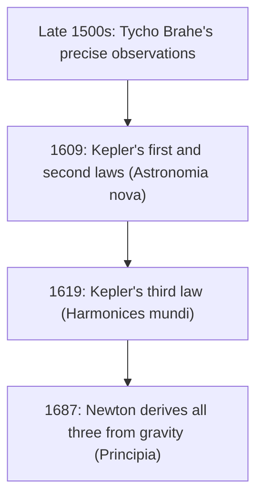

## From a polar equation to the solar system

Lesson 33 ended with a short note: a planet's orbit is an ellipse with the sun at a focus, which is exactly the polar conic $r = \frac{ed}{1 + e\cos\theta}$ with the sun at the pole. This lesson takes that seriously. You will rewrite the polar equation in the form astronomers use, then work through Kepler's three laws of planetary motion and use them to answer real questions: how far Earth is from the Sun in January and July, how much faster a comet moves near the Sun, how long a trip to Mars takes on the most economical path, and what it means for an orbit to be a parabola or a hyperbola.

Kepler found his laws by fitting curves to Tycho Brahe's careful naked-eye observations of Mars; Newton later showed that all three follow from his law of gravity.

## The first law: ellipses with the Sun at a focus

**Kepler's first law:** each planet moves on an ellipse with the Sun at one focus.

Orbits are usually described by two numbers instead of $e$ and $d$: the eccentricity $e$ and the **semi-major axis** $a$, half the length of the major axis. Distances are often given in **astronomical units** (AU); 1 AU is about 149.6 million km, roughly the average distance from Earth to the Sun.

The closest point to the Sun is the **perihelion** and the farthest is the **aphelion**; they are the two vertices of the ellipse. The Sun is at a focus, $c = ae$ from the center, so

$$\text{perihelion distance } q = a - c = a(1 - e), \qquad \text{aphelion distance } Q = a + c = a(1 + e).$$

Adding and subtracting these gives the reverse formulas, handy when you know the closest and farthest distances:

$$a = \frac{q + Q}{2}, \qquad e = \frac{Q - q}{Q + q}.$$

In the polar equation with the Sun at the pole and the perihelion at $\theta = 0$, the perihelion distance is $\frac{ed}{1 + e}$. Setting that equal to $a(1 - e)$ gives $ed = a(1 - e)(1 + e) = a(1 - e^2)$, so

$$r = \frac{a(1 - e^2)}{1 + e\cos\theta}.$$

Here $\theta$ is the angle at the Sun measured from the perihelion direction. At $\theta = \pi$ this gives $\frac{a(1 - e^2)}{1 - e} = a(1 + e)$, the aphelion distance, as it should.

### Example 1

Earth's orbit has $a = 1.000$ AU and $e \approx 0.0167$. Find its closest and farthest distances from the Sun.

$q = 1.000(1 - 0.0167) = 0.9833$ AU and $Q = 1.000(1 + 0.0167) = 1.0167$ AU, about 147.1 and 152.1 million km. Earth is closest in early January and farthest in early July, so the seasons are *not* caused by the distance (they come from the tilt of Earth's axis); the distance changes by only about 3%.

### Example 2

Mars has $a \approx 1.524$ AU and $e \approx 0.0934$. How far is it from the Sun a quarter of the way around from perihelion, at $\theta = 90°$?

At $\theta = 90°$, $\cos\theta = 0$, so $r = a(1 - e^2) = 1.524(1 - 0.0934^2) \approx 1.524(0.99128) \approx 1.511$ AU. This distance, the value of $r$ straight "above" the Sun, is the numerator $ed$ of the polar equation; it is half the focal width from Lesson 28's language.

## The second law: equal areas in equal times

**Kepler's second law:** the line from the Sun to a planet sweeps out equal areas in equal times.

So a planet moves fastest at perihelion and slowest at aphelion. At those two points the planet's velocity is perpendicular to the line to the Sun, so in a short time $\Delta t$ the swept region is nearly a thin triangle with base $r$ and height $v\,\Delta t$, of area $\frac12 r v\,\Delta t$. Equal areas in equal times means $\frac12 q\,v_p = \frac12 Q\,v_a$, so

$$\frac{v_p}{v_a} = \frac{Q}{q} = \frac{1 + e}{1 - e}.$$

### Example 3

Halley's Comet has $a \approx 17.8$ AU and $e \approx 0.967$. Find its perihelion and aphelion distances and compare its speeds there.

$q = 17.8(0.033) \approx 0.59$ AU, inside Venus's orbit, and $Q = 17.8(1.967) \approx 35.0$ AU, beyond Neptune. The speed ratio is $\frac{1.967}{0.033} \approx 60$: the comet moves about 60 times faster at perihelion than at aphelion. That is why it spends only a few months near the Sun and decades crawling through the outer solar system. For Earth the same ratio is $\frac{1.0167}{0.9833} \approx 1.034$, a difference of about 3%.

## The third law: periods and sizes

**Kepler's third law:** the square of a planet's **orbital period** $T$ is proportional to the cube of its semi-major axis. For objects orbiting the Sun, with $T$ in years and $a$ in AU, the constant is 1:

$$T^2 = a^3, \qquad T = a^{3/2}.$$

(This is a simplification. Newton's version, $T^2 = \frac{4\pi^2}{G(M + m)}a^3$, includes the planet's mass $m$ as well as the Sun's mass $M$. Even for Jupiter, $m$ is about a thousandth of $M$, so the simple form is very accurate for the planets. For objects orbiting Earth or another star, the constant is different.)

| Planet | $a$ (AU) | $a^{3/2}$ | Actual $T$ (years) |
|---|---|---|---|
| Mercury | 0.387 | 0.241 | 0.241 |
| Earth | 1.000 | 1.000 | 1.000 |
| Mars | 1.524 | 1.881 | 1.881 |
| Jupiter | 5.203 | 11.87 | 11.86 |

Notice that the period depends only on $a$, not on $e$: a long thin orbit and a circle with the same semi-major axis take the same time.

### Example 4

A comet comes within 0.5 AU of the Sun and reaches 35.5 AU at its farthest. Find $a$, $e$ and the period.

$a = \frac{0.5 + 35.5}{2} = 18$ AU and $e = \frac{35.5 - 0.5}{36} = \frac{35}{36} \approx 0.972$. Then $T = 18^{3/2} = 18\sqrt{18} \approx 76.4$ years.

## A trip to Mars

The cheapest way (in fuel) to move a spacecraft between two circular orbits is to coast along half of an ellipse that just touches both: perihelion at the inner orbit and aphelion at the outer one. This is a **Hohmann transfer orbit**, described by Walter Hohmann in 1925. The spacecraft fires its engine once to enter the ellipse and once more to match the new orbit.

### Example 5

Estimate the travel time from Earth's orbit (1 AU) to Mars's orbit (1.524 AU) on a Hohmann transfer, treating both orbits as circles in the same plane.

The transfer ellipse has $q = 1$ and $Q = 1.524$, so $a = \frac{1 + 1.524}{2} = 1.262$ AU and $e = \frac{0.524}{2.524} \approx 0.208$. A full lap would take $T = 1.262^{3/2} \approx 1.418$ years, but the trip is only half the ellipse: about $0.709$ years, roughly 259 days. (Simplified: real orbits are slightly elliptical and tilted, Mars's gravity matters at arrival, and real missions often use somewhat faster paths; trips to Mars have typically taken roughly six to ten months. The launch must also be timed so Mars arrives at the meeting point at the same moment.)

## Beyond ellipses

An object moving fast enough for its distance from the Sun is not captured at all. If its path is exactly a parabola ($e = 1$), it has just barely the speed to escape; with more speed, the path is one branch of a hyperbola ($e > 1$), and the object swings past the Sun once and leaves. The same polar equation $r = \frac{ed}{1 + e\cos\theta}$ covers all three cases. Many long-period comets have $e$ so close to 1 that a parabola is a good working model for the part of the orbit near the Sun. In 2017 astronomers found 'Oumuamua, the first known object from outside the solar system, on a clearly hyperbolic path with $e \approx 1.2$.

## Common mistakes

- *Putting the Sun at the center.* The Sun is at a focus; the center of the ellipse is empty.
- *Using $e$ and $d$ when the data are $a$ and $e$.* The numerator of the polar equation is $ed = a(1 - e^2)$.
- *Confusing $q$ and $Q$.* Perihelion $a(1 - e)$ is the smaller one.
- *Using $T^2 = a^3$ with other units or another central body.* It holds for orbits around the Sun with $T$ in years and $a$ in AU.
- *Using a full period for a Hohmann transfer.* The trip is half the transfer ellipse.
- *Thinking Earth's seasons come from its changing distance.* Earth is closest to the Sun in January.

## Key points

- Kepler's first law: elliptical orbit, Sun at a focus; $r = \dfrac{a(1 - e^2)}{1 + e\cos\theta}$ with $\theta$ measured from perihelion.
- Perihelion $q = a(1 - e)$, aphelion $Q = a(1 + e)$; $a = \frac{q + Q}{2}$, $e = \frac{Q - q}{Q + q}$.
- Second law: equal areas in equal times, so $\frac{v_p}{v_a} = \frac{Q}{q} = \frac{1 + e}{1 - e}$.
- Third law (Sun, years, AU): $T^2 = a^3$; the period depends only on $a$.
- A Hohmann transfer is half an ellipse from the inner orbit to the outer one.
- $e = 1$ is the boundary between capture and escape; $e > 1$ is a hyperbolic flyby.
