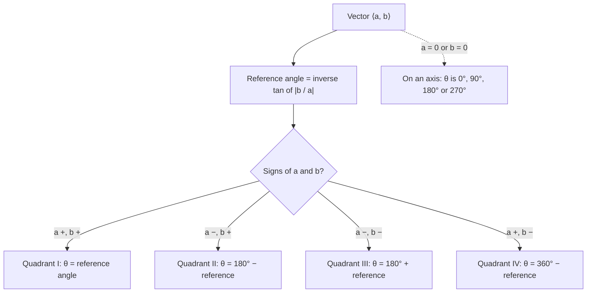

## Quantities with direction

Some quantities are fully described by a number: temperature, mass, time. Others need a direction too: a 40 mph wind *from the south*, a 50-newton push *up the ramp*, a displacement of 3 km *northeast*. These are **vectors**. Plain numbers are called **scalars**. This module gives vectors an algebra: you can add them, scale them, measure them and (in the next lesson) multiply them in a useful way. Vectors connect to the parametric equations of Module 7 and are the language of physics and of multivariable calculus.

## Geometric vectors

A vector can be drawn as an arrow, a **directed line segment** from an initial point $P$ to a terminal point $Q$, written $\vec{PQ}$. Its length is its **magnitude** $\lVert\vec{PQ}\rVert$, and the arrow shows its direction. Two arrows with the same length and direction represent the *same* vector, wherever they are drawn. So we can always slide a vector to start at the origin, its **standard position**.

## Component form

A vector in standard position ending at $(a, b)$ is written in **component form** $\vec v = \langle a, b \rangle$. For the vector from $P(x_1, y_1)$ to $Q(x_2, y_2)$, subtract the coordinates (terminal minus initial):

$$\vec{PQ} = \langle x_2 - x_1,\ y_2 - y_1 \rangle.$$

By the Pythagorean theorem,

$$\lVert\langle a, b \rangle\rVert = \sqrt{a^2 + b^2}.$$

The picture puts the pieces together: the arrow from $P$ to $Q$ is the hypotenuse of a right triangle whose legs are the two components.


### Example 1

Find the component form and magnitude of the vector from $P(1, 2)$ to $Q(4, -2)$.

$\vec{PQ} = \langle 4 - 1,\ -2 - 2 \rangle = \langle 3, -4 \rangle$, and $\lVert\vec{PQ}\rVert = \sqrt{9 + 16} = 5$.

## Operations

For $\vec u = \langle u_1, u_2 \rangle$, $\vec v = \langle v_1, v_2 \rangle$ and a scalar $k$:

| Operation | Algebra | Geometry |
|---|---|---|
| Addition | $\vec u + \vec v = \langle u_1 + v_1,\ u_2 + v_2 \rangle$ | place $\vec v$ at the tip of $\vec u$ (tip to tail); the sum goes from the start of $\vec u$ to the tip of $\vec v$ |
| Scalar multiple | $k\vec u = \langle ku_1, ku_2 \rangle$ | stretch by $\lvert k \rvert$; reverse if $k < 0$ |
| Subtraction | $\vec u - \vec v = \vec u + (-1)\vec v$ | the arrow from the tip of $\vec v$ to the tip of $\vec u$ |

The sum is also the diagonal of the parallelogram with sides $\vec u$ and $\vec v$, which is why it's called the **resultant** of the two.

```plot
{"x": [-1, 6], "y": [-1, 5], "equal": true, "segments": [{"from": [0, 0], "to": [4, 1], "arrow": true, "label": "u"}, {"from": [4, 1], "to": [5, 4], "arrow": true, "label": "v"}, {"from": [0, 0], "to": [5, 4], "arrow": true, "label": "u + v"}, {"from": [0, 0], "to": [1, 3], "dashed": true}, {"from": [1, 3], "to": [5, 4], "dashed": true}], "caption": "Tip-to-tail addition: ⟨4, 1⟩ + ⟨1, 3⟩ = ⟨5, 4⟩, the diagonal of the parallelogram."}
```

Scalar multiplication changes the magnitude in a simple way: $\lVert k\vec v \rVert = \lvert k \rvert\,\lVert\vec v\rVert$.

```plot
{"x": [-1, 7], "y": [-1, 5], "equal": true, "segments": [{"from": [0, 2.5], "to": [2, 3.5], "arrow": true, "label": "v"}, {"from": [0, 0], "to": [4, 2], "arrow": true, "label": "2v"}, {"from": [6.5, 4.5], "to": [4.5, 3.5], "arrow": true, "label": "−v"}], "caption": "Scalar multiples of v = ⟨2, 1⟩: 2v = ⟨4, 2⟩ is twice as long in the same direction, and −v = ⟨−2, −1⟩ has the same length pointing the opposite way."}
```

### Example 2

Let $\vec u = \langle 2, -1 \rangle$ and $\vec v = \langle -3, 4 \rangle$. Find $3\vec u - 2\vec v$.

$3\vec u = \langle 6, -3 \rangle$, $2\vec v = \langle -6, 8 \rangle$, so $3\vec u - 2\vec v = \langle 6 - (-6),\ -3 - 8 \rangle = \langle 12, -11 \rangle$.

## Unit vectors and $\mathbf{i}$, $\mathbf{j}$

A **unit vector** has magnitude 1. To get the unit vector in the direction of $\vec v$, divide by its magnitude:

$$\hat{u} = \frac{\vec v}{\lVert\vec v\rVert}.$$

For $\vec v = \langle 3, -4 \rangle$, $\hat u = \left\langle \tfrac35, -\tfrac45 \right\rangle$. The standard unit vectors $\mathbf{i} = \langle 1, 0 \rangle$ and $\mathbf{j} = \langle 0, 1 \rangle$ give another notation: $\langle a, b \rangle = a\mathbf{i} + b\mathbf{j}$. So $\langle 3, -4 \rangle = 3\mathbf{i} - 4\mathbf{j}$.

## Direction angles

The **direction angle** $\theta$ of $\vec v$ is measured counterclockwise from the positive $x$-axis, just like an angle in standard position (Module 5). Then

$$\vec v = \langle \lVert\vec v\rVert\cos\theta,\ \lVert\vec v\rVert\sin\theta \rangle, \qquad \tan\theta = \frac{b}{a}.$$

As with polar coordinates, $\tan^{-1}$ alone may give the wrong quadrant; look at the signs of the components.

The chart turns that advice into a procedure: find the reference angle from $\lvert b/a \rvert$, then let the signs of the components choose the quadrant.



### Example 3

Find the component form of the vector with magnitude 10 and direction angle $120^\circ$, and the direction angle of $\langle -3, -4 \rangle$.

- $\langle 10\cos 120^\circ,\ 10\sin 120^\circ \rangle = \langle -5,\ 5\sqrt3 \rangle \approx \langle -5, 8.66 \rangle$.
- $\langle -3, -4 \rangle$ is in Quadrant III. $\tan^{-1}\frac{-4}{-3} = \tan^{-1}\frac43 \approx 53.13^\circ$, which is in Quadrant I, so add $180^\circ$: $\theta \approx 233.13^\circ$.

## Applications

### Example 4

A plane flies at an airspeed of 200 mph heading due east. A 40 mph wind blows due north. What are the plane's ground speed and direction?

Velocity vectors: plane $\langle 200, 0 \rangle$, wind $\langle 0, 40 \rangle$. The resultant is $\langle 200, 40 \rangle$:

- ground speed $\sqrt{200^2 + 40^2} \approx 204.0$ mph;
- direction $\tan^{-1}\frac{40}{200} \approx 11.3^\circ$ north of east.

### Example 5

Two forces act on an object: 50 N at $0^\circ$ and 80 N at $60^\circ$. Find the resultant force.

$\vec F_1 = \langle 50, 0 \rangle$ and $\vec F_2 = \langle 80\cos 60^\circ, 80\sin 60^\circ \rangle = \langle 40, 69.28 \rangle$. Sum: $\langle 90, 69.28 \rangle$, with magnitude $\sqrt{90^2 + 69.28^2} \approx 113.6$ N at angle $\tan^{-1}\frac{69.28}{90} \approx 37.6^\circ$. Notice that $50 + 80 = 130$ N would be wrong: forces at an angle partly work against each other.

## Common mistakes

- *Subtracting in the wrong order.* $\vec{PQ}$ = terminal minus initial.
- *Adding magnitudes.* $\lVert\vec u + \vec v\rVert \ne \lVert\vec u\rVert + \lVert\vec v\rVert$ unless they point the same way.
- *Wrong quadrant for the direction angle.* Check the component signs.
- *Forgetting to divide by the magnitude* when making a unit vector.
- *Treating a vector's location as part of the vector.* Only length and direction matter.

## Key points

- $\vec{PQ} = \langle x_2 - x_1, y_2 - y_1 \rangle$; $\lVert\langle a, b\rangle\rVert = \sqrt{a^2 + b^2}$.
- Add and scale component by component; addition is tip to tail.
- Unit vector: $\frac{\vec v}{\lVert\vec v\rVert}$; $\langle a, b \rangle = a\mathbf{i} + b\mathbf{j}$.
- From magnitude and angle: $\langle \lVert\vec v\rVert\cos\theta, \lVert\vec v\rVert\sin\theta \rangle$.
- Resultants of velocities and forces are vector sums.
