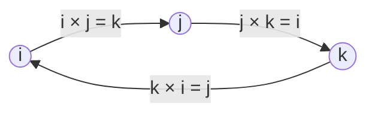

## A product that gives a vector

Lesson 35 ended with a formula pulled out of a hat: for vectors in space,

$$\vec u \times \vec v = \langle u_2v_3 - u_3v_2,\ u_3v_1 - u_1v_3,\ u_1v_2 - u_2v_1 \rangle,$$

with the claims that the result is perpendicular to both factors and that its length is the area of the parallelogram they span. This lesson earns those claims. We will see where the formula comes from (a determinant, from Lesson 25), prove both properties, settle which of the two perpendicular directions it picks, and then use it for three jobs: areas of triangles and parallelograms in space, volumes of slanted boxes, and the turning effect of a force, called torque.

A little history explains why the formula looks the way it does. In 1843 William Rowan Hamilton invented the quaternions, a number system with three imaginary units $i$, $j$, $k$. When two "pure" quaternions are multiplied, the answer splits into a number part (the negative of our dot product) and a vector part (our cross product). In the 1880s, J. Willard Gibbs in the United States and Oliver Heaviside in Britain separately pulled these two pieces out as products of their own, which is the vector algebra physicists and engineers have used ever since.

## Computing it with a determinant

The formula is easiest to remember as a $3 \times 3$ determinant whose first row holds the unit vectors $\mathbf{i}, \mathbf{j}, \mathbf{k}$:

$$\vec u \times \vec v = \begin{vmatrix} \mathbf{i} & \mathbf{j} & \mathbf{k} \\ u_1 & u_2 & u_3 \\ v_1 & v_2 & v_3 \end{vmatrix} = \begin{vmatrix} u_2 & u_3 \\ v_2 & v_3 \end{vmatrix}\mathbf{i} - \begin{vmatrix} u_1 & u_3 \\ v_1 & v_3 \end{vmatrix}\mathbf{j} + \begin{vmatrix} u_1 & u_2 \\ v_1 & v_2 \end{vmatrix}\mathbf{k}.$$

This is cofactor expansion along the first row, exactly as in Lesson 25. (Strictly, a determinant with vectors in one row is a memory device, not a real determinant of numbers, but the expansion gives the right formula.) Watch the minus sign on the middle term: it is the most common slip.

### Example 1

Find $\vec u \times \vec v$ for $\vec u = \langle 2, -1, 3 \rangle$ and $\vec v = \langle 1, 4, -2 \rangle$, and check the answer.

1. $\mathbf{i}$ component: cover the first column; $(-1)(-2) - (3)(4) = 2 - 12 = -10$.
2. $\mathbf{j}$ component: cover the middle column; $(2)(-2) - (3)(1) = -7$, and the minus sign makes it $+7$.
3. $\mathbf{k}$ component: cover the last column; $(2)(4) - (-1)(1) = 9$.

So $\vec u \times \vec v = \langle -10, 7, 9 \rangle$. Check with dot products: $\langle -10, 7, 9 \rangle \cdot \langle 2, -1, 3 \rangle = -20 - 7 + 27 = 0$ and $\langle -10, 7, 9 \rangle \cdot \langle 1, 4, -2 \rangle = -10 + 28 - 18 = 0$. Perpendicular to both, as promised. This check takes ten seconds and catches almost every arithmetic error.

## Why it is perpendicular to both factors

Dot $\vec u$ with $\vec u \times \vec v$ and expand:

$$u_1(u_2v_3 - u_3v_2) + u_2(u_3v_1 - u_1v_3) + u_3(u_1v_2 - u_2v_1).$$

Multiply out: the six terms are $u_1u_2v_3$, $-u_1u_3v_2$, $u_2u_3v_1$, $-u_1u_2v_3$, $u_1u_3v_2$, $-u_2u_3v_1$, and they cancel in pairs, leaving 0. The same happens for $\vec v$. In determinant language, $\vec u \cdot (\vec u \times \vec v)$ is a determinant with two equal rows, and such a determinant is always 0.

## Its length is an area

A longer calculation (multiply everything out and compare) proves **Lagrange's identity**:

$$\lVert\vec u \times \vec v\rVert^2 = \lVert\vec u\rVert^2\lVert\vec v\rVert^2 - (\vec u \cdot \vec v)^2.$$

For Example 1: $\lVert\langle -10, 7, 9\rangle\rVert^2 = 100 + 49 + 81 = 230$, and $\lVert\vec u\rVert^2\lVert\vec v\rVert^2 - (\vec u \cdot \vec v)^2 = 14 \cdot 21 - 8^2 = 294 - 64 = 230$. Now substitute $\vec u \cdot \vec v = \lVert\vec u\rVert\lVert\vec v\rVert\cos\theta$:

$$\lVert\vec u \times \vec v\rVert^2 = \lVert\vec u\rVert^2\lVert\vec v\rVert^2(1 - \cos^2\theta) = \lVert\vec u\rVert^2\lVert\vec v\rVert^2\sin^2\theta.$$

Since $0 \le \theta \le \pi$, $\sin\theta \ge 0$, so $\lVert\vec u \times \vec v\rVert = \lVert\vec u\rVert\lVert\vec v\rVert\sin\theta$. That is base times height for the parallelogram with sides $\vec u$ and $\vec v$: the base is $\lVert\vec u\rVert$ and the height is $\lVert\vec v\rVert\sin\theta$.

Two consequences follow at once. A triangle with sides $\vec u$ and $\vec v$ is half the parallelogram, so its area is $\tfrac12\lVert\vec u \times \vec v\rVert$. And $\vec u \times \vec v = \vec 0$ exactly when $\sin\theta = 0$ (or one vector is $\vec 0$), that is, exactly when the vectors are **parallel**.

## Which way it points: the right-hand rule

Two directions are perpendicular to a plane, and the cross product picks one by the **right-hand rule**: point the fingers of your right hand along $\vec u$ and curl them toward $\vec v$ (through the smaller angle); your thumb points along $\vec u \times \vec v$. With the right-handed axes of Lesson 35, $\mathbf{i} \times \mathbf{j} = \mathbf{k}$. Going around the cycle $\mathbf{i} \to \mathbf{j} \to \mathbf{k} \to \mathbf{i}$ gives the others:

Against the arrows the sign flips: $\mathbf{j} \times \mathbf{i} = -\mathbf{k}$. In general the cross product is **anticommutative**: $\vec v \times \vec u = -(\vec u \times \vec v)$. Swapping two rows of a determinant changes its sign, which is the algebraic reason.

| Property | Statement |
|---|---|
| Anticommutative | $\vec v \times \vec u = -(\vec u \times \vec v)$ |
| A vector with itself | $\vec u \times \vec u = \vec 0$ |
| Scalars pull out | $(k\vec u) \times \vec v = k(\vec u \times \vec v)$ |
| Distributive | $\vec u \times (\vec v + \vec w) = \vec u \times \vec v + \vec u \times \vec w$ |
| Not associative | $(\mathbf{i} \times \mathbf{i}) \times \mathbf{j} = \vec 0$, but $\mathbf{i} \times (\mathbf{i} \times \mathbf{j}) = \mathbf{i} \times \mathbf{k} = -\mathbf{j}$ |

So the usual algebra habits need care: order matters, and parentheses matter.

### Example 2

Find the area of the triangle with vertices $A(1, 0, 2)$, $B(3, 1, 1)$ and $C(0, 2, 4)$.

1. Two sides from the same vertex: $\vec{AB} = \langle 2, 1, -1 \rangle$ and $\vec{AC} = \langle -1, 2, 2 \rangle$.
2. Cross product: $\mathbf{i}$: $(1)(2) - (-1)(2) = 4$; $\mathbf{j}$: $-[(2)(2) - (-1)(-1)] = -3$; $\mathbf{k}$: $(2)(2) - (1)(-1) = 5$. So $\vec{AB} \times \vec{AC} = \langle 4, -3, 5 \rangle$ (check: $\langle 4, -3, 5 \rangle \cdot \langle 2, 1, -1 \rangle = 8 - 3 - 5 = 0$).
3. Length: $\sqrt{16 + 9 + 25} = \sqrt{50} = 5\sqrt2$.
4. Area of the triangle: $\tfrac12 \cdot 5\sqrt2 = \tfrac{5\sqrt2}{2} \approx 3.54$.

In the plane the same idea gives a shortcut. Treat $\langle a, b \rangle$ and $\langle c, d \rangle$ as $\langle a, b, 0 \rangle$ and $\langle c, d, 0 \rangle$; their cross product is $\langle 0, 0, ad - bc \rangle$, so the parallelogram they span has area $\lvert ad - bc \rvert$, the absolute value of a $2 \times 2$ determinant. For the triangle with vertices $(1, 1)$, $(5, 2)$, $(2, 6)$, the sides $\langle 4, 1 \rangle$ and $\langle 1, 5 \rangle$ give $\tfrac12\lvert 20 - 1 \rvert = 9.5$.

## Volume: the triple scalar product

Three vectors $\vec u$, $\vec v$, $\vec w$ from one corner build a slanted box called a **parallelepiped**. Its volume is base area times height. Take the base to be the parallelogram of $\vec v$ and $\vec w$, with area $\lVert\vec v \times \vec w\rVert$. The height is the part of $\vec u$ perpendicular to the base, which is the part along $\vec v \times \vec w$: the absolute value of the scalar projection $\dfrac{\vec u \cdot (\vec v \times \vec w)}{\lVert\vec v \times \vec w\rVert}$. Multiplying, the $\lVert\vec v \times \vec w\rVert$ cancels:

$$V = \lvert \vec u \cdot (\vec v \times \vec w) \rvert = \left\lvert \begin{vmatrix} u_1 & u_2 & u_3 \\ v_1 & v_2 & v_3 \\ w_1 & w_2 & w_3 \end{vmatrix} \right\rvert.$$

The number $\vec u \cdot (\vec v \times \vec w)$ is the **triple scalar product**. It is the determinant of the matrix with rows $\vec u, \vec v, \vec w$ (dotting $\vec u$ into the $\mathbf{i}, \mathbf{j}, \mathbf{k}$ expansion just puts $u_1, u_2, u_3$ in the top row).

If the triple product is 0, the box is flat: the three vectors lie in one plane, and they are called **coplanar**. That gives a quick test for whether four points lie in one plane.

### Example 3

Find the volume of the parallelepiped spanned by $\vec u = \langle 1, 2, 0 \rangle$, $\vec v = \langle 0, 1, 3 \rangle$, $\vec w = \langle 2, 0, 1 \rangle$.

Expand along the first row:

$$\begin{vmatrix} 1 & 2 & 0 \\ 0 & 1 & 3 \\ 2 & 0 & 1 \end{vmatrix} = 1(1 \cdot 1 - 3 \cdot 0) - 2(0 \cdot 1 - 3 \cdot 2) + 0 = 1 + 12 = 13.$$

The volume is 13 cubic units. The tetrahedron (triangular pyramid) with the same three edges from one corner has $\tfrac16$ of this volume, $\tfrac{13}{6}$. A negative determinant would just mean the three vectors form a left-handed set; the volume is the absolute value.

## Torque

Push on a wrench and the bolt turns. How hard it turns depends on how far from the bolt you push, how hard, and at what angle: pushing straight along the handle does nothing. If $\vec r$ runs from the pivot to the point where force $\vec F$ is applied, the **torque** is

$$\vec\tau = \vec r \times \vec F, \qquad \lVert\vec\tau\rVert = \lVert\vec r\rVert\,\lVert\vec F\rVert\sin\theta.$$

Its size measures the turning effect (in newton-meters, N·m), and its direction is the axis of the turn by the right-hand rule. For a bolt with a standard right-hand thread, turning it counterclockwise as you look at its head gives a torque pointing toward you, and the bolt backs out toward you: "righty-tighty, lefty-loosey."

### Example 4

A mechanic pushes with 40 N on a wrench, 0.25 m from the bolt, at $60^\circ$ to the handle. Find the size of the torque.

$\lVert\vec\tau\rVert = 0.25 \cdot 40 \cdot \sin 60^\circ = 10 \cdot \tfrac{\sqrt3}{2} \approx 8.66$ N·m. Pushing at $90^\circ$ would give the most, 10 N·m; that is why you pull a wrench at right angles to the handle.

In components: with $\vec r = \langle 0.3, 0, 0 \rangle$ m and $\vec F = \langle 0, 20, -10 \rangle$ N, $\vec\tau = \langle 0 \cdot (-10) - 0 \cdot 20,\ 0 \cdot 0 - 0.3(-10),\ 0.3 \cdot 20 - 0 \cdot 0 \rangle = \langle 0, 3, 6 \rangle$ N·m.

## Common mistakes

- *Dropping the minus sign on the $\mathbf{j}$ term.* Expanding along the first row goes $+, -, +$.
- *Switching the order.* $\vec v \times \vec u$ is the opposite of $\vec u \times \vec v$. The area is the same, but the direction flips.
- *Forgetting the $\tfrac12$ for a triangle,* or using two sides that don't start at the same vertex.
- *Using $\cos\theta$ for the cross product.* The dot product goes with cosine; the cross product's length goes with sine.
- *Reporting a negative volume.* The triple product can be negative; the volume is its absolute value.
- *Trying it in 2D or 4D.* The cross product as defined here exists only for vectors in three-dimensional space (in the plane, use the $\lvert ad - bc \rvert$ shortcut).

## Key points

- $\vec u \times \vec v$ = the determinant with rows $\mathbf{i}, \mathbf{j}, \mathbf{k}$; $\vec u$; $\vec v$. Check the answer by dotting with $\vec u$ and $\vec v$.
- It is perpendicular to both factors, points by the right-hand rule, and $\vec v \times \vec u = -(\vec u \times \vec v)$.
- $\lVert\vec u \times \vec v\rVert = \lVert\vec u\rVert\lVert\vec v\rVert\sin\theta$ = parallelogram area; a triangle is half of it; $\vec u \times \vec v = \vec 0$ means parallel.
- Volume of a parallelepiped: $\lvert\vec u \cdot (\vec v \times \vec w)\rvert$, a $3 \times 3$ determinant; 0 means coplanar.
- Torque $\vec\tau = \vec r \times \vec F$, size $\lVert\vec r\rVert\lVert\vec F\rVert\sin\theta$.
