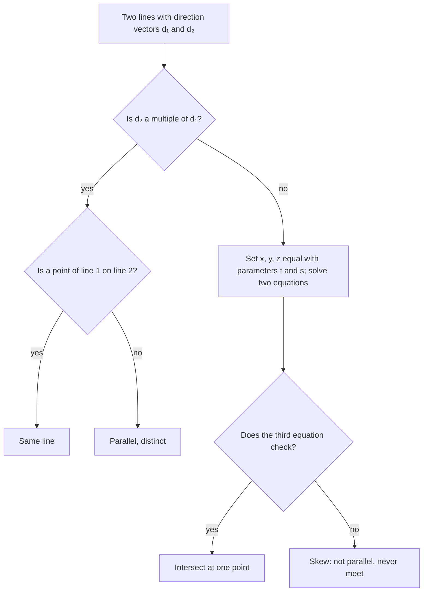

## Describing flat things without slope

In the plane, a line is $y = mx + b$: one equation, one slope. In space that stops working. There is no single "slope" for a line in three dimensions, and one linear equation in $x$, $y$, $z$ turns out to describe a whole plane, not a line. Vectors fix both problems. A line is "a point plus any multiple of a direction," which is the parametric idea from Lesson 31, and a plane is "every point you can reach from a given point while staying perpendicular to a given direction," which is the orthogonality test $\vec u \cdot \vec v = 0$ from Lesson 35. This lesson builds both descriptions, then uses projections and cross products to answer the questions engineers and graphics programmers ask all the time: do these lines meet, where does this line hit that plane, and how far is this point from that surface?

## Lines: a point and a direction

Pick a point $P_0(x_0, y_0, z_0)$ on the line and a nonzero vector $\vec d = \langle a, b, c \rangle$ pointing along it, a **direction vector**. Every point of the line is reached by starting at $P_0$ and moving some multiple $t$ of $\vec d$:

$$\vec r(t) = \langle x_0, y_0, z_0 \rangle + t\langle a, b, c \rangle,$$

or, one coordinate at a time, the parametric equations

$$x = x_0 + at, \qquad y = y_0 + bt, \qquad z = z_0 + ct.$$

Each real $t$ gives one point; $t = 0$ is $P_0$, and negative $t$ goes backward. If $a$, $b$, $c$ are all nonzero, solving each equation for $t$ and setting the results equal gives the **symmetric equations**

$$\frac{x - x_0}{a} = \frac{y - y_0}{b} = \frac{z - z_0}{c}.$$

A line has many correct descriptions: any point on it and any nonzero multiple of $\vec d$ work equally well. So two answers that look different can both be right; test whether they describe the same set of points.

### Example 1

Find parametric equations for the line through $P(1, -2, 3)$ and $Q(4, 0, -1)$, and find where it crosses the $xy$-plane.

1. Direction: $\vec{PQ} = \langle 3, 2, -4 \rangle$.
2. Using $P$: $x = 1 + 3t$, $y = -2 + 2t$, $z = 3 - 4t$. (Check: $t = 1$ gives $(4, 0, -1) = Q$.)
3. The $xy$-plane is where $z = 0$: $3 - 4t = 0$, so $t = \tfrac34$.
4. Then $x = 1 + \tfrac94 = \tfrac{13}{4}$ and $y = -2 + \tfrac32 = -\tfrac12$. The line crosses at $\left(\tfrac{13}{4}, -\tfrac12, 0\right)$.

The symmetric equations are $\dfrac{x - 1}{3} = \dfrac{y + 2}{2} = \dfrac{z - 3}{-4}$.

## Two lines: parallel, intersecting or skew

In the plane, two distinct lines either meet once or are parallel. Space has a third possibility: **skew lines**, which are not parallel and never meet, like a road and a bridge crossing over it. To sort a pair of lines, compare directions first, then look for a common point:

Use *different* parameters for the two lines. The lines may pass through the same point at different "times," so forcing one $t$ on both can miss a real intersection.

### Example 2

Classify $L_1$: $x = 1 + t$, $y = 2 - t$, $z = 2t$ and $L_2$: $x = 3 + 2s$, $y = s$, $z = 5 + s$.

1. Directions $\langle 1, -1, 2 \rangle$ and $\langle 2, 1, 1 \rangle$ are not multiples (the first components would need a factor of 2, the second a factor of $-1$). Not parallel.
2. Set $x$ and $y$ equal: $1 + t = 3 + 2s$ and $2 - t = s$. Substituting $s = 2 - t$ into the first: $1 + t = 7 - 2t$, so $t = 2$ and $s = 0$.
3. Test $z$: $L_1$ gives $z = 2(2) = 4$, but $L_2$ gives $z = 5 + 0 = 5$. They disagree.

The lines are skew. (How far apart do they pass? The vector $\vec d_1 \times \vec d_2 = \langle -3, 3, 3 \rangle$ is perpendicular to both lines, and projecting the vector between their starting points, $\langle 2, -2, 5 \rangle$, onto it gives the closest distance: $\dfrac{\lvert -6 - 6 + 15 \rvert}{\sqrt{27}} = \dfrac{3}{3\sqrt3} = \dfrac{1}{\sqrt3} \approx 0.58$.)

## Planes: a point and a normal

A plane is fixed by one point $P_0(x_0, y_0, z_0)$ in it and a nonzero vector $\vec n = \langle a, b, c \rangle$ perpendicular to it, a **normal vector**. A point $P(x, y, z)$ lies in the plane exactly when the arrow $\vec{P_0P}$ lies flat in the plane, which happens exactly when it is perpendicular to $\vec n$:

$$\vec n \cdot \vec{P_0P} = 0 \quad\Longleftrightarrow\quad a(x - x_0) + b(y - y_0) + c(z - z_0) = 0.$$

Multiplying out gives the general form $ax + by + cz = d$, where $d = ax_0 + by_0 + cz_0$. The key fact to read off: *the coefficients of $x$, $y$, $z$ are a normal vector.* So $2x - y + 5z = 7$ has normal $\langle 2, -1, 5 \rangle$, and every plane $2x - y + 5z = d$ is parallel to it. A plane through three points needs a normal perpendicular to two of its directions, and the cross product supplies exactly that.

### Example 3

Find an equation of the plane through $A(1, 0, 2)$, $B(3, 1, 1)$ and $C(0, 2, 4)$.

1. Two directions in the plane: $\vec{AB} = \langle 2, 1, -1 \rangle$ and $\vec{AC} = \langle -1, 2, 2 \rangle$.
2. Normal: $\vec n = \vec{AB} \times \vec{AC} = \langle 4, -3, 5 \rangle$ (computed in the cross product lesson; if you skipped it, use the formula from Lesson 35).
3. Point-normal form with $A$: $4(x - 1) - 3(y - 0) + 5(z - 2) = 0$, so $4x - 3y + 5z = 14$.
4. Check the other two points: $B$: $12 - 3 + 5 = 14$ ✓; $C$: $0 - 6 + 20 = 14$ ✓.

If the cross product comes out $\vec 0$, the three points are on one line and don't fix a single plane.

The angle between two planes is the angle between their normals. In particular, planes are perpendicular when their normals have dot product 0, and parallel when their normals are multiples of each other.

## Where a line meets a plane

Substitute the line's parametric equations into the plane's equation; you get one equation in $t$. For the line $x = 2 + t$, $y = -t$, $z = t$ and the plane $4x - 3y + 5z = 14$:

$$4(2 + t) - 3(-t) + 5t = 14 \;\Rightarrow\; 8 + 12t = 14 \;\Rightarrow\; t = \tfrac12,$$

so the line meets the plane at $\left(\tfrac52, -\tfrac12, \tfrac12\right)$. If the $t$'s cancel, the line is parallel to the plane: a false statement like $8 = 14$ means it never meets the plane, and a true one like $14 = 14$ means it lies in the plane. That happens exactly when $\vec d \cdot \vec n = 0$.

## Distance from a point to a plane

The shortest path from a point $P_1(x_1, y_1, z_1)$ to a plane runs along the normal. So take any point $P_0$ in the plane and project $\vec{P_0P_1}$ onto $\vec n$; the length of that projection is the distance. Writing it out with the plane $ax + by + cz = d$:

$$D = \frac{\lvert \vec n \cdot \vec{P_0P_1} \rvert}{\lVert\vec n\rVert} = \frac{\lvert ax_1 + by_1 + cz_1 - d \rvert}{\sqrt{a^2 + b^2 + c^2}}.$$

(The second form follows because $\vec n \cdot \vec{P_0P_1} = ax_1 + by_1 + cz_1 - (ax_0 + by_0 + cz_0)$, and the part in parentheses is $d$.) It is the 3D version of the distance from $(x_1, y_1)$ to the line $ax + by = d$ in the plane, $\dfrac{\lvert ax_1 + by_1 - d \rvert}{\sqrt{a^2 + b^2}}$.

### Example 4

How far is the point $(2, 1, -1)$ from the plane $4x - 3y + 5z = 14$?

1. Plug in: $4(2) - 3(1) + 5(-1) - 14 = 8 - 3 - 5 - 14 = -14$. The absolute value is 14.
2. Length of the normal: $\sqrt{16 + 9 + 25} = \sqrt{50} = 5\sqrt2$.
3. $D = \dfrac{14}{5\sqrt2} = \dfrac{7\sqrt2}{5} \approx 1.98$.

The sign of $ax_1 + by_1 + cz_1 - d$ tells which side of the plane the point is on: negative here, so $(2, 1, -1)$ is on the opposite side from the one $\vec n$ points toward. Two points with opposite signs are on opposite sides. The same formula gives the distance between parallel planes $ax + by + cz = d_1$ and $ax + by + cz = d_2$: $\dfrac{\lvert d_1 - d_2 \rvert}{\sqrt{a^2 + b^2 + c^2}}$.

## Common mistakes

- *Looking for a slope.* Lines in space are described by a point and a direction vector, not $y = mx + b$.
- *Using the same parameter for both lines* when testing for an intersection.
- *Calling non-parallel lines "intersecting" without checking the third equation.* They may be skew.
- *Reading a point off the coefficients.* In $ax + by + cz = d$, $\langle a, b, c \rangle$ is a normal vector, not a point of the plane.
- *Forgetting to subtract $d$, or the absolute value,* in the distance formula.
- *Using two vectors that are parallel* to build a normal: their cross product is $\vec 0$.

## Key points

- Line: $\vec r(t) = \vec r_0 + t\vec d$; parametric $x = x_0 + at$, $y = y_0 + bt$, $z = z_0 + ct$; symmetric form when $a, b, c \ne 0$.
- Two lines in space are the same, parallel, intersecting or skew; test directions first, then solve with separate parameters.
- Plane: $a(x - x_0) + b(y - y_0) + c(z - z_0) = 0$, or $ax + by + cz = d$, with normal $\langle a, b, c \rangle$; through three points, use a cross product for the normal.
- Line meets plane: substitute and solve for $t$.
- Point to plane: $D = \dfrac{\lvert ax_1 + by_1 + cz_1 - d \rvert}{\sqrt{a^2 + b^2 + c^2}}$.
