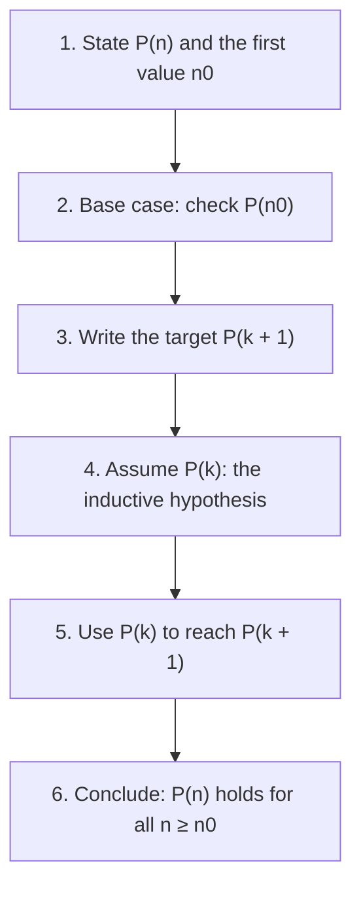

## Proving infinitely many statements at once

The last two lessons used formulas like $1 + 2 + \dots + n = \frac{n(n + 1)}{2}$. Checking the formula for $n = 1, 2, 3$ and a hundred more values is evidence, not proof: some patterns hold for many cases and then fail. (The expression $n^2 + n + 41$ is prime for $n = 0$ to $39$ and then fails at $n = 40$, where it equals $41^2$.) **Mathematical induction** is the standard way to prove that a statement holds for *every* positive integer. It's the main proof technique for formulas about sequences and sums, and you'll meet it again in discrete math and computer science.

## The idea: dominoes

Imagine an infinite row of dominoes. To be sure all of them fall, you need two facts:

1. The first domino falls.
2. Whenever one domino falls, it knocks over the next one.

Then the first knocks over the second, which knocks over the third, and so on forever.


## The principle

Let $P(n)$ be a statement about the positive integer $n$. If

1. **Base case**: $P(1)$ is true, and
2. **Inductive step**: for every $k \ge 1$, *if* $P(k)$ is true *then* $P(k + 1)$ is true,

then $P(n)$ is true for all positive integers $n$.

In the inductive step you *assume* $P(k)$, called the **inductive hypothesis**, and use it to prove $P(k + 1)$. That is not circular: you are not assuming the statement for all $n$, only showing that each case implies the next. (If the statements start at some other number, say $n \ge 4$, the base case is $P(4)$.)

Every induction proof follows the same six steps:



## A template for sum formulas

To prove $\displaystyle\sum_{i=1}^{n} a_i = F(n)$:

- *Base case.* Check $a_1 = F(1)$.
- *Inductive hypothesis.* Assume $a_1 + \dots + a_k = F(k)$.
- *Inductive step.* Then $a_1 + \dots + a_k + a_{k+1} = F(k) + a_{k+1}$, and show this equals $F(k + 1)$ by algebra.

### Example 1

Prove that $1 + 3 + 5 + \dots + (2n - 1) = n^2$ for all $n \ge 1$.

*Base case.* $n = 1$: the left side is $1$ and the right side is $1^2 = 1$. ✓

*Inductive hypothesis.* Assume $1 + 3 + \dots + (2k - 1) = k^2$ for some $k \ge 1$.

*Inductive step.* The next odd number is $2(k + 1) - 1 = 2k + 1$. Then

$$1 + 3 + \dots + (2k - 1) + (2k + 1) = k^2 + (2k + 1) = (k + 1)^2,$$

using the hypothesis for the first $k$ terms. That's the statement for $n = k + 1$. ✓

By induction, the formula holds for every positive integer $n$.

```shape
{"polygons": [{"points": [[0, 0], [1, 0], [1, 1], [0, 1]], "fill": true}, {"points": [[1, 0], [2, 0], [2, 2], [0, 2], [0, 1], [1, 1]]}, {"points": [[2, 0], [3, 0], [3, 3], [0, 3], [0, 2], [2, 2]], "fill": true}, {"points": [[3, 0], [4, 0], [4, 4], [0, 4], [0, 3], [3, 3]]}], "caption": "Each new L-shaped band adds the next odd number (1, 3, 5, 7) and completes the next square."}
```

### Example 2

Prove that $\displaystyle\sum_{i=1}^{n} i^2 = \frac{n(n + 1)(2n + 1)}{6}$.

*Base case.* $n = 1$: $1 = \frac{1 \cdot 2 \cdot 3}{6}$. ✓

*Inductive hypothesis.* Assume $\displaystyle\sum_{i=1}^{k} i^2 = \frac{k(k + 1)(2k + 1)}{6}$.

*Inductive step.* Add the next term:

$$\sum_{i=1}^{k+1} i^2 = \frac{k(k + 1)(2k + 1)}{6} + (k + 1)^2 = \frac{(k + 1)\big[k(2k + 1) + 6(k + 1)\big]}{6} = \frac{(k + 1)(2k^2 + 7k + 6)}{6}.$$

Since $2k^2 + 7k + 6 = (k + 2)(2k + 3)$, this is $\dfrac{(k + 1)(k + 2)(2k + 3)}{6}$, which is the formula with $n = k + 1$: $\frac{(k+1)\big((k+1)+1\big)\big(2(k+1)+1\big)}{6}$. ✓

The key move was factoring out $(k + 1)$ early rather than expanding everything. Always write out what $P(k + 1)$ should look like *before* you start, so you know your target.

## Beyond sums: divisibility and inequalities

### Example 3

Prove that $6^n - 1$ is divisible by 5 for all $n \ge 1$.

*Base case.* $6^1 - 1 = 5$. ✓

*Inductive hypothesis.* Assume $6^k - 1 = 5m$ for some integer $m$.

*Inductive step.* $6^{k+1} - 1 = 6 \cdot 6^k - 1 = 6(5m + 1) - 1 = 30m + 5 = 5(6m + 1)$, a multiple of 5. ✓

### Example 4

Prove that $n! > 2^n$ for all $n \ge 4$.

*Base case.* $n = 4$: $4! = 24 > 16 = 2^4$. ✓ (It fails for $n = 1, 2, 3$, so the base case must be 4.)

*Inductive hypothesis.* Assume $k! > 2^k$ for some $k \ge 4$.

*Inductive step.* $(k + 1)! = (k + 1)\,k! > (k + 1)2^k \ge 2 \cdot 2^k = 2^{k+1}$, using $k + 1 \ge 2$. ✓

## Common mistakes

- *Skipping the base case.* Without it, the dominoes never start. (The "statement" $n = n + 1$ has a valid-looking inductive step but no base case.)
- *Assuming $P(k + 1)$* instead of proving it.
- *Not using the hypothesis.* If your inductive step never uses $P(k)$, it's probably not an induction proof (or something's off).
- *Wrong next term.* In Example 1 the $(k + 1)$st odd number is $2k + 1$, not $2k - 1 + 1$.
- *Expanding everything blindly.* Factor toward the target form.

## Key points

- Induction proves $P(n)$ for all $n \ge n_0$ with a base case and an inductive step.
- Inductive step: assume $P(k)$ (the inductive hypothesis) and derive $P(k + 1)$.
- For sum formulas, add the $(k + 1)$st term to both sides of the hypothesis.
- Write the target $P(k + 1)$ first; factor toward it.
- Induction also proves divisibility statements and inequalities.
