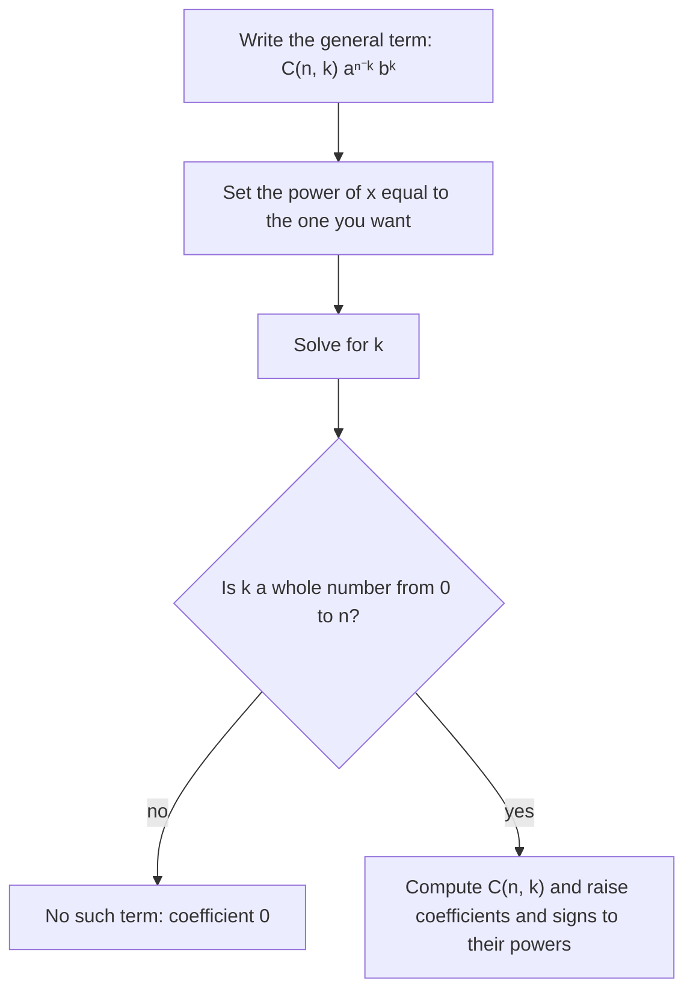

## Expanding powers without multiplying

$(a + b)^2 = a^2 + 2ab + b^2$ is easy. $(a + b)^3$ takes a minute. $(2x - 3)^{10}$ by repeated multiplication would take an afternoon. The binomial theorem gives every term directly, using numbers from Pascal's triangle. It ties together the sigma notation of Lesson 36, the induction of Lesson 38, and the counting of the next lesson, and it's the starting point for the power series of calculus.

## Looking for the pattern

$$\begin{aligned} (a + b)^1 &= a + b \\ (a + b)^2 &= a^2 + 2ab + b^2 \\ (a + b)^3 &= a^3 + 3a^2b + 3ab^2 + b^3 \\ (a + b)^4 &= a^4 + 4a^3b + 6a^2b^2 + 4ab^3 + b^4 \end{aligned}$$

Three patterns stand out in $(a + b)^n$:

- there are $n + 1$ terms;
- the power of $a$ falls from $n$ to 0 while the power of $b$ rises from 0 to $n$, so the exponents in each term add to $n$;
- the coefficients are symmetric and come from **Pascal's triangle**.

## Pascal's triangle

Each row starts and ends with 1, and each inner entry is the sum of the two entries above it:

| $n$ | Row |
|---|---|
| 0 | 1 |
| 1 | 1 1 |
| 2 | 1 2 1 |
| 3 | 1 3 3 1 |
| 4 | 1 4 6 4 1 |
| 5 | 1 5 10 10 5 1 |
| 6 | 1 6 15 20 15 6 1 |

Why the sum rule? To get $(a + b)^{n+1}$, multiply $(a + b)^n$ by $(a + b)$. A term $a^{n+1-k}b^k$ arises in exactly two ways: from $a \cdot (a^{n-k}b^k)$ and from $b \cdot (a^{n+1-k}b^{k-1})$. So its coefficient is the sum of two neighboring coefficients from row $n$.

## Binomial coefficients

The entry in row $n$, position $k$ (counting from $k = 0$) is the **binomial coefficient**

$$\binom{n}{k} = \frac{n!}{k!\,(n - k)!},$$

read "$n$ choose $k$" and also written $_nC_k$. For example $\binom{5}{2} = \frac{5!}{2!\,3!} = \frac{120}{2 \cdot 6} = 10$, matching row 5. Useful facts: $\binom{n}{0} = \binom{n}{n} = 1$, $\binom{n}{1} = n$, and $\binom{n}{k} = \binom{n}{n-k}$ (the symmetry of the triangle). In practice, cancel before multiplying: $\binom{10}{3} = \frac{10 \cdot 9 \cdot 8}{3 \cdot 2 \cdot 1} = 120$.

The next lesson explains the name: $\binom nk$ counts the ways to choose $k$ items from $n$. That is also why it appears here: in the product $(a + b)(a + b)\cdots(a + b)$ of $n$ factors, a term $a^{n-k}b^k$ comes from choosing $b$ from $k$ of the factors and $a$ from the rest, and there are $\binom nk$ ways to choose which ones.

## The binomial theorem

For any positive integer $n$,

$$(a + b)^n = \sum_{k=0}^{n} \binom{n}{k} a^{n - k} b^{k} = a^n + \binom n1 a^{n-1}b + \binom n2 a^{n-2}b^2 + \dots + b^n.$$

The **general term** (the $(k + 1)$st term) is $\binom{n}{k}a^{n-k}b^k$. Note the off-by-one: the term containing $b^k$ is term number $k + 1$.

### Example 1

Expand $(x + 2)^5$.

Row 5 is $1, 5, 10, 10, 5, 1$. With $a = x$, $b = 2$:

$$x^5 + 5x^4(2) + 10x^3(4) + 10x^2(8) + 5x(16) + 32 = x^5 + 10x^4 + 40x^3 + 80x^2 + 80x + 32.$$

### Example 2

Expand $(a - b)^4$.

Treat it as $(a + (-b))^4$: the odd powers of $-b$ are negative, so the signs alternate:

$$a^4 - 4a^3b + 6a^2b^2 - 4ab^3 + b^4.$$

To find a single term without expanding everything, follow these steps; Examples 3 and 4 use them.

### Example 3

Find the coefficient of $x^3$ in $(2x - 3)^6$.

The general term is $\binom{6}{k}(2x)^{6-k}(-3)^k$. We need $6 - k = 3$, so $k = 3$:

$$\binom63(2x)^3(-3)^3 = 20 \cdot 8x^3 \cdot (-27) = -4320x^3.$$

The coefficient is $-4320$. The common error is forgetting to raise the 2 and the $-3$ to their powers.

### Example 4

Find the constant term of $\left(x - \dfrac1x\right)^8$.

General term: $\binom8k x^{8-k}\left(-\frac1x\right)^k = \binom8k(-1)^k x^{8 - 2k}$. Constant means $8 - 2k = 0$, so $k = 4$: $\binom84(-1)^4 = 70$.

### Example 5

Estimate $1.02^5$ with the first few terms.

$(1 + 0.02)^5 = 1 + 5(0.02) + 10(0.02)^2 + 10(0.02)^3 + \dots = 1 + 0.1 + 0.004 + 0.00008 + \dots \approx 1.10408$. The true value is $1.1040808\ldots$: the later terms are tiny because powers of 0.02 shrink fast.

## Sums of binomial coefficients

Setting $a = b = 1$ in the theorem gives $\binom n0 + \binom n1 + \dots + \binom nn = 2^n$: each row of Pascal's triangle adds to a power of 2 (row 4: $1 + 4 + 6 + 4 + 1 = 16$). Setting $a = 1$, $b = -1$ shows the alternating sum is 0.

## Common mistakes

- *Forgetting to raise coefficients to powers.* In $(2x)^3$ the 2 is cubed too.
- *Dropping negative signs.* $(-3)^3 = -27$; write $b$ with its sign.
- *Off by one.* The term with $b^k$ is the $(k + 1)$st term; the 4th term uses $k = 3$.
- *Exponents not adding to $n$.* In every term of $(a + b)^n$ the exponents sum to $n$.
- *Expanding $(a + b)^n$ as $a^n + b^n$.* The middle terms are the point.

## Key points

- $(a + b)^n = \sum_{k=0}^{n}\binom nk a^{n-k}b^k$, with $n + 1$ terms.
- $\binom nk = \frac{n!}{k!(n-k)!}$; it's entry $k$ of row $n$ of Pascal's triangle.
- Each Pascal entry is the sum of the two above it; rows are symmetric and sum to $2^n$.
- General term $\binom nk a^{n-k}b^k$: set the exponent you want and solve for $k$.
- For $(a - b)^n$ the signs alternate.
