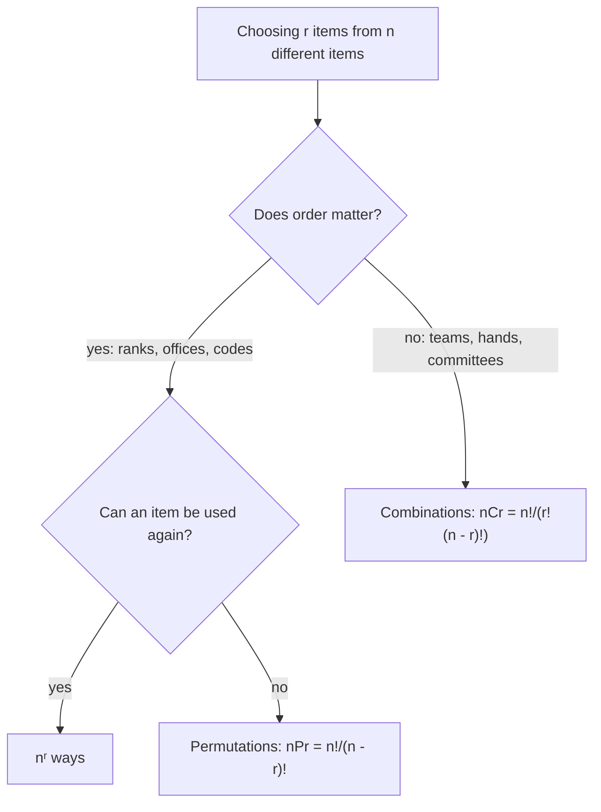

## Counting without listing

How many different license plates, passwords or lottery tickets are possible? Listing them is hopeless, but a few counting principles get the answer in seconds. Counting is also the foundation of probability: when outcomes are equally likely, a probability is just one count divided by another. This lesson builds both and explains why the binomial coefficients from the last lesson are called "choose" numbers.

## The fundamental counting principle

If a task is done in stages, with $m_1$ ways to do the first stage, $m_2$ ways to do the second (for each way of doing the first), and so on, then the number of ways to do the whole task is

$$m_1 \cdot m_2 \cdots m_k.$$

This is the **fundamental counting principle**. Picture a tree: each choice at one stage branches into all the choices at the next.

### Example 1

A license plate has 3 letters followed by 3 digits. How many plates are possible? How many if no letter may repeat?

- Repeats allowed: $26 \cdot 26 \cdot 26 \cdot 10 \cdot 10 \cdot 10 = 17{,}576{,}000$.
- No repeated letters: $26 \cdot 25 \cdot 24 \cdot 10^3 = 15{,}600{,}000$. Each letter used reduces the choices for the next.

## Permutations: order matters

A **permutation** is an arrangement in which order matters. The number of ways to arrange $n$ different objects in a row is $n!$ (n choices for the first place, $n - 1$ for the second, …). The number of ways to arrange $r$ of them, chosen from $n$, is

$$_nP_r = n(n - 1)\cdots(n - r + 1) = \frac{n!}{(n - r)!}.$$

### Example 2

From a club of 10 members, how many ways can a president, vice president and secretary be chosen?

The offices are different, so order matters: $_{10}P_3 = 10 \cdot 9 \cdot 8 = 720$.

## Combinations: order doesn't matter

A **combination** is a selection in which order doesn't matter. Each group of $r$ objects can be arranged in $r!$ orders, so dividing the permutation count by $r!$ removes the duplicates:

$$_nC_r = \binom nr = \frac{_nP_r}{r!} = \frac{n!}{r!\,(n - r)!}.$$

These are the binomial coefficients of the last lesson. In $(a + b)^n$, choosing which $k$ of the $n$ factors contribute a $b$ is exactly a combination.

### Example 3

How many 3-person committees can be formed from the same 10 members?

A committee is the same no matter the order of naming: $\binom{10}{3} = \frac{720}{3!} = 120$. Each committee corresponds to $3! = 6$ of the 720 ordered slates from Example 2.

*Which one?* Ask: "If I rearrange my selection, do I get a different outcome?" Different offices, rankings, seats or digits in a code: permutation. Teams, committees, hands of cards, toppings: combination.

The $n^r$ case is just the counting principle with the same $n$ choices at every stage, like the letters on the license plates of Example 1.

## Probability with equally likely outcomes

An experiment's **sample space** $S$ is the set of all possible outcomes; an **event** $E$ is a set of outcomes. When all outcomes are equally likely,

$$P(E) = \frac{\text{number of outcomes in } E}{\text{number of outcomes in } S}.$$

Every probability is between 0 (impossible) and 1 (certain).

### Example 4

Two fair dice are rolled. What is the probability that the sum is 7?

There are $6 \cdot 6 = 36$ equally likely ordered outcomes. The sum is 7 for $(1,6), (2,5), (3,4), (4,3), (5,2), (6,1)$: 6 outcomes. $P = \frac{6}{36} = \frac16$.

### Example 5

Two cards are drawn from a standard 52-card deck. What is the probability both are hearts?

Unordered pairs: $\binom{52}{2} = 1326$. Pairs of hearts: $\binom{13}{2} = 78$. So $P = \frac{78}{1326} = \frac{1}{17} \approx 0.059$.

## Rules for combining events

| Rule | Formula | When |
|---|---|---|
| **Complement** | $P(\text{not } E) = 1 - P(E)$ | always |
| Addition | $P(A \text{ or } B) = P(A) + P(B) - P(A \text{ and } B)$ | always; the last term is 0 if $A$, $B$ are **mutually exclusive** |
| Multiplication | $P(A \text{ and } B) = P(A)\,P(B)$ | when $A$ and $B$ are **independent** |

The addition rule subtracts the overlap because outcomes in both $A$ and $B$ were counted twice. Events are independent when one happening doesn't change the probability of the other, like separate coin flips.

### Example 6

A card is drawn. What is the probability it is a heart or a face card (J, Q, K)?

$P(\text{heart}) = \frac{13}{52}$, $P(\text{face}) = \frac{12}{52}$, and 3 cards are both. So $P = \frac{13 + 12 - 3}{52} = \frac{22}{52} = \frac{11}{26}$.

The Venn diagram shows why the 3 is subtracted: the jack, queen and king of hearts sit in both circles.

### Example 7

A die is rolled 4 times. What is the probability of at least one 6?

"At least one" is easiest through the complement. $P(\text{no 6 in one roll}) = \frac56$, and rolls are independent, so $P(\text{no 6 in four rolls}) = \left(\frac56\right)^4$. Then

$$P(\text{at least one 6}) = 1 - \left(\tfrac56\right)^4 \approx 1 - 0.482 = 0.518.$$

### Example 8

A box has 4 red and 6 blue marbles. Three are drawn at random. What is the probability of exactly 2 red?

Total selections: $\binom{10}{3} = 120$. Favorable: choose 2 of the 4 red and 1 of the 6 blue: $\binom42\binom61 = 6 \cdot 6 = 36$. $P = \frac{36}{120} = \frac{3}{10}$.

## Common mistakes

- *Using permutations for unordered selections* (or the reverse). Ask whether rearranging gives a new outcome.
- *Adding when you should multiply.* Stages in sequence multiply; disjoint alternatives add.
- *Double-counting overlaps* in "or" problems: subtract $P(A \text{ and } B)$.
- *Multiplying probabilities of dependent events* as if independent (like drawing without replacement).
- *Computing "at least one" directly* when the complement is much simpler.

## Key points

- Counting principle: multiply the number of choices at each stage.
- $_nP_r = \frac{n!}{(n - r)!}$ (order matters); $_nC_r = \frac{n!}{r!(n - r)!}$ (order doesn't).
- Equally likely outcomes: $P(E) = \frac{|E|}{|S|}$.
- $P(\text{not } E) = 1 - P(E)$; $P(A \text{ or } B) = P(A) + P(B) - P(A \text{ and } B)$.
- Independent events: $P(A \text{ and } B) = P(A)P(B)$.
