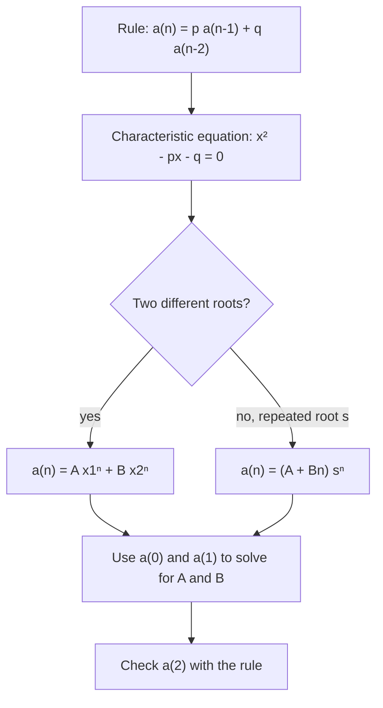

## Turning a recursive rule into an explicit formula

Lesson 36 noted that a recursive formula is natural but slow: to reach $a_{100}$ you must compute all 99 terms before it. For arithmetic and geometric sequences we found explicit formulas, $a_1 + (n - 1)d$ and $a_1r^{n-1}$. This lesson does the same for two wider families of rules. The first, "multiply and then add", describes loan balances, drug levels and a famous puzzle. The second, where each term depends on the *two* before it, includes the Fibonacci sequence and leads to a surprising formula for it that involves $\sqrt5$.

A rule that defines each term from earlier terms is called a **recurrence relation** (or just a recurrence). Together with enough starting values (**initial conditions**), it determines the whole sequence. Finding an explicit formula that matches is called **solving** the recurrence. In this lesson sequences start at $a_0$, which makes the formulas tidier.

## First-order rules: multiply, then add

A **first-order linear recurrence** with constant coefficients has the form

$$a_{n+1} = r\,a_n + c.$$

If $c = 0$ it is geometric; if $r = 1$ it is arithmetic. In between are many real situations: each month a loan balance grows by the interest factor and then drops by the payment; each day a drug level falls to a fraction of itself and then rises by a new dose.

### The fixed point

Suppose the sequence ever reached a value $L$ that the rule leaves unchanged. Then $L = rL + c$, so for $r \ne 1$

$$L = \frac{c}{1 - r}.$$

This value is the **fixed point** (or equilibrium) of the recurrence. Now measure every term by its distance from $L$. Subtracting $L = rL + c$ from $a_{n+1} = ra_n + c$ gives

$$a_{n+1} - L = r\,(a_n - L).$$

The distances form a *geometric* sequence with ratio $r$. So $a_n - L = (a_0 - L)r^n$, and

$$a_n = L + (a_0 - L)\,r^n, \qquad L = \frac{c}{1 - r}, \quad r \ne 1.$$

This one formula explains the long-run behavior too:

- If $|r| < 1$, then $r^n \to 0$ and $a_n \to L$, whatever the starting value. The fixed point *attracts*.
- If $|r| > 1$, the distance from $L$ is multiplied by $|r|$ every step, so unless $a_0 = L$ the terms run away from $L$. The fixed point *repels*.
- If $r$ is negative, the terms land alternately above and below $L$.

### Example 1

Solve $a_{n+1} = 0.5a_n + 6$ with $a_0 = 20$.

The fixed point is $L = \dfrac{6}{1 - 0.5} = 12$. The starting distance is $a_0 - L = 8$, and it halves each step:

$$a_n = 12 + 8(0.5)^n.$$

Check: the rule gives $a_1 = 0.5(20) + 6 = 16$ and $a_2 = 0.5(16) + 6 = 14$; the formula gives $12 + 4 = 16$ and $12 + 2 = 14$. ✓ As $n$ grows, $a_n \to 12$.

```plot
{"x": [0, 8], "y": [0, 22], "xLabel": "n", "yLabel": "aₙ", "points": [[0, 20], [1, 16], [2, 14], [3, 13], [4, 12.5], [5, 12.25], [6, 12.125], [7, 12.0625], [8, 12.03125]], "functions": [{"f": "12", "dashed": true, "label": "L = 12"}], "caption": "Each step halves the distance to the fixed point L = 12."}
```

The drug example from Lesson 37 fits the same pattern. If $A_n$ is the amount right after the $n$th dose, then $A_{n+1} = 0.4A_n + 100$ with $A_1 = 100$, and $L = \frac{100}{0.6} \approx 166.7$ mg. That is the same long-run level the infinite geometric series gave.

### Example 2: the Tower of Hanoi

In this puzzle (published by the French mathematician Édouard Lucas in 1883), $n$ disks of different sizes sit on one of three pegs, largest at the bottom. You must move the whole stack to another peg, one disk at a time, never putting a larger disk on a smaller one. What is the least number of moves $H_n$?

To move the bottom disk at all, the $n - 1$ disks above it must first be stacked on the third peg ($H_{n-1}$ moves). Then the big disk moves (1 move), and the $n - 1$ disks are moved back on top of it ($H_{n-1}$ moves). This can't be done faster, so

$$H_n = 2H_{n-1} + 1, \qquad H_0 = 0.$$

Here $r = 2$, $c = 1$ and $L = \dfrac{1}{1 - 2} = -1$. So $H_n = -1 + (0 - (-1))\,2^n = 2^n - 1$. Three disks take 7 moves; 64 disks would take $2^{64} - 1 \approx 1.8 \times 10^{19}$ moves. The fixed point $-1$ makes no sense as a number of moves, but it still does its algebraic job.

### Example 3: paying off a loan

You borrow \$10,000 at 1% interest per month and pay $P$ dollars at the end of each month. The balance obeys $B_{n+1} = 1.01B_n - P$ with $B_0 = 10{,}000$. What payment clears the loan in 36 months?

Here $r = 1.01$ and $c = -P$, so $L = \dfrac{-P}{1 - 1.01} = 100P$: the balance at which the month's interest exactly equals the payment. Then

$$B_n = 100P + (10{,}000 - 100P)(1.01)^n.$$

Set $B_{36} = 0$ and solve for $P$:

$$P = \frac{10{,}000(0.01)(1.01)^{36}}{(1.01)^{36} - 1} \approx \frac{143.08}{0.43077} \approx \$332.14.$$

Because $r > 1$, the fixed point repels. A payment of \$100 or less means the starting balance is already at or above $L = 100P$, so the balance never falls: with \$90 payments the debt *grows* to about \$10,126.83 after a year.

## Second-order rules: two terms back

In a **second-order linear recurrence** with constant coefficients, each term depends on the two before it:

$$a_n = p\,a_{n-1} + q\,a_{n-2}.$$

Two initial conditions, $a_0$ and $a_1$, are needed. The trick is to look for geometric solutions. If $a_n = x^n$ (with $x \ne 0$) satisfies the rule, then $x^n = p x^{n-1} + q x^{n-2}$, and dividing by $x^{n-2}$ gives the **characteristic equation**

$$x^2 = px + q, \quad\text{that is,}\quad x^2 - px - q = 0.$$

Two more facts finish the method. First, if two sequences both satisfy the rule, so does $A$ times the first plus $B$ times the second (the rule is linear, so it respects sums and multiples). Second, a sequence is fixed by $a_0$, $a_1$ and the rule. So when the characteristic equation has two different roots $x_1$ and $x_2$,

$$a_n = A\,x_1^{\,n} + B\,x_2^{\,n},$$

and the initial conditions give two linear equations for $A$ and $B$. (If the roots are equal, $x_1 = x_2 = s$, the solution is $a_n = (A + Bn)s^n$ instead; we state this without proof.)



### Example 4

Solve $a_n = 5a_{n-1} - 6a_{n-2}$ with $a_0 = 2$, $a_1 = 5$.

The characteristic equation is $x^2 - 5x + 6 = 0$, so $x = 2$ or $x = 3$, and $a_n = A \cdot 2^n + B \cdot 3^n$.

- $n = 0$: $A + B = 2$.
- $n = 1$: $2A + 3B = 5$.

Subtracting twice the first equation from the second gives $B = 1$, so $A = 1$, and $a_n = 2^n + 3^n$. Check: the rule gives $a_2 = 5(5) - 6(2) = 13$, and the formula gives $4 + 9 = 13$. ✓

## The Fibonacci numbers and the golden ratio

Take the Fibonacci rule $F_n = F_{n-1} + F_{n-2}$ with $F_0 = 0$ and $F_1 = 1$ (this matches Lesson 36's $F_1 = F_2 = 1$). The characteristic equation $x^2 - x - 1 = 0$ has roots

$$\varphi = \frac{1 + \sqrt5}{2} \approx 1.618, \qquad \psi = \frac{1 - \sqrt5}{2} \approx -0.618.$$

The number $\varphi$ is the **golden ratio**. Write $F_n = A\varphi^n + B\psi^n$. From $F_0 = 0$, $B = -A$. From $F_1 = 1$, $A(\varphi - \psi) = 1$, and $\varphi - \psi = \sqrt5$, so $A = \frac{1}{\sqrt5}$. This gives **Binet's formula**:

$$F_n = \frac{\varphi^n - \psi^n}{\sqrt5}.$$

It is remarkable that this expression full of $\sqrt5$ is a whole number for every $n$. Two consequences:

- Since $|\psi| < 1$, the term $\frac{\psi^n}{\sqrt5}$ is smaller than $\frac12$ in size and shrinks fast. So $F_n$ is simply $\frac{\varphi^n}{\sqrt5}$ rounded to the nearest whole number. For example $\frac{\varphi^{10}}{\sqrt5} \approx 55.004$, and $F_{10} = 55$.
- The ratio of neighbors approaches the golden ratio: $\frac{F_{n+1}}{F_n} \to \varphi$. Indeed $\frac{89}{55} \approx 1.6182$, already close to $1.6180$.

Once a formula is found, induction can confirm it. Because each Fibonacci number depends on the *two* before it, an induction proof of Binet's formula checks two base cases ($n = 0$ and $n = 1$) and assumes the formula for both $k - 1$ and $k$ in the inductive step.

## Recurrences from counting

Recurrences often come from splitting a counting problem by "what happens first". How many ways can a $2 \times n$ strip be tiled with $1 \times 2$ dominoes?


### Example 5

Let $T_n$ be the number of tilings. Look at the left end of the strip. Either a vertical domino covers the first column, leaving a $2 \times (n - 1)$ strip ($T_{n-1}$ ways), or a horizontal domino covers the top of the first two columns; then another horizontal domino must sit under it, leaving a $2 \times (n - 2)$ strip ($T_{n-2}$ ways). So

$$T_n = T_{n-1} + T_{n-2}, \qquad T_1 = 1, \quad T_2 = 2.$$

This is the Fibonacci rule shifted by one place: $T_n = F_{n+1}$. A $2 \times 10$ strip has $F_{11} = 89$ tilings, found without drawing a single one.

## Common mistakes

- *Using the wrong starting index.* If the sequence starts at $a_1$ instead of $a_0$, the closed form is $a_n = L + (a_1 - L)r^{n-1}$. Check your formula against the first two terms.
- *Getting the fixed point's sign wrong.* $L = \frac{c}{1 - r}$, not $\frac{c}{r - 1}$. Check that $L = rL + c$.
- *Expecting every fixed point to attract.* Only when $|r| < 1$ do the terms approach $L$.
- *Writing the characteristic equation as $x^2 + px + q = 0$.* Move everything to one side: $x^2 - px - q = 0$.
- *Using only one initial condition.* A second-order rule needs two, which give the two unknowns $A$ and $B$.
- *Forgetting to check.* Compute $a_2$ (or $a_3$) both from the rule and from your formula.

## Key points

- A recurrence plus initial conditions determines a sequence; solving it means finding an explicit formula.
- $a_{n+1} = ra_n + c$ ($r \ne 1$) has fixed point $L = \frac{c}{1 - r}$ and solution $a_n = L + (a_0 - L)r^n$; if $|r| < 1$ the terms approach $L$.
- For $a_n = pa_{n-1} + qa_{n-2}$, solve $x^2 - px - q = 0$; with different roots, $a_n = Ax_1^n + Bx_2^n$.
- Binet's formula $F_n = \frac{\varphi^n - \psi^n}{\sqrt5}$, and $\frac{F_{n+1}}{F_n} \to \varphi \approx 1.618$.
- Splitting a count by its first step often produces a recurrence.
