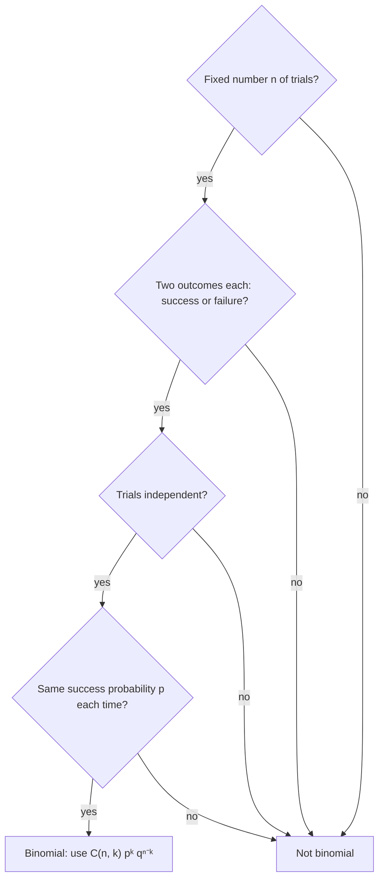

## Where the binomial theorem meets probability

Lesson 39 expanded $(a + b)^n$ and Lesson 40 computed probabilities by counting. This lesson puts them together. When the same chance experiment is repeated (ten free throws, twenty guessed answers, a hundred items off a production line), the probability of each possible number of successes is a term of a binomial expansion. Then we ask a second question that probability alone doesn't answer: on average, what should you *expect*? Expected value is how insurers set prices, how casinos are sure to profit, and how you can tell whether a game is worth playing.

## Bernoulli trials

A **Bernoulli trial** is a chance experiment with exactly two outcomes, called success and failure. A **binomial setting** is one in which all four of these hold:



We write $q = 1 - p$ for the probability of failure. Drawing cards or marbles *without* replacement fails the independence test (the marbles of Lesson 40, Example 8 needed combinations instead). Rolling a die until a 6 appears fails the first test, since the number of trials isn't fixed.

## The binomial formula

Flip a fair coin 5 times. What is the probability of exactly 3 heads?

One way it can happen is HHHTT, with probability $\left(\frac12\right)^5 = \frac{1}{32}$ (the flips are independent, so the probabilities multiply). Every other string with 3 H's and 2 T's has the same probability, and there are $\binom53 = 10$ such strings: choose which 3 of the 5 flips are heads. So $P(\text{3 heads}) = \frac{10}{32} = 0.3125$.

The same argument works for any $n$ and $p$. Let $X$ be the number of successes in $n$ binomial trials. A particular string with $k$ successes and $n - k$ failures has probability $p^kq^{n-k}$, and there are $\binom nk$ such strings, so

$$P(X = k) = \binom nk p^k q^{n-k}, \qquad k = 0, 1, \dots, n.$$

This list of probabilities is the **binomial distribution**. Each probability is one term of $(q + p)^n$, which is why the binomial theorem guarantees they add to 1:

$$\sum_{k=0}^{n}\binom nk p^kq^{n-k} = (q + p)^n = 1^n = 1.$$


### Example 1

A basketball player makes 70% of her free throws, and her shots are independent. In 10 shots, what is the probability she makes exactly 8? At least 9?

Here $n = 10$, $p = 0.7$, $q = 0.3$.

$$P(X = 8) = \binom{10}{8}(0.7)^8(0.3)^2 = 45 \cdot 0.057648 \cdot 0.09 \approx 0.2335.$$

"At least 9" means 9 or 10, which are mutually exclusive, so add:

$$P(X \ge 9) = \binom{10}{9}(0.7)^9(0.3) + (0.7)^{10} \approx 0.1211 + 0.0282 = 0.1493.$$

### Example 2

A 10-question multiple-choice quiz has 4 choices per question, and a student guesses every answer. What is the probability of at least one right? Of at least 6 right?

Each guess is right with $p = 0.25$. "At least one" is easiest through the complement: $P(X \ge 1) = 1 - (0.75)^{10} \approx 1 - 0.0563 = 0.9437$. For "at least 6", add the five terms $k = 6, \dots, 10$:

$$P(X \ge 6) = \sum_{k=6}^{10}\binom{10}{k}(0.25)^k(0.75)^{10-k} \approx 0.0197.$$

Guessing almost always gets *something* right, but passing by luck is rare: about 2 times in 100.

```plot
{"x": [-1, 11], "y": [0, 0.3], "xLabel": "k", "yLabel": "P(X = k)", "bars": [{"x": 0, "height": 0.0282, "width": 0.8}, {"x": 1, "height": 0.1211, "width": 0.8}, {"x": 2, "height": 0.2335, "width": 0.8}, {"x": 3, "height": 0.2668, "width": 0.8}, {"x": 4, "height": 0.2001, "width": 0.8}, {"x": 5, "height": 0.1029, "width": 0.8}, {"x": 6, "height": 0.0368, "width": 0.8}, {"x": 7, "height": 0.009, "width": 0.8}, {"x": 8, "height": 0.0014, "width": 0.8}, {"x": 9, "height": 0.0001, "width": 0.8}, {"x": 10, "height": 0, "width": 0.8}], "caption": "The binomial distribution with n = 10 and p = 0.3: bar k shows the probability of exactly k successes. It peaks at k = 3, which is np."}
```

## Expected value

A **random variable** is a number determined by the outcome of a chance experiment, like the number of successes $X$ or the amount you win in a game. Its **probability distribution** lists its possible values and their probabilities. The **expected value** of $X$ is the probability-weighted average of its values:

$$E(X) = \sum x\,P(X = x).$$

It need not be a value $X$ can actually take; the expected number of heads in 5 flips is 2.5. Its meaning is a long-run average: if the experiment is repeated many times, the average of the results settles near $E(X)$ (this is the law of large numbers, proved in statistics courses).

### Example 3: a raffle

A school sells 500 raffle tickets at \$5 each. One ticket wins \$1000 and one wins \$250. What is the expected value of buying a ticket?

Your net gain is $995$ with probability $\frac{1}{500}$, $245$ with probability $\frac{1}{500}$, and $-5$ with probability $\frac{498}{500}$:

$$E = 995\left(\tfrac{1}{500}\right) + 245\left(\tfrac{1}{500}\right) - 5\left(\tfrac{498}{500}\right) = \frac{995 + 245 - 2490}{500} = -2.50.$$

A quicker way: the prizes are worth $\frac{1250}{500} = 2.50$ per ticket on average, and the ticket costs 5. On average a buyer loses \$2.50 per ticket, which is exactly the school's profit per ticket. A **fair game** is one whose expected net gain is 0.

### Example 4: roulette

An American roulette wheel has 38 equally likely pockets. A \$1 bet on a single number wins \$35 (and you keep your dollar) if that number comes up, and otherwise you lose the dollar.

$$E = 35\left(\tfrac{1}{38}\right) + (-1)\left(\tfrac{37}{38}\right) = -\tfrac{2}{38} \approx -0.053.$$

The bettor loses about 5.3 cents per dollar in the long run. Any single night can go either way, but over millions of bets the casino's average gain per dollar is very close to that 5.3 cents.

## The expected number of successes

What is $E(X)$ for a binomial count? Write $X$ as a sum: $X = X_1 + X_2 + \dots + X_n$, where $X_i = 1$ if trial $i$ is a success and $0$ if not. Each $X_i$ has expected value $1 \cdot p + 0 \cdot q = p$. Expected values add (the expected value of a sum is the sum of the expected values, a fact we use without proof), so

$$E(X) = p + p + \dots + p = np.$$

The free-throw shooter expects $10(0.7) = 7$ makes in 10 shots, and the guessing student expects $10(0.25) = 2.5$ right answers. The histogram above ($n = 10$, $p = 0.3$) peaks at 3, which is exactly $np = 3$. (The peak is not always exactly at $np$, but it is always within 1 of it.)

### Example 5: waiting for a six

On average, how many rolls of a fair die does it take to get the first 6?

The number of rolls isn't fixed, so this is not binomial, but a neat argument gives the answer. Call the expected number of rolls $E$ (assuming it is finite). The first roll is a 6 with probability $\frac16$, and then you are done after 1 roll. With probability $\frac56$ it isn't, and then you have used 1 roll and are back where you started, so you expect $E$ more rolls. Thus

$$E = 1 + \tfrac56 E \quad\Longrightarrow\quad \tfrac16 E = 1 \quad\Longrightarrow\quad E = 6.$$

The same argument gives $\frac1p$ for any success probability $p$. (It can also be shown by summing $\sum k\,p\,q^{k-1}$, a series built from the geometric series of Lesson 37.)

## Common mistakes

- *Leaving out $\binom nk$.* $p^kq^{n-k}$ is the probability of one particular order; there are $\binom nk$ orders.
- *Using the binomial formula without independence or a fixed $p$,* as when drawing cards without replacement.
- *Reading "at least $k$" as "exactly $k$".* Add every value from $k$ up, or use the complement.
- *Forgetting the cost in expected gain.* In Example 3 the net prize is $1000 - 5$, and losing tickets count as $-5$.
- *Expecting the expected value to happen.* $E(X) = 2.5$ heads never occurs in a single run of 5 flips; it is a long-run average.

## Key points

- Binomial setting: fixed $n$, two outcomes, independent trials, constant $p$.
- $P(X = k) = \binom nk p^kq^{n-k}$, with $q = 1 - p$; these are the terms of $(q + p)^n$, so they add to 1.
- $E(X) = \sum x\,P(X = x)$ is a long-run average; a fair game has expected net gain 0.
- For a binomial count, $E(X) = np$.
- The expected number of trials until the first success is $\frac1p$.
