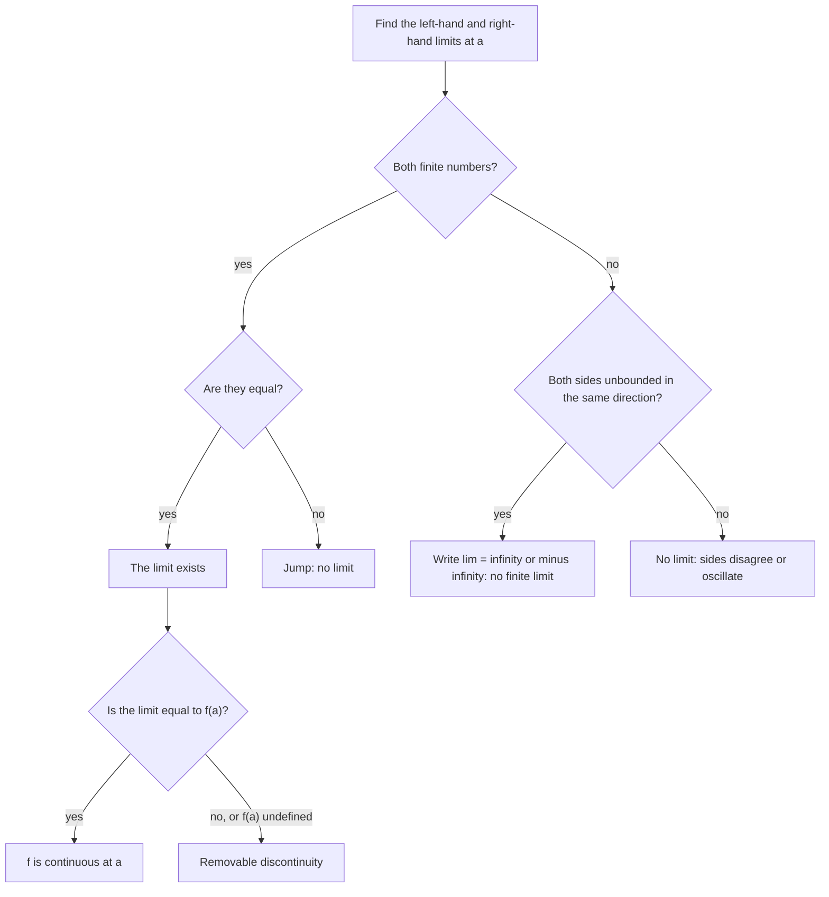

## The idea calculus is built on

All through this course we've asked what happens *near* a point: near a vertical asymptote, as $x \to \infty$, as $h$ shrinks in a difference quotient, as $n$ grows in a geometric series. Calculus makes this precise with one idea, the limit. This last module introduces limits informally: first by reading tables and graphs (this lesson), then with algebra (next lesson), and finally using them to find the slope of a tangent line, the derivative.

## What a limit means

We write

$$\lim_{x \to a} f(x) = L$$

and say "the **limit** of $f(x)$ as $x$ approaches $a$ is $L$" if the values $f(x)$ can be made as close to $L$ as we like by taking $x$ close enough to $a$ (on both sides), *but not equal to* $a$.

The last phrase is the important one. A limit is about the trend of $f$ near $a$, not about $f(a)$ itself. $f(a)$ might equal $L$, might be something else, or might not exist at all.

## Estimating limits with tables

### Example 1

Estimate $\displaystyle\lim_{x \to 1}\frac{x^2 - 1}{x - 1}$.

The function is undefined at $x = 1$ ($\frac00$). Evaluate nearby:

| $x$ | 0.9 | 0.99 | 0.999 | 1.001 | 1.01 | 1.1 |
|---|---|---|---|---|---|---|
| $f(x)$ | 1.9 | 1.99 | 1.999 | 2.001 | 2.01 | 2.1 |

From both sides the values close in on 2, so the limit appears to be 2. The graph shows why: for $x \ne 1$, $\frac{x^2 - 1}{x - 1} = x + 1$, a line with a hole at $(1, 2)$.

```plot
{"x": [-2, 4], "y": [-1, 5], "functions": [{"f": "x + 1", "label": "y = (x² − 1)/(x − 1)"}], "points": [{"at": [1, 2], "open": true, "label": "hole at (1, 2)"}], "caption": "The function is undefined at x = 1, yet its values approach 2 there."}
```

### Example 2

Estimate $\displaystyle\lim_{x \to 0}\frac{\sin x}{x}$ ($x$ in radians).

| $x$ | ±0.5 | ±0.1 | ±0.01 |
|---|---|---|---|
| $\frac{\sin x}{x}$ | 0.9589 | 0.99833 | 0.999983 |

(The function is even, so both sides agree.) The values approach 1. No algebra gives this one easily; it's proved in calculus with geometry, and it is the reason calculus uses radians.

Tables suggest limits but can mislead if you don't get close enough or if the function oscillates, so the next lesson adds algebraic methods.

## One-sided limits

Sometimes $f$ behaves differently on the two sides of $a$. The **left-hand limit** $\lim_{x \to a^-} f(x)$ uses only $x < a$; the **right-hand limit** $\lim_{x \to a^+} f(x)$ uses only $x > a$. Then

$$\lim_{x \to a} f(x) = L \quad\text{exactly when}\quad \lim_{x \to a^-} f(x) = L = \lim_{x \to a^+} f(x).$$

### Example 3

Let $f(x) = \begin{cases} x^2 & x < 2 \\ 7 - x & x \ge 2 \end{cases}$. Find the one-sided limits at 2.

- From the left, $f(x) = x^2 \to 4$.
- From the right, $f(x) = 7 - x \to 5$.

They differ, so $\lim_{x \to 2} f(x)$ does not exist (a jump). Note that $f(2) = 5$ exists; it just isn't a two-sided limit.

```plot
{"x": [-1, 5], "y": [-1, 7], "functions": [{"f": "x^2", "to": 2}, {"f": "7 - x", "from": 2}], "points": [{"at": [2, 4], "open": true, "label": "left limit 4"}, {"at": [2, 5], "label": "right limit 5 = f(2)"}], "caption": "A jump at x = 2: the one-sided limits differ, so the limit does not exist."}
```

## Reading limits from graphs

To find $\lim_{x \to a} f(x)$ from a graph, trace the curve toward $x = a$ from each side and see what height you approach. Ignore any isolated dot at $x = a$ itself; it gives $f(a)$, not the limit.

The chart below sums up the whole decision: first the two one-sided limits, then (if you want continuity) a comparison with $f(a)$.



## How limits fail to exist

| Behavior near $a$ | Example | Limit |
|---|---|---|
| **Jump**: one-sided limits differ | Example 3 | does not exist |
| Unbounded growth | $\frac{1}{x^2}$ near 0 | does not exist; we write $= \infty$ to describe it |
| Oscillation | $\sin\frac1x$ near 0 | does not exist |

For $\frac{1}{x^2}$, the values grow without bound on both sides, and we write $\lim_{x \to 0}\frac{1}{x^2} = \infty$. That is notation for *how* the limit fails, not a number. For $\frac1x$, the one-sided limits are $-\infty$ and $+\infty$, so even this description fails for the two-sided limit. These are the vertical asymptotes of Module 3 in limit language.

## Continuity

A function is **continuous** at $a$ when three things hold: $f(a)$ is defined, $\lim_{x \to a}f(x)$ exists, and they are equal:

$$\lim_{x \to a} f(x) = f(a).$$

Informally, you can draw the graph through $x = a$ without lifting your pencil. Polynomials are continuous everywhere; rational functions are continuous wherever they're defined; so are exponentials, logarithms (on their domains), sine and cosine. A **discontinuity** is a point where continuity fails: a hole (removable), a jump, or a vertical asymptote. The intermediate value theorem from Lesson 8 holds for every continuous function.

The graph below shows all three kinds of discontinuity on one function, plus a point where it is continuous.


At $x = -2$ the limit is 2 but $f(-2) = 4$: a removable discontinuity (redefine $f(-2) = 2$ to fix it). At $x = 0$ the one-sided limits are 3 and 1: a jump. At $x = 3$ the values are unbounded: an infinite discontinuity. At $x = 5$ nothing goes wrong.

### Example 4

Where is $g(x) = \dfrac{x^2 - 1}{x - 1}$ discontinuous, and could you fix it?

At $x = 1$, where it's undefined. The limit there is 2, so defining $g(1) = 2$ would make it continuous: a **removable discontinuity**. A jump or an asymptote can't be fixed by redefining one point.

## Common mistakes

- *Confusing $\lim_{x\to a}f(x)$ with $f(a)$.* They can differ or one can exist without the other.
- *Checking only one side.* A two-sided limit needs both sides to agree.
- *Treating $\infty$ as a value.* "$= \infty$" describes unbounded behavior; the limit doesn't exist as a number.
- *Calculator in degree mode* for trig limits like $\frac{\sin x}{x}$.
- *Trusting a table too far.* Use algebra to confirm (next lesson).

## Key points

- $\lim_{x\to a}f(x) = L$: $f(x)$ gets close to $L$ as $x$ gets close to $a$ (with $x \ne a$).
- Estimate limits with tables from both sides, or by tracing graphs.
- The limit exists exactly when the left- and right-hand limits exist and are equal.
- Limits fail at jumps, unbounded behavior and oscillation.
- Continuous at $a$: $\lim_{x\to a}f(x) = f(a)$.
